# 종이 백룸 — 통합 아트·퍼즐·스토리 설계

갱신: 2026-09-27. 이 문서가 최신 기획 기준이다. 아래 방별 내용은 **목표 설계**이며, 전체 구현 완료를 뜻하지 않는다. 실제 적용 범위는 [구현 현황](08_구현현황.md), 자동 검사 범위는 해당 검증 기록을 따른다.

상호작용 확장 제안: [구역별 상호작용과 동적 요소](15_구역별_상호작용과_동적요소.md). 기존 구현과 구분하는 후속 설계안이다.

## 중심 퍼즐 방향

**종이로 빛의 길을 만들고, 잊힌 그림과 문장을 되살린다.** 접기는 목표 자체가 아니라 차단·이동 경로를 바꾸는 수단이다. F0에 차단·반사·우회 규칙을 먼저 적용했다. 이후 1구역의 경로, 2구역의 그림자 모양, 3구역의 동시 연결 확장은 방향 제안이며 나머지 방이 전부 변경된 것은 아니다.

## 작품의 약속

작은 종이 정령이 거대한 책 안의 방들을 탐색한다. 따뜻하고 신비로운 실내, 손으로 접고 수선한 촉감, 읽어서 이해하는 퍼즐이 중심이다. 전투 게임으로 전환하지 않는다. 점프와 먹물 생물 밟기는 이후 방의 짧은 놀이 구간이다.

- 탐색 → 조작 → 결과 확인. 방마다 이동 경로와 추론 방식이 달라야 한다.
- 장식은 장르·기억·조작 단서 중 하나의 역할을 갖는다. 상호작용 오브젝트만 명확하게 반응한다.
- 색은 보조 단서다. 짝 문양, 접힘 자국, 실루엣, 위치로도 구분한다.
- 종이의 찢김은 시각 메시로 표현하고 바닥·문·난간의 충돌은 연속적으로 유지한다.
- 실패는 되돌릴 수 있고 낙하는 안전 지점으로 복귀한다.

## 최신 카메라와 입력

정령이 보이는 근접 3인칭 원근 카메라에서 마우스로 중앙을 조준한다. Q/E는 **월드 축의 0/90/180/270도** 중 해당 방향의 다음 축으로 고정한다. 현재 각도에 무조건 90도를 더하지 않는다. 이동하면 고정이 풀린다. 예: 35도에서 Q=0도, E=90도. Esc는 책갈피 일시정지 메뉴를 열고 커서를 해제한다. 계속하기 또는 Esc로 플레이와 마우스 조준을 재개한다. 조작·화면·소리·접근성은 [종이 UI와 설정 FSM](17_종이_UI와_설정_FSM.md)을 따른다. 전체 조망과 설명 HUD는 개발용이며 초행 이해도 검증의 근거로 사용하지 않는다.

## 서사 해석 통일

플레이어는 제본사와 동일한 육체가 아니라 **그가 남긴 마지막 기억에서 태어난 새 정령**이다. HD의 반전은 기억의 출처를 밝히는 것이며 3C의 결말을 뒤집지 않는다. 문장 조각 15개에는 단어뿐 아니라 획·문장부호·제본에 필요한 기억 조각이 포함된다. 현재 코드의 P1~P15 퍼즐 ID와 새 문장 수집 항목을 자동으로 동일시하지 않는다. 구체적 수집 데이터와 회상 연출은 별도 구현 과제다.

## 전체 시나리오: 《잊힌 제목》

거대한 책은 읽는 사람이 사라지자 스스로 이야기를 보존하려다 모든 문장을 방으로 접어 버렸다. 마지막 기억 제본사는 책을 먹어 치우는 검은 얼룩 **망각**을 마지막 장에 봉인했지만, 자신도 열다섯 개의 문장 조각으로 찢어졌다. 플레이어인 작은 종이 정령은 제본사가 남긴 붉은 책갈피 리본을 두르고 깨어난다.

각 방의 퍼즐을 풀면 문장 조각 하나와 제본사의 기억 한 장면을 얻는다. 조각은 단순한 열쇠가 아니라 다음 방의 규칙을 알려 주는 문장이다. 3A에서 조각을 시간 순서로 제본하고, 3B에서 완성된 문장에 빛을 통과시킨 뒤, 3C에서 책의 제목을 다시 읽으면 출구가 열린다.

완성 문장은 **“기억은 지워지는 것이 아니라, 다시 읽어 줄 이를 기다린다.”**이다. 숨겨진 HD 방에서는 제본사가 별개의 인물이 아니라 플레이어를 이룬 기억의 원래 주인이었다는 사실이 드러난다.

## 공통 화면 규칙

- 모든 이미지는 실제 플레이에 가까운 근접 3인칭 원근 시점이다.
- 정령은 화면 아래쪽에 보이며 건축물보다 아주 작다.
- 모든 공간은 바닥·벽·천장을 가진 실내다.
- 크레파스 색은 장식뿐 아니라 방의 규칙, 광원, 정답 피드백을 구분한다.
- 방 하나에는 탐색, 조작, 확인의 세 단계가 있고 입구에서 정답 전체가 보이지 않는다.

---

## F0 — 제본 현관

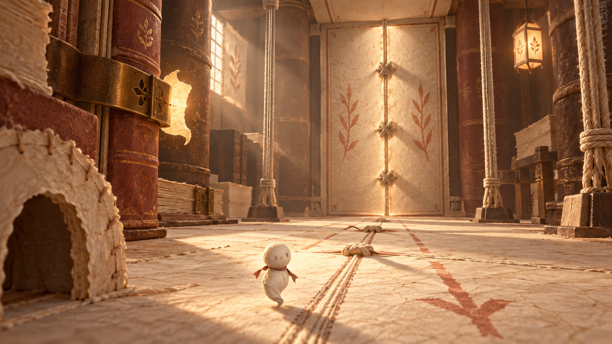

- **장르/색:** 고전 문학의 서문 · 아이보리, 세피아, 테라코타.
- **요소:** 거대한 책등, 두 책장 대지, 종이 다리, 광원 덮개, 회전 은박 책장 두 장과 고정 은박, 빛에 펼쳐지는 종이꽃, 출구 잎 문양과 황동 걸쇠.
- **해법:** 덮개를 접어 빛을 깨운다. 다리를 내리면 직진 빛이 막히므로 은박으로 옆 우회로를 만들고, 건너편 반사판으로 출구 문양까지 이어 걸쇠를 확정한다. 오답 경로도 장식 꽃을 펼친다. [현재 구현](ArtReview/FoldBridge/README.md).
- **이유:** 같은 종이의 상태가 이동 경로와 빛을 동시에 바꾼다는 규칙을 배운다. 손잡이 순서를 외우는 대신 공간과 결과를 관찰하게 한다.
- **스토리:** 붉은 리본이 전임 제본사의 물건이었다는 첫 기억을 본다. 첫 문장 조각은 **“기억은”**이다.

## 1A — 접힌 회랑

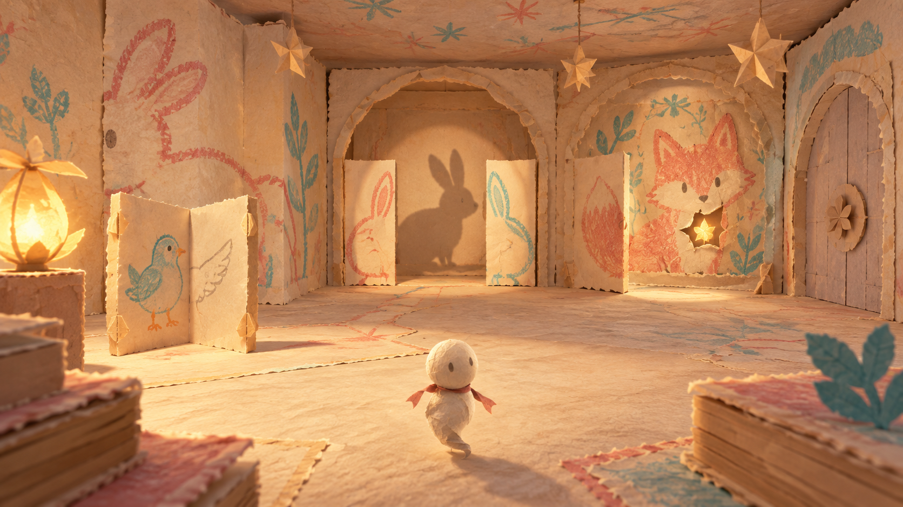

- **장르/색:** 어린이 팝업북 · 버터 옐로, 코럴, 청록.
- **요소:** 세 연속 방, 동물 크레파스 그림, 접이면 세 개, 종이 별 조명, 그림자 벽.
- **해법:** 첫 방에서 접기, 둘째에서 그림자 변화를 배우고 셋째에서 두 그림자 반쪽을 합친다. Q/E 관찰로 옆 벽의 결과를 비교한다.
- **이유:** 정령의 귀여운 외형과 가장 가까운 안전한 공간에서 핵심 조작을 학습시킨다.
- **스토리:** 제본사가 책 속 생명들에게 이름을 붙이던 시절을 본다. 조각은 **“지워지는”**이다.

## 1B — 찢어진 열람실

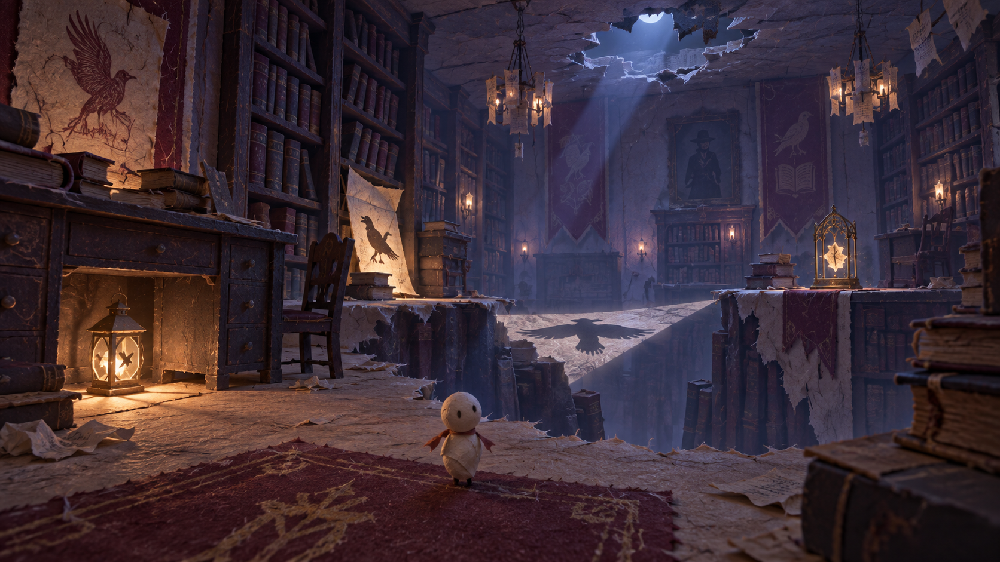

- **장르/색:** 고딕 미스터리 · 인디고, 목탄, 버건디.
- **요소:** 거대한 책상과 서가, 찢어진 바닥, 이동식 랜턴, 숨겨진 접이면, 천장 채광구, 황동 조각 우리.
- **해법:** 책상 아래에서 랜턴을 찾고 서가 뒤 접이면을 편 뒤, 새 모양 그림자를 바닥 틈 위에 투사해 다리를 만든다.
- **이유:** 하나의 행동으로 끝나지 않는 탐색→운반→정렬→통과 구조를 처음 제시한다.
- **스토리:** 망각이 처음 책의 문장을 찢은 밤을 본다. 조각은 **“것이”**이다.

## 1C — 양면 서고

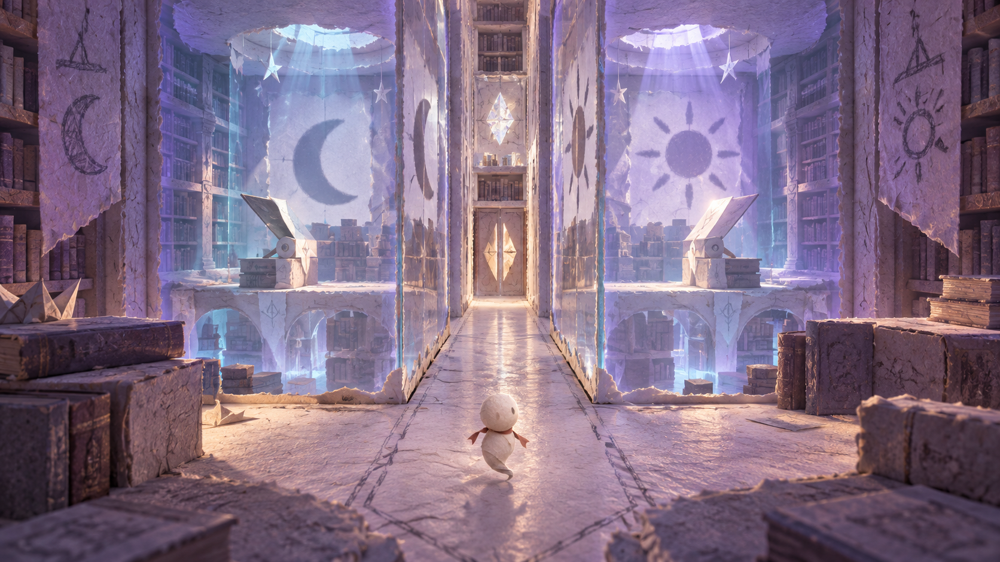

- **장르/색:** 거울 동화 · 라벤더, 시안, 은회색.
- **요소:** 두 서고, 반투명 공유벽, 중앙 반사 복도, 한 쌍의 접기 장치, 책장 지름길.
- **해법:** 양쪽 방에서 서로 다른 그림자를 만든 후 중앙 복도에서 Q/E로 반사를 비교해 하나의 문양으로 포갠다.
- **이유:** 카메라 관찰이 단순 시점 전환이 아니라 정보 비교 도구가 되게 한다.
- **스토리:** 제본사의 기억과 책의 기억이 서로 다르다는 사실이 드러난다. 조각은 **“아니라,”**이다.

## 1D — 잉크 발자국 보관실

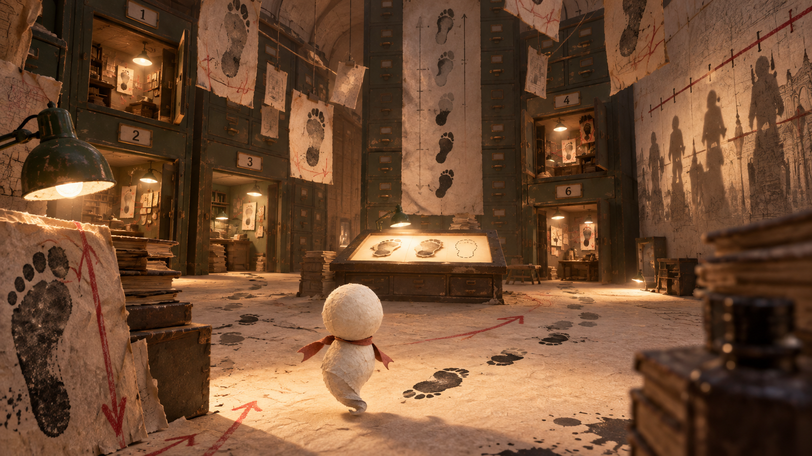

- **장르/색:** 탐정 기록물 · 황토, 병녹색, 검정 잉크, 빨간 증거선.
- **요소:** 여섯 서랍방, 세 발자국 조각, 건조 정도가 다른 잉크 자국, 벽면 시간선, 조명 테이블.
- **해법:** 각 서랍방을 조사하고 이동 방향과 잉크 건조 순서를 비교해 가짜 조각 하나를 제외한다.
- **이유:** 빛 퍼즐 뒤에 관찰과 추론 중심의 다른 리듬을 넣는다.
- **스토리:** 제본사가 봉인실로 간 경로에서 누군가 발자국을 조작했음을 발견한다. 조각은 **“다시”**이다.

## 1E — 표지 문양 홀

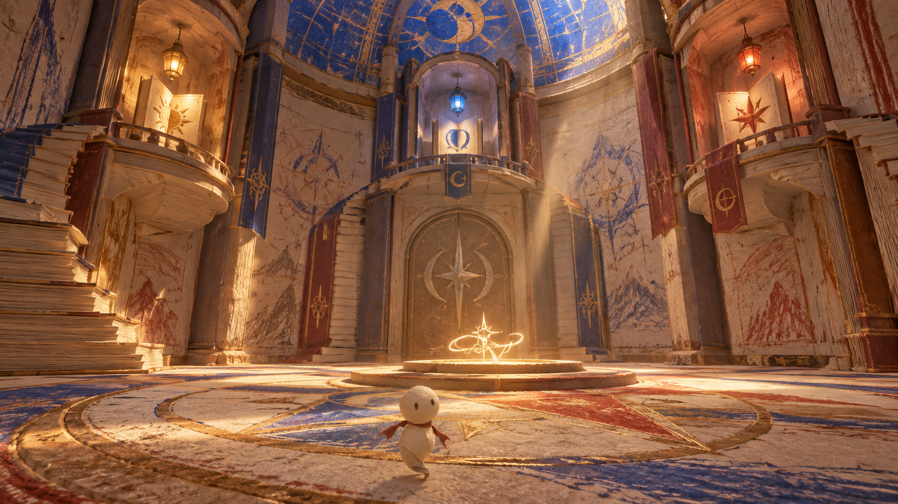

- **장르/색:** 영웅 판타지 지도책 · 울트라마린, 버밀리언, 금색.
- **요소:** 원형 홀, 세 발코니, 책등 계단, 세 색 랜턴, 중앙 표지 문양.
- **해법:** 세 발코니를 오가며 접이면 방향을 바꾸고 중앙 제단에서만 보이는 합성 문양을 완성한다.
- **이유:** 첫 장에서 배운 접기·그림자·기억 이동을 하나의 큰 공간에 결합한다.
- **스토리:** 표지 문양이 출구 표시가 아니라 망각을 가둔 봉인임을 알게 된다. 조각은 **“읽어”**이다.

## 2A — 기억 복도

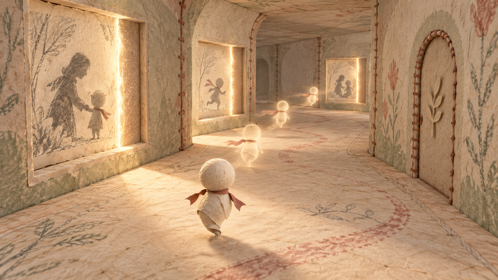

- **장르/색:** 회고록과 가족 스크랩북 · 세이지, 빛바랜 복숭아색, 연필 회색.
- **요소:** 굽은 복도, 액자 기억 페이지, 빛나는 주름, 전임 정령의 잔상.
- **해법:** 잔상의 리본 움직임과 액자 장면을 보고 기억 주름을 사건 순서대로 깨운다.
- **이유:** 전투 없이 추적의 긴장과 감정적 휴식 구간을 만든다.
- **스토리:** 제본사가 어린 정령을 구하려 봉인을 약하게 만들었다는 기억을 본다. 조각은 **“줄”**이다.

## 2B — 잔상 제본실

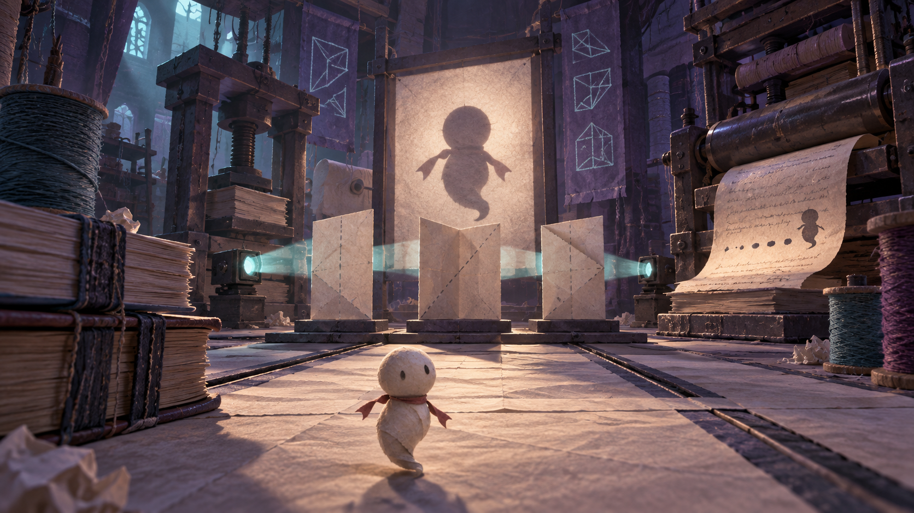

- **장르/색:** 초자연 미스터리 · 딥 틸, 스모키 바이올렛, 옅은 시안.
- **요소:** 거대 제본 프레스, 실타래, 롤러, 세 접이면, 중앙 그림자 스크린, 잔상.
- **해법:** 잔상에 남은 최종 실루엣에서 세 접기 각도와 순서를 역산한다. 한 면을 먼저 세우면 다른 빛이 막힌다.
- **이유:** 정답 모양을 보여 주되 과정은 플레이어가 추론하도록 난도를 높인다.
- **스토리:** 제본사가 자신의 기억을 의도적으로 여러 방에 나눴음을 알게 된다. 조각은 **“이를”**이다.

## 2C — 포개진 기록실

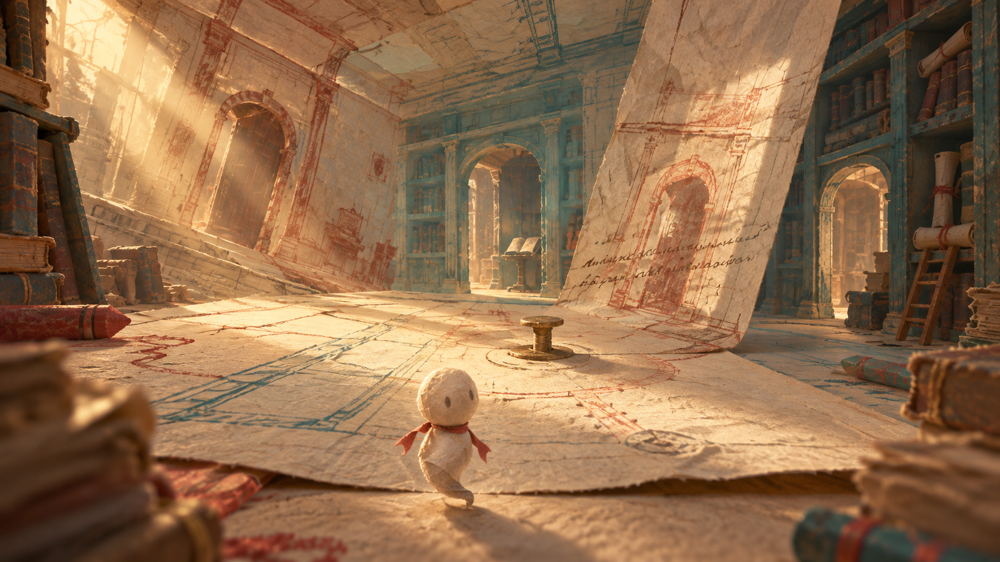

- **장르/색:** 역사 팔림프세스트 · 양피지, 산화 청록, 녹슨 빨강.
- **요소:** 현재 서가와 기울어진 과거 벽, 거대한 바닥 페이지, 황동 못, 반투명 문틀.
- **해법:** 황동 못을 공통 기준점으로 삼아 바닥 페이지를 접고 과거의 문과 현재의 문을 공간적으로 포갠다.
- **이유:** 단순 색 맞추기 대신 실제 3D 깊이와 Q/E 측면 관찰을 사용한다.
- **스토리:** 봉인 사고 기록의 일부가 두 시대에 겹쳐 저장되어 있었다. 조각은 **“기다린다.”**의 첫 획이다.

## 2D — 잘못된 기록 보관소

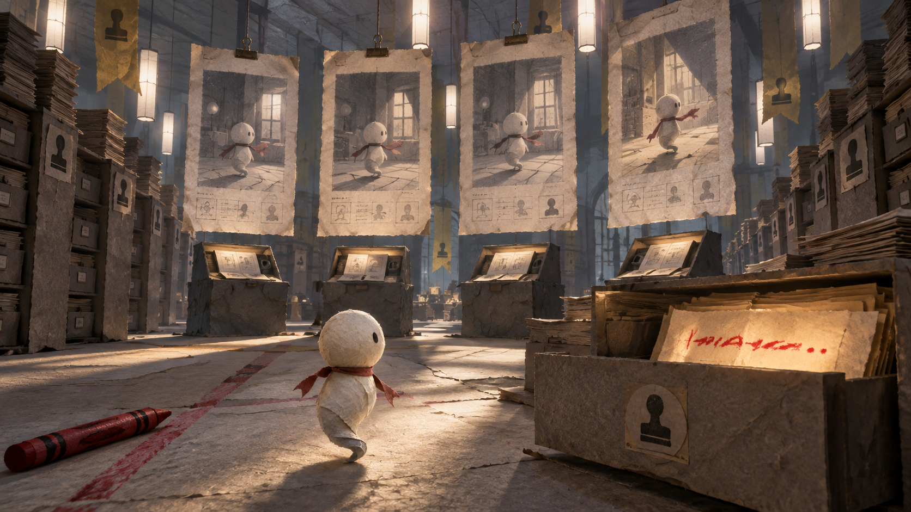

- **장르/색:** 관료주의 디스토피아 · 회청색, 탁한 겨자색, 날카로운 빨강.
- **요소:** 반복 서가, 네 기록지, 기억 재생대, 도장 장치, 오류 서랍.
- **해법:** 네 기록을 잔상과 비교해 리본 방향과 그림자 시간이 다른 하나에 도장을 찍는다.
- **이유:** 반복 공간의 불안을 살리면서 세밀한 차이를 찾는 퍼즐을 제공한다.
- **스토리:** 기록을 조작한 존재가 외부 악당이 아니라 책의 자동 보존 장치였음이 드러난다. 조각은 **“기다”**를 보완한다.

## 2E — 마모 연대실

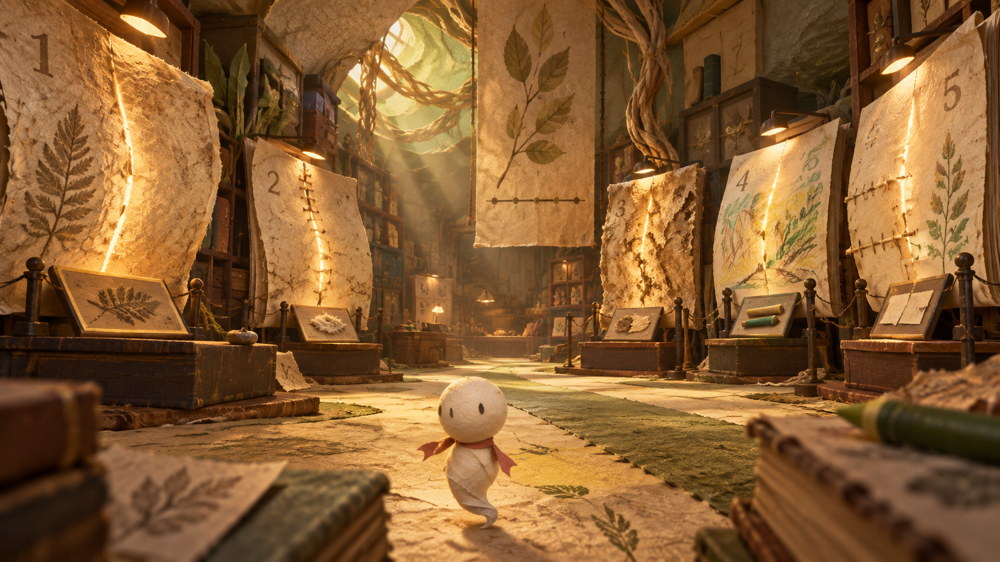

- **장르/색:** 자연사 관찰일지 · 이끼색, 엄버, 호박색, 연두.
- **요소:** 다섯 주름 표본, 수선 실밥, 먼지층, 빛바랜 크레파스, 압화 장치.
- **해법:** 마모, 먼지, 수선 방식과 주변 기록을 비교해 가장 오래된 주름부터 깨운다.
- **이유:** 빛나는 번호 대신 재질 자체를 단서로 읽게 해 종이 세계의 촉감을 게임 규칙으로 만든다.
- **스토리:** 붉은 리본이 여러 세대의 정령에게 전해졌다는 사실을 확인한다. 조각은 **“린”**을 보완한다.

## 2F — 어린 책갈피 통로

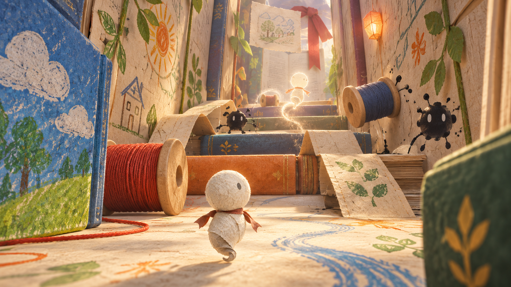

- **장르/색:** 삽화 모험일기 · 하늘색, 잎색, 주황.
- **요소:** 책등 계단, 굴러오는 실타래, 접이 지름길, 통통 튀는 먹물 생물, 어린 잔상.
- **해법:** 먹물 생물을 밟아 높이를 얻고 두 접이 지름길을 열어 도망가는 잔상을 따라잡는다.
- **이유:** 전투 없이 귀엽고 활동적인 점프 미니게임으로 긴 추론 구간의 리듬을 바꾼다.
- **스토리:** 어린 잔상이 플레이어 안에 남은 어린 시절의 기억이라는 단서가 나온다. 조각은 문장의 **마침표 빛**이다.

## 3A — 복원 대서고

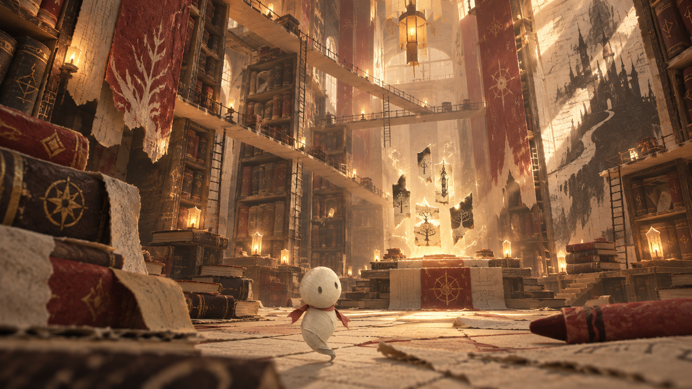

- **장르/색:** 잃어버린 대서사 · 아이보리, 그을음, 진홍, 절제된 금색.
- **요소:** 거대 서가, 천장 보행로, 사다리, 일곱 그을음 조각, 중앙 복원대, 대형 그림자 벽.
- **해법:** 여러 높이의 구역에서 조각을 모으고, 이전 방에서 배운 문장과 그을음 각도로 순서를 추론해 제본한다.
- **이유:** 지금까지의 탐색과 기억을 한 공간에서 종합하는 메타 퍼즐이다.
- **스토리:** 열다섯 문장이 제본사의 마지막 기록이 아니라 플레이어 자신의 기억임이 밝혀진다.

## 3B — 삼중 채광실

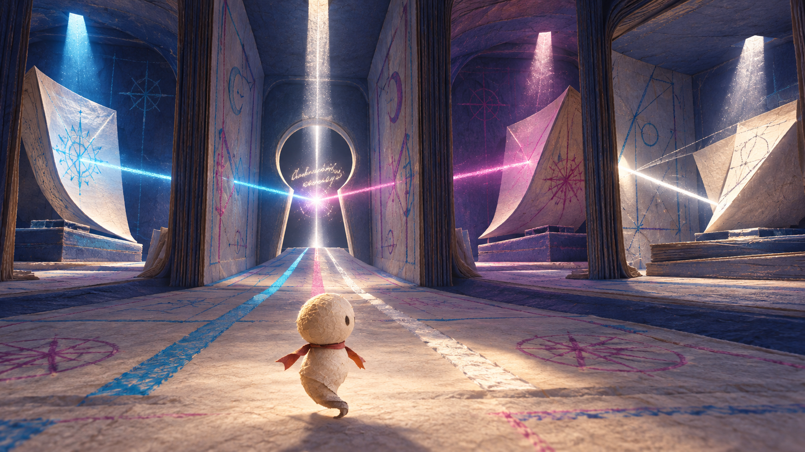

- **장르/색:** 비전 광학 논문 · 미드나이트 블루, 프리즘 시안, 마젠타, 흰색.
- **요소:** 세 측실, 세 반사 접이면, 중앙 열쇠구멍 복도, 세 채광구, 빛먼지.
- **해법:** A로 빛을 보내고 B가 주름을 가리지 않게 한 다음 C를 벽이 아니라 반사면으로 사용해 세 빛을 열쇠구멍에 모은다.
- **이유:** Q/E 관찰을 최종적으로 검증하고 P15를 위한 정확한 광축을 만든다.
- **스토리:** 완성 문장을 빛으로 읽을 때만 마지막 장이 기억을 받아들인다.

## 3C — 마지막 장

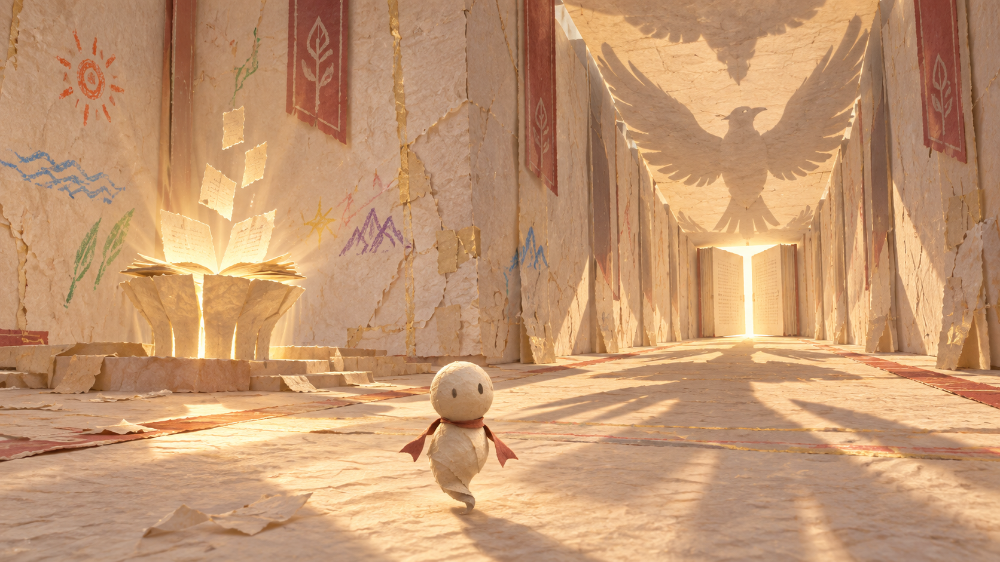

- **장르/색:** 미니멀 서정시 · 백색, 새벽 금색, 앞선 방의 모든 크레파스 잔색.
- **요소:** 빛 점화대, 긴 광축 복도, 수선된 벽, 책 모양 출구, P15 왜상 조각.
- **해법:** 문장 조각을 점화대에 넣고 빛을 켠 뒤 되돌아가며 바닥·벽·천장 그림자를 한 시점에서 새 모양으로 합친다.
- **이유:** 수집, 이야기, 빛과 그림자, 카메라 관찰을 하나의 감정적 결말로 묶는다.
- **스토리:** 플레이어는 자신이 전임 제본사의 마지막 기억에서 태어난 새 정령임을 받아들이고 책 밖으로 나간다.

## HD — 책 속의 책

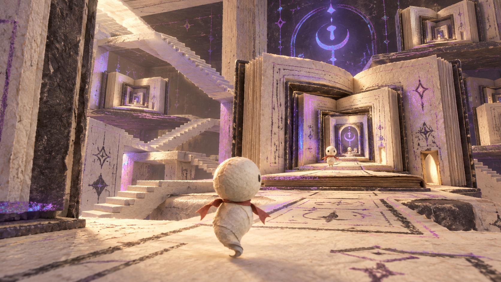

- **장르/색:** 초현실 메타픽션 · 반전된 아이보리와 목탄, 무지갯빛 보라.
- **요소:** 책 안의 축소된 방, 반복 문틀, 불가능한 종이 계단, 작은 F0·1B·3C, 미니어처 정령.
- **해법:** Q/E 관찰로 서로 다른 크기의 세 방이 같은 구조임을 알아보고 한 실루엣으로 정렬한다.
- **이유:** 본편 해법을 비틀어 재사용하며 세계가 하나의 책 안에서 반복된다는 후일담을 준다.
- **스토리:** 저자의 인장은 플레이어의 눈 모양과 같고, 책이 다음 독자를 기다리며 다시 접히는 장면으로 끝난다.

## 모델링 우선순위

1. F0, 1A, 1B를 실제 플레이 카메라로 블록아웃한다.
2. 각 이미지에서 바닥 동선, 문, 핵심 퍼즐 실루엣만 먼저 모델링한다.
3. 종이 표면의 찢김과 주름은 시각 메시로 만들고 이동 충돌체는 단순하게 유지한다.
4. 플레이 검증 후 책장, 크레파스, 조명, 수집물 디테일을 추가한다.
