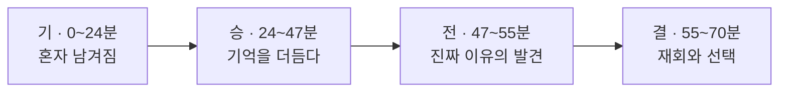

# 거인 책의 탑 — 통합 기획서

> 지금까지 확정된 모든 설계를 한 문서로 정리한 마스터 기획서. 이후 결정이 바뀌면 이 문서를 기준으로 갱신한다.

---

## 1. 개요

| 항목 | 내용 |
|---|---|
| 제목(가제) | **거인 책의 탑** |
| 장르 | 방탈출형 퍼즐 어드벤처 |
| 플랫폼 | PC 전용 (마우스+키보드) |
| 플레이타임 | 본편 **70분** + 히든 보너스 12분 |
| 엔진 | Unity 6.3 / URP 17.3 / **3D 프로젝트 + 직교 카메라** |
| 시점 | 직교 카메라, 90° 스냅 4방향 회전 |
| 대사 | **없음** — 모든 서사를 상호작용·연출·오브젝트로 전달 |
| 등장인물 | **사람 없음** — 종이로 접힌 존재들만 등장 |

**한 줄 컨셉**
> 접힌 종이로 세워진 거대한 책의 탑에서, 책갈피새가 사라진 선대의 흔적을 좇으며 빛과 접힘의 비밀을 풀어간다.

---

## 2. 세계관

이 세계는 거대한 팝업북처럼, **평면(2D) 종이가 접혀 입체(3D) 공간이 된 곳**이다. 탑은 하늘을 향해 세워진 한 권의 거대한 책이고, 접힌 페이지들이 층을 이룬다.

### 핵심 마법 규칙 (단 하나)

> **접힘 = 존재, 펼쳐짐 = 잊혀짐.**
> 그리고 탑 꼭대기의 빛은, 아래 페이지들이 **올바르게 접혀 있을 때만** 정확한 길을 그린다.

접힌 면의 각도가 빛의 경로를 결정한다(실제 등대 렌즈·반사판이 각도로 빛을 잡는 원리와 같은 논리). 페이지가 찢어지거나 잘못 접히면 빛이 그리는 길이 뒤틀리고, 그 길을 따라오던 존재들이 방향을 잃는다.

이 규칙 하나만으로 세계관 설명이 끝난다 — 추가 설정이 필요 없도록 의도적으로 절제했다.

---

## 3. 등장 "존재"

| 존재 | 설명 |
|---|---|
| **책갈피새** (플레이어) | 리본 책갈피가 새 형태로 깨어난 존재. 탑의 페이지를 돌보는 역할을 물려받음 |
| **전임 책갈피** | 주인공을 이끌던 선대. 페이지가 찢어진 사고 이후 자취를 감춤 |
| **길 잃은 여행자들** | 탑의 빛(그림자 길)을 보고 바다를 건너던 다른 책갈피·페이지 조각들. 사고가 나던 밤 뒤틀린 길을 따라갔다가 바다(잊혀짐)에 닿아 사라짐 |

※ 이름을 최소화한 것은 의도적이다. 무대사 게임에서는 "이름"보다 물건·습관·형태가 더 강하게 각인된다.

---

## 4. 스토리 (기승전결)



| 막 | 구간 | 내용 | 놀람 포인트 |
|---|---|---|---|
| **기** | 프롤로그~1장 | 선대가 돌아오지 않는다. 흔적을 좇아 표지를 열고 탑으로 들어간다 | **#1** 최근까지 누가 머문 흔적이 있다 — 단순 실종이 아니다 |
| **승** | 2장 | 주름에 새겨진 과거(에코)를 재생하며 사고 당일을 재구성한다 | **#2** 탑이 남긴 공식 기록과 주름의 기억이 다르다 — 진실이 은폐되어 있었다 |
| **전** | 3장 전반 | 모은 조각을 전부 복원하자 전체 그림이 드러난다 | **#3** 페이지가 찢어진 건 선대의 실수가 아니라, **어린 나를 구하러 간 사이** 벌어진 일이었다 |
| **결** | 3장 후반 | 선대가 스스로 펼쳐진 채 그 방에 계속 있었음을 발견하고, 선택한다 | **#4** 그의 펼쳐진 몸에는 접혀 있을 땐 볼 수 없던 **그날의 기록**이 그려져 있다 |

### 결말의 딜레마 — 존재 vs 진실

| 선택 | 얻는 것 | 잃는 것 |
|---|---|---|
| **접기** (재접기) | 그가 존재로 돌아온다. 둘이 함께 탑을 지킨다 | 그림이 접히며 가려진다 → 사라진 여행자들의 기록은 영영 남지 않는다 |
| **앉기** (그대로 두기) | 기록이 남아, 앞으로 탑을 찾는 존재들이 진실을 읽는다 | 그는 돌아오지 않고, 주인공은 혼자 탑을 지킨다 |

두 엔딩 모두 **얻은 것 1컷 + 잃은 것 1컷**으로 끝난다. 좋은 엔딩/나쁜 엔딩이 아니다.

---

## 5. 3대 기믹

| 기믹 | 이 세계에서의 모습 |
|---|---|
| **정보 = 열쇠** | 떨어져 나간 페이지 조각을 모아 원래 자리에 복원. "책을 읽어나간다"는 행위 자체가 퍼즐 |
| **빛 / 그림자 = 존재** | 빛이 접힌 페이지를 통과하며 그림자 길을 그림. **착시는 이 기믹의 구현 방식**이지 별도 기믹이 아님 |
| **에코 (되감기)** | 종이의 주름이 곧 과거의 기록. 주름을 깨우면 예전 모습이 재생됨 |

**기믹은 3개로 고정한다.** 1시간대 플레이타임에서 기믹 하나가 "도입→응용→반전"을 완주하려면 최소 15~20분이 필요하기 때문이다.

### 폴딩 시스템 기본 규칙

| 규칙 | 내용 |
|---|---|
| 접이면 상태 | **이산 4단계** (펼침 / 45° / 90° / 135°) — 연속값이 아니라 "감으로 흔들기"가 불가능 |
| 빛 | 탑 꼭대기에서 아래로. 접이면에 닿으면 아래 페이지에 그림자 |
| 대응 | 접힘 각도 → 그림자 위치·모양이 **결정론적 1:1 대응** |
| 가역성 | **모든 접힘은 100% 되돌릴 수 있다** (소프트락 원천 차단) |
| 기록 | 본 적 있는 단서는 유품함에 자동 기록, 언제든 재열람 |

---

## 6. 챕터 구조 & 분 단위 타임라인

```mermaid
gantt
    title 본편 70분 + 보너스 12분
    dateFormat HH:mm
    axisFormat %H:%M
    section 프롤로그
    오프닝·조작 학습 :00:00, 3m
    P1 걸쇠 문양 :00:03, 3m
    표지 진입 :00:06, 1m
    section 1장
    P2 접힘 방향 :00:07, 2m
    P3 끊긴 길 :00:09, 4m
    P4 교차 그림자 :00:13, 5m
    P5 다급한 발자국 :00:18, 4m
    P6 첫 번째 봉인 :00:22, 2m
    section 2장
    P7 주름 깨우기 :00:24, 2m
    P8 따라 접기 :00:26, 4m
    P9 숨겨진 틈 :00:30, 5m
    P10 엇갈린 기록 :00:35, 4m
    P11 순서의 방 :00:39, 6m
    P12 작은 그림자 :00:45, 2m
    section 3장
    P13 메타퍼즐 :00:47, 8m
    P14 삼중 조건의 문 :00:55, 8m
    P15 반쯤 펼쳐진 존재 :01:03, 4m
    엔딩 :01:07, 3m
    section 알파
    히든: 책 속의 책 :01:10, 12m
```

---

## 7. 퍼즐 전체 목록 (최종본)

> 난이도 감사 및 QA 점검의 수정안이 모두 반영된 상태.

### 프롤로그: 표지 (0:00~7:00)

| # | 퍼즐 | 목표 | 기믹 | 설계 |
|---|---|---|---|---|
| P1 | 걸쇠 문양 | 3분 | 정보 | 조각 2개를 찾아 조합 → 문양 완성. **필수 아이템은 낙하해도 자동 회수**(분실 방지) |

### 1장: 갈라진 페이지들 (7:00~24:00) — 정보 + 빛

| # | 퍼즐 | 목표 | 설계 |
|---|---|---|---|
| P2 | 접힘 방향 | 2분 | 접는 자리에서는 그림자 목표가 **안 보임** → 다른 위치에서 목표 확인 후 돌아와 접기. 접힘 방향 3~4개 |
| P3 | 끊긴 길 | 4분 | 빠진 조각을 **찾을 수 없음**. 다른 페이지를 접어 그 그림자로 끊긴 구간을 대체 (모든 접힘 가역) |
| P4 | 교차 그림자 | 5분 | 두 접이면이 **다른 방**에 있고 빛은 N초마다만 깜빡임 → 예측 강제. **반사되는 페이지**로 간접 확인 (→ P14 반사 개념의 학습 장치) |
| P5 | 다급한 발자국 | 4분 | 조각 3개 중 1개는 **레드 헤링** — 종이 결·찢긴 방향이 다른 시대의 것 (색 아님) |
| P6 | 첫 번째 봉인 | 2분 | 접이면 3개의 그림자를 합쳐 P1의 문양 재현 (64조합). 열릴 때 **네 번째 조각**이 비쳐 유품함에 기록 → P13에서 처음 쓰임 |

### 2장: 접힌 기억 (24:00~47:00) — 정보 + 빛 + 에코

| # | 퍼즐 | 목표 | 설계 |
|---|---|---|---|
| P7 | 주름 깨우기 | 2분 | 에코 튜토리얼. **활성 주름은 미세하게 빛을 머금는** 시각 규칙 확립 |
| P8 | 따라 접기 | 4분 | 재생 화면에서 **손동작은 몸에 가려 안 보이고 결과 그림자만 보임** → 각도 역산. 그림자에 비대칭 요소를 넣어 **유일해** 보장 |
| P9 | 숨겨진 틈 | 5분 | 기억은 **지금과 다르게 접혀 있던 시절**의 장면 → 공간 변환으로 현재 위치를 계산. 양쪽 상태 공통 참조점 제공 |
| P10 | 엇갈린 기록 | 4분 | 기록 3~4개 중 **하나만** 어긋남. 주름 기억 쪽에 물리적 증거(찢긴 결이 맞물림)를 붙여 진위 판단 근거 제공 |
| P11 | 순서의 방 | 6분 | 주름 5개를 시간순으로 (**120순열**). 근거 3중: ①마모 형태 ②장면 인과 ③소리(보조). 실패 시 **재생만 초기화**(단서 소실 없음) + 8초 연출로 브루트포스 억제 |
| P12 | 작은 그림자 | 2분 | 서사 비트. 단일 인터랙션으로 명확하게 |

### 3장: 마지막 장 (47:00~70:00) — 전부 총동원

| # | 퍼즐 | 목표 | 설계 |
|---|---|---|---|
| P13 | 메타퍼즐: 페이지 복원 | 8분 | 조각 **7개**(5040순열)를 **그을음 각도**로 순서 판정 — 빛 각도가 시간에 따라 변하므로 자국 각도 = 놓였던 시점. 기준점은 P6의 네 번째 조각. 피드백은 **구간(초·중·후반)까지만** |
| P14 | 삼중 조건의 문 | 8분 | A·B·C 세 접이면(64조합). 세 조건이 **서로를 무너뜨림**. 유일해 = **C면을 가로막는 벽이 아니라 빛을 꺾는 반사면으로 쓰는 것**. 진입 시 에코로 "과거에 성립했던 한 순간"을 1초 노출 (포기 방지) |
| P15 | 반쯤 펼쳐진 존재 | 4분 | **왜상(아나모포시스)**. 상세는 아래 |
| P16 | 엔딩 선택 | 3분 | 접이선을 **접으면** 재접기 / 그 위에 **앉으면** 그대로 두기 |

### P15 상세 — 이 게임의 정점

전임은 "스스로 완전히 펼쳐져" 사라졌다. 펼쳐진 종이새 = **한 장의 평면**. 즉 그는 사라진 것이 아니라 **방 전체에 펼쳐진 채 계속 거기 있었다.** 플레이어는 못 찾은 게 아니라 **보고도 읽지 못한 것**이다.

| 단계 | 내용 |
|---|---|
| ① 모순 인지 | 그림자는 있는데 **그림자를 만들 물체가 없다** — 60분간 "빛→접힘→그림자" 인과를 학습한 플레이어에게 무시 불가능한 모순 |
| ② 역추적 | 빛의 경로를 따라가니 벽·바닥·천장에 흩어진 조각들이 그 그림자를 만들고 있음 |
| ③ 시점 확보 | 정렬되어 보이는 지점은 **허공이라 도달 불가** → **거기로 갈 수 없다면, 거기를 이쪽으로 접어 온다** |

**동선 트릭**: P13(47~55분)을 **바로 이 방에서** 진행시킨다. 플레이어는 전임 위에서 8분간 퍼즐을 푼 셈이 되고, 그 사실을 나중에 깨닫는다. 문을 나선 뒤 빛을 켜면 그 빛이 뒤쪽을 비추며 새 모양 그림자가 생겨 되돌아가게 된다.

---

## 8. 난이도 설계 원칙

### 전역 규칙 (모든 퍼즐 공통)

| 규칙 | 이유 |
|---|---|
| 모든 접힘은 가역 | 소프트락의 최대 원인 차단 |
| 진행 필수 아이템은 분실 불가 | 낙하·손상 시 자동 회수 |
| 저장은 퍼즐 단위로만 | 퍼즐 중간 상태 저장 시 꼬임 방지 |
| **색 단독 의존 금지 (이중 코딩)** | 마모·재질 구분을 형태로도 표현 — 색맹 접근성 |
| 모든 단서 재열람 가능 | 정보 지연 노출이 "기억력 테스트"로 변질되는 것 방지 |

### 힌트 에스컬레이션 (텍스트 없이 연출로만)

| 무진전 경과 | 개입 |
|---|---|
| 목표 시간 × 1.0 | 관련 오브젝트 근처 종이가 살짝 떨림 |
| × 1.5 | 빛줄기가 해당 페이지 쪽으로 천천히 기울어짐 |
| × 2.0 | 접혀야 할 면 하나가 저절로 반쯤 접힘 (나머지는 플레이어 몫) |

이 장치로 최악의 경우에도 퍼즐당 목표의 2배 안쪽에서 통과 → 전체 플레이타임이 70분~100분 선에서 수렴한다.

### 적용한 난이도 기법

| 기법 | 적용 위치 |
|---|---|
| 정보 지연 노출 | P6의 네 번째 조각 → P13 |
| 레드 헤링 | P5(가짜 조각), P10(공식 기록) |
| 다중 감각 결합 | P11(마모 형태 + 인과 + 소리) |
| 비선형 역참조 | 2장의 정보로 1장 페이지의 의미가 뒤늦게 이해됨 |
| 다변수 동시 충족 | P14 |
| 메타 퍼즐 | P13 |

---

## 9. 기술 방향

| 항목 | 결정 |
|---|---|
| 템플릿 | **Universal 3D** (URP) — Universal 2D는 진짜 3D 그림자가 없어 탈락, HDRP는 과함 |
| 카메라 | **Orthographic**, 회전은 90° 스냅 4방향 (자유 회전 금지 — 정렬 판정이 흔들림) |
| 조명 | 주광원 1개(탑 꼭대기) + 약한 앰비언트. Soft Shadows |
| URP 설정 | Shadow Distance를 씬 크기에 맞게 **짧게** (같은 해상도에서 그림자가 선명해짐), Shadow Resolution 2048+ |
| 접힘 구현 | 접이면을 힌지(빈 GameObject) 자식으로, localRotation을 4단계 스냅 |
| **판정 분리** | 그림자 판정을 렌더 결과에서 읽지 말 것. **접힘 조합 → 정답 여부를 별도 데이터로 관리**하고 렌더링은 표시만 |

---

## 10. QA 점검 결과 요약

퍼즐 16개를 7항목(해결가능성·공정성·우회·소프트락·순서의존성·모호성·접근성)으로 전수 점검하여 **치명 4 / 주의 8 / 경미 3** 결함을 발견하고 모두 수정 완료.

### 플레이테스트에서 측정할 것

| 항목 | 목적 |
|---|---|
| 퍼즐별 소요 시간 분포(중앙값/최댓값) | 목표 시간 대비 어디가 튀는지 |
| 힌트 단계별 발동 비율 | 3단계가 잦으면 난이도가 아니라 **정보 전달 실패** |
| 이탈 지점 | 난이도 조정 1순위 |
| 반전 3개의 체감 타이밍 | 예상보다 일찍 눈치채면 배치를 뒤로 |

---

## 부록: 히든 보너스 「책 속의 책」

엔딩 후 열리는 중첩공간(Recursed식) 퍼즐 1개. 목표 12분. **어느 엔딩을 골랐든 열린다** — 선택으로 콘텐츠를 벌주지 않는다.
