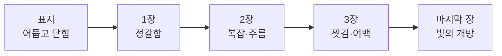

# 거인 책의 탑 — 아트 컨셉

> 무대사 게임이라 **아트가 곧 서사**다. 이 문서의 모든 결정은 "빛 = 존재, 접힘 = 존재"라는 단일 규칙을 시각적으로 뒷받침하는 데 맞춰져 있다.

---

## 1. 비주얼 한 줄

> **오래된 책 속에서 접혀 세워진 세계 — 빛이 닿는 곳만 색을 얻는다.**

---

## 2. 톤 & 무드

| 항목 | 방향 |
|---|---|
| 전체 채도 | **낮게** — 종이·바랜 잉크 톤. 화려한 색은 배제 |
| 대비 | 명도 대비는 **강하게** (그림자가 퍼즐의 정답이므로 반드시 읽혀야 함) |
| 질감 | 종이의 결·구김·닳은 가장자리가 항상 보이게 |
| 정서 | 쓸쓸하지만 따뜻함. 폐허가 아니라 **오래 지켜온 자리** |
| 금기 | 네온·형광·강한 원색, 사실적 인체, 과한 파티클 |

### 핵심 컬러 규칙 ⭐

> **세계는 거의 무채색에 가깝고, 빛이 닿는 부분만 따뜻한 색을 얻는다.**

이러면 "빛 = 존재"라는 게임 규칙이 **컬러 시스템 자체**가 된다. 플레이어는 설명 없이도 "색이 있는 곳 = 살아있는 곳"으로 읽게 된다.

---

## 3. 컬러 팔레트

| 역할 | HEX | 설명 |
|---|---|---|
| 종이 밝은면 | `#EDE6D6` | 빛을 정면으로 받은 페이지 |
| 종이 중간톤 | `#D6CBB4` | 기본 페이지 색 |
| 종이 그늘 | `#A99B84` | 접혀 꺾인 면 |
| 그림자 | `#5C5648` | **완전 검정 금지** — 종이에 지는 그림자는 세피아 그레이 |
| 공허 / 바다 | `#2E2E33` | 탑 바깥, 잊혀진 영역 |
| **빛 (유일한 채도)** | `#F2C879` | 강조색. 이 색이 닿은 곳만 "존재함" |
| 찢김 / 손상 | `#8C5A46` | 바랜 적갈. 경고가 아니라 상처의 색 |

**접근성**: 위 팔레트는 명도 차가 충분히 벌어져 있어 색을 못 봐도 구분된다. 그리고 **색이 단독 정보로 쓰이는 퍼즐은 없다** — 모든 구분은 형태·질감으로도 가능해야 한다(전역 규칙).

---

## 4. 종이 재질 규칙

모든 오브젝트는 **평면 quad + 종이 텍스처**로 만든다. 3D지만 다루는 건 평면과 회전뿐이다.

| 요소 | 규칙 |
|---|---|
| **투과 (가장 중요)** ⭐ | 빛을 등진 면이 **은은하게 비쳐 밝아짐**. 종이의 정체성은 여기서 나온다 — 이거 하나가 "3D 판때기"와 "종이"를 가른다 (Shader Graph에 translucency 항) |
| 가장자리 | 매끈한 직선 금지. 미세하게 거친 결(deckle edge) |
| 접힌 자국 | 크리즈 라인이 하이라이트로 남음 — **에코 기믹의 시각적 근거**(주름 = 과거의 기록)라서 반드시 보여야 함 |
| 두께 | 아주 얇게. 옆에서 봤을 때 선처럼 |
| 오염 | 시간에 따른 변색·그을음. **P13의 정답 근거**이므로 각도가 읽히게 |

---

## 5. 캐릭터 — 책갈피새

| 항목 | 설계 |
|---|---|
| 형태 | 리본 책갈피가 새로 접힌 모습. 몸통은 접힌 종이, 꼬리는 리본 술(fringe) |
| **실루엣** ⭐ | **매우 중요.** P15의 왜상이 이 실루엣으로 해소되므로, 단순하고 즉각 식별 가능해야 함. 복잡한 형태 금지 |
| 색 | 종이보다 한 톤 어둡게. **리본 부분만** 미세한 채도를 허용해 플레이어 식별성 확보 |
| 애니메이션 | 뼈대 없이 **종이 접힘 단위로 회전**. 부자연스러운 게 아니라 그것이 이 세계의 물리 |
| 감정 표현 | 눈·표정 없음. **고개 각도, 날개 접힘 정도, 정지 시간**으로만 |

### 전임 책갈피
- 같은 종족이지만 **한 세대 낡은 종이** — 더 누렇고 결이 거침
- 등장 시점에는 **완전히 펼쳐진 한 장의 평면**
- 그 평면 위에 **그날의 기록이 그려져 있다** (엔딩 딜레마의 핵심 오브젝트)

---

## 6. 공간 — 층별 비주얼 진행

시각적으로도 이야기가 진행되도록, 층마다 페이지의 상태가 달라진다.

| 구간 | 페이지 상태 | 빛 | 정서 |
|---|---|---|---|
| **프롤로그 (표지)** | 두껍고 어두운 판지. 닫혀 있음 | 거의 없음 | 봉인됨 |
| **1장 (초반 페이지)** | 정갈하고 밝음. 접힘이 단순 | 잘 듦 | 정돈 |
| **2장 (본문 페이지)** | 빽빽하고 접힘이 복잡. 주름이 많음 | 조각남 | 혼란 |
| **3장 (마지막 장)** | 찢김이 많고 여백이 넓음 | 강해짐 | 파손 → 개방 |

---

## 7. 조명

| 항목 | 설계 |
|---|---|
| 주광원 | **1개**(탑 꼭대기). 방향이 항상 명확해야 함 — 플레이어가 빛의 출처를 늘 알아야 퍼즐이 성립 |
| 광량 | 층이 올라갈수록 증가 |
| 그림자 엣지 | **항상 선명하게.** 그림자가 곧 정답이므로 흐릿한 그림자는 버그와 같음 |
| 보조광 | 약한 앰비언트만. 두 번째 그림자를 만드는 광원은 금지(정답이 흐려짐) |
| 색온도 | 따뜻한 등불빛(`#F2C879`) |

---

## 8. 카메라

| 항목 | 설계 |
|---|---|
| 투영 | **Orthographic** (평면감 유지 + 정렬 정확도) |
| 회전 | **90° 스냅 4방향만.** 자유 회전 금지 |
| 전환 | 컷 전환 없음. 무대사 게임이라 **카메라의 이동 자체가 연출** |
| 특수 | P15 왜상 해소 순간에만 아주 천천히 뒤로 물러남 |

---

## 9. UI — 최소주의

대사가 없으므로 UI도 없어야 세계가 깨지지 않는다.

| 요소 | 처리 |
|---|---|
| 텍스트 UI | **없음** |
| 상호작용 프롬프트 | 아이콘 대신 **종이가 미세하게 들리는 애니메이션** |
| 유품함 | 화면 구석 아이콘이 아니라, **실제 오브젝트**(작은 페이지 홀더)를 펼쳐 보는 방식 |
| 힌트 | UI 없음. 전부 연출(떨림 → 빛 기울기 → 자동 반접힘) |
| 필수 UI | 일시정지·설정만. 이때만 화면 위에 얹힘 |

---

## 10. 사운드 (아트와 한 쌍)

| 요소 | 방향 |
|---|---|
| 기본 팔레트 | **종이 소리** — 넘김, 구김, 찢김, 스침 |
| 음악 | 최소한. 정적을 적극적으로 사용 |
| 퍼즐 성공 | 팡파레 금지. **접힘이 맞물리는 소리** 하나로 |
| P11 | 주름 마모도에 따라 마찰음이 달라짐 (보조 단서) |
| 엔딩 A | 접을 때마다 종이 소리가 겹치며 하나의 화음으로 수렴 |
| 엔딩 B | 소리가 줄어들어 바람 소리만 남음 |

---

## 11. 아트 제작 우선순위

프로토타입 단계에서 아트를 다 만들 필요는 없다. 이 순서를 권장한다.

| 순위 | 항목 | 이유 |
|---|---|---|
| 1 | **종이 셰이더 (투과 포함)** | 이게 없으면 전체 톤 판단 자체가 불가능 |
| 2 | **접이면 프리팹 + 그림자 확인** | 퍼즐이 성립하는지 검증하는 최소 단위 |
| 3 | 책갈피새 실루엣 | P15까지 영향을 주므로 일찍 확정 |
| 4 | 1장 페이지 1개 (완성도 있게) | 톤 기준점(art bible)이 됨 |
| 5 | 나머지 층 | 4번을 기준으로 확장 |

**프로토타입에서는 1·2번만 있어도 충분하다.** 회색 박스로 퍼즐부터 검증하는 게 정석이다.
