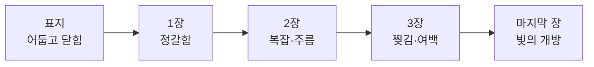

# 거인 책의 탑 — 아트 컨셉

> 무대사 게임이라 **아트가 곧 서사**다.
> 2026-09-10 에 방향을 바꿨다. 아래 "2026-09-10 개정"이 현재 기준이다.

> **2026-09-24 주인공 기준:** 사용자가 선택한 둥근 종이 정령 참조 이미지를 현재 모델 기준으로 사용한다. 흰 종이·흑연·붉은 리본의 공통 표현을 유지한다. 아래의 책갈피새/깃털/P15 실루엣 설명은 서사 연결을 재설계할 대상이며, 새 모델로 되돌리라는 지시가 아니다. [1A~1B 및 P15 검증](ArtReview/2026-09-24-direction-validation.md).

---

> **2026-09-25 적용:** 16개 방을 흰 종이·얇은 흑연선·저채도 책 표지로 통일. 둥근 정령과 붉은 리본은 유지하며, 반복 책장보다 말린 낱장과 큰 책을 중심으로 배치한다. [적용 범위와 렌더](ArtReview/2026-09-25-sketchbook-redesign.md).

## 2026-09-10 개정 — 스케치북

### 한 줄

> **흰 종이 위에 연필로 그리고 크레파스로 칠한 세계. 어두운 건 그림자뿐이다.**

### 왜 바꿨나

회색 상자만 놓인 프로토타입을 플레이해 보니 무엇을 만들고 있는지 읽히지 않았다.
이전 컨셉(세피아 고서)은 문서로는 그럴듯했지만, 화면에서 **종이 색과 그림자 색이
너무 가까워** 정작 이 게임의 핵심인 그림자가 안 보였다.

흰 바탕으로 가면 그 문제가 정반대로 풀린다.
**화면에서 어두운 덩어리가 그림자밖에 없게 되므로, 정답이 가장 잘 읽힌다.**
아트 방향을 바꾸는 김에 핵심 기믹이 더 선명해지는 쪽을 골랐다.

### 팔레트

| 이름 | 값 | 쓰임 |
|---|---|---|
| 종이 밝은면 | `#FBFAF6` | 빛을 정면으로 받은 면 |
| 종이 기본 | `#F2EFE7` | 대부분의 면 |
| 종이 그늘 | `#DED8CC` | 그늘진 면 |
| **연필** | `#3A3733` | 외곽선. 형태를 읽게 하는 유일한 선 |
| 그림자 | `#6E6A63` | 연필로 문지른 회색. **검정 금지** |
| **빛 (유일한 채도)** | `#F2C879` | 이 색이 닿은 곳만 "존재함" |
| 책갈피새 | `#D9694F` | 크레파스 빨강. 화면에서 가장 눈에 띈다 |
| 빈 종이 | `#FDFCFA` | 탑 바깥 |

### 탑 바깥은 검정이 아니라 백지다

이전 컨셉에서 탑 바깥은 `#2E2E33` 공허였다. 지금은 **아직 그려지지 않은 빈 종이**다.
떨어지면 어둠이 아니라 백지로 사라진다. 스케치북 세계관에 맞고,
안개도 흰색이라 멀어질수록 "여기까지가 그려진 부분"이라는 느낌이 난다.

### 선이 형태를 만든다

면이 거의 흰색이므로 색으로는 형태가 안 읽힌다. **연필 외곽선이 그 일을 한다.**
`PencilOutline` 이 같은 메시를 살짝 키운 껍질을 자식으로 붙이고, 그 재질이
앞면을 잘라내(`_Cull = Front`) 가장자리에만 어두운 테두리를 남긴다.
셰이더를 새로 쓰지 않아도 되는 방식을 고른 이유는, 셰이더를 잘못 쓰면
프로젝트가 통째로 컴파일이 안 되기 때문이다.

벽을 숨길 때는 그 벽의 외곽선도 같이 숨긴다. 안 그러면 사라진 벽 자리에 선만 뜬다.

### 결

평면으로 두면 아무리 색을 맞춰도 "3D 판때기"로 보인다.
`Tools/make_textures.py` 가 타일링 텍스처 3장을 절차적으로 만든다.

| 텍스처 | 내용 | 쓰는 곳 |
|---|---|---|
| `T_Paper` | 종이 섬유와 옅은 얼룩 | 대부분의 면 |
| `T_Crayon` | 결이 깊은 데는 안료가 안 얹혀 하얗게 남는다 | 강조색·책갈피새 |
| `T_Pencil` | 한 방향 해칭이 겹친다 | 그늘진 면 |

값이 코드에 있으므로 "결을 좀 거칠게"가 숫자 하나로 끝난다.

### 조명 재조정

흰 면은 반사율이 높아서 예전 광량을 그대로 쓰면 하얗게 날아간다.
날아가면 그림자만 안 보이는 게 아니라 **형태 자체가 사라진다.**

| | 이전 | 지금 |
|---|---|---|
| 표지 태양 | 0.30 | 0.22 |
| 3장 태양 | 1.55 | 1.05 |
| 앰비언트 | 0.10~0.38 | 0.18~0.50 (올림) |
| 그림자 강도 | 0.82 | 0.62 |

앰비언트를 올린 건 **연필 그림자는 회색이지 검정이 아니기** 때문이다.

### 그대로 가져가는 규칙

| 규칙 | 이유 |
|---|---|
| 채도가 있는 색은 `#F2C879` 하나뿐 | "빛 = 존재"가 컬러 시스템 자체가 된다 |
| 색이 단독 정보인 퍼즐은 없다 | 접근성. 모든 구분은 형태·질감으로도 가능해야 한다 |
| 주광원 1개, 각도 고정 | 방마다 빛이 달라지면 "접힘 → 그림자" 인과가 무너진다 |
| 두 번째 그림자를 만드는 광원 금지 | 정답이 흐려진다 |
| 그림자 엣지는 선명하게 | 그림자가 곧 정답이다 |

### 아직 안 한 것

- **종이 투과(translucency)** — 빛을 등진 면이 은은하게 비치는 것.
  아트 문서가 "이거 하나가 3D 판때기와 종이를 가른다"고 표시해 둔 항목인데
  Shader Graph 작업이라 따로 잡아야 한다
- 손그림 느낌의 가장자리 흔들림(boil) — 선이 미세하게 떨리면 훨씬 손그림다워진다
- 크레파스 칠이 윤곽선을 삐져나가는 표현

---

# (이전) 세피아 고서 컨셉

> 아래는 2026-09-10 이전 기준이다. 팔레트와 조명 수치는 위 개정본이 대체했지만,
> 종이 재질 규칙·챕터별 정서·카메라 항목은 그대로 유효하다.

---

## 1. 비주얼 한 줄

> **오래된 책 속에서 접혀 세워진 세계 — 빛이 닿는 곳만 색을 얻는다.**

---

## 2. 톤 & 무드

| 항목 | 방향 |
|---|---|
| 전체 채도 | **낮게** — 종이·바랜 잉크 톤. 화려한 색은 배제 |
| 대비 | 명도 대비는 **강하게** (그림자가 퍼즐의 정답이므로 반드시 읽혀야 함) |
| 질감 | 종이의 결·구김·닳은 가장자리가 항상 보이게 |
| 정서 | 쓸쓸하지만 따뜻함. 폐허가 아니라 **오래 지켜온 자리** |
| 금기 | 네온·형광·강한 원색, 사실적 인체, 과한 파티클 |

### 핵심 컬러 규칙 ⭐

> **세계는 거의 무채색에 가깝고, 빛이 닿는 부분만 따뜻한 색을 얻는다.**

이러면 "빛 = 존재"라는 게임 규칙이 **컬러 시스템 자체**가 된다. 플레이어는 설명 없이도 "색이 있는 곳 = 살아있는 곳"으로 읽게 된다.

---

## 3. 컬러 팔레트

| 역할 | HEX | 설명 |
|---|---|---|
| 종이 밝은면 | `#EDE6D6` | 빛을 정면으로 받은 페이지 |
| 종이 중간톤 | `#D6CBB4` | 기본 페이지 색 |
| 종이 그늘 | `#A99B84` | 접혀 꺾인 면 |
| 그림자 | `#5C5648` | **완전 검정 금지** — 종이에 지는 그림자는 세피아 그레이 |
| 공허 / 바다 | `#2E2E33` | 탑 바깥, 잊혀진 영역 |
| **빛 (유일한 채도)** | `#F2C879` | 강조색. 이 색이 닿은 곳만 "존재함" |
| 찢김 / 손상 | `#8C5A46` | 바랜 적갈. 경고가 아니라 상처의 색 |

**접근성**: 위 팔레트는 명도 차가 충분히 벌어져 있어 색을 못 봐도 구분된다. 그리고 **색이 단독 정보로 쓰이는 퍼즐은 없다** — 모든 구분은 형태·질감으로도 가능해야 한다(전역 규칙).

---

## 4. 종이 재질 규칙

모든 오브젝트는 **평면 quad + 종이 텍스처**로 만든다. 3D지만 다루는 건 평면과 회전뿐이다.

| 요소 | 규칙 |
|---|---|
| **투과 (가장 중요)** ⭐ | 빛을 등진 면이 **은은하게 비쳐 밝아짐**. 종이의 정체성은 여기서 나온다 — 이거 하나가 "3D 판때기"와 "종이"를 가른다 (Shader Graph에 translucency 항) |
| 가장자리 | 매끈한 직선 금지. 미세하게 거친 결(deckle edge) |
| 접힌 자국 | 크리즈 라인이 하이라이트로 남음 — **에코 기믹의 시각적 근거**(주름 = 과거의 기록)라서 반드시 보여야 함 |
| 두께 | 아주 얇게. 옆에서 봤을 때 선처럼 |
| 오염 | 시간에 따른 변색·그을음. **P13의 정답 근거**이므로 각도가 읽히게 |

---

## 5. 캐릭터 — 책갈피새

| 항목 | 설계 |
|---|---|
| 형태 | 리본 책갈피가 새로 접힌 모습. 몸통은 접힌 종이, 꼬리는 리본 술(fringe) |
| **실루엣** ⭐ | **매우 중요.** P15의 왜상이 이 실루엣으로 해소되므로, 단순하고 즉각 식별 가능해야 함. 복잡한 형태 금지 |
| 색 | 종이보다 한 톤 어둡게. **리본 부분만** 미세한 채도를 허용해 플레이어 식별성 확보 |
| 애니메이션 | 뼈대 없이 **종이 접힘 단위로 회전**. 부자연스러운 게 아니라 그것이 이 세계의 물리 |
| **실루엣 확정** | 후보 A~D 중 **B(세로로 선 새)**. 걷는 캐릭터라 세로가 유리하고, 작을 때 가장 덜 뭉개지며, P15 가 요구하는 단순함에 가장 가깝다 |
| 구현 | `PaperBirdBuilder` 가 평면 판 8장을 절차적으로 세운다. 스프라이트 아님 — 아래 참조 |

### 5-1. 스프라이트를 버린 이유

2D 스프라이트로 먼저 만들었다가 폐기했다. 이 게임에서는 못 쓴다.

| | |
|---|---|
| 카메라가 Q/E 로 **90° 4방향** 회전 | 옆모습 그림 한 장은 한 각도에서만 맞다 |
| **그림자가 곧 정답**이다 | 납작한 판때기의 그림자는 각도에 따라 선이 된다 |
| 씬이 전부 3D 메시로 생성됨 | 스프라이트가 들어갈 자리가 없다 (관련 코드 0줄) |

빌보드로 회전 문제를 풀면 그림자가 더 망가진다. 그건 못 하는 타협이다.
문서가 원래 말하던 "몸통은 접힌 종이 · 뼈대 없이 접힘 단위로 회전" 이 곧 3D 지시였다.

### 5-2. 스프라이트 시안에서 건진 규칙 — 모든 에셋에 적용

| 규칙 | 근거 |
|---|---|
| **캐릭터·소품에 흰색 금지** | 배경이 `#FDFCFA` 라 밝은 면은 **사라진다**. 시안에서 캐릭터 앞쪽 절반이 통째로 안 보였다. 책갈피새는 `#C6BDAC` / `#A89E8B` 를 쓴다 |
| **명암은 두 단계까지** | 1유닛 = **67.5px**(1080p, ortho 8). 키 1.4 면 95px 다. 네 단계는 전부 뭉개진다 |
| **가는 돌기 금지** | 같은 이유. 100px 에서 살아남는 형태만 그린다 |
| 면을 칠한 뒤 윤곽을 다시 그을 것 | 나중에 칠한 면이 그 아래 외곽선을 덮는다 |

### 5-3. 접힘각은 렌더해서 맞췄다

`Tools` 밖 검증기로 카메라 4방향 + 햇빛 그림자를 렌더해 수치를 정했다.

| | 처음 | 확정 | 이유 |
|---|---|---|---|
| 몸통 접힘 | 21° | **39°** | 정면(yaw 0/180)에서 판이 거의 안 보이는 얇은 조각이었다 |
| 고개 접힘 | 27° | **11°** | 두 판이 위로 벌어져 '토끼귀' 로 보였다 |
| 리본 | 직사각형 | **곡선·끝이 가늘게** | 몸에서 옆으로 뻗은 막대로 보였다 |

### 5-4. 회전으로 접지 않는다 — 꼭짓점마다 벌림을 다르게

플레이테스트 지적: **"부리가 양옆으로 벌어져 있는 건가? 그림자가 너무 뾰족뾰족하다"**

둘 다 원인이 하나였다. 판 전체를 세로축으로 **회전**시켜 접었더니

- 축이 머리 뒤에 있어 **부리 쪽이 벌어졌다** — 부리가 두 갈래가 됐다
- 배가 활짝 열려 **아래가 두 갈래로 갈라졌다**
- 결국 **모든 끝점이 둘씩** 생겼고, 그림자는 그걸 전부 합친 것이라 별처럼 삐죽해졌다

회전 대신 **꼭짓점마다 벌어지는 정도를 달리** 준다. 0 인 곳에서 두 판이 만나
하나의 모서리가 되고, 1 인 곳이 가장 벌어진다. 종이로 치면 곡선 접기이고,
실제 종이접기에서 부리가 만들어지는 방식이기도 하다.

| 부위 | 벌림 가중치 | 닫히는 곳 |
|---|---|---|
| 몸통 | 발치 0.10 · **등 0** · 어깨 0.40 · 턱 0.62 · 가슴 1.00 · 앞발치 0.18 | 등 |
| 고개 | 목뒤 0.55 · **정수리 0** · **부리 0** · 턱 0.42 | 정수리 · 부리 |

정수리를 0 으로 닫는 게 중요하다 — 안 그러면 정면에서 V 자 틈이 남는다.
날개도 끝을 뭉툭하게 깎았다. 뾰족한 삼각형이 그림자 가시의 나머지 절반이었다.

### 5-5. 판을 버리고 닫힌 껍질로 — "딱딱하고 뾰족하다"

플레이테스트 지적: **"너무 딱딱해 보여. 입체감이 있었으면. 너무 뾰족하고 딱딱해."**

§5-4 까지는 부품이 전부 **판 두 장**이었다. 접힘각을 아무리 맞춰도 남는 문제가 셋.

- 옆에서 보면 두께가 0 이라 **종잇장**으로 보인다
- 면이 한 장이라 **음영도 한 단계** — 덩어리로 안 읽힌다
- 외곽선 꼭짓점이 그대로 각이라 **부리·날개 끝이 가시처럼** 선다

지금은 부품마다 **닫힌 껍질**을 만든다.

```
테두리(x=0) → 인셋 1단 → 인셋 2단 → 인셋 3단 → 평평한 대(臺)로 닫음
```

| 규칙 | 이유 |
|---|---|
| 테두리는 **x=0** 으로 닫는다 | 두 쪽이 맞물려 실루엣이 어느 각도에서도 한 겹. 그림자도 한 덩어리 |
| 무게중심 축소가 아니라 **인셋** | 중심으로 줄이면 몸통 같은 긴 모양이 달걀로 뭉개진다. 실제로 그랬다 |
| 겹은 **셋까지만** | 방 조명이 밝다(ambient 0.62~0.92). 완만한 곡면은 음영이 뭉개진다. 면을 적게 쓰되 각도 차를 크게 두는 쪽이 덩어리로 읽히고, 접힌 종이의 인상과도 맞는다 |
| 꼭짓점을 삼각형마다 따로 | 면마다 법선이 갈려야 '매끈한 곡면' 이 아니라 '접힌 면' 이 된다 |
| 코너컷은 **한 번만** | 두 번 돌리면 새 모양이 통째로 달걀이 된다 |

실루엣도 다시 잡았다.

| | 고친 것 | 이유 |
|---|---|---|
| 목 | 노치를 확실히 판다 (목 폭 0.10) | 없으면 머리가 몸에 먹혀 덩어리 하나로 보였다 |
| 부리 끝 | 점 하나 → **두 점으로 끊어** 뭉툭하게 | 한 점으로 모으면 그림자에 가시가 남는다 |
| 몸 폭 | 0.34 → **0.51** (깊이의 2/3) | 정면(yaw 0/180)에서 기둥처럼 보였다 |
| 리본 | 뒤로 길게 → **짧고 아래로** | 뒤로 뻗으면 두 번째 부리로 읽혔다. 발끝 아래로 내려가면 다리로 보인다 |

색도 한 톤 올렸다 — 면이 갈리면서 아래를 향한 면이 많아져 덩어리가 어두워 보였다.

| | 이전 | 지금 |
|---|---|---|
| 몸통 | `#C6BDAC` | `#D0C7B6` |
| 고개 | (없음) | `#DCD4C4` |
| 날개 | `#A89E8B` | `#B4AA97` |

순백 근처로는 못 올린다 — **배경이 `#FDFCFA`** 다. 이 상한은 §5-2 그대로다.

### 5-6. "돌 같다" — 표면은 법선과 UV 의 문제였다

플레이테스트 지적: **"텍스처가 너무 돌같이 딱딱하다. 부드러운 종이였으면."**

색이나 텍스처 그림의 문제가 아니었다. 원인이 셋.

| 원인 | 왜 돌로 보였나 | 고친 것 |
|---|---|---|
| **UV 가 없었다** | 유니티는 UV 없는 메시를 전부 `(0,0)` 으로 읽는다. 텍스처를 물려 놔도 텍셀 하나만 샘플링해서 그냥 단색이었다 | 물체 좌표 `(z, y)` 를 그대로 UV 로 굽는다. 껍질 두 쪽이 거의 ±x 를 보므로 그 평면 투영이 맞다 |
| **플랫 셰이딩** | 삼각형마다 법선을 따로 둬서 음영이 면마다 뚝뚝 끊겼다 — 깎아 놓은 돌이 정확히 그 모습이다 | 이웃 면끼리 법선을 평균. 단 **40° 넘게 꺾이는 이웃은 뺀다** — 곡면은 이어지고 접힘선·테두리는 남는다 |
| **결이 크레파스였다** | `T_Crayon` 은 안료가 안 얹힌 점을 흩뿌린다. 95px 캐릭터에서 그 점이 모래알로 읽힌다 | 캐릭터 전용 `T_Paper_Soft` 신설 |

**전부 평균 내면 안 된다.** 접힌 자국까지 뭉개져 물렁한 덩어리가 된다.
40° 임계값은 25·40·55° 를 나란히 렌더해 고른 값이다 — 25° 면 이미 각이 사라지고,
40° 위로는 차이가 거의 없다.

#### T_Paper_Soft — 캐릭터용 결의 규칙

벽면용(`T_Paper`)과 규칙이 다르다.

| 규칙 | 이유 |
|---|---|
| 고주파 금지 | 95px 물체에서 1px 이하 결은 지글거리는 모래가 된다 |
| 대비 낮게 (σ ≈ 0.036) | 형태(음영)가 주인공이고 결은 바탕이다 |
| 저주파 얼룩 위주 | 손으로 뜬 종이의 두께 얼룩처럼 보인다 |
| **타일 1유닛당 2장** | 5장을 넘기면 사포로 읽힌다. 0.8·1.5·3·5·8 을 렌더해 확인 |

노이즈는 `sin/cos` 곱이 아니라 **FFT 대역 필터**로 만든다.
앞 방식은 바둑판 격자가 그대로 보였고, 작은 물체에서 그 격자가 자갈로 읽혔다.
FFT 는 격자가 없고, 주기적이라 타일 이음매도 안 생긴다.

#### 색은 실제 종이 팔레트에서

눈대중으로 찍던 회갈색을 버리고 종이 텍스처 팔레트 값을 썼다 — 노란기가 있어야 종이로 읽힌다.

| | 이전 | 지금 | 출처 |
|---|---|---|---|
| 몸통 | `#D0C7B6` | `#E0D8C8` | ihatecolors "Paper Texture" primary |
| 고개 | `#DCD4C4` | `#E8E0D0` | 위와 배경(`#F5F0E8`) 사이 |
| 날개 | `#B4AA97` | `#C9C0AE` | 같은 팔레트 secondary(`#C0B8A8`) 쪽 |

상한은 여전히 §5-2 그대로 — **배경이 `#FDFCFA`** 라 순백 근처로는 못 올린다.

| 감정 표현 | 눈·표정 없음. **고개 각도, 날개 접힘 정도, 정지 시간**으로만 |

### 전임 책갈피
- 같은 종족이지만 **한 세대 낡은 종이** — 더 누렇고 결이 거침
- 등장 시점에는 **완전히 펼쳐진 한 장의 평면**
- 그 평면 위에 **그날의 기록이 그려져 있다** (엔딩 딜레마의 핵심 오브젝트)

---

## 6. 공간 — 층별 비주얼 진행

시각적으로도 이야기가 진행되도록, 층마다 페이지의 상태가 달라진다.

| 구간 | 페이지 상태 | 빛 | 정서 |
|---|---|---|---|
| **프롤로그 (표지)** | 두껍고 어두운 판지. 닫혀 있음 | 거의 없음 | 봉인됨 |
| **1장 (초반 페이지)** | 정갈하고 밝음. 접힘이 단순 | 잘 듦 | 정돈 |
| **2장 (본문 페이지)** | 빽빽하고 접힘이 복잡. 주름이 많음 | 조각남 | 혼란 |
| **3장 (마지막 장)** | 찢김이 많고 여백이 넓음 | 강해짐 | 파손 → 개방 |



---

## 7. 조명

| 항목 | 설계 |
|---|---|
| 주광원 | **1개**(탑 꼭대기). 방향이 항상 명확해야 함 — 플레이어가 빛의 출처를 늘 알아야 퍼즐이 성립 |
| 광량 | 층이 올라갈수록 증가 |
| 그림자 엣지 | **항상 선명하게.** 그림자가 곧 정답이므로 흐릿한 그림자는 버그와 같음 |
| 보조광 | 약한 앰비언트만. 두 번째 그림자를 만드는 광원은 금지(정답이 흐려짐) |
| 색온도 | 따뜻한 등불빛(`#F2C879`) |

---

## 8. 카메라

| 항목 | 설계 |
|---|---|
| 투영 | **Orthographic** (평면감 유지 + 정렬 정확도) |
| 회전 | **90° 스냅 4방향만.** 자유 회전 금지 |
| 전환 | 컷 전환 없음. 무대사 게임이라 **카메라의 이동 자체가 연출** |
| 특수 | P15 왜상 해소 순간에만 아주 천천히 뒤로 물러남 |

---

## 9. UI — 최소주의

대사가 없으므로 UI도 없어야 세계가 깨지지 않는다.

| 요소 | 처리 |
|---|---|
| 텍스트 UI | **없음** |
| 상호작용 프롬프트 | 아이콘 대신 **종이가 미세하게 들리는 애니메이션** |
| 유품함 | 화면 구석 아이콘이 아니라, **실제 오브젝트**(작은 페이지 홀더)를 펼쳐 보는 방식 |
| 힌트 | UI 없음. 전부 연출(떨림 → 빛 기울기 → 자동 반접힘) |
| 필수 UI | 일시정지·설정만. 이때만 화면 위에 얹힘 |

---

## 10. 사운드 (아트와 한 쌍)

| 요소 | 방향 |
|---|---|
| 기본 팔레트 | **종이 소리** — 넘김, 구김, 찢김, 스침 |
| 음악 | 최소한. 정적을 적극적으로 사용 |
| 퍼즐 성공 | 팡파레 금지. **접힘이 맞물리는 소리** 하나로 |
| P11 | 주름 마모도에 따라 마찰음이 달라짐 (보조 단서) |
| 엔딩 A | 접을 때마다 종이 소리가 겹치며 하나의 화음으로 수렴 |
| 엔딩 B | 소리가 줄어들어 바람 소리만 남음 |

---

## 11. 아트 제작 우선순위

프로토타입 단계에서 아트를 다 만들 필요는 없다. 이 순서를 권장한다.

| 순위 | 항목 | 이유 |
|---|---|---|
| 1 | **종이 셰이더 (투과 포함)** | 이게 없으면 전체 톤 판단 자체가 불가능 |
| 2 | **접이면 프리팹 + 그림자 확인** | 퍼즐이 성립하는지 검증하는 최소 단위 |
| 3 | 책갈피새 실루엣 | P15까지 영향을 주므로 일찍 확정 |
| 4 | 1장 페이지 1개 (완성도 있게) | 톤 기준점(art bible)이 됨 |
| 5 | 나머지 층 | 4번을 기준으로 확장 |

**프로토타입에서는 1·2번만 있어도 충분하다.** 회색 박스로 퍼즐부터 검증하는 게 정석이다.
