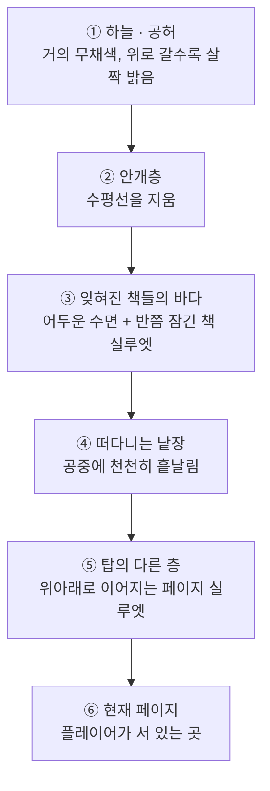

# 프로토타입 구간의 스토리 & 탑 바깥 배경 설계

> 지금 만든 그레이박스가 게임의 **어느 지점**인지, 그리고 **탑 바깥에는 무엇이 있는지**를 정한다.
> 배경은 지금까지 문서에 한 번도 정의된 적이 없는 빈칸이었다.

---

## 1. 이 프로토타입은 게임의 어디인가

| 항목 | 내용 |
|---|---|
| 위치 | **1장 「갈라진 페이지들」 초반** — 표지를 막 열고 들어온 직후 |
| 타임라인 | 7:00 ~ 14:00 구간 (P2 접힘 방향 → P3 끊긴 길) |
| 이 구간의 목표 | 접힘 → 그림자 인과를 몸으로 배우고, 다음 층으로 가는 길을 연다 |
| 서사 목표 | **딱 하나만 심는다** — "혼자 남겨졌고, 최근까지 누가 여기 있었다" |

여러 개를 심으려 하지 않는 게 중요하다. 프로토타입에서 검증할 건 재미이지 서사 밀도가 아니다.

---

## 2. 지금 그레이박스가 무엇을 뜻하는가

| 현재 오브젝트 | 실제로는 무엇인가 |
|---|---|
| **Page_Base** | 1장의 첫 페이지. 표지를 열면 처음 밟게 되는 장 |
| **Wall_Back** | 아직 넘기지 못한 **다음 장의 뒷면**. 여기에 그림자가 그려진다 |
| **FoldPanel ×2** | 이 페이지에 접혀 있는 두 개의 날개. 각도를 맞추면 뒷장에 문양이 완성된다 |
| **Page_Mid / Page_Top** | 위층으로 이어지는 접힌 페이지들 |
| **플레이어 시작 위치** | 표지를 열고 들어온 자리 |

즉 이 방의 논리는 이렇다:

> 다음 장은 그냥은 안 넘어간다. **두 날개를 올바로 접어 뒷장에 문양을 그려야** 페이지가 반응한다.

---

## 3. 무대사로 "위화감"을 심는 법

대사 없이 "최근까지 누가 있었다"를 전달할 오브젝트 세 개. 전부 작고 만들기 쉬운 것들이다.

| 오브젝트 | 놓는 위치 | 읽히는 의미 |
|---|---|---|
| **반쯤 접히다 만 페이지** | 시작 지점 근처, 접이면 중 하나가 이미 1단계로 접혀 있음 | 누가 접다가 **중간에 그만뒀다** |
| **깃털 하나** | 그 페이지 옆에 떨어져 있음 | 선대가 여기 있었다 |
| **아직 마르지 않은 자국** | 바닥 페이지의 얼룩 — 다른 얼룩보다 색이 진함 | **최근**이다 |

세 개를 한 화면에 모아 두지 말 것. 걸어가면서 순서대로 마주치게 배치해야 "발견"이 된다.

---

## 4. 탑 바깥 — 잊혀진 책들의 바다 (신규 설계)

### 핵심 설정

> 이 탑은 **잊혀진 책들의 바다** 위에 서 있다.
> 수면에는 반쯤 잠긴 책들이 무수히 떠 있고, 아직 온전히 서 있는 건 이 탑 하나뿐이다.

| 요소 | 설정 |
|---|---|
| **바다 = 잊혀짐** | 종이가 물에 닿으면 글자가 번지고 녹아 사라진다. 죽음이 아니라 **잊혀지는 것** |
| **수평선 없음** | 안개로 흐려져 끝이 보이지 않는다 — 망각에는 끝이 없다 |
| **빛의 출처** | 해가 아니라 **탑 꼭대기 자체**가 광원. 그래서 하늘은 어둡고 탑 주변만 따뜻하다 |
| **여행자들** | 이 바다를 건너던 종이 존재들. 탑의 빛이 그리는 길을 보고 방향을 잡았다 |

### 이 설정이 게임 규칙에 주는 근거

| 게임 규칙 | 서사적 근거 |
|---|---|
| 떨어져도 죽지 않고 복귀 | 바다에 닿기 직전 바람에 밀려 되돌아온다 — 아직 잊혀질 때가 아니다 |
| 빛이 곧 길 | 탑이 유일한 광원이므로, 빛이 그리는 그림자가 문자 그대로 항로다 |
| 빛 닿는 곳만 착지 가능 | 빛이 닿지 않는 페이지는 이미 반쯤 잊혀져 딛을 수 없다 |

규칙에 이유가 생기면 플레이어가 규칙을 외우지 않아도 납득한다.

---

## 5. 배경 레이어 (원경 → 근경)

| 레이어 | 역할 | 구현 난이도 |
|---|---|---|
| ① 하늘 | 팔레트의 `#2E2E33`. 그라데이션으로 위쪽만 살짝 밝게 | 하 |
| ② 안개 | 먼 곳을 지워 무한해 보이게 | 하 |
| ③ 바다 | 어두운 평면 + 아주 느린 물결. 반사는 넣지 말 것(그림자 판독을 방해) | 중 |
| ④ 낱장 | 공중을 천천히 지나가는 종이 조각. **스케일 감**을 주는 게 진짜 목적 | 하 |
| ⑤ 다른 층 | 위아래 페이지 실루엣 — 탑이 계속 이어진다는 감각 | 중 |
| ⑥ 현재 페이지 | 이미 있음 | — |

### ⚠️ 직교 + 90° 스냅이라 주의할 점

카메라가 네 방향으로만 도니까 배경은 **네 각도에서 전부 말이 돼야** 한다.
- 배경 실루엣을 한쪽에만 두면 90° 돌렸을 때 텅 빈다 → **탑을 둘러싸는 링 형태로** 배치
- 또는 스카이박스로 처리해서 각도와 무관하게

---

## 6. 프로토타입에서 만들 것 / 미룰 것

| 지금 (프로토타입) | 나중 |
|---|---|
| ① 하늘색 + ② 안개 | ③ 물결 셰이더 |
| ③ 바다 = 어두운 단색 평면 | ⑤ 탑의 다른 층 |
| ④ 떠다니는 낱장 몇 개 | 반쯤 잠긴 책 실루엣 |
| 위화감 오브젝트 3개 (3번 항목) | 종이 셰이더(투과) |

**이유**: 지금 검증할 건 "접었을 때 그림자가 움직이는 게 재밌는가"이지 배경의 완성도가 아니다.
다만 하늘·안개·바다는 **있고 없고가 체감 차이가 커서** 지금 넣는 게 값어치가 있다 —
검은 허공에 떠 있는 판때기와, 바다 위에 선 페이지는 완전히 다르게 읽힌다.

---

## 7. 다음 작업 순서 제안

1. 배경 3종(하늘·안개·바다) + 떠다니는 낱장 씬에 추가
2. 위화감 오브젝트 3개 배치 (반쯤 접힌 페이지 / 깃털 / 진한 얼룩)
3. 그 상태로 플레이 — "여기가 어디인지" 대사 없이 읽히는지 확인
4. 읽히면 종이 셰이더(투과)로 톤 올리기
