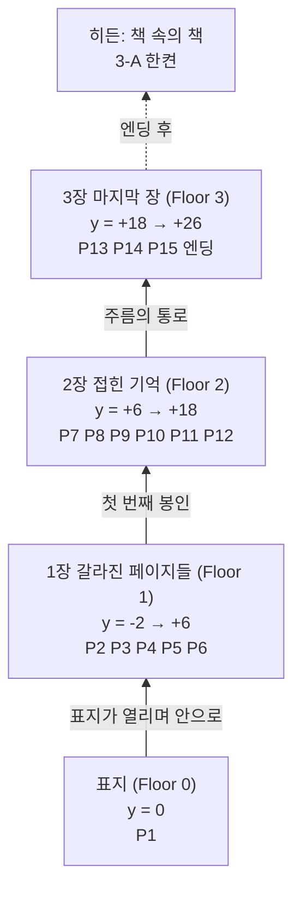

# 거인 책의 탑 — 레벨 디자인

> 80분(본편 70 + 히든 12) 동안 플레이어가 실제로 돌아다닐 공간 전체를 설계한다.
> 시스템을 더 붙이기 전에 **공간이 먼저 성립해야** 한다 — 퍼즐은 결국 공간의 문제이기 때문이다.

---

## 0. 스케일 기준

모든 치수는 이 기준에서 나온다.

| 항목 | 값 | 근거 |
|---|---|---|
| 플레이어 키 | **1 유닛** | CharacterController height 0.9 |
| 화면에 보이는 범위 | 가로 약 21 × 세로 약 24 유닛 | 직교 6 + 30° 내려보기 |
| **한 화면 방** | 16 × 14 | 화면에 여유 있게 들어옴 |
| **두 화면 방** | 24 × 20 | 카메라가 조금 움직임 |
| **큰 방** | 32 × 28 | 클라이맥스 전용 |
| 활공 가능 낙차 | 약 6 유닛 | 하강 속도 -1.6 기준 |
| 접이면 하나로 오를 수 있는 높이 | 최대 3.5 유닛 | 5 길이 판을 45°로 세웠을 때 |

---

## 1. 레벨 설계 5원칙

| # | 원칙 | 이유 |
|---|---|---|
| **1** | **올라가기 = 접기, 내려가기 = 활공** | 이동 수단이 곧 핵심 기믹이 된다. 사다리·점프대 같은 별도 장치를 만들지 않는다 |
| **2** | 모든 퍼즐 방에는 **그림자를 받는 면**이 있다 | 그림자가 어디에도 안 지면 퍼즐이 성립하지 않는다. 바닥이든 뒷벽이든 하나는 반드시 |
| **3** | 90° 회전은 **꼭 필요한 4곳에서만** | 남발하면 "일단 네 방향 다 눌러보기"가 습관이 되어 착시의 의미가 사라진다 |
| **4** | 일방통행은 **챕터 경계에서만** | 챕터 안에서는 항상 되돌아갈 수 있어야 "아까 그거였구나"가 가능하다 |
| **5** | 각 구역에 **멀리서 보이는 랜드마크** 하나 | 무대사 · 미니맵 없음. 길을 잃으면 그 자체가 난이도가 되어버린다 |

---

## 2. 탑 전체 구조



**표지는 y=0에서 시작해 안으로 내려간다.** 책을 여는 행위라서 처음엔 아래로 향하고, 이후 계속 올라간다. 시작을 하강으로 잡으면 "책 속으로 들어간다"는 감각이 생긴다.

---

## 3. Floor 0 — 표지 (0:00 ~ 7:00)

| 항목 | 값 |
|---|---|
| 크기 | **14 × 12** (일부러 좁게) |
| 높이 | y = 0 |
| 밝기 | 가장 어두움 — 탑의 빛이 아직 안 닿음 |
| 랜드마크 | 중앙의 **걸쇠** — 유일하게 빛을 받는 것 |

### 배치

```
        [바다]
   ┌──────────────┐
   │   조각 A     │
   │       ⊕걸쇠  │   ⊕ = 유일한 광원 지점
   │  조각 B      │
   │   ▲시작      │
   └──────────────┘
        [바다]
```

- 시작 지점에서 걸쇠까지 **8유닛** — 조작을 익히기에 딱 좋은 거리
- 조각 A·B는 걸쇠에서 서로 반대 방향 → 자연스럽게 좌우로 걷게 됨
- 표지 가장자리 바로 너머가 바다 → **떨어져 보게 만든다**. 여기서 "죽지 않고 되돌아온다"를 배워야 이후에 겁내지 않음

### 출구

걸쇠가 풀리면 표지가 열리며 **아래로 경사**가 생긴다 → Floor 1의 y = -2 지점으로 내려간다.

---

## 4. Floor 1 — 갈라진 페이지들 (7:00 ~ 24:00)

정돈되고 밝은 층. 접힘 → 그림자 인과를 가르치는 층이라 **공간이 단순해야** 한다.

| 구역 | 퍼즐 | 크기 | 높이 | 그림자 받는 면 | 90° 회전 | 랜드마크 |
|---|---|---|---|---|---|---|
| **1-A** | P2 접힘 방향 | 16 × 14 | y −2 | 바닥 | ✗ | 반쯤 접히다 만 페이지 |
| **1-B** | P3 끊긴 길 | 20 × 14 | y 0 | 바닥 | ✗ | 찢겨나간 간극 |
| **1-C** | P4 교차 그림자 | 14 × 12 **×2방** | y +2 | 각 방 뒷벽 | **✓** | 두 방 사이의 반사 페이지 |
| **1-D** | P5 다급한 발자국 | 16 × 14 | y +4 | 바닥 | ✗ | 흩어진 조각 3개 |
| **1-E** | P6 첫 번째 봉인 | 18 × 16 | y +6 | 뒷벽(문양) | ✗ | 봉인된 큰 페이지 |

### 1-A 상세 — 관찰 후 적용을 가르치는 방

P2의 핵심은 **"접는 자리에서는 목표가 안 보인다"**는 것. 공간으로 강제해야 한다.

```
   접이면 ●          ┃ ← 세워진 페이지가 시야를 막음
        (여기서 접음) ┃
                     ┃    ◎ 목표 지점
                     ┃    (여기 와야 보임)
```

- 접이면과 목표 사이에 **세워진 페이지 한 장**을 놔서 시선을 끊는다
- 둘 사이 거리는 **6유닛** — 왕복이 지겹지 않은 최소 거리
- 접이면 방향을 4개로 늘려서(0/45/90/135) 무작정 다 해보기가 귀찮게

### 1-C 상세 — 두 방을 잇는 반사 페이지

P4는 두 접이면이 **서로 다른 방**에 있어야 한다. 그런데 매번 왕복하면 이동 피로가 난이도를 대신하게 된다(지난 점검에서 지적된 문제).

```
  [방 1]  ●접이면A        [방 2]  ●접이면B
     ╲                        ╱
      ╲    ▨ 반사 페이지    ╱
       ╲   (통로 가운데)   ╱
        여기 서면 양쪽 그림자가 함께 비침
```

- 두 방 사이 통로 가운데에 **광택 있는 페이지** 한 장
- 여기 서면 반대편 방의 그림자가 **반사되어** 보인다 → 왕복 없이 결과 확인
- 이 반사 개념이 **P14 해법의 학습 장치**가 된다 (문서 간 연결)

### 층 이동

1-A → 1-E까지 총 **+8 상승**. 각 구역 사이 낙차는 2유닛씩이라, 접이면 하나를 45°로 세우면 올라갈 수 있다.
**되돌아 내려올 땐 활공** — 낙차 2는 활공 없이도 안전.

---

## 5. Floor 2 — 접힌 기억 (24:00 ~ 47:00)

주름이 많고 빛이 조각나는 층. **혼란**이 이 층의 정서다.

| 구역 | 퍼즐 | 크기 | 높이 | 그림자 받는 면 | 90° 회전 | 랜드마크 |
|---|---|---|---|---|---|---|
| **2-A** | P7 주름 깨우기 | 14 × 12 | y +8 | 바닥 | ✗ | 빛을 머금은 주름 |
| **2-B** | P8 따라 접기 | 18 × 14 | y +10 | 뒷벽 | ✗ | 재생 지점의 잔상 |
| **2-C** | P9 숨겨진 틈 | 20 × 18 | y +12 | 바닥+측벽 | ✗ | 두 겹으로 접힌 페이지 |
| **2-D** | P10 엇갈린 기록 | 16 × 20 (긴 방) | y +14 | 양측벽 | ✗ | 나란히 걸린 기록 4장 |
| **2-E** | P11 순서의 방 | 22 × 22 | y +16 | 사방 벽 | **✓** | 방을 둘러싼 주름 5개 |
| **2-F** | P12 작은 그림자 | 12 × 10 (좁게) | y +18 | 바닥 | ✗ | 좁은 통로 끝의 잔상 |

### 2-C 상세 — 공간 변환을 가르치는 방

P9는 "과거의 접힘 상태 ↔ 현재 위치"를 계산하는 퍼즐이고, 이게 **P15의 선행 학습**이다.

- 방 자체가 **접혔다 펴지는** 구조 — 접힘 상태에 따라 같은 지점이 다른 곳에 온다
- 양쪽 상태에 공통으로 존재하는 **고정 표식**(움직이지 않는 못 자국)을 하나 둔다 → 이게 없으면 불공정해진다

### 2-D 상세 — 긴 방인 이유

대조하려면 **나란히 놓고 봐야** 한다. 정사각 방에 흩어 놓으면 비교가 안 된다.
16 × 20의 긴 방에 기록 4장을 **양쪽 벽에 마주보게** 걸어, 한 화면에 여러 장이 들어오게 한다.

### 2-E 상세 — 회전이 필수인 방

주름 5개를 **사방 벽에 하나씩 + 천장에 하나** 배치. 한 각도에서는 최대 2개만 보인다.
→ 마모 정도를 비교하려면 반드시 카메라를 돌려야 한다. **이 층에서 유일하게 회전이 강제되는 방.**

---

## 6. Floor 3 — 마지막 장 (47:00 ~ 70:00)

찢김이 많고 여백이 넓은 층. **개방**이 정서다. 그리고 이 층의 배치가 이 게임에서 가장 중요하다.

| 구역 | 퍼즐 | 크기 | 높이 | 그림자 받는 면 | 90° 회전 |
|---|---|---|---|---|---|
| **3-A** | P13 메타퍼즐 → **P15 왜상** → 엔딩 | **32 × 28** | y +20 | 바닥·사방벽·천장 | **✓** |
| **3-B** | P14 삼중 조건의 문 | 20 × 18 | y +22 | 문 주변 | ✗ |
| **3-C** | 마지막 장 (도착 지점) | 18 × 16 | y +26 | 바닥 | ✗ |

### ⭐ 3층 배치의 핵심 — 일직선

```
   [3-A 복원의 방]  ──  [3-B 문]  ──  [3-C 마지막 장]
        32 × 28          20 × 18        18 × 16
          ↑                                │
          └────────  되돌아옴  ────────────┘
```

**세 구역을 반드시 일직선으로 놓는다.** 이유:

3-C에서 빛을 켜면 그 빛이 **뒤쪽 3-A까지 닿아야** 하고, 플레이어가 뒤를 돌아봤을 때 새 모양 그림자가 보여야 한다. 꺾인 배치면 이 연출이 불가능하다. P14의 문은 한 번 열리면 **계속 열린 채**로 둬서 시선이 통하게 한다.

### 3-A 상세 — 이 게임에서 가장 중요한 방

```
        [천장: 조각 흩어짐]
   ┏━━━━━━━━━━━━━━━━━━━━━┓
   ┃ 조각    ▣복원대      조각┃  ← P13은 여기서 8분
   ┃    조각        조각     ┃
   ┃  조각   ◈       조각    ┃  ◈ = 정렬 시점(허공, 도달 불가)
   ┗━━━━━━━━━━━━━━━━━━━━━┛
        [바닥: 조각 흩어짐]
```

| 요구사항 | 이유 |
|---|---|
| 조각이 **바닥·사방벽·천장 전부**에 흩어져 있을 것 | 왜상은 3차원으로 흩어져야 성립. 한 면에만 있으면 그냥 그림 |
| 그 조각들이 **P13을 푸는 동안 계속 화면에 있을 것** | 나중에 "8분 동안 보고 있었네"를 깨달아야 공정하다 |
| 정렬 시점 ◈ 는 **허공** | 걸어갈 수 없어야 "공간을 접어 끌어온다"가 성립 |
| 방 안에 **접이면 하나** | 그걸 접으면 방의 기하가 포개져 ◈ 가 플레이어 위치와 겹침 |
| 천장 = **위층 페이지의 뒷면** | 책이라는 설정과 자연스럽게 맞음 |

**32 × 28로 크게 잡은 이유**: 조각이 충분히 흩어져 있어야 "의미 없는 얼룩"으로 보인다. 좁으면 처음부터 형태가 눈치채인다.

### 3-B 상세 — 세 조건이 한 화면에

P14는 A·B·C 접이면이 **서로를 방해**한다. 그걸 이해하려면 셋이 한 화면에 다 보여야 한다.

```
   채광구 ☀
      ╲
   [A면]   [열쇠구멍]
      ╲       ↑
       [C면] ─┘        [B면 주름]
```

- 20 × 18 — 셋을 한 화면에 담을 수 있는 최소 크기
- 회전 없이 풀 수 있게 배치 (여기서 회전까지 요구하면 8분으로는 불가능)

---

## 7. 수직 이동 규칙

| 방향 | 수단 | 규칙 |
|---|---|---|
| **위로** | 접이면을 45~90°로 세워 밟고 오름 | 한 번에 최대 3.5유닛. 그 이상은 2단으로 |
| **아래로** | 활공 | 낙차 6유닛까지 안전 |
| **되돌아가기** | 같은 접이면을 다시 세움 | 모든 접힘은 가역이므로 항상 되돌아갈 수 있다 |

**사다리·점프대·엘리베이터는 만들지 않는다.** 이동이 곧 퍼즐이어야 기믹이 살아난다(원칙 1).

---

## 8. 페이싱 — 방 크기와 밝기의 리듬

| 층 | 방 크기 | 밝기 | 정서 |
|---|---|---|---|
| 표지 | **좁음** (14×12) | 가장 어두움 | 봉인 |
| 1장 | 보통 (16~20) | 밝음 | 정돈 |
| 2장 | 보통~큼, 형태 불규칙 | **조각난 빛** | 혼란 |
| 3장 | **가장 큼** (32×28) | 가장 밝음 | 개방 |

좁음 → 보통 → 불규칙 → 넓음. 공간만으로도 이야기가 진행되게 했다.

---

## 9. 90° 회전을 쓰는 4곳 (그리고 나머지에선 안 씀)

| 위치 | 회전이 필요한 이유 |
|---|---|
| **1-C** (P4) | 두 방의 그림자를 각각 봐야 함 |
| **2-E** (P11) | 주름 5개가 사방에 있어 한 각도로는 2개만 보임 |
| **3-A** (P13) | 조각의 그을음 각도를 여러 방향에서 대조 |
| **3-A** (P15) | 왜상 정렬 — 이 게임의 정점 |

나머지 12개 퍼즐은 **회전 없이 풀린다.** 이렇게 아껴야 3-A에서 카메라를 돌리는 행위에 무게가 실린다.

---

## 10. 길찾기 — 무대사 게임의 생명줄

미니맵도 화살표도 없다. 대신 세 가지로 유도한다.

| 장치 | 방법 |
|---|---|
| **빛** | 다음 목적지 쪽이 항상 미세하게 더 밝다. 플레이어는 무의식적으로 밝은 쪽으로 간다 |
| **랜드마크** | 각 구역에 멀리서도 식별되는 형태 하나 (위 표의 랜드마크 열) |
| **떠다니는 낱장** | 배경의 낱장이 **진행 방향으로 흐른다**. 강물처럼 방향을 암시 |

세 번째가 특히 좋은데, 이미 만들어둔 배경 요소를 길잡이로 재활용하는 거라 추가 비용이 없다.

---

## 11. 제작 순서 (프로토타입 → 전체)

| 단계 | 만들 것 | 검증할 것 |
|---|---|---|
| **1** | 1-A 한 구역만 완성 | 접힘 → 그림자가 재밌는가 |
| **2** | 1-A ~ 1-C 연결 | 구역 간 이동(접어 오르기·활공)이 자연스러운가 |
| **3** | 1장 전체 (1-A~1-E) | 17분이 지루하지 않은가 |
| **4** | 3-A 단독 | **P15 왜상이 실제로 성립하는가** ← 가장 위험한 부분, 일찍 검증 |
| **5** | 2장 | 에코가 정답 자판기로 전락하지 않는가 |
| **6** | 3-B·3-C 연결 + 엔딩 | 되돌아보는 연출이 작동하는가 |

**4단계를 3단계 바로 뒤에 둔 이유**: P15는 이 게임에서 유일하게 "안 될 수도 있는" 설계다. 왜상이 직교 카메라에서 원하는 만큼 극적으로 맞아떨어지지 않을 가능성이 있다. 2장을 다 만든 뒤에 그걸 발견하면 손해가 크므로, **가장 위험한 걸 일찍 확인한다.**
