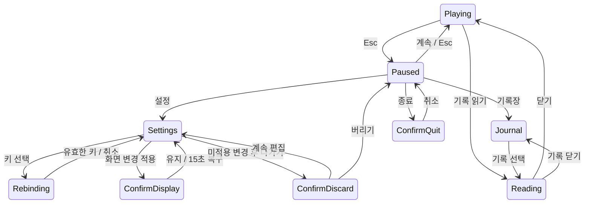

# 종이 백룸 UI와 설정 — Unity 구현

2026-09-26. `Assets/Scenes/InGame.unity`에 적용. Play 후 Esc로 책갈피 메뉴를 연다.

## 아트와 공통 규격

추출 이미지 적용 갱신: `Extracted/Settings_NoText.png`의 버튼·카테고리 아이콘·코럴 선택 띠·붉은 책갈피·드롭다운·체크박스·슬라이더·구분선·나뭇잎을 `PaperUISkin`이 개별 Sprite로 참조한다. 원본 픽셀은 유지하며, Unity 임포터의 NPOT 자동 리사이즈를 끈다. 실제 글자와 값은 계속 UGUI Text로 표시한다. 드롭다운은 `Choosing` 상태에서 목록을 선택하고 Settings로 돌아온다. Esc와 목록 밖 클릭으로 취소할 수 있다.

기존 설정 콘셉트를 빈 종이 노트 배경과 투명 나뭇잎 장식으로 리터칭했다. 텍스트와 버튼은 이미지에 구워 넣지 않고 Unity UGUI로 표시한다. 따뜻한 장지색, 진한 갈색 글자, 적갈색 선택 상태, 황동 테두리를 공유한다.

- 기준 캔버스: 1920 × 1080. Expand 스케일 방식으로 화면비가 달라도 내용 전체를 유지한다.
- 노트: 1440 × 900, 중앙 배치.
- 네 설정 탭의 나뭇잎: 동일 Sprite와 **동일 Image 인스턴스**, 120 × 120, 노트 내부 좌상단 기준 (1220, 655). 탭 전환 때 다시 만들지 않는다.
- 글꼴: 본문·메뉴·안내는 Nanum Gothic Bold, 제목은 Nanum Gothic ExtraBold. 붓글씨처럼 보이는 명조의 맺음을 줄이고 굵기는 유지했다. 실제 굵기별 폰트를 사용하며 합성 Bold를 중복 적용하지 않는다. Google Fonts 공식 배포본과 OFL 라이선스를 `Assets/_BookTower/UI/Fonts/`에 동봉했다. 출처: https://github.com/google/fonts/tree/main/ofl/nanumgothic
- 실제 게임은 Overlay Canvas이므로 월드의 밝기·블룸이 글자를 흐리게 만들지 않는다.

## UI 범위

텍스트 박스 테마 갱신: `PaperStoryTheme`과 `Resources/StoryPanels.png`를 추가했다. 일시정지는 두 페이지 설정 노트 대신 하나의 세로 책갈피 패널만 보여준다. 오른쪽 간이 설정 패널은 없다. `PaperMenuHighlight`가 포인터·키보드 선택에 따라 항목 띠를 진하게 하고 책갈피를 표시한다. 설정·기록장·복귀·종료 기능은 유지한다. Esc 메뉴의 관찰 힌트는 제거했다. 읽기·상호작용 안내·짧은 피드백은 같은 찢긴 종이 텍스트 박스를 사용한다.

현재 편집기가 열린 상태라 별도 프로젝트 복사본에서 검증했다. 결과: `Docs/ArtReview/PaperUI/story-theme-play-check.txt`. 원본 씬에는 UI 텍스처 참조만 추가했다. 열린 씬이 이전 참조를 유지해도 다음 Play에서 Resources로 새 패널을 로드한다. 음악 세 곡의 청취 파일과 설명은 [구역별 배경음악](18_구역별_배경음악.md)을 참고한다.

| 화면 | 기능 |
|---|---|
| 플레이 | 중앙 조준점, 상호작용 대상 모서리, 현재 지정 키와 행동 안내, 짧은 결과 피드백 |
| 책갈피 | 계속하기, 설정, 기록장, 체크포인트 복귀, 종료 확인 |
| 읽기 | F0 제본사의 기록, 다음 페이지, 닫기, 기록장에 보관 |
| 기록장 | 읽은 이야기와 획득 조각 목록, 페이지 이동, 다시 읽기 |
| 조작 | 감도, 상하 반전, 이동·점프/활공·상호작용·Q/E 관찰 키 재지정 |
| 화면 | 전체/테두리 없는 창/창, 해상도, 밝기, 그래픽 품질, 프레임 제한, 수직 동기화 |
| 소리 | 전체·음악·효과·환경 음량, 종이 소리 미리 듣기, 백그라운드 음소거 |
| 접근성 | 글자 크기, 상호작용 안내, 색 외의 문양 보조, 화면 흔들림, 번쩍임 완화, 자동 시점 회전 |

그래픽 품질은 런타임 URP 복제본의 렌더 배율·그림자 거리·MSAA에 적용한다. 원본 파이프라인 에셋을 변경하지 않는다. 수직 동기화가 켜져 있으면 모니터 주사율이 우선임을 표시한다. 화면 설정 변경은 15초 확인 후 저장하며 시간 초과 시 이전 설정으로 복구한다.

음악과 환경음은 별도 루프 소스, 효과음은 개별 소스의 기준 음량에 채널 게인을 곱한다. 전체 음량은 AudioListener에 적용한다. 미리 듣기는 일시정지 중에도 동작한다. 이번에 추가한 잔잔한 음악과 종이 공기음은 `Tools/make_ui_audio.py`로 합성한 임시 사운드이며 최종 작곡 음원으로 교체할 수 있다.

번쩍임 완화는 블룸을 억제하고 퍼즐 성공 조명의 강도와 상승 속도를 완화한다. 색 보조는 접기 대상의 ○·△·◇와 읽을 대상의 □를 사용한다. 자동 회전은 시점을 직접 조절하지 않은 시간이 지난 뒤 정령 방향으로 천천히 정렬하며 Q/E 관찰 고정 중에는 개입하지 않는다.

## 유한상태머신

`PaperUI`는 기존 `StateMachine<T>`와 `IState<T>`를 사용한다. 화면별 상태 클래스가 진입·업데이트·종료를 소유한다.

메뉴와 읽기 중에는 GameFlow를 Paused로 전환하고 플레이어 입력을 차단한다. 타이머는 unscaled time을 사용한다. 화면을 닫은 직후 한 프레임 동안 입력을 차단해 같은 클릭이 월드 상호작용으로 이어지는 것을 막는다. 확인창은 아래 메뉴의 포인터 입력과 키보드 선택을 차단한다.

## 저장과 파일 구성

- `PaperSettings.cs`: 설정 데이터와 값 검증.
- `PaperSettingsRuntime.cs`: 런타임 적용, JSON 저장/복구.
- `PaperAudioLevel.cs`: 음악·환경·효과 음량 채널.
- `PaperUI.cs`: FSM, 설정 초안, 확인 절차, 기록 저장.
- `PaperUIView.cs`: 노트 공통 레이아웃, 네 탭, HUD, 읽기·기록장.
- `PaperUISkin.cs`, `PaperUISkinView.cs`: 승인된 추출 이미지의 Sprite 영역과 설정창 스타일. `PaperInk.shader`는 아이콘 주변 종이색을 렌더링 시 제거한다. 나뭇잎 메시 영역은 옆 드롭다운 테두리가 들어오지 않도록 제한한다.
- `ReadableNote.cs`, `PaperWorldSymbol.cs`: 월드 연결.
- `PaperUIBuilder.cs`: 씬·프리팹 적용. 메뉴 `Book Tower/종이 UI 적용`으로 재구성.
- `PaperUIVerifier.cs`: 독립 저장 경로를 쓰는 Play Mode 통합 검증.

설정은 `Application.persistentDataPath/paper-settings-v1.json`, 기록은 `paper-records-v1.json`에 저장한다. 설정은 초안을 편집한 뒤 적용하며 파일 쓰기 실패 시 저장된 값으로 복구한다. Esc와 중복 키는 재지정할 수 없다. 진행 상태 전체를 디스크에 저장하는 기능은 이번 UI 범위에 포함되지 않는다. 체크포인트는 현재 플레이 세션의 안전 위치이며 종료 확인창에도 이를 표시한다.

## 이미지 생성 기록

내장 imagegen으로 기존 노트 UI를 리터칭했다. 결과는 `Assets/_BookTower/UI/Notebook.png`와 `Leaf.png`에 포함했다. 생성 방향은 다음과 같다.

1. 기존 종이 설정 노트의 장지 결, 가죽 가장자리, 좌측 제본 고리를 보존한 정면 UI 배경. 글자·버튼·나뭇잎을 제거하고 Unity에서 내용을 얹을 수 있는 빈 양면 페이지.
2. 같은 세계관의 작은 황동빛 나뭇잎 가지 하나. 투명 배경, 다른 글자나 장식 없이 모든 설정창에서 재사용할 독립 스프라이트.

## 검증과 제한

최종 검증 완료:

- 추출 이미지 스킨: 네 탭의 아이콘 4개·선택 책갈피 1개, 동일 나뭇잎 크기, 실제 드롭다운 목록 선택/닫기, 체크박스 값 변경을 기존 통합 검증에 추가했다.

- PaperUIBuilder로 씬과 프리팹 재생성 → 씬 다시 열기 → UI 통합 검증 통과. 설정 컴포넌트의 MonoScript 참조도 저장됨.
- 네 탭의 동일 나뭇잎, 슬라이더 범위, 초안/취소/저장, 키 충돌 방지와 실제 R 입력, 음량 채널, 카메라 감도/반전, 화면 15초 복구, 읽기·기록장·종료 취소 통과.
- F0 회귀 검증: 실제 키와 마우스로 다리 접기, 빛 복원, 문 해금, 역방향 이동, 출구 통과.
- 1A 회귀 검증: 연결 통로 낙하 없음, 두 아치 이동, 세 접기 조합과 토끼 정렬, 1B 출구 연결 통과.
- 네 탭과 큰 글자·읽기 화면을 렌더링해 확인. 슬라이더가 노트 밖으로 늘어나는 문제를 수정하고 재검증함.

Unity Play Mode 결과는 `Docs/ArtReview/PaperUI/play-check.txt`, 실제 Unity UI 캡처는 같은 폴더에 있다. 캡처는 배치 환경에서 Overlay를 임시 Camera Canvas로 전환하고 후처리를 끈 뒤 렌더링하며, 종료 후 원래 모드로 복구한다. 생성형 이미지로 검증 화면을 대신하지 않는다.

배치 환경은 OS 창의 실제 해상도를 바꾸지 않는다. 해상도 설정 값·확인·저장·시간 초과 복구는 자동 검증하지만, 최종 모니터의 전체화면 전환과 실제 스피커 음량 체감은 일반 Play/빌드에서 확인해야 한다.
