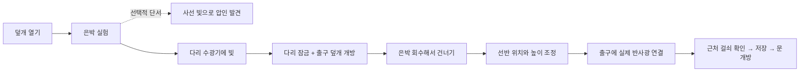

# F0 기믹 구현 설계 — 한 장의 은박, 남겨 두는 길

2026-09-27. **설계 문서이며 씬이나 게임 로직에 적용한 결과가 아니다.** 19번 문서의 F0 목표를 공간·조작·판정·복구 수준으로 구체화한다. F0의 세부 해법은 이 문서를 우선하고 다른 방의 서사는 19번 문서를 따른다.

## 1. 플레이 경험의 목표

나를 깨워준 종이새 모아와 함께 다음 방으로 건널 길을 만든다. 문을 열기 위한 추론은 세 가지다.

1. 빈 종이에도 비스듬한 빛에서 드러나는 정보가 있다.
2. 다리가 기계적으로 고정되면 은박은 회수해도 된다.
3. 빛을 받는 위치와 빛을 보내는 높이는 서로 다른 문제다.

핵심 도구는 **이동 가능한 은박 한 장**이다. 같은 물건을 기록 조사 → 다리 개방 → 출구 연결에 재사용한다. 상호작용 횟수, 암호 조합, 정밀한 마우스 조준을 난이도로 삼지 않는다. 초행 8~12분을 목표로 하되 아직 플레이테스트로 측정한 시간은 아니다. 첫 방의 난이도는 중하: 한 번에 새 규칙 하나씩 보여준다.

## 2. 현재 구현과 교체 범위

현재 `FoldBridgePuzzle`은 입구/건너편 반사판을 3상태로 회전시키고, 중간 고정 반사판으로 우회한다. 다리는 별도 손잡이로 접고 편다. 최근 제작한 작업책·수레는 장식 프리팹이다.

새 구현에서는 현재의 두 회전 고리와 고정 반사판을 핵심 해법에서 제거한다. 기존 종이 다리 메시·충돌·문·복구 위치·1A 통로·플레이어 카메라를 재사용하되, 손잡이와 광원 및 수광기의 위치·상태 로직은 교체한다. 천장까지 닿는 기둥 위를 넘긴다는 이전 설명은 폐기한다. 대신 **낮은 책벽 위로 반사광을 보내는 구조**를 쓴다.

이번 문서 작업은 코드 변경이나 새 퍼즐 구현 완료를 뜻하지 않는다.

## 3. 오브젝트별 역할

| 요소 | 기능 | 발견/상태를 보여주는 방법 |
|---|---|---|
| 제본 광원과 덮개 | 퍼즐에 쓰는 고정 광원 하나 | 빛 구멍→덮개→당기는 고리가 물리적으로 이어짐 |
| 작업책 | 사선 조명에서 압인 도해가 드러나는 단서 | 닳은 종이, 빛을 비껴 볼 때의 얕은 그림자. 일반 읽기로도 표면 확대 가능 |
| 은박 책장 M | 들기·운반·놓기·방향 조정 | 실제 은박 앞면과 불투명 종이 뒷면, 접이식 받침. 다른 금박 장식과 구분 |
| 다리 수광기 B | 빛을 받으면 실제 다리를 펼침 | 꽃잎→권취 바퀴→다리의 제본실 연결을 눈으로 추적 가능 |
| 자동 다리 잠금쇠 | 펼친 다리 유지, 출구 수광기 덮개 해제 | 큰 잠금쇠가 걸리고 늘어진 제본실이 팽팽해짐. 유지에 빛이 필요 없음을 표시 |
| 이동 선반 C | 은박의 수평 위치와 받침 높이 변경 | 연속된 바퀴 홈, 아래/위의 넓은 받침. 정답 한 칸 표시 없음 |
| 매달린 책표지 두 장 | 특정 위치에서만 광원을 볼 수 있게 함 | 은박에 빛이 들어오기 전 표지에 빛 자국이 보임 |
| 낮은 책벽 | 낮은 반사 경로를 차단 | 책벽의 윗면과 뒤 수광기가 함께 보이는 측면 시야 확보 |
| 출구 수광기 E | 올바른 방향에서 받은 빛으로 문 걸쇠 활성화 | 측면으로 열린 짧은 차광 후드. 종이 덮개는 다리 잠금쇠와 실로 연결 |
| 문 걸쇠 | 살아 있는 광로를 확인하고 출구 확정 | 가까이서만 조작, 해결 후에는 빛을 옮겨도 문 유지 |

장식의 역할도 구분한다. 잉크병·깃펜은 사용자가 살펴볼 생활 흔적, 종이 등은 시선과 분위기, 토끼 표지는 다음 방의 모양 예고다. 이 물건을 모두 클릭해야 풀리는 목록 수집으로 만들지 않는다.

## 4. 플레이 순서와 추론

### 0 — 첫 관찰

도입 연출 후 약속을 유지한다: ‘모아와 건널 길 찾기’. 정령 앞에는 중앙의 접힌 다리, 왼쪽에는 펼친 책이 있다. 원경의 문 전체를 가리는 거대한 설명 HUD는 없다. 모아가 책을 한 번 바라보고 페이지가 살짝 움직인다.

모아: “저 책에는 아직 자국이 남아 있어.”

책상 아래 은박의 가장자리가 보이고, 잡아당기면 한 번에 꺼낸다. 매우 작은 픽셀이나 깊은 암부를 뒤져야만 찾을 수 없게 한다. 보관함에는 은박 한 장의 자리만 있고 ‘빈 두 번째 슬롯’을 만들어 다른 도구를 찾게 하지 않는다.

### 1 — 빛으로 기록 읽기

덮개를 열면 넓은 제본 광원의 범위가 드러난다. 은박을 작업책 옆에 세워 빛을 비스듬히 보낸다. 단순히 책이 밝아지는 것과 압인에 작은 그림자가 생기는 것을 구분한다.

압인 두 컷: (A) 빛에 펴지는 다리와 열린 잠금쇠, (B) 걸린 잠금쇠와 다른 곳으로 가져간 은박. 긴 정답 절차 대신 둘의 차이를 읽게 한다. 글은 “빛은 자리를 옮겨도, 걸어 둔 길은 남는다.” 한 문장이다.

나: “빈 페이지가 아니었네.”

압인 발견은 지식 보상이다. `BookRead` 또는 `ClueRevealed`는 문 판정에 들어가지 않는다. 실험만으로 원리를 알아낸 사람은 책을 읽지 않고 풀어도 된다. 압인이 어두워져도 한 번 발견한 그림은 기록장에 남는다.

### 2 — 빛으로 다리 펼치기

은박을 입구 중앙의 넓은 바닥 작업 영역으로 옮긴다. 반사광을 다리 수광기 B로 보낸다. 0.5초 안정적으로 맞으면 꽃잎이 펴지고 권취 바퀴가 실제 다리를 내린다. 전개 목표 2.5~3초.

빛이 중간에 끊기면 동작은 안전한 위치에서 정지하고, 다시 비추면 이어진다. 완전히 펴지면 큰 잠금쇠가 자동으로 걸린다. ‘잠그기 버튼을 찾아 추가 클릭’하는 과제로 늘리지 않는다. 잠금쇠를 보여주는 1초 시선 유도는 조작을 강제로 빼앗지 않는다.

다리 잠금과 연결된 실이 건너편 출구 수광기의 종이 덮개도 걷는다. 따라서 다리 개방은 단순한 진행 플래그가 아니라 마지막 장치를 쓸 수 있게 하는 물리적 변화다.

### 3 — 은박 회수

도구가 하나뿐이므로 은박을 회수해야 한다. 들면 빛이 끊기지만 다리는 그대로 남는다. 수광 꽃은 접혀도 잠금쇠의 모양과 팽팽한 실은 유지된다. ‘현재 빛을 받는 상태’와 ‘이미 고정된 상태’를 분리해서 보여준다.

모아는 다리 입구의 안전한 위치에 내려앉는다. 대사는 실패 직후 자동으로 답을 주지 않는다. 플레이어가 은박을 회수했을 때만 나: “길은 그대로 있네.” 이후 은박을 들고 건넌다.

### 4 — 위치와 높이 두 문제

건너편의 이동 선반은 처음에 빛을 받지 못하는 위치에 놓여 있다. 아래·위 두 단 모두 사용할 수 있다.

- 처음 위치에서는 높은 단에 올려도 들어오는 광선이 매달린 책표지에 막힌다. **위치 문제**다.
- 선반을 옮겨 빛을 받는 구간에 와도 아래 단에서는 반사광이 낮은 책벽에 부딪힌다. **높이 문제**다.
- 빛을 받는 구간의 높은 단에서는 책벽 위로 보내 출구 수광기에 도달한다.

바퀴 흔적은 정확한 정답점이 아니라 이동 방향과 오래 사용한 넓은 구간을 암시한다. 은박 테두리에 입사광이 생기는 변화로 그 구간을 발견한다. 책벽에 남는 빛 자국은 어디서 경로가 끊겼는지를 보여준다. 정답 좌표로 자동 스냅하지 않는다.

두 문제를 푸는 순서는 자유다. 높은 단에 먼저 올리고 움직여도 되고, 낮은 단에서 광원을 찾은 뒤 올려도 된다. 어느 순서든 물리적으로 성립하면 정답이다.

### 5 — 마지막 확인과 이야기

출구 수광기가 빛을 받으면 꽃잎이 호흡하고 문 걸쇠까지 이어진 실이 밝아진다. 가까이서 걸쇠를 조작하면 완료 확정 → 보상/문 상태 저장 → 문 열림과 6초 기억 연출 순서로 실행한다.

제본사가 새 날개를 고치는 손 그림자: “잠깐 다녀와도 괜찮아. 돌아올 자리는 남겨 둘게.”
모아: “이 목소리… 우리 집에서 들었어.”

M01 ‘돌아올 자리’를 자동 등록한다. 출구의 그림책에는 작은 토끼 종이를 등 가까이 가져가자 큰 그림자가 되는 두 컷이 있다. 다음 방의 크기 규칙만 예고하고 해법 좌표는 주지 않는다.

## 5. 공간과 광로 초안

좌표는 **F0 방 로컬, 미터 단위**, +Z가 출구다. 현재 주 실내 약 32×36m, 천장 Y≈16m, 양쪽 책장 바닥 Y≈3m를 기준으로 한다. 이 좌표는 블록아웃 시작값이며, 아래 산술 검토 외에 Unity 물리/시각 판정을 완료한 값이 아니다.

| 요소 | 시작값/범위 | 배치 목적 |
|---|---|---|
| 광원 S | (-4, 12, -17) | 입구 상부의 제본 채광구. 책·다리·건너편으로 같은 광원이 보임 |
| 광원 방사 방향 | normalize(5,-8,17), 전체 원뿔각 80° 시작 | 특정 은박을 자동 추적하는 레이저가 아닌 고정된 넓은 입사 영역 |
| 작업대 | 중심 (-10, 3.05, -7), 기존 모델 활용 | 현재 작업 구역 유지 |
| 책 조사 은박 예시 | (-8, 5.0, -7.4) | 옆에서 책 표면에 얕게 비춤. 기존 잉크병은 뒤쪽으로 이동 필요 |
| 책 표면 관심 지점 | 약 (-9.6, 5.1, -7.5) | 실제 곡면 메시와 맞춰 확정할 것 |
| 다리용 은박 예시 | (-2.4, 4.45, -4.8) | 넓은 바닥 위 연속 배치. 정답 전용 받침 슬롯 아님 |
| 다리 수광기 B | (3.2, 4.1, -2) | 접힌 페이지 앞쪽에서 빛을 받을 수 있음 |
| 다리 | X±2.2, Z -1.2~7.2, 상면 Y≈3.04 | 기존 4.4m 폭·8.4m 길이 유지 |
| 수레 중심 레일 | X 4.0~7.6, Z=8.8 | 바닥 홈을 따른 연속 이동. 중앙 보행로와 오른쪽 책등 기둥에서 이격 |
| 은박 중심 높이 | 아래 Y=4.4 / 위 Y=6.3 | 수레 받침·거치 구조를 수정해 두 높이를 읽히게 함 |
| 입사 차광 표지 | Z≈6, X 2~5 및 6.6~9.6, Y 5.1~10.5 | 둘 사이 X 5~6.6의 넓은 틈에서 광원 확인. 중앙 다리 위 보행 공간은 비움 |
| 낮은 책벽 | Z≈9.8, X 1.8~8.5, 상단 Y=6.2 | 낮은 반사만 차단. 중앙 X±1.3 보행로와 문 경사면 유지 |
| 출구 수광기 E | (0, 6.7, 10.7) | 문 앞 상부 장치. 실제 문까지는 제본실로 연결 |
| 출구 수광기 후드 | (7,6.3,8.8)을 향해 개방, 수용 반각 8° 시작 | 입구에서 정면으로 쏘는 우회를 물리적으로 차단. 외형에 방향을 표시 |

은박을 받을 작업 면은 작업대의 넓은 빈 면, 안전한 양쪽 바닥, 수레의 두 받침이다. 창틀·난간·수직 벽·불안정한 소품 위에는 놓지 않는다. 이 차이는 평평한 작업판과 접이 받침이 실제로 서는 모습으로 설명한다. 특별한 정답 슬롯만 노랗게 빛나게 하지 않는다.

### 대표 광로 산술 확인

S에서 은박 중심 M으로 향하는 선을 Z=6에서, M에서 E로 향하는 선을 Z=9.8에서 평가했다. 반사판 법선은 입사/출사 단위벡터 차로 구할 수 있다. 단순 선분 계산이며 실제 씬의 모든 콜라이더·각도 허용치를 검사한 것은 아니다.

| 후보 | 입사 표지 평면의 교점 | 책벽 평면의 교점 | 기대 반응 |
|---|---|---|---|
| M=(7,6.3,8.8) | (5.81,6.92,6) | (3.32,6.51,9.8) | 틈 통과, 책벽 위 약 0.31m 통과 |
| M=(7,4.4,8.8) | (5.81,5.22,6) | (3.32,5.61,9.8) | 입사 가능하지만 책벽에 막힘 |
| M=(4,6.3,8.8) | (3.13,6.92,6) | 도달 전 차단 | 높이는 충분해도 입사 표지에 막힘 |

위 배치의 광원 가시 구간은 수레 X≈6.10~7.60 안에서 확보할 수 있다. 최종 성공 구간은 후드·수광기 크기·은박 방향과 함께 검증해야 한다. 최소 1m 정도의 유효한 수레 구간을 목표로 하며, 한 점만 정답이 되면 틈이나 후드를 넓혀 다시 시험한다.

### 즉시 다음 방을 밝히는 우회 방지

수광기 덮개는 다리 잠금쇠가 기계적으로 열어 준다. 후드는 수레 쪽 낮은 각도에서만 열려 있고, 입구에서의 정면 빛은 실제 측벽에 막힌다. 낮은 바닥 배치로 후드 앞을 겨냥하면 낮은 책벽에 막히게 한다. 조건문으로 ‘수레 위에 있어야 정답’을 강제하지 않는다. 예상 밖의 배치라도 모든 물리 경로와 안전 조건을 만족하면 정답으로 인정한다. 지름길이 핵심 추론을 완전히 생략하면 블록아웃을 수정한다.

## 6. 빛 판정과 분위기 조명의 구분

퍼즐 광원은 한 개의 고정된 넓은 방사 영역이다. 은박 중심/작은 표본 영역이 이 원뿔 안이고 S와 사이에 불투명한 것이 없을 때 입사한다. 그 입사 벡터와 은박의 실제 법선으로 반사 벡터를 계산한다. 출사 목적지를 자동 선택하거나 가까운 정답으로 돌리지 않는다.

입사하는 전체 조명은 넓고, 은박에서 반사된 길은 좁고 선명한 금빛 선으로 보여준다. 분위기용 창빛·등불·먼지는 상태 판정에 쓰지 않는다. 처음부터 외형상 제본 렌즈와 덮개가 있는 ‘집광된 빛’만 기구를 움직이는 것으로 보여준다. 일반 창빛으로 책을 자세히 볼 수 있지만 핵심 압인은 실제 사선 입사 여부로 판정한다.

책 압인의 시작값: 입사 방향과 페이지 평면 사이 약 5~25°에서 잘 보이고 범위 바깥에서는 부드럽게 흐려짐. 밝기와 각도에 따른 연속 피드백이지 정확한 각도 맞추기 시험이 아니다. 판정의 경계에는 완충 범위를 두며 접근성 설정에서는 발견한 선의 대비를 높인다.

출구 수광기 지름 0.9~1.2m, 선폭 약 0.06~0.09m를 블록아웃 시작값으로 사용한다. 0.5초 안정 입사 후 준비 상태. 손 떨림 완충은 최대 0.15초 정도로 제한하고, 실제 차폐가 있으면 즉시 경로를 끊는다. 퍼즐의 빛을 순간 저장하는 기능은 F0에 추가하지 않는다.

## 7. 입력

기존 마우스 조준·WASD 이동·Q/E 월드 축 관찰을 유지한다. 설정의 바인딩을 읽고 하드코딩한 키 문구를 사용하지 않는다.

- 가까이서 상호작용: 은박 집기, 배치 확정, 조정 진입, 수레 손잡이 잡기, 걸쇠 확인.
- 은박 운반 중: 받침이 접히고 은박 면을 보호지로 덮어 반사하지 않음. 들고 뛰면서 문을 비추는 것이 해법이 되지 않게 물건의 상태로 설명한다.
- 배치 미리보기: 조준한 유효 작업 면 위에서 연속 위치 선택. 불안정·관통 위치는 붉은색뿐 아니라 기울어진 받침 표시로 설명. 확정 전 실제 광로에는 참여하지 않음.
- 은박 조정 중: 커서/조준으로 받침의 좌우 회전 고리와 기울임 손잡이를 조작. 카메라 방향을 통째로 퍼즐 각도로 쓰지 않는다. 눈금은 5° 보조, 연속 조정 가능. Q/E 의미를 바꾸지 않음.
- 수레 조작: 바퀴 홈 방향 입력으로 연속 이동. 레일 끝의 물리적 고정쇠, 낮은 잡는 손잡이. 캐릭터/물건과 겹치면 멈춤.
- 높은 단 배치: 아래쪽 제본 고리로 받침을 내려 은박을 얹고 다시 올리는 짧은 동작으로 처리. 정령이 허공의 선반을 클릭해 물건을 순간이동시키지 않음. 고리 한 번 조작으로 완결하며 별도 퍼즐로 늘리지 않는다.
- 취소 입력: 미확정 배치/조정만 취소. Esc는 상호작용 모드를 종료하고 일시정지로 전환하며 조작권은 한 상태만 가진다.

개념 UI 상태: Gameplay / Carrying / PlacementPreview / Adjusting / MovingCart / Reading / Paused. 기존 UI FSM에 이름만 추가하지 말고 이동·마우스·시간 소유권과 복귀 상태를 정의한다. 이것은 후속 구현 명세다.

## 8. 상태와 완료 조건

독립 상태를 둔다. 이야기를 반드시 특정 순서로 읽게 하는 거대한 선형 상태 하나로 만들지 않는다.

- Source: Covered / Open.
- Foil: Stored / Carried / Placed, 받침 ID·위치·방향·단 높이.
- Book: Undiscovered / Revealed / Read. 기록용 상태, 진행 조건 아님.
- Bridge: Folded / Deploying / Latched. Latched는 재입장·로드 후 유지.
- ExitCover: BridgeLatched에 기계적으로 연결되어 열림.
- Exit: Dark / LitStable / Committed.
- Door: Closed / Opening / Open. Committed 이후 되잠그지 않음.

완료 요청 수락: `BridgeLatched && ExitCoverOpen && ExitLitStable && PlayerNearSeal`.
`ReadBook`, `CartAtExactCoordinate`, `FoilOnUpperShelf` 같은 정답 행동 플래그는 요구하지 않는다. 위치/높이는 실제 가시성·광선·후드에 의해 필요해진다.

## 9. 실패·복구·우회 대응

| 상황 | 처리 |
|---|---|
| 은박 뒷면을 광원으로 향함 | 종이 뒷면에 빛 자국, 반사 없음 |
| 책에 정면으로 빛 | 표면은 밝지만 압인 명암 부족. 옆에서 빛을 보낼 이유를 볼 수 있음 |
| 다리 전개 도중 광원 차단 | 안전 정지, 재입사로 이어짐. 플레이어와 충돌하는 전개 금지 |
| 다리 고정 후 은박 회수 | 다리/덮개 유지, 수광 꽃만 꺼짐 |
| 선반 위치 오류 | 은박 입사 테두리가 어둡고 앞 차광 표지에 빛이 맺힘 |
| 선반 높이 오류 | 은박은 밝지만 책벽에 반사광이 맺힘 |
| 출구 연결 후 확인 전에 빛 차단 | 걸쇠 준비 상태만 해제, 완료 아님 |
| 완료 후 빛 차단 | 문·통로·기억 보상 유지 |
| 은박 낙하/무효 저장 위치 | 마지막 유효 받침으로 복귀. 그 받침이 잠겨 접근 불가하면 입구 보관함으로 복귀 |
| 정령 추락 | 기존 안전한 쪽의 복귀 지점. 다리/선반/단서 진행 보존 |
| 저장 중 운반/애니메이션 | 은박은 마지막 안정 위치, 다리는 안전한 상태로 복원. 잠금 완료는 반드시 보존 |
| 점프/활공 우회 | 현재 이동 규칙을 임의로 바꾸지 않는다. 모아의 길과 출구 덮개가 실제로 다리 잠금을 필요로 함 |

이동 코드 기본값은 속도 5.5m/s, 점프 높이 1.2m, 중력 -18m/s²이며 점프 후 활공은 현재 코드에서 제한한다. 8.4m 간격만으로 모든 우회가 차단된다고 단정하지 않는다. 서가·책상·책더미에서 출발하는 이동과 카메라 충돌을 별도로 검사한다.

## 10. 선택 놀이와 단서 강도

필수 해법과 무관한 반응은 두 개만 우선 넣는다: 은박으로 옆 종이꽃을 비추면 꽃이 펴지고 모아가 들여다보기, 작업대의 마른 인장을 누르면 먼지가 한 번 흩어지고 눌린 잎 자국이 남기. 실패나 수집 개수에 영향을 주지 않는다.

자동 대사로 정답을 반복하지 않는다. 플레이어가 모아에게 요청할 때만 단계별 힌트:

1. 관찰 대상: “다리 옆 실은 어디까지 이어져?”
2. 관계: “빛이 없어도 걸린 고리는 남아 있네.”
3. 다음 행동: “그 은박을 가져가서, 건너편 선반에서도 써 보자.”

선반에서 막혔을 때는 ‘은박이 빛을 받는가’와 ‘반사된 빛이 어디에 닿는가’를 비교하도록 유도한다. Esc의 삭제된 관찰 힌트 메뉴는 복구하지 않는다.

## 11. 제작 순서와 통과 기준

1. 코드 변경 전 현재 F0/P1을 백업한다. 신규 광원·은박 운반·받침·수레를 단순 블록으로 만든다.
2. 책 밝히기/다리/출구의 대표 광로 및 잘못된 위치·높이를 실제 Collider Raycast로 검증한다. 위 좌표의 산술 결과는 이 단계를 대체하지 않는다.
3. 다리 자동 고정과 출구 덮개 연결, 추락/도구 복구, 저장을 붙인다.
4. 단서 책·실 연결·실패 피드백을 적용한다. 그 후 최근 만든 아트 모델을 연결한다.
5. 실제 플레이어 카메라에서 위/아래 받침, 후드 방향, 걸린 잠금쇠, 막힌 빛 자국이 보이는지 확인한다.
6. 입력/키 재지정/일시정지/읽기 충돌과 1A까지 보행을 검증한다.

필수 기능 사례: 책을 안 읽어도 물리적으로 풀림, 광원을 가리면 올바른 은박도 실패, 낮은 단 실패, 높은 단/잘못된 위치 실패, 여러 위치의 유효 해법 성공, 다리 고정 후 회수 가능, 은박 하나만 존재, 저장 중 소실/복제 없음, 해결 후 재잠금 없음.

초행 테스트 목표(미측정): 설명 HUD 없이 약 1분 내 첫 조작물 발견, 막힌 이유를 10초 정도 관찰해 구분, 완료 후 ‘왜 은박을 회수했나’와 ‘왜 선반을 옮기고 높였나’를 말할 수 있음. 가능한 한 3~5명의 초행자를 관찰한다. 모든 물건을 무작위로 눌러 통과하거나 각도 맞추기에만 오래 걸리면 설계를 수정한다.

구현 전 남은 검증: 방사 원뿔과 실제 책 곡면의 사선 입사, 기존 기둥/가구와의 간섭, 1m 이상인 유효 선반 구간, 출구 후드의 시각적 납득 가능성, 높은 받침 조작의 도달 거리. 확정되지 않은 부분을 정밀 조작이나 숨은 조건문으로 메우지 않는다.
