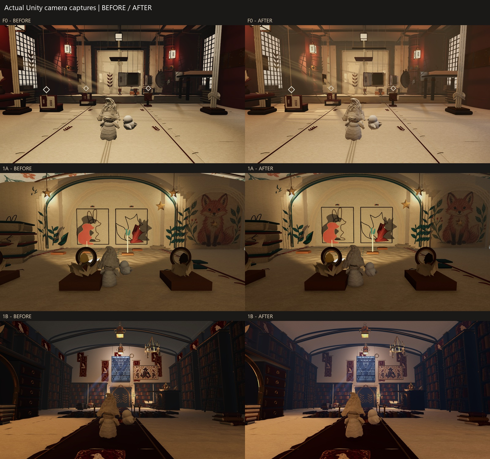

# F0 · 1A · 1B 공간 깊이 개선

2026-10-02 / Unity 6000.3.10f1, URP 17.3. 자료 조사와 판단은 [Docs/38](../../38_공간깊이와_자연스러운_조명_연구.md)에 있다. 이 폴더의 방 이미지는 생성형 콘셉트 이미지가 아니라 실제 Unity 카메라 렌더다.

## 무엇을 바꿨나

물체가 같은 정도로 선명해 보이던 원인은 거의 없는 거리 감쇠, 방향과 위치 차이가 약한 주변광, 일부 종이 재질의 고정 밝기가 겹친 것이었다. 안개를 덧씌우는 것에 그치지 않고, 종이 재질이 방의 실제 조명에 반응하도록 수정하고 반사광·공기층·접촉 음영을 함께 조정했다.

- 환경 64광원과 2,483개 정적 메시를 사용해 780개 확산 간접광 프로브를 계산했다. 3회 반사, 간접 샘플 128 × 프로브 배율 2. 벽 라이트맵은 0개이며 APV가 아니다.
- 기존 게임 광량에서 베이크 결과가 지나치게 밝아, 방별 프로브 배율을 보정했다. 캐릭터와 소품에 위치·방향에 따른 반사색이 남는다. 에디터 Scene 뷰의 보정 전 GI와 Play 화면은 다를 수 있다.
- 원근 깊이를 읽는 URP 화면 패스를 추가했다. 방의 부피와 첫 불투명 표면까지의 구간에만 공기를 적용하고, 카메라에서 4.5m까지는 선명하게 남긴다.
- F0은 꿀빛 창과 차가운 보조광, 1A는 그림자 무대에 집중한 확산광, 1B는 남색 원경과 따뜻한 등불로 분리했다.
- `ReadingPaper`의 과도한 최소 밝기를 낮췄다. `CrayonAtlasRepeat`는 실제 조명·그림자·SSAO와 깊이 패스에 참여한다.
- SSAO 강도 0.48 / 반경 0.36 / 직접광 영향 0.10, 카메라 SMAA High를 사용한다. ACES·사용자 밝기의 기존 소유권을 유지했다.

| 방 | 공기 밀도 | 공기 색, 선형 RGB | 환경 산란 광원 | 프로브 배율 |
|---|---:|---|---:|---:|
| F0 | 0.016 | 0.250 / 0.190 / 0.115 | 2 | 0.035 |
| 1A | 0.010 | 0.130 / 0.180 / 0.170 | 0 | 0.045 |
| 1B | 0.013 | 0.062 / 0.086 / 0.125 | 2 | 0.045 |

공기 적분은 낮음 16 / 기본 28 / 높음 40 단계다. 그림자 퍼즐의 세 광원과 운반등은 장식 산란에 포함하지 않았다.

## 실제 화면

전후의 해상도 차이는 시트에서 리사이즈했다. 동일 위치·FOV이며 1A는 이전 촬영 pitch 4°, 현재 5°다. 캐릭터 idle과 새의 위치는 프레임마다 조금 다르므로 픽셀 차이를 성능·화질 점수로 해석하지 않는다.

- [세 방 네 방향](three-room-four-views.jpg)
- [새 조명을 유지한 상태의 공기 OFF/ON](air-comparison.jpg)
- [F0 원본](F0-0.png), [1A 무대 원본](1A-0.png), [1A 입구](1A-entry.png), [1B 원본](1B-0.png)
- [카메라·프로브·품질 검증](review.txt), [베이크 원본 수치](indirect-bake.txt)
- [F0→1A 실제 이동 화면](passage-walk.jpg)

## 기능 회귀 결과

최종 조명 씬에서 아래 검사가 모두 통과했다. [실행 목록](Checks/regressions.json), [빌드 결과](build.txt). 새 셰이더의 FXC 초기화 경고를 정리한 뒤 동일 화면 검사를 다시 실행하고 최종 빌드를 재생성했다.

| 범위 | 확인한 내용 | 증거 |
|---|---|---|
| F0 | 런타임 카메라와 퍼즐, 문 연출의 입력 잠금·복귀 | [F0](Checks/foyer.txt), [문 전환](Checks/foyer-transition.txt) |
| 1A | 실제 마우스/F, 네 오림의 동시 두 축 이동, WASD 유지, 토끼·여우 정답/오답, 광원 선택 | [그림자 공방](Checks/shadow-duet.txt) |
| 1A 품질 | 낮음·기본·높음에서 같은 정답/오답 판정, 실제 투영 이미지 | [품질별 광학 검사](PuzzleQualities/review.txt) |
| 1B | F·클릭 충전/잠금/운반/해제/기록·창문·출구까지, 오답 후 복구 | [기억등](Checks/reading-room.txt) |
| 통로 | F0↔1A 이동·달리기·점프·천장/벽 샘플, 1A↔1B 좌·중·우 양방향 이동 | [첫 통로](Checks/passage-traversal.txt), [두 번째 통로](Checks/reading-entrance.txt) |
| 외부 노출 | 새 공기 효과를 꺼 둔 1B 전후 및 두 번째 통로 12시점에서 노출 배경 픽셀 0 | [방 외피](Checks/rendered-envelope.txt), [통로](Checks/reading-entrance.txt) |
| 스토리·설정·음악 | F/클릭의 중복 방지와 이동 복귀, Shift 설정, 책 읽는 동안 BGM 지속 | [스토리](Checks/opening-story.txt), [설정](Checks/run-settings.txt), [BGM](Checks/reading-music.txt) |

빌드에서 남은 경고는 Unity Cloud 심볼 업로드 인증 없음이다. 초기 전체 컴파일에는 기존 미사용 필드 경고도 있었다. 플레이 시작의 기존 Sprite 사각형/음수 스케일 BoxCollider 메시지는 이전 `release-finish-standalone-delivery.log`에도 동일하게 존재한다. 이번 검사 PASS를 프로젝트 전체 경고가 0이라는 뜻으로 사용하지 않는다.

## 실제 Windows 빌드 성능

최종 빌드 성공: 오류 0, 경고 1(Cloud 심볼 업로드 인증). Win64 Mono, 비개발 빌드, InGame 씬만 포함한 QA 실행 파일이다. 전체 게임 출시에 대한 인증이 아니다.

RTX 4060 Ti 8GB / Ryzen 5 7500F / RAM 32GB / D3D12 / 출력 1920×1080. VSync와 프레임 제한을 끄고 실제 CharacterController와 제작 카메라로 작은 이동·360도 시선 변화를 실행했다. 각 구간은 5초 예열 뒤 기본 품질 60초, 낮음·높음은 각 15초 측정했다. 내부 렌더 배율은 기존 설정대로 낮음 0.75 / 기본 1.0 / 높음 1.15다. 화면 저장은 측정 구간 밖에서 수행했다.

| 방 | 기본 평균 | 기본 p95 | 기본 최대 | 낮음 p95 | 높음 p95 |
|---|---:|---:|---:|---:|---:|
| F0 | 8.08ms | 10.05ms | 10.42ms | 6.63ms | 12.57ms |
| 1A | 5.52ms | 5.93ms | 6.89ms | 5.58ms | 6.70ms |
| 1B | 9.20ms | 12.56ms | 13.89ms | 7.72ms | 15.48ms |

모든 구간의 p95가 60fps 예산 16.67ms 이내였다. 높은 품질 1B의 최대값은 16.90ms로 예산을 한 번도 넘지 않았다는 뜻은 아니다. 측정 구간에 33.33ms 초과 프레임은 없었다. 이전 아트 패스의 기본 p95 8.40 / 5.83 / 9.79ms에 비해 F0·1B에서 비용이 증가했으며, 동일 기기의 다른 시점 실행이라 엄밀하게 통제된 A/B 성능 시험은 아니다.

실행 파일에서 780개 프로브의 보정과 안개 셰이더 지원을 확인했고, 자동 실행 시퀀스는 PASS였다. [원본 성능 수치](Standalone/standalone-report.txt), [실제 측정 설정](Standalone/measurement-config.txt), [긴 프레임 기록](Standalone/slow-frames.txt), [F0 빌드 화면](Standalone/F0-standalone.png), [1A](Standalone/1A-standalone.png), [1B](Standalone/1B-standalone.png).

## 본 프로젝트 반영

검증한 52개 파일을 본 프로젝트에 반영하고 SHA-256으로 다시 비교했다. [명세](asset-manifest.json)에 이전/적용 해시와 백업 경로가 있다. 씬·PC 렌더러·새 간접광 데이터·필요한 코드와 메타만 옮겼으며, 복사본의 빌드용 PlayerSettings는 반영하지 않았다. 본 프로젝트의 `Assets/Scenes/InGame.unity`를 Play하면 적용된 화면을 사용한다.

## 시각 판단과 한계

F0의 먼 문·기둥, 1A의 반대편 골방, 1B의 서가 끝이 가까운 정령보다 낮은 대비로 보인다. 그림자 무대의 실제 토끼·여우 투영은 그대로 읽힌다. 안개를 껐을 때보다 전후 거리 구분이 늘었지만, 이것을 레퍼런스와 같은 완성 외형이라고 판단하지 않는다.

정령 모자의 거친 주름, 새의 단순한 실루엣, 일부 책과 바닥의 반복, 1A의 빈 바닥 면적은 메시·재질·배치 단계의 과제다. 이번 조명 작업으로 이 형태 자체를 고쳤다고 보고하지 않는다. 강한 DOF나 블러로 이 문제를 숨기지도 않았다.

환경 광선의 가림은 정적 건축물을 샘플링한 근사다. 움직이는 물체의 완전한 체적 그림자, 다중 산란, 투명 물체별 깊이는 지원하지 않는다. 물리 그림자 퍼즐은 기존 실시간 시스템을 그대로 사용한다. 현재 방은 축에 정렬되어 있으며, 새로 회전된 방을 만들면 볼륨 좌표 계산부터 확장해야 한다.

## 재현

1. 최신 작업 씬의 복사본을 `Logs/F0ArtValidation`에서 사용한다. 구형 전체 씬 빌더를 실행하지 않는다.
2. 조명과 경계 변경 시 `PaperAtmosphereBuilder.Apply` → `PaperIndirectBake.Run` → `PaperAtmospherePolish.Run` 순서로 다시 만든다. 베이크 후 조명/건축 구조가 달라졌다면 기존 GI와 환경 광선 가림을 그대로 쓰지 않는다.
3. `Tools/verify_atmosphere.ps1`로 세 방과 두 통로 회귀 및 Windows QA 빌드를 실행한다. `PaperAtmosphereReview.Run`은 현재 씬을 재생해 네 방향·효과 OFF/ON·품질·접근성 상태를 촬영한다.
4. 빌드에서 `-releaseArtProbe <출력 경로>`를 주면 격리된 설정으로 실제 이동·카메라 회전과 성능을 측정한다. 일반 실행에는 이 측정 오브젝트가 생기지 않는다.
5. 검증된 의존성·씬만 `Tools/promote_atmosphere.ps1`로 본 프로젝트에 옮긴다. 원본 씬 해시와 소스 일치 여부를 검사하고, 백업과 SHA-256 명세를 남긴다.

자동 기능 검사, 시각 검토, 실제 빌드 성능은 별개다. 초행 플레이어의 재미·추론 난이도는 이번 검사로 측정하지 않았다.
