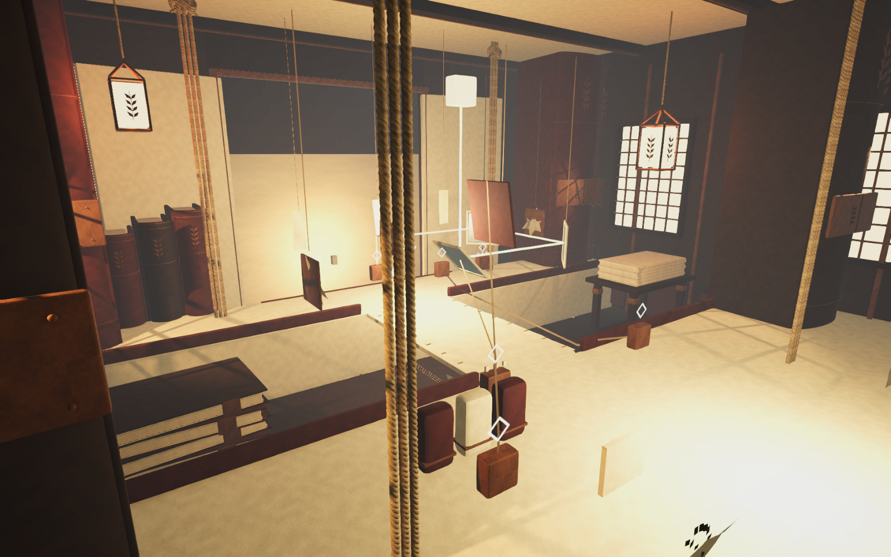

# F0 — 종이로 만드는 빛의 우회로

2026-09-27. InGame의 P1을 빛 차단·반사·우회 경로 퍼즐로 수정했다. 접기는 빛과 이동 경로를 바꾸는 수단이다.

## 핵심 규칙

불투명한 종이는 빛을 막는다. 은박 책장은 보이는 면 방향으로 빛을 반사한다. 빛을 받은 종이꽃은 펼쳐지고, 출구의 잎 문양이 켜지면 가까이서 걸쇠를 눌러 복원을 확정한다. 조작 횟수나 숨은 순서 배열은 정답 판정에 쓰지 않는다.

## 플레이 흐름

1. 입구 왼쪽의 제본 고리로 광원의 종이 덮개를 접는다. 아래 골의 종이꽃이 펼쳐져 빛의 도착을 보여준다.
2. 입구 오른쪽 손잡이로 종이 다리를 내린다. 건널 수 있지만 종이가 빛을 막아 아래 꽃이 닫힌다.
3. 입구 왼쪽 은박 회전 고리를 조작한다. 책장은 세 위치(비켜두기·옆 꽃·우회 반사)를 순환한다. 옆으로 잘못 보낸 빛도 종이꽃을 펼치므로 결과를 관찰할 수 있다.
4. 우회 위치에서 빛은 오른쪽 고정 은박을 거쳐 건너편 은박 책장까지 간다. 다리를 건너 건너편 회전 고리를 조작한다. 처음에는 장식 꽃, 다음에는 되돌아가는 빛, 마지막에는 중앙 출구 잎 문양으로 향한다.
5. 문양에 빛이 닿고 장치가 멈추면 중앙 걸쇠를 누른다. 기존 제본 문이 안쪽으로 열리고 경사면과 오른쪽 통로를 따라 1A로 이동한다.

‘다리를 내려 건넌 뒤 다시 세우기’만으로는 해결되지 않는다. 우회 빛은 다리가 내려진 상태에서도 연결된다. 정해진 행동 순서를 강제하지 않아 반사 경로부터 준비해도 된다. 입구에서 건너편 고리와 걸쇠를 원격 조작할 수는 없다.

## 공간·연출·안전

- 기존 이동 5.5m/s·점프 높이 1.2m와 책장 대지 3m·다리 폭 4.4m·골 폭 8.4m 유지.
- 덮개가 회전하며 빛을 가리고, 은박 책장이 부드럽게 회전한다. 황동 고리와 제본실이 손잡이와 대상의 관계를 드러낸다.
- 은박에는 종이 테두리와 종이 노멀 질감, 낮은 채도의 금속 재질을 적용했다. 각 수광 꽃은 빛에 따라 여섯 꽃잎을 펼치고 조명을 켠다.
- 다리 위에서는 접기 거절, 장치 이동 중 중복 입력 거절, 양쪽 대지 낙하 복귀 유지.
- 완료 시 중앙 걸쇠가 바닥으로 내려가 출구 직선 동선을 비운다.
- 완료 상태는 고정된다. 이후 덮개·반사판·다리를 바꾸어도 문이 다시 잠기지 않는다.
- 기존 음계 책·먼지 쪽지 등 선택적 놀이와 1A는 유지한다.

## 구현과 한계

Physics.RaycastAll로 실제 충돌면까지 광선을 추적하고 은박의 법선으로 Vector3.Reflect를 계산한다. 벽·종이 다리·덮개는 빛을 막는다. 플레이어와 트리거는 광선 차단에서 제외해 정령이 지나가며 퍼즐 상태를 흔들지 않는다. 최대 반사 8회로 서로 마주 보는 면의 무한 루프를 막는다. 도착 판정은 렌더된 그림자 픽셀이 아니라 광선 충돌이다. 빛의 시각화는 LineRenderer이며 볼류메트릭 광학 렌더링은 아니다.

생성: FoldBridgeBuilder.RunBatch 또는 Book Tower/F0 접는 다리 퍼즐 적용. 장치와 메시를 현재 InGame에 저장한다. 기존 씬 백업은 Logs/FoldBridgeBackups에 남긴다.

검증 결과: [F0 플레이 검사](../InteriorRoomsV3/F0-play-verification.txt). 키보드·마우스 조준, 덮개 차단, 오답 꽃 반응, 다리 위 보행, 점유 시 접기 거절, 예전 해법 실패, 실제 반사 연결, 광원 재차단, 완료 후 유지, 문 개방과 1A 방향 통로 보행을 검사한다. 자동 검증은 재미나 초행 이해도를 보증하지 않으므로 첫 플레이 관찰은 별도로 필요하다.

