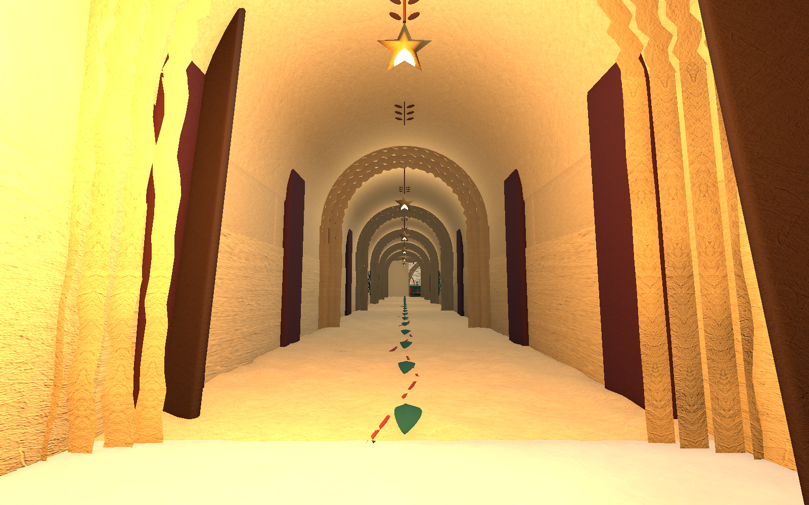

# F0 → 1A 문 연출과 통로 천장 보강

2026-09-28

- F0 퍼즐 성공 즉시 플레이어 수평·수직 속도를 지우고 문 열림 전환에 진입한다. 문이 실제로 완전히 열릴 때까지 이동 컴포넌트를 보관 후 비활성화한다.
- `BindingDoor.IsOpen`이 완전 열림을 알리는 프레임에 기존 `F0.Complete.Memory01` 이야기를 시작한다. 접지/추가 이동을 기다리지 않는다. 이야기가 끝나면 정상 조작으로 복귀한다.
- 통로 좌표 A=(28, 0.1, -208.8), B=(68, 4.1, -192.8). 폭 5.5m, 양끝 각각 6m를 더 덮는 길이 약 55.27m의 연속 아치 덮개와 측벽. 종이 재질, 실제 0.3m 두께, MeshCollider, 작은 잎 문양을 사용한다.
- `Resources/FoyerPassageCeiling.prefab`에 메시·재질·콜라이더를 저장했다. 편집기에서는 로드된 InGame에 추가하고, 저장되지 않은 사용자 변경이 있는 씬은 자동 저장하지 않는다. Play 시작 시에도 누락을 확인하여 한 번만 생성하므로, 기존 열린 씬이 오래된 상태여도 덮개가 적용된다.
- F0와 1A 양쪽 RoomBound에 속해 방 전환 중 천장이 컬링되지 않는다.

검증: 별도 복제 프로젝트의 실제 InGame Play 모드. 이동/점프 입력 중 문 열림 동안 위치 유지, 문 완료 직후 스토리 진입, 대화 후 조작 복귀, 양쪽 방의 천장 가시성, 실제 CharacterController의 통로 전체 통과를 확인했다. 3,441개 천장·측벽 광선 샘플 통과. 로그: `Logs/foyer-ceiling-check.txt`, `Logs/foyer-transition-play-check.txt`.

