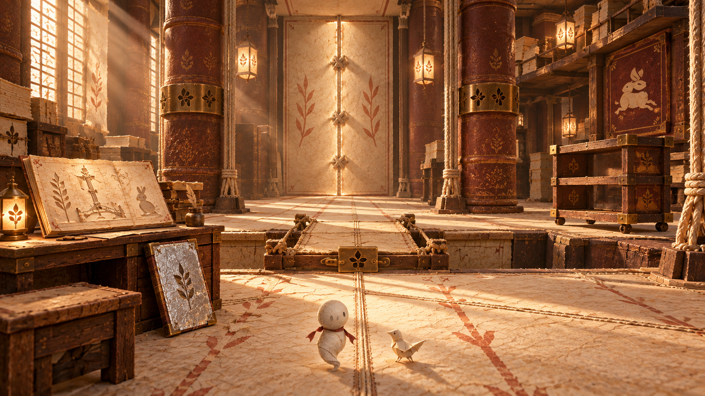
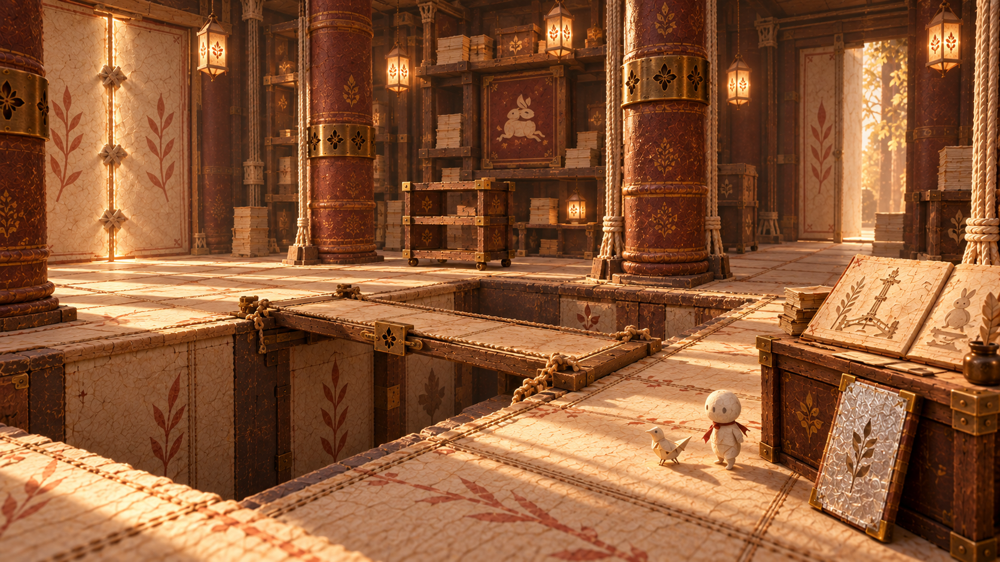
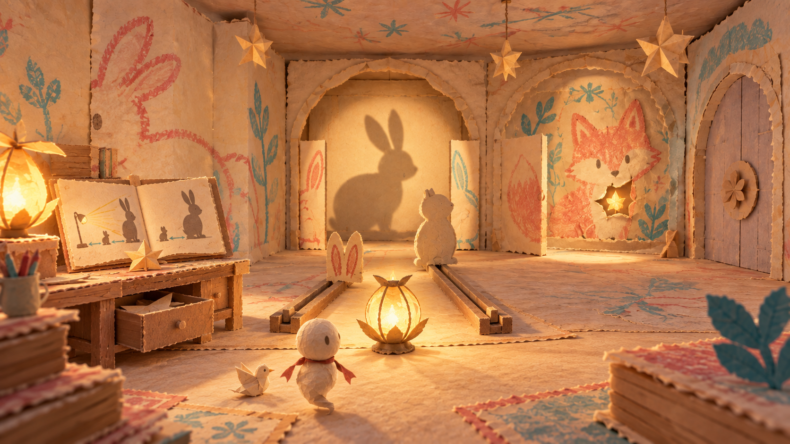
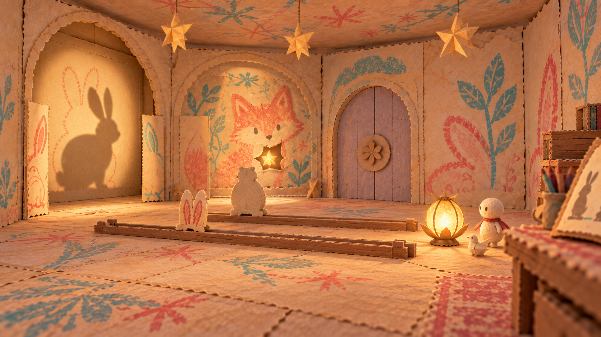
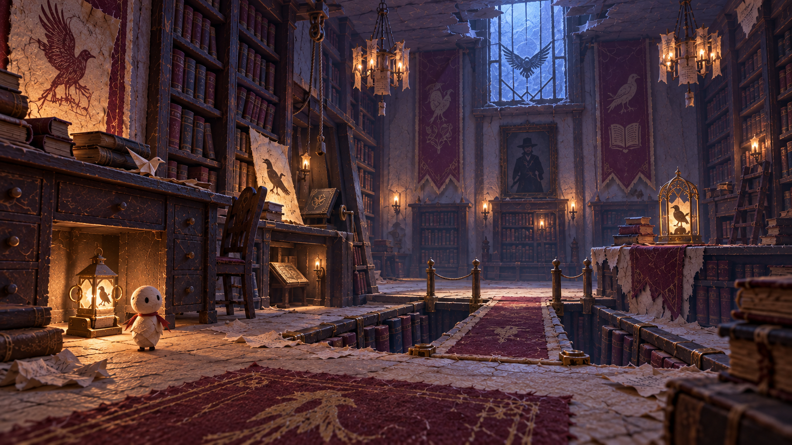
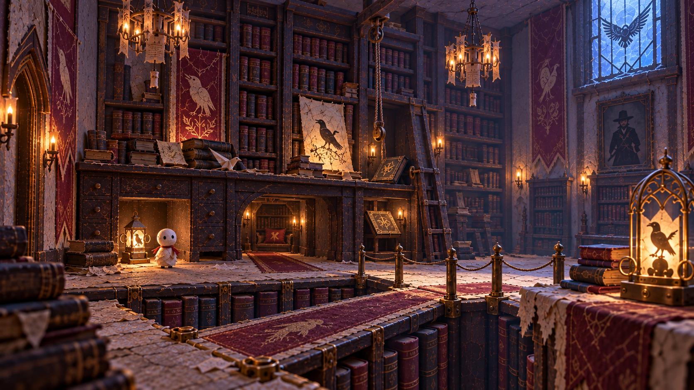
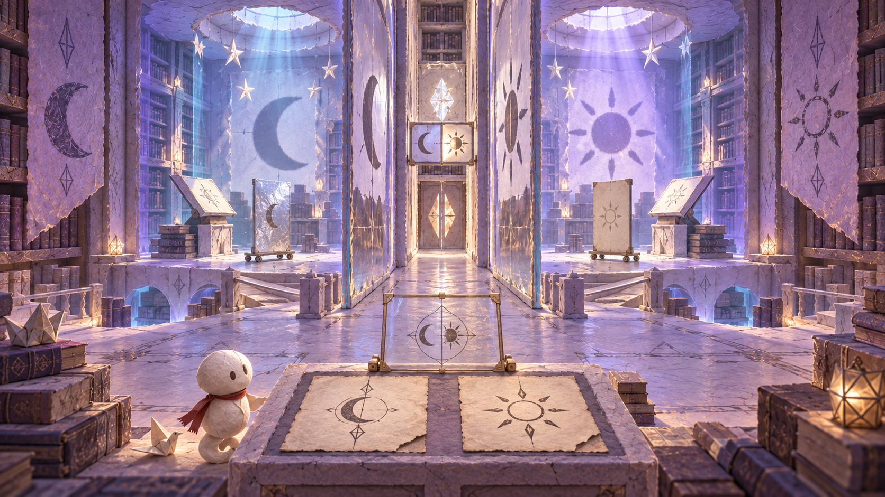
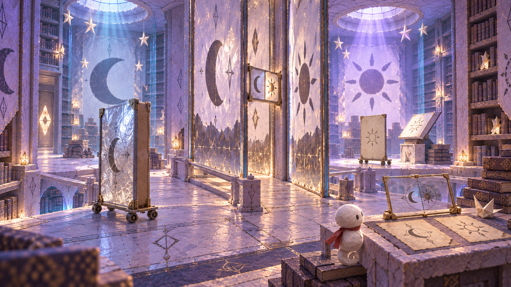

# 첫 네 방 — 퍼즐 배치와 두 가지 이야기 연출

2026-09-27. F0 → 1A → 1B → 1C, 정면·측면 총 8장. 기존 InteriorRoomsV3 레퍼런스에 19번 상세 설계의 기믹을 넣은 **생성형 콘셉트 이미지**다. 유니티 스크린샷이나 정확한 정투상 도면이 아니다. 두 시점 사이 세부 기둥·통로·소품은 완전히 일치하지 않을 수 있다. 모델링 시 아래 배치 관계와 퍼즐 규칙을 우선해 하나의 공간으로 확정한다. 기존 씬은 수정하지 않았다.

생성: built-in image_gen, 각 정면은 기존 방 이미지를 참조, 각 측면은 해당 정면을 다시 참조. [전체 생성 프롬프트](prompts.md). 본편 기준 이야기: [전 방 상세 설계](../../19_전방_스토리와_퍼즐_상세설계.md).

## 읽는 방법

입구를 남쪽, 출구 방향을 북쪽으로 부른다. 정면은 입구에서 출구를 바라보는 실내 원근 시점이다. 측면은 기믹의 깊이와 옆 동선을 읽기 위한 실내 사선 시점이다. 실제 게임의 기본 카메라는 기존 근접 3인칭을 유지한다. 이미지의 넓은 화각은 배치를 설명하기 위한 것이다.

스토리 A/B는 **같은 맵·같은 퍼즐을 쓰는 연출 대안**이며, 이미지가 A/B 각각 8장씩 있는 것이 아니다. A는 동행 대화 중심, B는 행동과 그림 기록 중심이다. 모아를 집으로 데려가는 목표와 결말은 공통이다.

## 1. F0 — 제본 현관

### 정면

### 측면

**배치.** 왼쪽 입구 작업책과 그 아래 운반 가능한 은박 → 중앙 골을 가로지르는 실제 종이 다리 → 건너편 오른쪽 2단 이동 선반 → 뒤쪽 큰 출구. 책등 기둥이 낮은 광로를 가린다. 은박은 한 장이며, 다리 개방 후 회수해 선반에 올리는 것이 핵심이다. 측면은 다리의 걸쇠와 선반 높이를 비교하는 참고다.

**플레이.** 덮개를 열고 은박으로 작업책에 사선 조명을 보낸다. 드러난 압인에서 다리 고정 구조를 읽는다. 은박을 이동해 다리를 열고 잠금쇠를 건 뒤, 회수해서 건넌다. 선반을 옮기고 은박을 높여 기둥을 우회해 출구 문양을 비춘다. 출구 옆 책에는 다음 방의 그림자 크기 단서가 있다.

**그림에서 구현 시 보완할 부분.** 중앙 다리는 열린 중간 상태로 묘사했다. 시작 상태는 닫힘이다. 빛 덮개와 수광기의 정확한 광축은 별도 블록아웃에서 맞춘다. 토끼 단서가 작업책에도 그려졌지만 실제 플레이에서는 출구 책으로 분리해 당장 풀 문제와 다음 방 예고를 구별한다. 측면 그림의 골 깊이를 그대로 채택하지 않고 낙하 복귀가 있는 유한한 지형으로 만든다.

**A — 동행 대화형.** 진입은 정령을 깨운 모아와 약속하는 도입 직후. 책 옆에서 모아가 빛을 따라 고개를 움직인다. 압인을 읽으면 나: “빈 페이지가 아니었네.” 모아: “빛이 닿는 쪽에 숨어 있었어.” 문이 열리면 제본사의 손이 새를 고치는 종이 그림자 6초. 기록: “돌아올 자리는 남겨 둘게.” 모아: “우리 집에서 들었던 목소리야.”

**B — 행동·기록형.** 도입에서 ‘같이 집으로 가자’는 약속은 분명히 말한다. 이후 모아가 지워진 집 그림을 내려다보고 정령에게 펼쳐 보이는 3초 행동. 대사 없이 작업책에 빛을 대면 집·다리 도면이 드러난다. 해결 때 리본이 그림 속 제본실에 반응하고, 책에서 “돌아올 자리는 남겨 둘게.” 한 줄만 읽힌다. 모아가 출구 쪽으로 고개를 돌린 뒤 기다린다.

## 2. 1A — 접힌 회랑

### 정면

### 측면

**배치.** 왼쪽 낮은 작업대·열린 서랍은 단서와 오림 조각의 조사 지점. 중앙 등 앞의 두 레일에서 종이를 앞뒤로 옮긴다. 뒤쪽 아치 벽은 투영 목표. 오른쪽 여우 벽화와 보라색 문은 기억 연출과 출구 역할이다. 레일 주변에는 종이를 들고 돌아다닐 여유 공간을 둔다.

**플레이.** 작업대의 별로 크기 변화를 시험한다. 귀·몸통 오림을 찾아 레일에 꽂는다. 작은 귀는 광원 쪽, 몸통은 스크린 쪽으로 조절하고, 귀의 앞뒤를 뒤집어 방향을 맞춘다. 투영 윤곽이 맞으면 팝업 토끼가 나와 실제 다리와 출구를 작동시킨다.

**그림에서 구현 시 보완할 부분.** 이미지의 토끼 그림자는 합성 예시이며, 현재 그려진 오림 배치로 물리적으로 같은 그림자가 생긴다는 뜻이 아니다. 정면에는 토끼가 이미 완성돼 보이는 표현이 있다. 실제 시작 스크린은 흐린 크레파스 목표 윤곽만 두고, 오림의 그림자는 어긋나 있어야 한다. 귀 조각이 광원에 더 가깝도록 배치하고 레일의 좌우 이동도 허용해야 귀와 몸통의 중심을 맞출 수 있다. 몸통 조각에 큰 귀를 중복해서 만들지 않는다.

**A — 동행 대화형.** 진입 모아: “여기서는 다들 나보다 컸는데.” 나: “그림자가 컸던 걸까?” 해결 7초, 토끼가 모아를 가리키고 벽에 이름을 적던 손이 보인다. 모아: “나… 모아였어.” 나: “이제 부를 수 있겠다. 모아.” 안내용 화자명은 이 장면 이전 ‘종이새’, 이후 ‘모아’로 전환한다.

**B — 행동·기록형.** 모아가 벽의 작은 새 그림 옆에서 같은 자세를 취한다. 어긋난 그림자를 보고 한 번 고개를 갸웃하지만 정답 위치로 날아가지는 않는다. 해결하면 동물 그림책이 펼쳐지고 새 삽화 아래 이름 ‘모아’가 나타난다. 나: “모아?” 종이새가 짧게 울고 정령의 리본에 앉는다. 이때부터 화자명·기록장 이름이 바뀐다.

## 3. 1B — 찢어진 열람실

### 정면

### 측면

**배치.** 왼쪽 큰 책상 밑 충전대에 두 고리가 달린 운반등. 책상 아래 통로로 들어가면 서가 뒤 기록대와 도르래 장치에 접근한다. 높은 북쪽 창에서 실내 광원을 확보한다. 오른쪽 새장 형태는 출구 수광기이며 휴대용 등이 아니다. 중앙 다리와 가장자리 길은 이동 동선이다.

**플레이.** 기억등 충전 → 두 고리 잠그기 → 어두운 기록대까지 운반 → 도킹해 기록 읽기 → 뒤 선반에서 손잡이 회수 → 도르래 수선으로 창 개방 → 재충전 후 출구 수광기 점등. 저장빛을 조사에 먼저 쓸 이유를 제공한다. 책상 아래를 통과하는 것은 웅크리기 신기능 없이 정령 키에 충분한 높이로 만든다.

**그림에서 구현 시 보완할 부분.** 배치 가독성을 위해 기록대·출구 장치에 장식 조명이 보이지만, 실제 시작에서는 단서를 읽을 만큼 밝지 않게 한다. 수광 완료 빛과 주변 촛불은 분리한다. 현재 생성 이미지에는 고정 손잡이가 묘사됐으므로 시작 모델에서는 빠진 소켓과 찾을 손잡이를 분리한다. 파란 창은 구조 위치 참고이며 게임 시작 시 종이 덮개가 닫혀 있어야 한다. 찢어진 천장은 후면 보존지·채광창으로 막는다.

**A — 동행 대화형.** 진입에서 모아가 떨어지는 글자 조각을 날개로 받는다. 모아: “여기는 읽을 빛이 없었나 봐.” 창이 열리면 실내 쪽 잠금쇠가 드러난다. 나: “밖에서 잠근 게 아니야.” 모아: “누가 여기 안에 있었던 걸까?” 기록 음성: “우선 안쪽 문부터 닫는다.”

**B — 행동·기록형.** 모아가 어두운 기록대에 다가갔다가 글씨가 보이지 않아 돌아온다. 등으로 읽으면 문 그림의 잠금쇠가 안쪽에 있는 사실이 확대된다. 창을 열 때 손이 안에서 덮개를 내리던 잔상 4초를 재생한다. 나: “안에서 닫았네.” 질문의 답은 다음 방으로 남긴다.

## 4. 1C — 양면 서고

### 정면

### 측면

**배치.** 입구 중앙 비교대는 양쪽 기록을 가져와 겹쳐 보는 곳. 달 서고와 해 서고에 기록 받침과 이동식 양면 판이 각각 있다. 중앙 공유벽의 관측 구멍으로 광로를 확인한다. 두 서고를 오갈 짧은 연결 통로가 있어 조사마다 입구까지 되돌아가지 않는다.

**플레이.** 찢긴 모서리와 도장을 기준으로 원본·거울본 방향을 대조한다. 원본이 가리키는 목표 창을 결정한다. 은박 면으로 목표 창에 빛을 보내고, 다른 판의 종이 면으로 불필요한 창을 가린다. 두 창 모두 밝히면 기록이 겹쳐 판독할 수 없으며, 정확히 한 창이 밝아야 해결된다.

**그림에서 구현 시 보완할 부분.** 이미지의 달·해 종이는 방의 테마를 보여주는 자리표시자다. 실제 증거는 같은 사건·같은 찢김·좌우 반전된 비대칭 인장이어야 한다. 달과 해처럼 서로 다른 그림을 단순히 짝 맞추는 퍼즐로 바꾸지 않는다. 중앙 판의 문양 표시는 목표 표시 참고이며 실제로 빛이 통과할 관측 구멍을 별도로 만들어야 한다. 두 이미지의 문·가림벽 세부 위치는 모델링에서 한 평면도에 맞춰 통일한다.

**A — 동행 대화형.** 서로 반대로 가리키는 제본사의 그림자 두 개가 4초 재생된다. 나: “같은 장면인데, 방향이 달라.” 모아: “어느 쪽에서 본 걸까?” 해결 뒤 기록: “반대편에서 본 일을 틀린 기억이라 부르지 말 것.” 나: “둘 다 있었던 일이었어.”

**B — 행동·기록형.** 모아가 공유벽 양쪽에서 자신의 모습이 반대로 보이는 것을 따라 해 본다. 플레이어가 비교대에 두 기록을 포개면 찢긴 모서리만 일치하고 도장이 반대로 보인다. 해결 때 두 그림자가 하나의 실제 장면으로 겹친다. 나: “다른 쪽에서 보고 있었구나.” 기록장에 ‘시점이 다른 기록’이 등록된다.

## 추천 조합

첫 약속과 1A의 이름 회복은 A처럼 짧은 대사로 관계를 분명히 한다. 조사 과정은 B처럼 행동·물건·기록이 먼저 말하게 한다. 매 방 입구에서 강제 대화창을 열지 않는다. 긴 글은 직접 책을 조사할 때만, 이동 중에는 한두 줄 자막으로 전달한다. 해결 직후 짧은 장면은 건너뛰어도 필수 기록이 저장된다.

## 이후 모델링에 넘길 체크

이미지의 구조를 한 장의 평면도와 고정 카메라 좌표로 확정 → 플레이어 크기로 통로·책상 높이 검사 → 실제 광선/투영 기하 검증 → 단서 그림 교체 → 그 뒤 장식 밀도와 재질 마감. 생성 이미지만 보고 광학 퍼즐이 성립한다고 판정하지 않는다.
