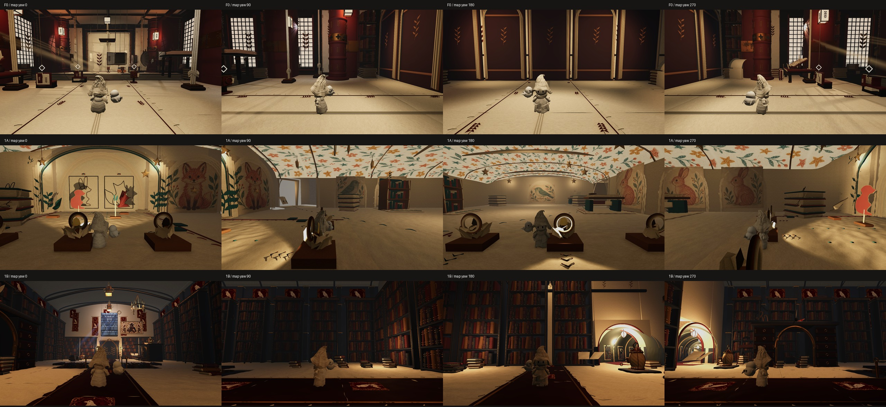

# 완성 아트 1~8 통합 적용·검수 기록

2026-10-02 · 《접힌 빛 — A Fold of Light》 · Unity 6000.3.10f1 / URP 17.3.

현재 모델링된 **F0·1A·1B와 두 연결 통로**를 기준으로 구조, 재질, 조명, 주요 물체, 카메라, 공간 구성, 환경 움직임, 색보정을 적용·검사했다. 1C 이후를 새로 모델링한 작업이나 레퍼런스와 동등한 출시 아트 승인으로 해석하지 않는다. 적용한 변경, 자동 검사, 화면 관찰, 남은 제작 과제를 아래에 구분했다.

## 실제 화면

생성한 콘셉트 그림이 아니라 수정된 Unity 씬을 `PaperCamera`로 렌더한 화면이다. 각 방의 같은 위치에서 맵 기준 0°·90°·180°·270°를 촬영했다. 카메라 좌표·FOV·품질·해상도는 [실행 기록](review.txt)에 있다. 이후 접합부 마감의 최신 재촬영과 검사는 [F0 후면](foyer-contact-checks.txt), [1B 입구](coverage-diagnostic.txt)에 따로 있다.

[3단계와 이번 적용 비교](before-after.jpg) · [흑백 구성 비교](composition-grayscale.jpg) · [F0 원본](F0-0.png) · [1A 원본](1A-0.png) · [1B 원본](1B-0.png)

비교는 기존 3단계 기준 시점과 이번 기준 시점을 사용한다. 움직이는 정령·새·종이의 프레임까지 동일한 픽셀 비교는 아니다. 이미지에 추가 색보정이나 생성형 리터칭을 하지 않았다.

## 1~8번에서 실제로 반영한 내용

| 단계 | 반영 내용 | 근거 |
|---|---|---|
| 1 구조 | 앞 단계의 F0 겹장 바닥·천장·제본 회랑 유지. 세 방과 통로 재검사. 새로 발견한 1B 아치 위 삼각 틈을 닫힌 종이 마감 메시와 충돌체로 봉합 | [F0 구조](../F0/01-Structure/README.md), 아래 입구 검증 |
| 2 재질 | 장지·책 표지·속지 단면·면실·황동·은박 구분을 세 방에 공통 적용. 정령·모아 UV 바깥 검은 여백 보정 유지. 이번 추가 구조도 같은 재료군 사용 | [재질 기록](../02-Materials/README.md), [1B 확장](../03-Lighting/README.md) |
| 3 조명 | 세 방의 주광/환경광/퍼즐광 역할 분리와 실내 반사 유지. F0 뒤 표지의 따뜻한 반사광 보강, 1A 투사기 바닥 과노출 완화 | [3단계](../03-Lighting/README.md), 아래 조명 계약 |
| 4 주요 물체 | 작업책의 실제 접힌 책갈피와 작은 움직임. 완성한 동물 오림을 무대 옆으로 옮겨 다음 그림자의 광로와 시야 확보 | [핵심 물체](../04-HeroObjects/README.md), [두 동물 완료](1A-both-recorded.png) |
| 5 카메라 | 벽에 접근할 때 즉시 당기고, 벗어나면 부드럽게 복귀. 그림자 물체를 잡을 때 자동 회전·흔들림 억제. Q/E 맵 기준 방향과 이동 시 해제 유지 | [카메라](../05-Camera/README.md), 기능 검사 |
| 6 공간 구성 | F0 높이가 다른 후면 제본 표지와 상부 실. 1A 겹장 무대 아치·측면 골방 틀·휘어진 천장 띠. 1B 남색 둥근 천장 리브·서가 아치·후면 부조 | [구성](../06-Composition/README.md), 네 방향 화면 |
| 7 움직임 | 종이 끝의 정지/잔움직임/반응/잔향/일시정지 상태. 방 숨김·접근성 완화 대응. 기존 떠다니는 종이의 루프 순간이동 제거 | [움직임](../07-Motion/README.md), 60초 관찰 |
| 8 최종 화면 | 사용자 밝기 설정이 대비·채도까지 초기화하던 문제 수정. 공통 색보정, 품질별 실제 그림자 비교, 기능 회귀, 독립 실행 빌드 성능 측정 | [성능](performance.md), [검사 결과](Regression/latest-results.json) |

추가 생성물은 `Generated/ReleaseFinish`의 **128개 메시**, 7개 공통 재질, 색보정 프로필이다. 새 정적 장식은 공간별 **30개 병합 그룹**으로 묶었다. 그룹당 재질이 여러 개일 수 있으므로 30 Draw Calls라는 뜻은 아니다. 오림·반사판·문 등 기존 퍼즐 변환은 유지했다. 새 콜라이더는 1B 입구 상부 마감 하나와 F0 후면 표지 다섯 개다. 기존 충돌체는 변경 전후 계약 검사로 보존했다.

F0 후면 제본 표지는 기존 장지의 말린 끝보다 앞으로 0.44u 옮겨 가려짐을 없앴다. 시각 면을 통과하지 않도록 표지마다 얇은 충돌체를 넣었다. 실제 플레이어가 좌·중·우 표지 앞에서 정지하는 결과와 네 방향 재촬영은 [후면 접합 검사](foyer-contact-checks.txt)에 있다.

## 틈을 확인하고 고친 방법

기존 통로 검사만으로 놓친 지점이 있었다. 1B 안쪽에서 입구를 올려다볼 때, 직사각형 벽 상인방 아래와 아치 천장 위 사이가 연결되지 않아 외부가 보였다.

1. 30×17 화면 광선 표본에서 누락 위치를 찾았다.
2. 천장 정면의 여섯 누락은 `continuous folded paper vault`의 뒷면 충돌 검사 생략이었다. 양면 렌더는 정상이며, 이것을 실제 구멍 여섯 개로 잘못 보고하지 않았다.
3. 입구 후면의 한 누락은 실제 틈이었다. 안개·후처리를 끄고 카메라 배경을 자홍색으로 바꿔 외부 노출 **1,083픽셀**을 확인했다.
4. 통로 마지막 아치의 곡률에 맞춘 두께 있는 종이 마감재를 기존 벽 재질로 연결했다. 보행 개구부를 막는 직사각형 판으로 덮지 않았다.
5. 같은 화면의 외부 노출 **0픽셀**, 후면 광선 **510/510**을 확인했다. 실제 CharacterController로 좌·중·우 세 경로를 양방향 이동하고 통로 12시점도 재검사했다.

[수정 전 외부 노출](EntranceBefore/1B-180-envelope.png) · [수정 후](1B-180-envelope.png) · [정상 조명 화면](1B-180.png) · [광선/픽셀 결과](coverage-diagnostic.txt) · [통로 검사](Regression/ReadingEntrance.txt)

이 결과는 기록된 표본과 시점의 확인이다. 모든 위치의 모든 시선을 수학적으로 보장한다고 확대하지 않는다.

## 빛·색·재질의 계약

- `PaperWorldGrade`는 ACES, 대비 5, 채도 -5, 비네트 0.10 / Smoothness 0.65, Bloom 0.13 / Threshold 1.2 / Scatter 0.6을 사용한다. 노출은 덮어쓰지 않는다.
- `PaperSettingsRuntime`은 밝기 설정의 Post Exposure만 조절한다. 밝기 50에서 +0.35, 75에서 +0.85를 실제 Volume Stack으로 검사했다. 기존 `Add<ColorAdjustments>(true)`는 대비·채도까지 기본값으로 덮어써 아트 조정을 무효화했으므로 `false`로 고쳤다.
- 기본 번쩍임 완화가 켜지면 Bloom은 0이다. 사용자 접근성 선택보다 아트 프로필을 우선하지 않는다.
- 1A 투사기는 160→115로 조정하고 광원의 하단을 완만하게 제한하는 쿠키를 적용했다. 토끼·여우의 실제 투영과 오답 구분은 낮음·기본·높음 모두 유지했다. [품질별 증거](ProjectionQualities/)
- 종이의 미세 굴곡과 인쇄를 분리한다. 새로운 마감재의 노멀 강도는 0.25, 무광 표지와 장지는 Smoothness 0.13이다. 기존 재질의 값은 재질 기록이 기준이다.
- 새 GI/Light Probe 베이크는 하지 않았다. 실내 반사는 앞 단계에서 만든 세 개의 정적 HDR Reflection Probe, 조명은 현재 실시간/보조광 체계를 사용한다. 발광 재질이 간접광을 만든다고 가정하지 않는다.

## 기능 검증

검사는 별도 복제 프로젝트에서 실제 씬을 Play 모드로 실행했다. 일부는 실제 키·마우스 이벤트, 일부는 검증된 조작 함수를 호출한다. 사람의 초행 플레이나 재미 평가를 자동 검사로 대체하지 않는다.

| 검사 | 확인 범위 | 최종 결과 |
|---|---|---|
| F0PlayVerifier | 기존 F0 오답·광로·다리·문·걷기·달리기·점프 | PASS |
| FoyerTransitionVerifier | 문 전체 카메라, 이동 잠금, 다음 대화, 조작 복귀 | PASS |
| OpeningStoryVerifier | 새의 실루엣→빛→3초 노출, F/마우스 대사, 이동 대화, 대사 후 상호작용, 핵심 기록 시점 | PASS |
| ShadowDuetVerifier | 네 오림의 받침/기둥/문양 잡기, 마우스 두 축+WASD, 거리 감도, 세 광원, 토끼→여우 | PASS |
| ReleaseFinishReview | 여우→토끼 역순, 완료 오림 치우기, 밝기/색보정, Q/E, 숨긴 방/일시정지/움직임 완화 | PASS |
| ReadingRoomVerifier | 기억등의 두 고리, 잠금/이동/방출, 잘못된 출구 실험, 기록대·손잡이·창·재충전·출구, 1C 방향 기존 통로 | PASS |
| ReadingEntranceVerifier | 1A→1B 세 줄 왕복, 외부 노출 12시점, 양쪽 방에서 가시성 | PASS |
| ReleaseReadingStructureCheck | 1B 바닥·천장·옆벽·상인방 표본, 유효 재질 | PASS |
| ReleaseStructureTraversal | F0→1A 실제 이동, 위를 보는 통로 표본, 왕복 | PASS |
| RunSettingsVerifier | Shift 달리기 재지정·저장·기본값, 설정 하단/팝업 여백 | PASS |
| ReadingMusicVerifier | 책 읽기 중 BGM 지속, 곡 재시작 없음, 음량/ESC 동작 | PASS |
| ReleaseLightingReview.PuzzleQualities | 1A 여우의 실제 정답/오답 투영을 세 품질에서 비교 | PASS |
| ReleaseArtBuild + 독립 실행 Probe | Windows64 비개발 빌드, 세 방 실행·화면·성능 | 별도 원본과 성능표 참조 |

원문은 [Regression](Regression/), 실행별 종료 코드·시간은 [latest-results.json](Regression/latest-results.json)에 있다. 처음 실패한 기록도 `run-records`에 보존했다. 한 이동 검사 중 검사 도중 C# 파일 복사로 에디터가 재로드돼 중단됐고, 복사 없이 새로 실행한 검사는 통과했다. 색보정 검사 첫 시도는 배치 모드에서 아직 평가되지 않은 Volume Stack을 읽어 실패했으며, 카메라 렌더와 명시적 Stack 평가를 사용하도록 고친 뒤 통과했다. 이를 게임 기능 실패나 근거 없이 성공한 검사로 섞지 않았다.

## 화면비·움직임·빌드

월드 렌더는 1600×900, 1600×1000, 2100×900으로 확인했다. 실제 빌드의 UI는 1920×1080·1600×1000에서 확인했다. `UI-2100x900-*`는 요청 이름이며, 운영체제가 창 폭을 제한하여 실제 PNG는 **1920×900**이다. 그 파일을 21:9 UI 검증 완료로 사용하지 않는다.

[ESC 화면](Standalone/UI-1920x1080-pause.png) · [Shift 설정과 하단 여백](Standalone/UI-1920x1080-settings.png) · [16:10 설정](Standalone/UI-1600x1000-settings.png)

[60초 환경 관찰 GIF](Motion/sixty-second-observation.gif)는 실제 카메라에서 1초마다 캡처한 자료다. 움직임의 부드러움을 평가하는 60fps 영상이 아니다. [F0](Standalone/F0-clip.gif)·[1A](Standalone/1A-clip.gif)·[1B](Standalone/1B-clip.gif) 회전 GIF는 독립 실행 빌드 캡처를 약 12fps로 묶은 시각 자료이며 캡처 간 지연을 포함하므로 성능 측정과 분리한다. 원시 프레임은 `Logs/F0ArtValidation`에 보존했다.

빌드는 InGame 씬만 포함하는 내부 QA용 Windows64 Mono 비개발 빌드다. 메인 메뉴·배포 패키지 완성본이라는 뜻은 아니다. [빌드 결과](build.txt), [실제 성능과 한계](performance.md)를 확인한다. 복제본에서 설정한 빌드용 PlayerSettings는 본 프로젝트에 덮어쓰지 않는다.

최종 증분 빌드는 오류 0, 경고 1이다. Unity Cloud 인증이 없어 네이티브 심볼을 업로드하지 않았다는 알림이다. 앞선 전체 C# 컴파일에는 기존 미사용 필드 경고 7개도 있었으며, 마지막 증분 빌드에서 해당 코드가 다시 컴파일되지 않은 것을 경고 수정으로 보고하지 않는다.

## 아직 출시 아트 판정과 구별할 부분

- F0·1A·1B의 분위기와 재료군은 통일했지만, 레퍼런스의 소품 밀도·맞춤 조형·손으로 만든 불규칙함을 모두 재현한 것은 아니다. 1A의 넓은 바닥, 반복 천장 인쇄, 1B의 반복 서가는 다음 개별 소품 제작에서 개선할 부분이다.
- 정령 얼굴은 모자 아래 일부 각도에서 어둡고, 모자·겹옷 실루엣의 각진 면과 모아의 단순한 몸통이 남아 있다. 이번 작업은 해당 모델의 재제작이 아니다.
- 1A의 완료 상태는 오림 이동·기록된 투영·진행 상태로 구분되지만, 여우의 기록선이 토끼보다 어두워 보이는 각도가 있다. 색상만으로 완료를 판정하지 않는다.
- F0의 기존 흰 상호작용 다이아몬드와 1A 정답 윤곽 등 퍼즐 디자인의 단순함은 장식만으로 해결되지 않는다. 난도 재설계는 27·37번의 자원 회수/독립 단서/광원 추론 설계를 구현할 때 처리한다.
- HUD 없이 첫 목표와 원인·결과를 이해하는지, 재미와 난도가 적절한지에 대한 초행 플레이 관찰은 미실시다. 30fps 제한에서의 전체 플레이, 다른 하드웨어, 진짜 21:9 Overlay UI도 이번 증거 범위 밖이다.

이 목록은 발견한 기능 오류를 방치했다는 의미가 아니라, 현재 적용·검증 범위와 다음 제작의 품질 기준을 분리한 것이다. 실제 틈, 입력 충돌, 색보정 덮어쓰기, 완료 오림의 광로 가림은 이번 범위에서 수정했다.

## 적용 파일과 다음 방 제작

검증한 씬·생성 에셋·코드 **304개 파일**을 본 프로젝트에 반영하고 SHA-256 일치를 확인했다. 같은 내용의 파일은 불필요하게 다시 쓰지 않는다. [적용 매니페스트](asset-manifest.json)에 대상 목록, 적용 전후 해시, 검증 원본 해시, 백업 경로가 있다. 최초 백업은 `Logs/ReleaseFinishMainBackup-20261002-020924`, 후면 접합 수정의 최종 반영 전 백업은 `Logs/ReleaseFinishMainBackup-20261002-022259`다. 이번 작업 시작 시 본 씬의 SHA-256은 `AC325294E53EBAE2C67B7F1B3AF28E6E448AAB74C959C947C995E0AF33BB9C7F`였다. 기존 정령·새·통로의 사용자 변경을 초기화하지 않았다.

`ReleaseArtFinishBuilder`는 자신이 만든 루트만 교체하며 반복 실행으로 장식·광량·색이 누적되지 않는다. 오래된 전체 방 생성기를 실행해 현재 퍼즐이나 씬을 덮어쓰지 않는다. `ReleaseArtBuildProbe`는 명시적인 `-releaseArtProbe` 인수가 있을 때만 작동하며 일반 Play에서는 측정 오브젝트 생성이나 설정 파일 쓰기를 하지 않는다.

향후 제작은 [37번 통합 기준](../../../37_앞으로의_방제작_아트와_퍼즐_통합기준.md)을 먼저 따른다. 11개 게임의 공식 자료를 조사한 원리, 본 게임에 적용할 해석, F0부터 마지막 방까지의 형태·추리·서사 보상, 실제 광로와 충돌 검증 순서를 정리했다. 루트 `AGENTS.md`에도 연결했으므로 이후 작업의 기본 지침으로 남는다.
