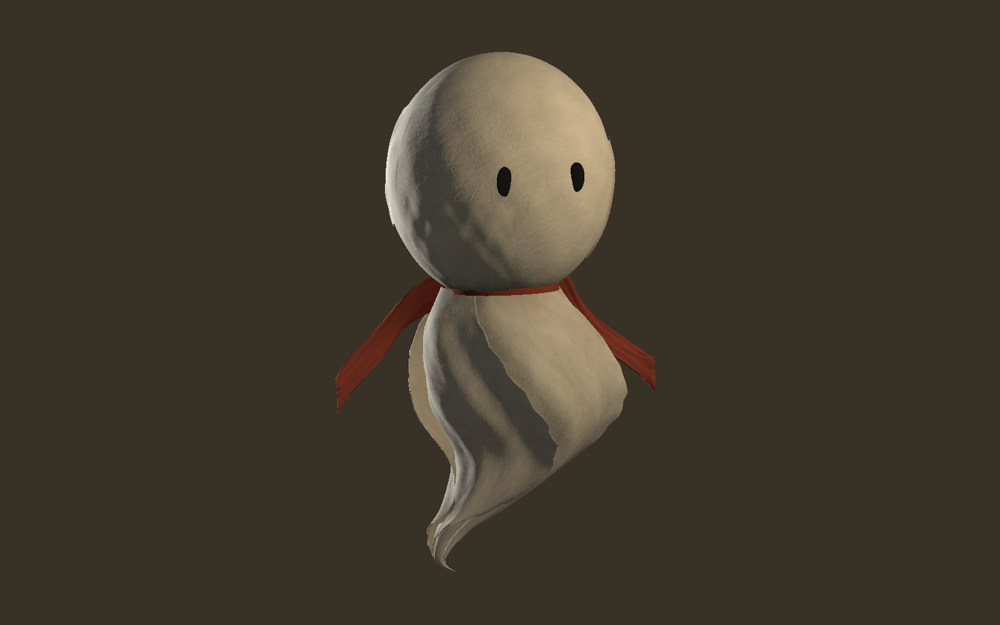
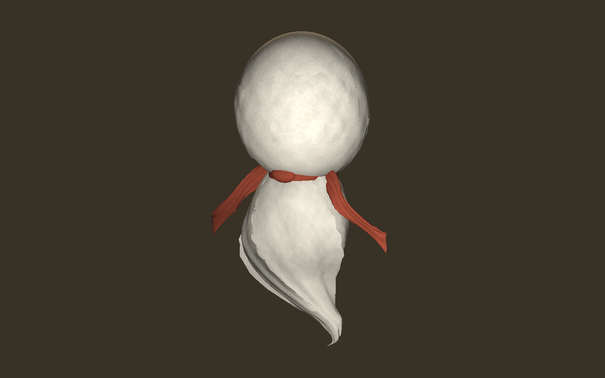

# 정령 — 둥근 몸을 감싸는 종이 겹

2026-09-27. 사용자 참고 이미지의 겹쳐 감싼 장지와 말린 끝을 몸통에 반영했다. 머리·눈·붉은 목도리와 기존 둥근 속몸통은 유지한다.

- 몸통부터 꼬리까지 네 장의 얇은 종이가 나선형으로 겹쳐 감싼다.
- 가장자리의 미세한 뜯김, 대각선 밑단, 들뜬 끝, 실제 두께 2.8mm를 메시로 표현한다.
- 별도 PaperWrap 무광 재질에서 기존 1024px 섬유 노멀의 강도를 높인다. 머리 재질은 유지한다.
- 겉종이는 목 아래를 중심으로 0.65~1.4도만 흔들린다. 기존 Idle 72 / Move 48 / Jump 44 표본과 부드러운 곡선을 유지한다.
- 총 15개 메시, 61,072 삼각형. 현재는 플레이어용 상세 모델이며 별도 LOD는 생성하지 않았다.
- InGame 씬과 PaperSpirit.prefab, 재생성용 JSON·OBJ·MTL을 갱신했다. 씬 백업은 Logs/SpiritBackups에 있다.
- 검증: 세 애니메이션 각 21개 시점에서 유한한 모델 경계 확인. 25/90/145/180도 실제 Unity 렌더를 검사한다. 런타임 이동·퍼즐 코드는 이번 수정 범위에 포함하지 않는다.

