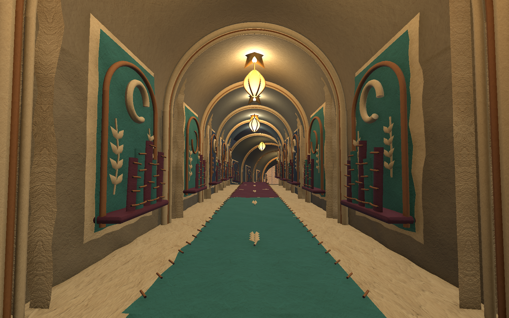
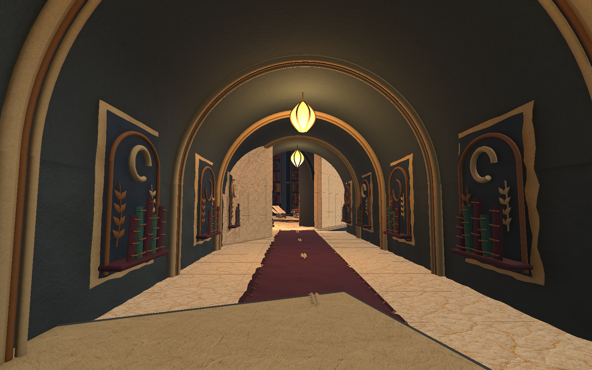

# 1A → 1B, 이야기가 깊어지는 회랑

2026-09-28. 동화방 출구의 경사 통로와 열람실 입구로 꺾이는 연결 구간을 함께 꾸몄다.

- 크림·청록색에서 남색·와인색으로 이어지는 종이 벽과 곡면 천장.
- 세 겹으로 감은 아치, 뜯긴 페이지 테두리, 얕은 벽감, 볼록한 작은 책등과 책받침.
- 접힌 잎, 나선과 초승달 문양, 바느질된 책갈피 길, 꽃봉오리 종이등.
- 원래의 경사로·바닥·외벽 충돌은 유지한다. 열람실 앞 새 통로 안으로 튀어나오던 예전 도착 측벽 두 개만 비활성화한다. 겹친 입구 페이지와 경사로 바닥도 종이 재질로 맞춘다.
- 아트 메시를 재질별로 병합해 23개 렌더러로 구성했다. 추가 장식에는 이동을 막는 충돌체를 만들지 않았다.

프리팹: `Assets/_BookTower/Resources/StorybookReadingPassage.prefab`
제작 코드: `Assets/_BookTower/Editor/StorybookPassageArt.cs`
적용 코드: `Assets/_BookTower/Scripts/Rooms/StorybookReadingPassage.cs`

기존 열린 씬을 통째로 덮어쓰지 않는다. 편집기에 프리팹을 추가하며, 사용자 미저장 변경이 있는 씬은 자동 저장하지 않는다. Play 시작 시 누락된 프리팹은 한 번만 추가한다. 1A·1B 양쪽 방에서 표시된다.

실제 Unity 렌더를 확인해 바닥 겹침, 낮은 천장에 들어가던 벽감 상단, 아치 튜브의 꺾임, 돌출 흰 측벽을 수정했다. 84개 바닥/기존 천장 검사, 실제 InGame의 CharacterController로 경사로→꺾인 통로→열람실 입구 왕복, 두 방의 가시성과 프리팹 중복 방지를 검증했다. 로그는 `Logs/storybook-passage-check.txt`, `Logs/storybook-passage-play-check.txt`.

