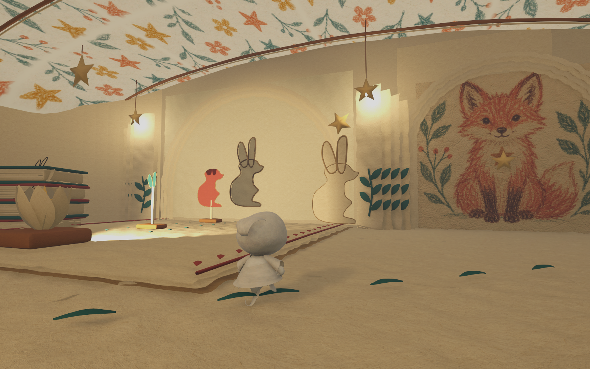
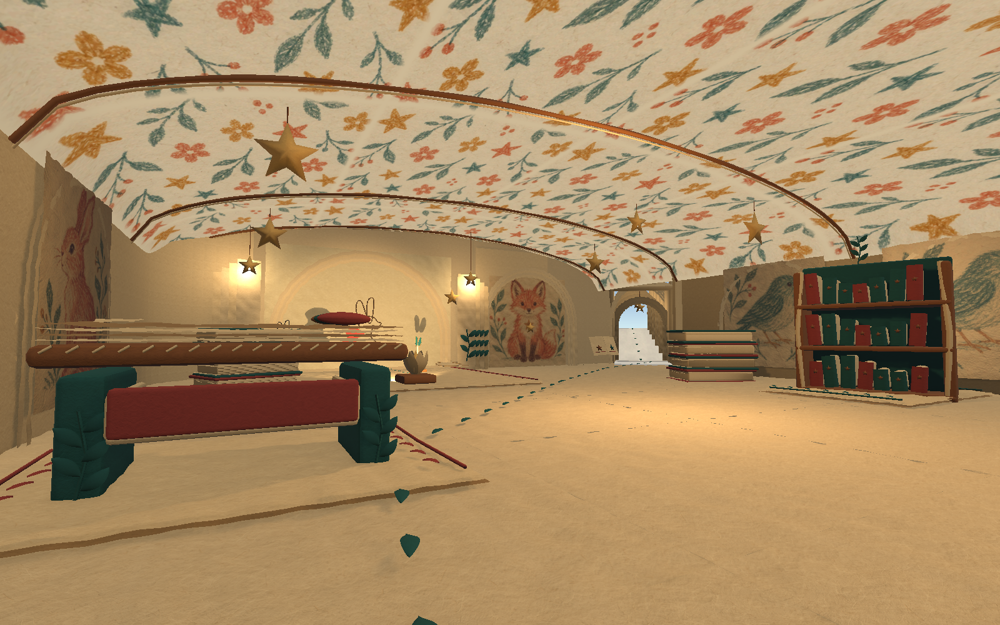
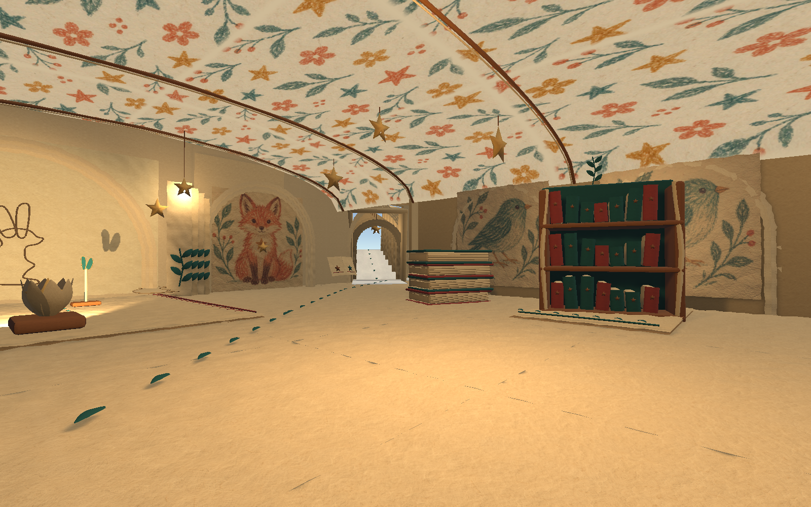
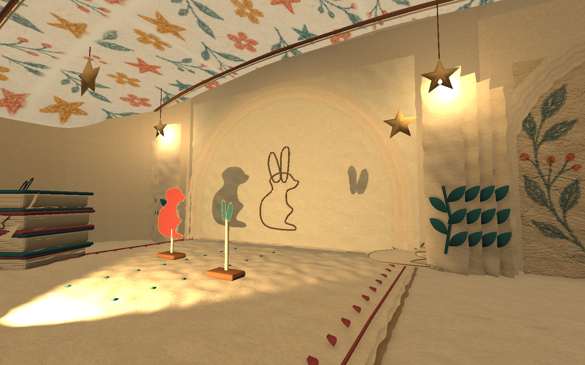
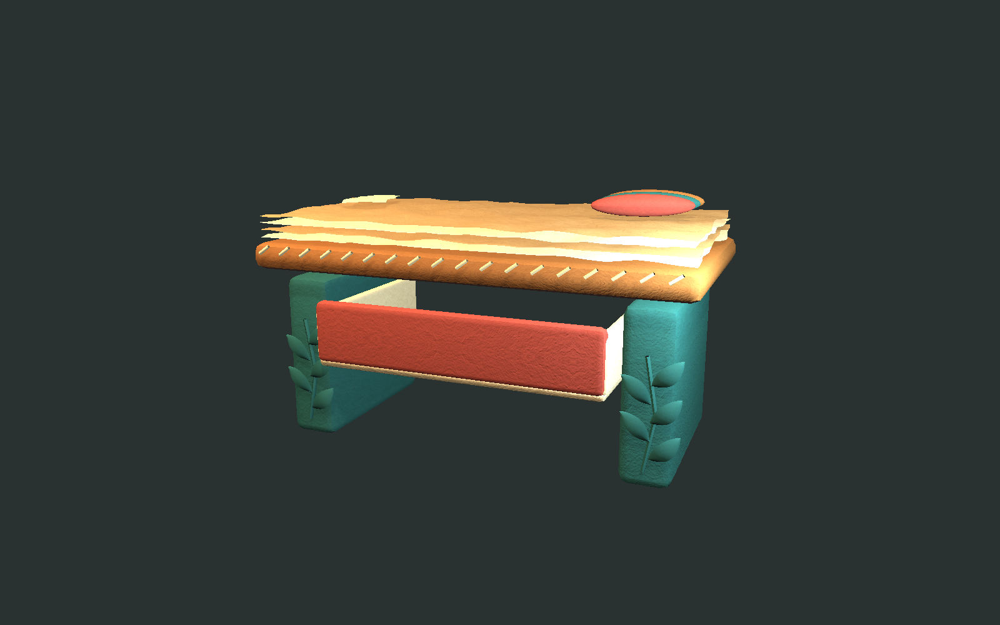
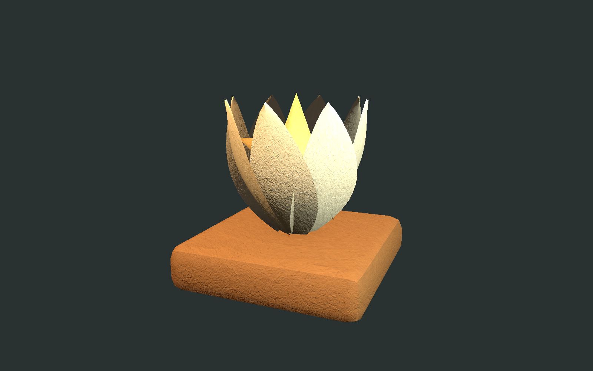

# 1A 그림자 공방 — 실제 Unity 구현

2026-09-28 / Unity 6000.3.10f1 / `Assets/Scenes/InGame.unity`.

1A를 곡면 천장과 둥근 내벽의 그림책 방으로 수정했다. 크레파스 동물 벽화와 별·잎 천장 무늬를 적용하고 오림 직접 드래그·실제 스포트라이트 그림자를 연결했다. F0→1A 및 1A→1B의 밀폐 통로를 유지했다. 마지막 방까지의 새 퍼즐은 [설계 문서](../../24_그림자공방과_전방_난이도설계.md)에 정리했으며, 이후 방은 이번에 새로 구현한 범위가 아니다.

## 게임에서의 모습

실제 Unity 렌더다. 생성형 레퍼런스 이미지가 아니다. 에디터 구도 캡처에는 캐릭터가 없으며, `1A-play-solved.png`는 실제 Play 모드의 3인칭 카메라다.

## 따로 제작한 소품

재질·메시·프리팹: `Assets/_BookTower/Generated/StorybookWorkshop/`.
장지의 섬유·노멀은 F0와 공유하며 아이보리·버터·코럴·청록·면실·단면·먹색을 분리했다. 프리팹은 재사용용 아트 모듈이며 퍼즐 참조 연결은 씬 생성 패스가 설정한다.

## 검증

- [Play 검증](play-check.txt): 실제 좌클릭 잡기/드래그/놓기, F 잡기/놓기, 휠·우클릭 귀 뒤집기, 오답·조명 조건, 기존 P2 해결, 입출구 실제 보행. PASS 개수와 세부 결과는 최신 보고서를 따른다.
- [그림자 ON](real-shadow-on.png) / [OFF](real-shadow-off.png): 동일 카메라에서 실제 메시의 그림자 캐스터만 바꾼 비교. Unity 렌더 픽셀 변화도 검사한다.
- [스토리 회귀 검증](story-check.txt): 오프닝·빛 도착·새 공개·조작 복귀·작업책·1A 입장·공방 해결→M02→모아 이름 컷씬·F/클릭 대사 진행.
- [공방 외피 검사](structure-check.txt): 2,457개 바닥·천장·통로 방향 광선 표본. 모든 활성 1A 메시의 유한 좌표와 출구 단서책 중복도 검사.
- [F0·1A 외피 검사](envelope-check.txt): 바닥·천장 1,299쌍과 벽 2,670개 표본. 의도된 출입구는 제외했다. 표본 검사는 모든 틈에 대한 수학적 증명이 아니다.
- [원본 씬 병합](merge-check.json): 원본과 기준 씬 비교 후 바뀐 객체만 병합, 충돌 0건. 다른 미완료 작업을 통째로 덮어쓰지 않았다.

생성: `StorybookRoomBuilder.ApplyWorkshop`.
공방 검증: `WorkshopVerifier.RunBatch`.
스토리 검증: `OpeningStoryVerifier.RunBatch`.

그림자는 실제 URP 광원이 종이 메시를 비춰 만든다. 성공 판정은 픽셀 판독 대신 동일 좌표계의 D/d 비율·좌우 위치·귀 방향·빛 유지 조건을 사용한다. 플레이어는 시각적인 윤곽으로 맞추며 숫자를 입력하지 않는다. 최종 성능 예산을 위한 전체 게임 프로파일링과 외부 플레이어 난이도 테스트는 별도 단계다.

레퍼런스와의 차이 및 이후 방 제작 기준: [디테일 점검표](../../25_방제작_레퍼런스_디테일점검표.md). [벽화 생성 기록](texture-provenance.md).
