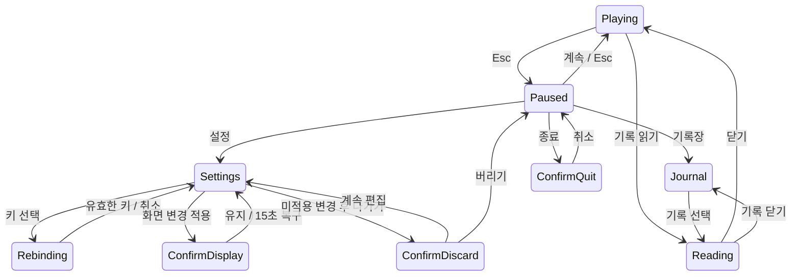
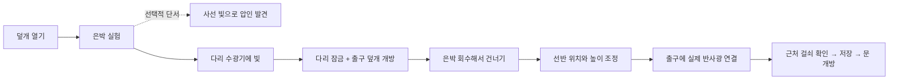

# A Fold of Light · ChatGPT용 통합 작업 맥락

2026-10-02 스냅샷. 가장 앞의 인계 01~03이 최신 상태의 안내다. 뒤의 번호 문서는 역사와 설계를 포함하므로 작성 시점/구현 여부를 구분한다. 이 통합본은 읽기용이며 수정 원본은 각 SOURCE 경로다. 아래 링크의 상대 경로는 저장소 루트 기준으로 재표기했으므로 파일 첨부만 받은 ChatGPT에서는 경로 지도처럼 사용한다.

공개 대화 전문은 별도 Conversation 날짜 파일 7개에 있으며 본문을 새로 요약한 인계와 구별한다. 게임 코드/3D 에셋/음원은 이 텍스트 안에 들어 있지 않다.


---

## SOURCE: START_HERE.md

# 접힌 빛 — A Fold of Light · 노트북 작업 인계

작성 기준: 2026-10-02. 이 저장소는 Unity 게임의 실제 프로젝트다. 최신 제작·검증 범위는 **F0, 1A, 1B와 두 연결 통로**이며 후반 방 전체가 완성된 상태는 아니다.

**[이 대화의 읽기용 공유본 열기](https://chatgpt.com/s/cx_6abeab0a40dc81919f501caf1bbdfcd3)**. 2026-10-02 인계 중 생성한 고정 스냅샷이다. 링크를 가진 사람이 볼 수 있는 공개 공유본이며, ChatGPT 일반 대화 목록의 자동 동기화나 노트북 프로젝트 복제는 아니다. 이후 메시지·파일 변경은 자동 갱신되지 않는다.

## 가장 먼저 읽기

1. [사용자 의도·변경 과정·최종 결정](Docs/Handoff/01_%EA%B2%8C%EC%9E%84%EB%B0%A9%ED%96%A5%EA%B3%BC_%EC%A0%84%EC%B2%B4%EB%B3%80%EA%B2%BD%EC%9D%B4%EB%A0%A5.md)
2. [현재 구현·파일 위치·검증·남은 작업](Docs/Handoff/02_%ED%98%84%EC%9E%AC%EA%B5%AC%ED%98%84%EA%B3%BC_%EA%B2%80%EC%A6%9D_%EA%B8%B0%EC%88%A0%EC%9D%B8%EA%B3%84.md)
3. [노트북 설치·ChatGPT 인계·검증 재현](Docs/Handoff/03_%EB%85%B8%ED%8A%B8%EB%B6%81%EC%97%90%EC%84%9C_%EC%9D%B4%EC%96%B4%ED%95%98%EA%B8%B0.md)
4. [날짜별 대화 전문](Docs/Handoff/04_%EB%8C%80%ED%99%94%EC%9B%90%EB%AC%B8_%EC%9D%B8%EB%8D%B1%EC%8A%A4.md)
5. [전체 Markdown 문서 인덱스](Docs/Handoff/05_%EC%A0%84%EC%B2%B4_MD_%EC%9D%B8%EB%8D%B1%EC%8A%A4.md)

ChatGPT에 파일 하나로 맥락을 전달하려면 [통합 인계 파일](Docs/Handoff/CHATGPT_GAME_CONTEXT.md)을 첨부한다. 기존 Markdown 전체를 옮기려면 [Markdown 묶음](Docs/Handoff/ChatGPT_Documents.zip)을 내려받는다. 원화·음원·Unity 에셋은 이 ZIP의 텍스트 문서에 포함되지 않으므로 게임 제작에는 저장소 전체가 필요하다.

## 새 대화에 붙여 넣을 요청

> 이 저장소는 《접힌 빛 — A Fold of Light》 Unity 6000.3.10f1 / URP 17.3 게임이다. START_HERE.md와 Docs/Handoff/01~03, AGENTS.md를 먼저 읽고, Docs/37·38의 제작 기준을 지켜서 이어서 작업해줘. 실제 최신 씬은 Assets/Scenes/InGame.unity다. F0·1A·1B와 두 통로까지 아트 및 기능 검증이 진행되었으며, Docs/27의 후반 퍼즐과 일부 F0/1A 확장안은 아직 설계다. 오래된 전체 씬 빌더로 현재 씬을 덮어쓰지 말고, 현재 Git 변경을 보존해줘. 파일을 직접 읽고 수정하고, 변경에 맞는 실제 플레이·렌더·빌드 검증을 해줘. 과거 대화보다 현재 코드·최신 검증 기록을 우선하되 사용자 디자인 결정은 유지해줘. 다음 작업 전에 현재 상태와 남은 품질 문제부터 확인해줘.

## 게임 실행

Unity Hub에서 이 저장소 폴더를 **6000.3.10f1**로 연다. 패키지 복원이 끝나면 `Assets/Scenes/InGame.unity`를 열고 Play한다. Library/Logs/Temp는 Git에 없으며 첫 실행 시 다시 만들어진다. Library를 지우거나 씬을 재생성할 필요는 없다.

걷기 WASD, 달리기 Shift, 점프 Space, 상호작용 F/대상별 마우스 클릭, 마우스 시선, Q/E 월드 네 방향, Esc 일시정지. 대화는 F/좌클릭 한 번으로 전체 표시, 다음 입력으로 다음 문장이다.

## 저장과 동기화의 정확한 의미

이 문서와 Git 저장은 현재 로컬 Codex 대화를 ChatGPT 웹 대화 목록으로 자동 옮기는 기능이 아니다. 현재 도구에는 그 대화 기록을 직접 가져오는 기능이 없어 파일 인계를 준비했다. 날짜별 원문에는 공개 메시지만 보존했고, 내부 추론·시스템 설정·로그인 정보는 포함하지 않았다.

지원되는 데스크톱 앱에서는 다른 기기를 연결해 기존 호스트의 작업을 이어가는 방법도 있다. 이는 호스트가 켜져 있어야 하는 원격 연결이며, 노트북에 프로젝트를 독립 복제하는 것과 다르다. [OpenAI 공식 원격 연결 안내](https://learn.chatgpt.com/docs/remote-connections).

**원격 업로드가 완료됐는지는 GitHub의 main 커밋과 마지막 작업 보고로 확인한다. 이 파일이 로컬에 존재한다는 것만으로 push 성공을 의미하지 않는다.**


---

## SOURCE: AGENTS.md

# Book-tower 작업 기준

게임은 《접힌 빛 — A Fold of Light》다. 이후 방과 콘텐츠를 제작할 때 `Docs/37_앞으로의_방제작_아트와_퍼즐_통합기준.md`를 먼저 읽는다. 방별 이야기·해법은 Docs/27, 아트 구현과 검수는 Docs/29~36을 함께 따른다. 현재 구현과 향후 설계안을 구분한다.

- 사용자 요청을 바탕으로 직접 Unity 파일·코드·배치 플레이 검사·렌더를 사용한다. 사용자가 달리 요청하지 않으면 computer use에 의존하지 않는다.
- 현재 모델링된 F0·1A·1B와 두 연결 통로를 공통 회귀 범위로 유지한다. 오래된 전체 씬 빌더로 현대화된 씬과 퍼즐을 덮어쓰지 않는다.
- 방을 직육면체로 제한하지 않는다. 서사·추리·광로에 맞춰 곡면, 골방, 순환 미로, 높이 차, 지름길을 설계하고 통로의 외부 노출·충돌부터 검증한다.
- 조작 대상과 원인·결과는 명확하게, 해법은 단서 결합으로 추론하게 한다. 클릭 수·불편한 조작·정답을 숨긴 어둠으로 난도를 만들지 않는다.
- 공통 종이 재질·밀도·조명·카메라·접근성을 유지한다. 무작정 장식·Bloom을 늘리지 않는다. 실제 플레이 시점으로 확인한다.
- 조명·안개·깊이 표현을 수정할 때 Docs/38을 읽는다. 환경광과 퍼즐광을 분리하고, 깊이/그림자 패스에 참여하지 않는 고정 밝기 재질을 경계한다. 동일 시점 전후, 퍼즐 가독성, 통로, 실제 빌드를 확인한다.
- 기능 PASS, 시각 검토, 빌드 성능, 초행 플레이 테스트를 구분한다. 미검증을 완료로 표시하지 않는다.
- 기존 사용자 변경을 보존하고, 검증한 에셋만 옮긴다. 생성 도구는 반복 실행 시 중복 생성이나 누적 색/광량 변경이 없어야 한다.

상세 제작 카드와 조사 출처는 Docs/37에 있다.


---

## SOURCE: Docs/Handoff/01_게임방향과_전체변경이력.md

# 게임 방향과 전체 변경 이력

2026-10-02 인계. 사용자 요청의 최종 의도를 놓치지 않도록 긴 대화를 분야별로 정리했다. 대사 원문·요청 순서는 [날짜별 대화](Docs/Handoff/04_%EB%8C%80%ED%99%94%EC%9B%90%EB%AC%B8_%EC%9D%B8%EB%8D%B1%EC%8A%A4.md), 실제 적용 상태는 [기술 인계](Docs/Handoff/02_%ED%98%84%EC%9E%AC%EA%B5%AC%ED%98%84%EA%B3%BC_%EA%B2%80%EC%A6%9D_%EA%B8%B0%EC%88%A0%EC%9D%B8%EA%B3%84.md)를 함께 본다. 여기서 ‘요구’는 사용자의 방향이며 전부 구현됐다는 표시가 아니다.

## 1. 게임의 정체성

- 확정 제목: **접힌 빛 — A Fold of Light**. 과거 ‘종이 백룸’, ‘잊힌 제목’은 기획·콘텐츠의 옛 이름이며 같은 프로젝트다. 사용자의 첫 영어 표기 Ligh는 이후 타이틀에서 Light로 정리됐다.
- 장르: 스토리를 따라 단서를 관찰하고 빛·그림자·종이를 실험하는 3D 퍼즐 어드벤처. 단순 탈출 자체보다 모아와의 약속, 잃어버린 기억, 돌아갈 자리가 동기다.
- 세계: 플레이어가 작아진 거대한 책 속 실내. 거대한 책, 장지, 제본 구조, 조명과 가구가 방을 이룬다. 귀엽고 고요하지만 신비롭다.
- ‘백룸 같은 느낌’은 방 안에 들어와 있는 시점·연결된 실내 공간을 뜻한다. 점프 스케어나 전투 중심 호러로 바꾸는 요구가 아니다.
- 캐릭터: 종이 정령과 종이새 모아. 서로를 도우며 이야기를 되살린다. 종이 섬유·불규칙한 접힘·겹친 단면이 공통 재료다.
- 방마다 책 장르·크레파스·색·형태를 구별하되 같은 종이 세계의 물성·조명·스케일을 유지한다.
- 방 형태는 사각 상자에 한정하지 않는다. 큰 곡면, 아치, 골방, 높이 변화, 미로와 지름길을 서사와 퍼즐의 관계에 맞춘다.

## 2. 사용자가 반복해서 지적한 문제

1. 평평한 바닥/벽, 도형을 붙인 듯한 모델, 비어 있는 넓은 면, 딱딱한 연결 통로가 프로토타입처럼 보인다.
2. 레퍼런스의 창문·기둥·거대한 책·밧줄·등불·선반·벽화·천장 무늬를 누락한 채 ‘비슷하게 했다’고 하면 안 된다.
3. 오브젝트가 모두 같은 정도로 또렷하고 밝으면 3D여도 깊이가 없다. 자연스러운 간접광, 거리별 대비, 안개와 접촉 그림자가 필요하다.
4. 답처럼 생긴 장치를 눈앞에서 몇 번 클릭하면 끝나는 퍼즐은 사고할 이유가 없다. 단서 결합과 실험, 도구의 다른 용도, 회수와 우회가 있어야 한다.
5. 조작이 모호한 것은 어려운 퍼즐과 다르다. 왼쪽 버튼을 누를 때 오른쪽 뒤에서 무엇이 움직였는지 모르면 원인과 결과를 배울 수 없다.
6. 벽/천장/문과 방 사이 틈으로 맵 밖이 보이거나 플레이어가 통과하면 몰입이 깨진다. 열린 문이 다음 길을 가려도 안 된다.
7. 상호작용 거리, 드래그 축, 카메라 잠금 같은 불편함으로 난도를 만들지 않는다.
8. 배경 물건이 정지한 채 클릭만 기다리는 방은 지루할 수 있다. 핵심 퍼즐과 무관해도 시험해 볼 만한 작고 귀여운 반응이 필요하다.
9. 스토리 대사가 갑자기 다음 목표를 통보하지 않도록 ‘왜 지금 여기에 있고, 누구를 위해 무엇을 하는가’를 이어 준다.
10. 완료 보고는 실제 씬/에셋 교체와 애니메이션·입력 검증까지 근거가 있어야 한다. 이미지 생성만으로 인게임 제작 완료라고 하지 않는다.

## 3. 정령 디자인의 변경 과정과 유지할 결정

초기에는 둥근 머리, 검은 타원 눈, 붉은 목도리, 종이로 감싼 몸과 휘어진 꼬리가 있는 부유 정령을 사용했다. 이후 세 가지 재디자인 중 사용자가 두 번째 종이 모자 정령을 선택했다. 최신 기준은 모자와 긴 겹옷을 입은 작은 정령이다. 초창기 모자 없는 유령으로 되돌리지 않는다.

| 부분 | 사용자 최종 요구 | 제작 시 주의 |
|---|---|---|
| 전체 | 귀엽고 둥근 인상을 유지하되 손으로 만든 종이 인형처럼 | 기본 도형을 그대로 붙여 봉합선처럼 보이게 하지 않는다 |
| 모자 | 푹 눌러써서 머리 빈 면이 많이 드러나지 않게 | 원형 머리에 작은 종이 조각 하나를 붙인 챙을 피한다 |
| 챙 | 울퉁불퉁하고 자연스럽게 벌어지는 꼬깔의 연장, 약간 뾰족하고 구김이 있음 | 규칙적인 톱니/비늘 반복을 피하고 큰 형태에 연결한다 |
| 끝 | 위로 곧게 솟는 대신 뒤쪽으로 더 휘어짐 | 최신 V6 형태와 리깅의 후행 움직임을 함께 확인한다 |
| 얼굴 | 완전한 원보다 세로가 아주 조금 짧은 둥근 형태 | 과도한 타원·납작한 얼굴로 바꾸지 않는다 |
| 안감 | 얼굴을 둘러싼 종이 안감 여러 겹, 끝이 해짐 | 층 사이 간격을 남기고 선이 턱 밑보다 턱 뒤쪽으로 빠지게 한다 |
| 목 | 종이 목도리, 겹침과 접촉 그림자 | 두꺼운 플라스틱 고리처럼 만들지 않는다 |
| 옷 | 둥근 몸을 감싸는 여러 장의 종이, 거친 섬유와 얇은 그림자 | 사용자가 ‘악어 가죽 같다’고 거부한 균일한 작은 조각 반복을 재도입하지 않는다 |
| 길이 | 발만 보일 만큼 길게 | 달리기·점프 때 발과 자락 관통을 검사한다 |
| 소매/밑단 | 약간 해진 불규칙한 끝 | 멀리서 노이즈가 되지 않도록 큰 실루엣과 미세 섬유를 분리한다 |
| 팔다리 | 옷 안에 실제 팔, 손과 팔 연결, 다리와 발 연결 | 허공에 손/발만 떠 있는 구조를 피한다 |

최신 제작 원본은 `ArtSource/TurnaroundSpiritModelV6`, 실제 Unity 모델은 `Assets/_BookTower/Art/PaperHoodSpirit`다. V1~V6와 턴어라운드는 개선 과정의 증거이며 각 폴더가 모두 런타임 캐릭터인 것은 아니다.

사용자가 요청한 초기 애니메이션 프레임 수(Idle 6, Move 8, Jump 6)는 이후 ‘훨씬 부드럽게, 더 동적으로’라는 요구로 갱신됐다. 현재는 리깅된 연속 클립과 상태 전환이 기준이다. 가만히 있을 때 단순 부유만 하지 않고 몸을 늘이거나 옷/책갈피를 정리하는 행동이 있다. 움직이면 대기 행동을 자연스럽게 중단해야 한다.

## 4. 모아 디자인·동행

- 종이 접기 몇 조각을 붙인 각진 새에서, 둥근 머리와 몸을 가진 귀여운 새로 개선 요청이 이어졌다.
- 날개 끝과 깃털의 종이층, 섬유 재질을 정령과 맞춘다. 단순한 구·삼각형 조립처럼 보이지 않아야 한다.
- Idle, Run, 간헐적 날갯짓뿐 아니라 플레이어 곁에서 귀엽게 날아다니는 동적인 동행을 원한다.
- 새 모델을 만든 것과 씬의 동행 새 참조를 교체한 것은 별개다. 사용자가 ‘아직 예전 새’라고 지적했던 이력이 있으므로 프리팹/Resources 생성 경로를 확인한다.
- 컷씬 새의 날개를 별도 종이 막대처럼 움직이는 표현은 거부했다. 날개가 몸에 자연스럽게 연결된 전체 포즈 이미지가 기준이다.
- 현재 파일군: `Art/MoaSculpt`, `Story/PaperCompanion.cs`, `Story/MoaSculptMotion.cs`. 새를 비활성 방에도 중복 생성하지 않는다.

## 5. 이동·카메라·상호작용의 최종 의도

평소에는 정령이 보이는 가까운 원근 3인칭이다. 마우스로 FPS처럼 화면 중앙을 조준한다. Q/E는 현재 시선에서 임의로 90도 돌리는 기능이 아니라 **월드/맵 기준 네 방향**으로 정렬하는 관찰 기능이다. 이동 입력을 주면 고정 관찰이 풀리고 정령을 따라간다.

걷기는 이전보다 느리게, 달리기는 이전 기본보다 조금 빠르게 요청했다. 현재 코드 기본값은 걷기 3.8u/s, 달리기 5.9u/s이고 Shift가 달리기 키다. 이전 5.5u/s를 여전히 기본 이동으로 가정하지 않는다. 점프 기본 높이는 1.2u, 중력 -18u/s²다. 캐릭터 컨트롤러와 실제 씬의 설정이 최종 기준이다.

1A의 오림은 F로만 가까이 가서 만지는 방식에서, 마우스로 조준해 적절한 거리에서 잡고 끄는 방식으로 바뀌었다. 물체의 문양만 아니라 받침과 기둥 전체를 잡을 수 있어야 한다. 잡고 있는 동안 이동·시선도 가능하며, 앞뒤와 좌우를 분리된 특수 조작만으로 옮기지 않는다. 최신 구현은 마우스 두 축과 정령의 WASD 이동을 함께 사용한다. 위를 바라보기만 해서 그림자 위치가 불안정하게 바뀌는 문제를 막고, 너무 가깝거나 멀면 감도를 낮춘다.

대화 입력과 물체 입력은 서로 충돌하면 안 된다. 마지막 대사를 넘긴 입력이 그 프레임에 물체까지 클릭하거나, 종료 후 F 입력이 영구 차단되면 회귀다.

## 6. 도입 스토리와 UI 연출의 변경 과정

처음에는 3D 모델과 카메라 애니메이션으로 이야기했다. 사용자는 이것을 종이 질감의 2D 컷씬으로 교체하길 원했고, 다시 **정령의 1인칭 어둠에서 깨어나는 연속된 장면**으로 다듬었다.

최종 흐름:

1. Play 시작에는 매우 어두운 화면과 대화창. 새의 실제 몸을 먼저 보여 주지 않는다.
2. 대화창에는 새의 실루엣과 정체를 모르는 화자 표시가 나온다.
3. 새가 빛을 나누면 빛이 정령의 시점, 즉 화면 가까이 접근하고 커진다. 정령의 손으로 물건을 받는 그림을 쓰지 않는다.
4. 빛을 받은 순간 새가 드러나고 화자 초상도 실루엣에서 실제 새로 바뀐다.
5. 새를 알아볼 수 있도록 완전히 드러난 뒤 약 3초 유지한다.
6. 정령이 정신을 차리는 대사부터 인게임 3인칭으로 넘어간다. 남은 대화창과 화자 이미지는 유지하며 플레이어가 이동·점프·시선 조작을 할 수 있다.
7. 기억 보상은 방의 행동과 연결한다. F0에서 돌아올 자리의 약속, 1A에서 모아의 이름, 1B에서 안쪽에서 닫았던 문의 의도를 발견한다.

대화는 F/좌클릭 한 번으로 현재 타이핑을 완성하고, 이미 다 나온 문장에서 다시 누르면 다음 문장으로 넘어간다. 마지막 문장 다음에는 플레이로 복귀한다. 길게 누르기 스킵은 폐기했다. 동일 입력의 눌림/떼기 중복, F+클릭 동시 입력, Esc 복귀 때 누르고 있던 버튼을 처리하지 않게 한다. 빛 전달의 핵심 도착 연출은 일반 대사와 별도 대기를 가진다.

기록장은 모든 대사와 퍼즐 공략을 쌓는 곳이 아니다. **스토리 핵심 사실만** 남긴다. 대화가 아직 끝나지 않았는데 미래 사건을 완료 기록으로 보관하지 않는다. 책을 읽는 동안 게임 조작은 멈춰도 BGM은 계속 재생되어야 한다.

## 7. UI·설정 디자인

- 공통 언어: 낡은 종이 노트, 제본 고리, 종이 버튼 테두리, 적갈색 책갈피, 나뭇잎/책/빛 시그니처.
- 일시정지: ‘잠시 책갈피를 꽂아둘까요’ 단일 책 패널. 옆의 작은 설정 요약 박스는 제외.
- 메뉴 글씨는 중앙 정렬, 충분히 큰 크기, 마우스 오버/선택 시 더 진한 종이색.
- 버튼은 팝업 가장자리와 충분한 여백을 둔다. 설정 하단 기본값/취소/적용도 해당한다.
- 나뭇잎 문양은 네 설정 탭에서 일관된 크기(기존 공통 기준 120×120)를 사용한다.
- 폰트는 두께감과 책의 따뜻함이 있으나 궁서체처럼 보이는 강한 고전 서체는 줄인다. 타이틀도 과도한 서양 장식체 대신 단단한 책 표지 글자와 종이/제본 장식에 어울려야 한다.
- 조작/화면/소리/접근성 네 탭과 키 재지정, 해상도·전체화면·밝기·음량·접근성, 적용·취소·기본값·화면 변경 복구를 FSM으로 관리한다.
- Esc의 ‘관찰 힌트’는 제거 요청됐다. 상단의 방 목표는 계속 보이게 하되 해법을 전부 설명하지 않는다.

## 8. 퍼즐 설계가 바뀐 이유

책을 접고 펴면 바로 문이 열리거나, 눈에 띄는 거울을 차례로 클릭하면 끝나는 방식은 사용자가 여러 번 거부했다. 중심 규칙은 **빛의 전달·보존·차단·투영**으로 정리하고, 각 방에서 같은 규칙의 다른 용도를 발견하게 한다.

Portal, The Talos Principle, The Witness, Outer Wilds, The Room 계열, COCOON, Gorogoa, Obra Dinn, Golden Idol, Viewfinder 등의 조사와 적용 판단은 Docs/27·37에 출처와 함께 있다. 37에는 The Exit 8 관찰 설계도 추가로 참고한다. 원작의 장치 외형·대사·정답을 복제하는 지시가 아니다.

지켜야 할 설계 순서:

1. 이 방에서 모아와 정령이 새로 이해하는 사건/감정을 정한다.
2. 빛·도구·잠금·경로의 상태와 의존성을 적는다.
3. 서로 독립적인 두 단서를 배치한다. 기록 하나에 해법을 전부 적거나 클릭 대상에 답을 표시하지 않는다.
4. 작은 안전 실험에서 규칙을 익힌 뒤 다른 상황에 적용하게 한다.
5. 결과가 관찰되게 하고 잘못된 가설도 무엇이 달랐는지 알려준다.
6. 실수 후 도구를 회수하고 다시 실험할 수 있어야 한다. 막다른 저장 상태를 만들지 않는다.
7. 핵심 해법 외 물건에도 짧은 반응·움직임·소리가 있지만 필수 장치와 혼동하지 않는다.

## 9. 첫 세 방의 아트와 현재 플레이

### F0 · 제본 현관

큰 제본 홀, 상아 장지, 적갈색 책등 기둥, 측면 채광창, 매달린 등불, 밧줄, 두꺼운 선반, 토끼 문양, 큰 책문, 중앙 페이지 다리, 좌측 작업책이 핵심이다. 원화의 큰 비율과 실내 낮은 카메라를 비교한다. 창문·지지 구조·천장·후면도 채운다.

현재 플레이는 종이 덮개, 반사판/은박 광로, 빛으로 반응하는 꽃과 다리, 출구 문양과 걸쇠를 연결한다. 작업책을 읽어야만 성공하는 숨은 플래그는 사용하지 않는다. 다리가 장치 움직임을 가리는 문제, 은박/거울의 작동 음, 화사하지만 과하지 않은 광선, 전체 문이 보이는 카메라와 열림 중 이동 잠금, 다음 이야기로의 전환을 중요하게 다뤘다.

Docs/27의 ‘임시 광로로 다리를 만든 뒤 지지하고 은박을 회수해 다른 회로로 옮김’은 더 어려운 확장 설계이며 현재 모든 단계가 구현된 것은 아니다.

### 1A · 그림자 공방

둥근 내벽, 겹친 아치, 접힌 곡면 천장, 청록/산호 크레파스 토끼·여우·새·식물, 종이별 모빌, 작업대와 수납장이 레퍼런스의 정체성이다. 상자 외피에 평면 벽화만 붙이는 것으로 만족하지 않는다.

실제 스포트라이트와 물체의 실제 그림자로 동물을 만든다. 토끼 몸통/귀와 여우 몸통/꼬리 네 오림, 세 방향 광원, 평면 이동/뒤집기, 안정된 정렬 상태를 사용하는 현재 구현이 있다. 먼저 완성한 동물의 오림은 무대 옆으로 옮겨 다음 그림자를 가리지 않게 했다. 토끼와 여우를 모두 기록해야 완료한다. Docs/27의 ‘정답 윤곽 없이 서로 다른 방향에서 검증’은 추가 설계이며 현재 윤곽을 없앴다고 보고하면 안 된다.

### 1B · 찢어진 열람실

남색 서가, 높은 푸른 창, 따뜻한 기억등, 버건디 긴 배너, 황동, 상아 종이, 큰 아치 책상과 하부 통로가 중심이다. 길쭉한 벽 장식은 정사각 그림을 세로로 늘리는 대신 비율에 맞는 아트를 쓴다.

빛을 충전하고 두 걸쇠를 잠가 운반한다. 곧장 출구에 쓰면 안 되며 기록대 조사→손잡이 발견→도르래 창 복구와 고정→재충전→출구 방출 순으로 선행 조건을 발견한다. 고리 하나만 잠그거나 닫힌 채 방출하는 오답은 시각적으로 구별되고 다시 충전해 회복 가능하다. 책상 아래 경로와 양옆 우회가 실제 통로다.

두 통로 모두 천장과 벽이 닫히고, 단순 박스 연결이 아니라 제본/종이 아치·패턴·등불·장지 단면으로 이어져야 한다. 장식 마감이 보행 개구부를 막지 않아야 한다.

## 10. 후반 방은 어디까지인가

본편 F0부터 3C까지 15실, 선택 HD가 설계되어 있다. 현재 모델링·최신 아트 검증의 중심은 첫 세 방이다. 다음 표는 **앞으로 구현할 설계 요약**이며 실제 완료 표가 아니다.

| 방 | 사고의 핵심 | 서사 목적 |
|---|---|---|
| 1C 양면 서고 | 비출 곳과 가릴 곳, 양면의 방향 차이 | 같은 기록도 관점이 다름 |
| 1D 잉크 발자국 | 흔적과 복사본, 이동 순서 교차 추리 | 쫓은 것이 아니라 구하려 했음 |
| 1E 표지 문양 홀 | 두 도구로 세 상태를 유지하고 회수 | 집으로 알던 장소가 봉인임 |
| 2A 기억 복도 | 전시된 순서와 사건의 인과 구별 | 사고와 수선의 연결 |
| 2B 잔상 제본실 | 도구 회수의 순환 의존성 끊기 | 다음 사람을 위한 작업 |
| 2C 포개진 기록실 | 옛 도면과 현재 공간의 대응, 두 경로 보존 | 복원은 과거 그대로만이 아님 |
| 2D 자동 보존 기록실 | 통제 실험으로 기록의 주장 반박 | 보존 장치의 오류 |
| 2E 압화 수선실 | 겹친 층과 부분 순서, 손상을 지울지 판단 | 상처도 기억의 일부 |
| 2F 어린 책갈피 통로 | 나와 모아가 모두 건너는 경로 | 처음의 약속을 행동으로 지킴 |
| 3A 복원 대서고 | 사건·동기·선택 종합 추론 | 정령의 기원 |
| 3B 빛 회로 종합 | 통로·보존·집을 동시에 유지 | 빛을 반환하는 선택 |
| 3C 마무리 | 함께 온 기억으로 공간 재해석 | 정령도 돌아올 자리를 얻음 |
| HD 선택 공간 | 다른 책에서 도구의 축척/용도 변화 | 다음 독자 |

상세 단서, 상태 그래프, 대사, 실패와 복구, 배치 규칙은 Docs/19·27·37을 읽는다. 초창기 P15 왜상/엔딩 블록아웃과 최신 서사 설계를 동일한 완료 콘텐츠로 취급하지 않는다.

## 11. 소리·음악

사용자는 조용하고 신비하지만 지나치게 느리거나 듣기 불편하지 않은 미드템포를 원한다. 피아노, 글로켄슈필, 하프, 따뜻한 스트링/바이올린 계열, 작은 퍼커션과 반복 아르페지오, 가사 없는 약 1분 루프가 기준이다. 구역 1/2/3, 타이틀, 엔딩 다섯 변주를 제작했다.

V1→CalmV2→PianoViolinV3→FantasyLibraryV4가 제작 이력이다. **파일 존재와 재생 라이브러리 연결은 다르다.** V4 문서는 다섯 음원 제작만 했고 기존 라이브러리 연결은 유지했다고 명시한다. 최신 활성 곡은 실제 RegionMusic.asset의 GUID로 확인한다. 메인 메뉴나 엔딩이 완성됐다고 음원 파일만 보고 추론하지 않는다.

조용한 UI 클릭, 종이 넘김, 거울·은박 이동, 문 열림, 점프 음이 요청됐다. 외부 효과음의 라이선스는 ArtSource/Audio/Kenney의 License.txt를 보존한다. 점프는 자체 합성 원본이다. 책을 읽으면 BGM이 끊기던 문제는 수정·검증됐다. Esc 일시정지의 기존 음향 일시정지 정책과는 구별한다.

## 12. 완성 아트 8단계와 그 이후

사용자는 ‘유니티 프로토타입 느낌’을 없애기 위한 8개 MD와 실제 순차 실행, 세 방 동일 검수, 이후 방의 공통 기준을 요청했다. Docs/29~36에 구조, 재질, 조명, 핵심 장치, 카메라, 공간 밀도, 움직임, 색보정·최종 검수를 분리했다. 이 단계들은 첫 세 방과 두 통로에 적용·검증되었고 Docs/37이 이후 작업 규칙이다.

그 뒤 ‘여전히 너무 선명하고 원근감이 적다’는 요청에 따라 Docs/38의 16개 1차 자료를 검토하고, 실제 간접광 프로브·종이 셰이더 조명 반응·방 내부 깊이 안개·창빛 산란·접촉 음영을 적용했다. 이 작업은 모델 형태 전체를 고친 것이 아니다. 모자의 거친 주름, 새의 단순한 실루엣, 반복 바닥·책, 1A의 넓은 빈 면은 남은 과제로 명시했다.

## 13. 다음 작업자에게 남기는 판단 기준

사용자는 기능 추가 수보다 실제 화면과 플레이 감각을 중요하게 본다. 개선할 때 먼저 현재 씬을 실제 카메라로 보고, 문제를 구조/재질/빛/게임 규칙/전달 방식 중 어디에서 해결할지 정한다. 예쁜 원화를 만드는 일, 원화를 메시로 옮기는 일, 실제 플레이에서 검증하는 일을 구별해서 보고한다. ‘모든 방 완성’, ‘레퍼런스와 완전히 동일’, ‘모든 하드웨어 60fps’ 같은 근거 없는 결론을 피한다.


---

## SOURCE: Docs/Handoff/02_현재구현과_검증_기술인계.md

# 현재 구현과 검증 · 기술 인계

2026-10-02 기준. 이 문서는 현재 파일을 읽고 최신 검증 보고서와 대조한 인계다. 인계 작성 작업 자체는 게임을 다시 제작하거나 모든 Unity 검사를 재실행한 작업이 아니다. 직전 검증의 증거를 보존하며, 새 기기에서는 환경 차이를 다시 확인한다.

## 1. 프로젝트 식별과 문서 우선순위

| 항목 | 값 |
|---|---|
| 게임 | 접힌 빛 — A Fold of Light |
| 저장소 | https://github.com/lde0707/Book-tower.git |
| 작업 브랜치 | main |
| 인계 시작 시 로컬 HEAD | 055194a3c1783b62858b74a9aa67c66f8d8c4683 (`2nd`) |
| Unity | 6000.3.10f1, revision e35f0c77bd8e |
| 렌더링 | Universal Render Pipeline 17.3.0 |
| 입력 | com.unity.inputsystem 1.18.0 |
| 실제 게임 씬 | Assets/Scenes/InGame.unity |
| 직전 검증 플랫폼 | Windows64 / Mono / D3D12 / 비개발 QA 빌드 |
| 최신 개선·회귀 범위 | F0, 1A, 1B, F0↔1A, 1A↔1B |

문서가 충돌하면 **현재 코드와 최신 실제 검증 → Docs/38 조명 → Docs/37 공통 제작 → Docs/29~36 구현·검수 → Docs/27 최신 전 방 설계 → Docs/19 서사 상세 → 이전 문서** 순으로 날짜와 상태를 확인한다. 설계의 우선순위가 높다고 해당 구현이 존재하는 것은 아니다. 예를 들어 08·21에는 과거 시점의 ‘1B 미구현’, 예전 접이면 퍼즐 설명이 남아 있지만 현재 1B는 Docs/28 및 최신 검사로 구현되어 있다. 문맥 없이 오래된 한 문장을 현재 상태로 인용하지 않는다.

## 2. 폴더 지도

| 폴더 | 역할 | 노트북에 필요 여부 |
|---|---|---|
| Assets | 씬, 스크립트, 런타임 프리팹, 모델, 텍스처, 음악, 폰트 | 필수 |
| Packages | manifest와 lock 파일 | 필수, 네트워크로 패키지 복원 |
| ProjectSettings | Unity 프로젝트 설정 | 필수 |
| ArtSource | Blender/GLB/FBX 제작 원본, 음원/라이선스 등 | 모델·음원 재제작 시 필요 |
| Tools | Python/Blender/PowerShell 제작·검증·승격 도구 | 제작·검증 시 필요 |
| Docs | 번호 설계서, ArtReview 실제 렌더·보고서, Blueprint·인계 | 필수 맥락 |
| AGENTS.md | 저장소 작업 지침 | 다음 에이전트가 먼저 읽음 |
| Library, Temp, Logs, UserSettings | 로컬 캐시, 검증 복제 프로젝트, 대형 실행 파일/로그 | Git 제외, 필요 시 생성 |

메타 파일의 GUID가 씬·프리팹·재질 연결을 보존한다. 에셋만 복사하고 `.meta`를 빼거나 새로 만들지 않는다. 최신 InGame 씬은 약 87.6MB의 큰 텍스트 파일이다. 단순 편집/저장만으로 대량 변경되면 줄바꿈과 Unity 재직렬화를 먼저 확인한다.

## 3. 런타임 코드 지도

모든 아래 경로는 `Assets/_BookTower/` 기준이다.

| 책임 | 핵심 파일 |
|---|---|
| 플레이어 이동/점프/달리기 | Scripts/Player/PlayerController.cs, PlayerInputReader.cs |
| 3인칭·마우스·Q/E | Scripts/Camera/PaperCamera.cs |
| 그림자 물건 잡기 | Scripts/Interaction/PaperShadowDrag.cs, PaperShadowHandle.cs |
| F0 광로 | Scripts/Puzzle/F0LightRouting.cs, F0LightSurface.cs, FoldBridgePuzzle.cs |
| F0 다리/광선 표현 | Scripts/Puzzle/F0BookSuspension.cs, F0BeamPresentation.cs |
| F0 문 카메라/입력 잠금 | Scripts/Story/F0DoorReveal.cs |
| 1A 기본 극장·투영 | Scripts/Puzzle/StorybookLightPuzzle.cs, StorybookLightControl.cs |
| 1A 세 빛·토끼·여우 | Scripts/Puzzle/ShadowDuet.cs, Resources/ShadowDuet.prefab |
| 1B 기억등과 순서 | Scripts/Puzzle/ReadingRoomPuzzle.cs, ReadingRoomControl.cs, ReadingLanternPresentation.cs |
| 도입/방 전환 이야기 | Scripts/Story/OpeningStoryData.cs, OpeningStoryDirector.cs |
| 동행 새 | Scripts/Story/PaperCompanion.cs, MoaSculptMotion.cs |
| 정령 클립·상태 | Scripts/Presentation/HoodSpiritAnimator.cs, Art/PaperHoodSpirit/HoodSpirit.controller |
| UI FSM | Scripts/UI/PaperUI.cs 및 PaperUIView.cs / PaperUISkinView.cs |
| 대화·컷씬·깨우기 | Scripts/UI/PaperStoryUI.cs, PaperCutsceneView.cs, ContinuousAwakening.cs |
| 목표·책·기록장 | Scripts/UI/PaperObjectiveGuide.cs, ReadableNote.cs, StoryJournal.cs |
| 설정 저장·적용 | Scripts/UI/PaperSettings.cs, PaperSettingsRuntime.cs |
| 음악 | Scripts/Audio/RegionMusicPlayer.cs, RegionMusicLibrary.cs, Resources/RegionMusic.asset |
| 효과음 | Scripts/Audio/SfxDirector.cs, Resources/Sfx |
| 방별 기존 빛 | Scripts/Presentation/LightingDirector.cs |
| 새 깊이/공기층 | Scripts/Presentation/PaperAtmosphere.cs, PaperAtmosphereDirector.cs |
| 베이크 프로브 보정 | Scripts/Presentation/PaperIrradianceCalibration.cs |
| 환경의 잔움직임 | Scripts/Presentation/PaperRoomMotion.cs, FloatingPage.cs, Scripts/Rooms/StorybookPaperMotion.cs |
| 실제 빌드 측정 | Scripts/Presentation/ReleaseArtBuildProbe.cs |

## 4. 플레이어·정령·새

현재 기본 걷기 3.8u/s, 달리기 5.9u/s, 회전 속도 14, 가속 시간 0.14s, 감속 0.24s, 중력 -18, 점프 높이 1.2, 활공 하강 -1.6, 활공 drift 1.4다. `PlayerController`의 직렬화 필드가 출처이며 씬 override가 있으면 실제 값도 확인한다. 과거 moveSpeed=5.5 기반 계산은 현재와 맞지 않는다.

정령은 `ArtSource/TurnaroundSpiritModelV6/PaperHoodSpirit_Rigged.blend` 원본, `Art/PaperHoodSpirit/PaperHoodSpirit_Rigged.fbx`와 `HoodSpirit.prefab`을 사용한다. V6는 V5의 연결된 팔다리·길어진 옷·얼굴 안감/비율을 유지하면서 모자 상단을 뒤로 굽혔다. 23개 관절과 10개 애니메이션이 있고 Idle/Move/Run/점프 계열 및 TidyBookmark/Stretch 대기 행동을 포함한다. 자세한 클립·해시·실제 렌더는 `Docs/ArtReview/TurnaroundSpiritModelV6/Animation/`에 있다.

모아는 `Art/MoaSculpt/MoaSculpt.prefab`, `MoaSculpt_Rigged.fbx`, `MoaFlight.controller`, 종이 PBR 텍스처군이 실제 에셋이다. 주변 비행·날개 움직임은 동행 코드와 함께 판단한다. 예전 PaperMoaMotion/여러 스피릿 스크립트가 있다는 사실만으로 미사용이라고 삭제하지 않는다. 씬·Resources·프리팹·빌더 참조를 검사해야 한다.

점프 소리는 `Resources/Sfx/spirit_jump.wav`, 0.34초 / 48kHz mono 자체 합성이다. 접지 상태에서 점프가 시작될 때 한 번만 나고 효과음 설정을 따른다. Shift 양쪽 키, 재지정·저장·기본값 복구와 설정 팝업 여백은 별도로 검사했다.

## 5. F0 구현과 확장 설계의 경계

현재 적용: 실제 광선 반사, 덮개와 은박 우회, 접는 페이지 다리, 출구 문양/걸쇠, 작업책 안내, 문 전체를 보여 주는 연출 카메라와 조작 잠금, 문 열린 후 스토리, 1A 연결. 단순 작업책 읽음 플래그를 성공 조건으로 쓰지 않는다. 일부 작은 상호작용과 페이지 움직임은 살아 있고, 핵심 손잡이와 혼동되던 선택 고리는 비활성화된 이력이 있다.

추가 설계: 은박을 직접 운반·재배치하고, 다리를 다른 물건으로 지지한 뒤 도구를 회수하는 자원 문제. Docs/20·27의 모든 행동이 현재 구현됐다고 가정하지 않는다. 현재 조명 변경은 이 규칙을 전면 개편한 작업이 아니다.

아트: `Generated/F0Reference`, `F0ReferenceDetail`, `F0PaperIdentity`, `ReleaseStructure`, `ReleaseMaterials`, `ReleaseLighting`, `ReleaseFinish` 등이 누적된 결과다. 폴더가 오래됐다는 이유로 삭제하면 현대화된 씬의 메시·재질 참조가 끊길 수 있다. 이름보다 GUID 참조를 우선한다.

## 6. 1A의 정확한 현재 조작과 판정

`PaperShadowDrag.GrabDistance=12f`. 화면 중앙 광선으로 받침/기둥/문양의 `PaperShadowHandle`을 찾아 좌클릭으로 잡는다. 방 숨김, UI 조작 차단, 스토리 입력, 비활성 물건이면 잡지 않는다. 클릭을 놓거나 방/포커스가 바뀌면 놓는다. 운반 거리 18을 넘으면 해제한다.

마우스 delta 두 축을 카메라의 수평 right/forward로 변환해 무대 평면에서 이동한다. 정령의 이전/현재 위치 차이도 같은 평면 이동에 더한다. 수직 시선과 평면의 교차점을 직접 쫓는 방식이 아니어서 위를 올려다볼 때 불안정한 도약을 줄인다. 거리 1.2~5.5에서 감도를 키우고 7~15에서 다시 줄이며, 보조키를 누르면 추가 0.3배 정밀 조절이다. 우클릭은 뒤집기다. 예전 ShadowDuet README의 ‘앞뒤는 휠만’ 문장은 과거 버전이다.

네 오림: 토끼 몸통/귀, 여우 몸통/꼬리. 세 실제 투사광 중 하나를 선택한다. 현재 투사광 강도는 115, URP 실제 shadow를 사용하며 검은 동물 복제 메시를 벽에 붙이는 연출이 아니다. 판정은 같은 광원과 무대 좌표의 투영 오차를 사용한다. 토끼/여우 각각 안정 상태를 유지해 기록하고 둘 다 기록해야 완료한다. 여우 잘못된 광원은 위치를 억지로 보정해도 통과하지 않는 검사가 있다.

최신 아트 패스는 이미 기록한 오림을 좌우 무대 날개 쪽으로 옮기고 그림자 캐스팅을 종료해 두 번째 동물을 가리지 않게 했다. 논리 위치와 보이는 위치를 분리하여 완료 순서가 판정을 바꾸지 않게 한다. 토끼→여우와 여우→토끼를 모두 검사했다. 현재 정답 윤곽이 일부 남아 있으므로 추리 난도 개선은 별도 과제다.

## 7. 1B 기억등 상태와 해결 흐름

1. 채광대에서 기억등 충전.
2. 두 보존 고리를 모두 닫아 빛을 보존.
3. 손잡이로 들어 플레이어 옆에서 운반. 시간이 지나며 자동 소모되는 제한은 없다.
4. 기록대에 내려놓고 두 고리를 열어 빛을 방출. 점검판이 올라가고 손잡이가 드러남.
5. 손잡이를 도르래 축에 연결하고 창을 올려 고정.
6. 새 채광 위치에서 다시 충전하고 잠금·운반.
7. 출구 받침에서 두 고리를 열어 방출. 창 고정 등의 선행 조건이 맞으면 P3 출구가 열린다.

출구부터 시험해 빛을 소비해도 다시 충전 가능하다. 고리 하나만 잠긴 상태는 운반 불가, 닫힌 고리로는 방출 불가, 운반 중 열기 불가다. 고리 각도와 충전 띠, 받침의 형상·빛으로 상태를 읽게 한다. `ReadingMemoryLantern.prefab`, `ReadingLanternDock.prefab`이 변경 목록에 포함된다. 높고 좁은 붉은 배너와 책상 하부 우회로, 1A 통로의 아치 접합도 제작·검사했다.

## 8. 스토리·목표·기록 저장

현재 도입은 손 없는 1인칭 빛 전달→새 노출→3인칭 이동 대화다. 새의 실루엣 초상과 실제 초상을 구분하고 충분한 노출 시간을 둔다. `OpeningStoryData`, `OpeningStoryDirector`, `ContinuousAwakening`, `PaperStoryUI`가 역할을 나눠 갖는다. 한 파일의 대사만 바꾸고 연출 대기/입력 소비 계약을 깨지 않는다.

F/좌클릭 전체 표시/다음, 누른 채 입장/일시정지 복귀 방지, 대화 종료 후 물체 상호작용 복귀를 검사했다. Story UI가 떠 있어도 걷는 대화에서는 GameFlow가 Playing일 수 있다. ‘대화창이 있다=항상 플레이어를 정지’로 단순화하면 안 된다.

상단 목표는 진행 상태에 맞게 지속 표시된다. 기록장은 핵심 스토리만 남기며, 새로운 이름/기억이 실제 대화로 밝혀진 뒤 저장한다. JSON 기록장/설정 저장과 **퍼즐 위치까지 이어 하는 게임 저장**은 다르다. 현재 새 Play는 새 퍼즐 세션이며 완전한 이어하기가 구현되었다고 가정하지 않는다.

## 9. UI·설정·음악 실제 상태

PaperUI FSM은 Playing/Reading/Story/Paused/Settings/Journal 등의 상태 전환을 관리한다. 메뉴/설정은 공통 종이 스킨·여백·중앙 정렬과 상태색을 사용한다. 설정 하단 버튼과 키 재지정 팝업의 가장자리 간격, Shift 재지정, 확대 글자/움직임 완화 등을 검사했다.

최신 색보정에서 **밝기는 PaperSettingsRuntime만 소유**한다. ColorAdjustments 전체를 override해서 아트의 대비/채도를 초기화하던 처리를 수정했다. 밝기 50→postExposure +0.35, 75→+0.85를 실제 Volume Stack에서 검사했다. 공통 프로필은 ACES, 대비 5, 채도 -5를 유지한다. 번쩍임 줄이기에서는 Bloom이 꺼지며 접근성보다 아트를 강제하지 않는다.

인계 시 실제 `Resources/RegionMusic.asset`의 세 곡은 GUID 검사 결과 **PianoViolinV3**다:

- Audio/RegionMusic/Region1_PaperLanterns_PianoViolinV3.wav
- Audio/RegionMusic/Region2_FadedMemories_PianoViolinV3.wav
- Audio/RegionMusic/Region3_TitleInTheLight_PianoViolinV3.wav

라이브러리 volume=0.5, fadeSeconds=2.5. **FantasyLibraryV4의 5곡은 제작된 음원 자산이며 이 라이브러리에 자동 교체되지 않았다.** V4는 구역1 96BPM/60s, 구역2 100BPM/57.60s, 구역3 98BPM/58.78s, 메인 92BPM/62.61s, 엔딩 90BPM/64s다. 원본 WAV와 MP3/악보 JSON/파형 검사는 각각 Audio/FantasyLibraryV4, Docs/ArtReview/RegionMusic/FantasyLibraryV4에 있다. 후속으로 연결을 요청받으면 기존 곡을 무단 삭제하지 말고 라이브러리/메인·엔딩 트리거를 명시적으로 바꾼다.

책 읽기에서는 BGM 재생 위치가 진행되고 곡이 재시작되지 않는다. 음량 0과 닫기/재열기, Esc의 기존 음향 일시정지 동작도 검사했다. 모든 소리를 IgnoreListenerPause로 바꾸는 식의 우회는 피한다.

## 10. 완성 아트 1~8의 적용 내용

| 단계 | 실제 작업 | 근거 문서/증거 |
|---|---|---|
| 1 구조 | 바닥·벽·천장·통로의 연결, 1B도 동일 기준 검사 | Docs/29, ReleaseArt/01-Structure |
| 2 재질 | 종이 섬유·인쇄 분리, 표지·단면·면실·금속의 공통 재료군 | Docs/30, Generated/ReleaseMaterials |
| 3 조명 | F0/1A/1B 광원 소유권, 반사, 전경/중경/후경 | Docs/31, ReleaseLighting 기록 |
| 4 주요 장치 | 문·작업책 읽기, 실제 그림자와 완료 오림 정리 | Docs/32, ReleaseArt/04-Hero |
| 5 카메라 | 실제 조작 시점, Q/E 복귀, 벽 근접, 목표 가독성 | Docs/33 및 최종 회귀 |
| 6 공간 구성 | 큰 형태/통로/밀도, 1B 입구 아치 상부의 실제 외부 노출 수정 | Docs/34 및 08-Final |
| 7 환경 움직임 | 종이 끝의 잔움직임·반응·잔향, 숨긴 방/일시정지/접근성 | Docs/35, PaperRoomMotion |
| 8 마감·검수 | 색보정 소유권, 3품질 투영, 실제 QA 빌드 성능 | Docs/36, 08-Final/README.md |

ReleaseFinish의 새 메시 128개, 재질 7개, 정적 장식 병합 30그룹이라는 이전 보고가 있다. 30그룹을 30 draw calls로 해석하지 않는다. 기존 퍼즐 변환과 콜라이더 계약을 유지했다. 1B 아치 상부 틈은 새 곡면 종이 마감으로 닫았고, F0 후면 표지가 시각적으로 가려지던 접합도 조정했다.

## 11. 최신 공간 깊이·자연스러운 조명 패스

사용자 문제는 단순 FOV가 아니라 서로 비슷한 대비/밝기, 거의 없는 공기 감쇠, 일부 셰이더의 고정 밝기가 겹친 현상이었다. 기존 카메라는 이미 원근 60°였다. DOF로 전체를 흐리는 대신 실제 조명 반응과 거리 관계를 수정했다.

### 실제 간접광

`PaperIndirectBake`가 환경광 64개, 정적 메시 2,483개를 사용해 **Light Probe 780개**를 계산했다. Progressive GPU, 간접 128샘플×프로브 2배, 3회 반사. **라이트맵 atlas는 0개이며 APV도 아니다.** 광학 퍼즐의 스위치/운반등을 정적 베이크 빛으로 굳히지 않았다. 현재 베이크 자산은 Assets/Scenes/InGame/LightingData.asset과 ReflectionProbe-0.exr이다.

원래 광량에서 베이크가 과하게 밝아 `PaperIrradianceCalibration`이 런타임 bakedProbes 계수를 F0=0.035, 1A/1B=0.045로 보정하고 작은 기본 성분을 더한다. 활성화 시점에 데이터가 아직 없으면 Start에서도 시도하며 비활성 시 원래 값을 복구한다. Scene 뷰의 원시 GI와 Play 화면이 다를 수 있다. 원본 LightingData를 그만큼 재저장한 것은 아니다.

### 공기와 산란

`PaperAtmosphereDirector`와 `PaperAtmosphere.shader`가 첫 불투명 표면까지의 깊이를 읽고, 방의 AABB 내부 구간만 적분한다. 4.5m 근거리는 명료하게 남기며 이후 완만하게 감쇠한다. 낮음/기본/높음 16/28/40 단계다. 최대 보이는 방 3개·환경 광선 6개를 업로드하고 숨긴 방은 제외한다. 불필요한 전체 화면 안개로 외부 틈을 숨기지 않는다.

| 방 | 밀도 | 공기색 linear RGB | 산란 광원 |
|---|---:|---|---:|
| F0 | 0.016 | 0.250, 0.190, 0.115 | 2 |
| 1A | 0.010 | 0.130, 0.180, 0.170 | 0 |
| 1B | 0.013 | 0.062, 0.086, 0.125 | 2 |

환경 산란의 가림은 정적 건축물을 64×64 RFloat 텍스처로 샘플링한 근사다. 동적 물체의 완전한 체적 그림자, 다중 산란, 투명 표면별 깊이 처리가 아니다. 방 회전이 생기면 현재 축 정렬 볼륨 수학을 확장해야 한다. 1A 퍼즐 투사광을 산란 장식으로 사용하지 않는다.

### 셰이더·후처리

- `ReadingPaper.shader`: 강제 최소 SH 밝기를 (0.16,0.16,0.19)에서 (0.018,0.018,0.02)로 낮춤.
- `CrayonAtlasRepeat.shader`: 실제 SH, 메인/추가광과 그림자, Forward+, SSAO, DepthOnly/ShadowCaster 참여. 양면 문양의 조명 반응을 유지.
- SSAO 강도 0.48, 반경 0.36, 직접광 영향 0.10. 카메라 SMAA High.
- `LightingDirector`: 새 Atmosphere가 환경광을 소유할 때 과거 매 프레임 ambient/fog 덮어쓰기를 중단. 다른 방의 기존 fallback은 남김.
- `PC_Renderer.asset`: 깊이·카메라 색을 사용하는 BeforePost FullScreenPass 추가. 기존 설정의 밝기 소유권 유지.
- 전경을 계속 뿌옇게 하는 DOF/전체 블러, 과한 Bloom, 애니메이션 노이즈 기반 안개는 추가하지 않음.

### 생성·승격 순서

검증 복제 씬에서 `PaperAtmosphereBuilder.Apply` → `PaperIndirectBake.Run` → `PaperAtmospherePolish.Run`. 구조나 빛이 바뀌면 오래된 GI/환경 가림을 그대로 쓰지 않는다. 최종 화면은 `PaperAtmosphereReview.Run`. 기존 전체 씬 재생성 명령을 먼저 실행하면 안 된다.

직전 작업에서 본 프로젝트로 52개 파일을 옮기고 SHA-256 일치를 확인했다. `Docs/ArtReview/Atmosphere/asset-manifest.json`에 목록·이전/최신 해시가 있다. 복제본의 빌드 전용 PlayerSettings는 본 프로젝트에 복사하지 않았다.

인계 시작 시 InGame 원시 파일 SHA-256: `017236A418EF6B54612CAF1CBE8C8CF77551EAC64BF2427ACEC20DE694D2E119`. Git의 LF 정규화나 다른 OS checkout은 원시 파일 해시를 바꿀 수 있다. 이를 내용 변경으로 단정하지 말고 Git blob과 직렬화 내용을 함께 비교한다.

## 12. 실제 검증 증거

최신 모음은 `Docs/ArtReview/Atmosphere/README.md`, 비교 이미지는 `before-after.jpg`, `three-room-four-views.jpg`, `air-comparison.jpg`, `passage-walk.jpg`다. 이 방 이미지는 AI 시안이 아니라 Unity의 실제 렌더다. 이전 단계는 `Docs/ArtReview/ReleaseArt/08-Final/README.md`와 Regression/에 있다.

최신 12개 배치 항목은 모두 exit 0:

| 메서드 | 확인 범위 |
|---|---|
| ReleaseLightingReview.PuzzleQualities | 낮음·기본·높음 실제 토끼/여우 투영과 오답 |
| ReleaseFinishReview.CoverageOnly | 안개를 끈 외부 노출 픽셀·방 외피 |
| ShadowDuetVerifier.Run | 마우스/F, 네 오림, 두 축/WASD, 광원·기록 순서 |
| ReadingRoomVerifier.RunBatch | 기억등 충전/잠금/운반/조사/창/출구, 오답 복구 |
| ReadingEntranceVerifier.Run | 1A↔1B 좌·중·우 왕복, 통로 12시점 |
| F0PlayVerifier.Run | F0 퍼즐·광로·다리·문·이동 |
| FoyerTransitionVerifier.Run | 문 카메라·입력 잠금·스토리 전환·복귀 |
| OpeningStoryVerifier.RunBatch | 실루엣/빛/3초 노출, F/클릭, 이동 대화·상호작용 복귀 |
| RunSettingsVerifier.Run | Shift 재지정·저장·기본값·팝업 여백 |
| ReadingMusicVerifier.Run | 읽기 BGM 지속·음량·Esc/복귀 |
| ReleaseStructureTraversal.Run | F0↔1A 걷기·달리기·점프·천장/벽 표본 |
| PaperAtmosphereBuild.Run | 실제 Windows64 QA 빌드 |

1B 입구 틈은 이전 1,083개 외부 배경 픽셀에서 수정 후 0개, 후면 광선 510/510을 기록했다. 새 공기 효과를 꺼 둔 최신 재검사에서도 해당 시점/통로의 외부 노출 0을 확인했다. 이것은 **검사된 표본과 시점**의 결과이며 맵 모든 점을 수학적으로 증명한 것은 아니다.

## 13. 실제 빌드 성능과 한계

RTX 4060 Ti 8GB, Ryzen 5 7500F, RAM 32GB, D3D12, 출력 1920×1080. VSync/프레임 제한 해제. 각 구간 5초 예열, 기본 품질 60초, 낮음/높음 각 15초. 실제 CharacterController와 제작 카메라의 작은 이동/360도 회전으로 측정했고 화면 저장은 측정 바깥에서 수행했다.

| 방 | 기본 평균 | 기본 p95 | 낮음 p95 | 높음 p95 |
|---|---:|---:|---:|---:|
| F0 | 8.08ms | 10.05ms | 6.63ms | 12.57ms |
| 1A | 5.52ms | 5.93ms | 5.58ms | 6.70ms |
| 1B | 9.20ms | 12.56ms | 7.72ms | 15.48ms |

전 구간 p95는 16.67ms 안이지만 높은 품질 1B 최대 16.90ms가 있어 한 번도 예산을 넘지 않았다고 말하지 않는다. 낮음/기본/높음 내부 렌더 배율은 0.75/1.0/1.15. 새 공기의 비용 때문에 이전 별도 측정보다 F0/1B p95가 증가했으나 통제된 A/B 시험은 아니다. 노트북, 내장 그래픽, 다른 해상도의 결과를 보장하지 않는다.

최종 증분 빌드는 오류 0/경고 1이며 경고는 Unity Cloud 심볼 업로드 인증 없음이다. 기존 미사용 필드 경고, 시작 시 Sprite rectangle/음수 스케일 BoxCollider 메시지는 과거에도 존재했고 이번에 모두 제거한 것이 아니다. InGame 씬만 포함한 내부 QA 빌드라 메인 화면/엔딩까지 출시 패키지가 완성된 것도 아니다.

## 14. 현재 남은 일과 우선순위

1. **모델/재질 형태 개선**: 모자의 거친 규칙적 구김, 새의 단순 실루엣, 반복 바닥·책, 1A의 넓은 빈 면. 조명만으로 해결됐다고 하지 않는다. 현재 승인된 디자인과 실제 근접 카메라를 함께 비교하며 큰 형태부터 다듬는다.
2. **추리 난도 구현**: F0 이동식 은박/받침 회수, 1A 정답 윤곽에 덜 의존하는 다방향 단서 등 Docs/27의 확장안을 현 구현과 연결한다. 새로운 장치 수보다 상태 의존성과 관찰되는 결과를 먼저 만든다.
3. **초행 플레이 테스트**: HUD 없이 첫 목표/대상/성공 이유를 읽는지, 가설이 생기는지, 방마다 반복감이 없는지 실제 사람 관찰이 필요하다. 자동 PASS는 재미 검증이 아니다.
4. **다음 방 제작**: 1C부터 Docs/37의 제작 카드, 단서 2개, 상태/복구표, 광로·충돌, 큰 구조, 미술, 소리·움직임, 회귀 증거 순서를 따른다.
5. **재생 연결/제품 기능**: V4 다섯 음악의 실제 라이브러리/메뉴/엔딩 연결 여부를 요청 범위에 맞춰 결정한다. 퍼즐 전체 저장·이어하기, 완성 타이틀/엔딩, 실제 출시 빌드는 별도 확인이 필요하다.
6. **기기/화면비**: 노트북 성능과 진짜 21:9 Overlay UI, 낮은 프레임에서 조작/전체 플레이. 이전 2100×900 요청 캡처 중 실제 OS 창 제한으로 1920×900인 파일을 21:9 검증으로 쓰면 안 된다.

## 15. 삭제와 재생성 주의

과거 미사용 파일 정리는 `Docs/Maintenance/2026-09-26-cleanup.md`에 있다. 현행 에셋 삭제는 `.meta` GUID, 씬/프리팹 직렬화, Resources.Load 문자열, Editor 빌더, ArtSource 원본 관계를 모두 검사한 뒤 수행한다. 사용자의 이전 ‘미사용 파일 삭제’ 요청은 참조된 모델/이력 원화를 임의 삭제하라는 의미가 아니다.

검증/승격 스크립트는 원본 씬 해시, 의존성, 백업을 검사한다. 새 변경이 있는 상태에서 옛 ExpectedHash를 무시하거나 강제로 덮어쓰지 않는다. 복제 프로젝트에서 작업하고 검증한 에셋만 원본에 옮기는 방식이 현재 안전한 재현 경로다.


---

## SOURCE: Docs/Handoff/03_노트북에서_이어하기.md

# 노트북에서 이어하기

2026-10-02. 이 문서는 노트북에서 이 게임을 처음 열거나 새 ChatGPT/Codex 대화에 넘길 때 사용한다.

대화를 바로 읽으려면 [현재 대화 공유 스냅샷](https://chatgpt.com/s/cx_6abeab0a40dc81919f501caf1bbdfcd3)을 연다. 공개 링크이며 고정된 읽기용 사본이다. 생성 이후 대화는 자동 추가되지 않고, 원본 작업의 Git/Unity 파일을 노트북으로 옮기지도 않는다. 이 링크 생성은 도구의 성공 응답으로 확인했다. 전체 페이지의 모든 첨부 파일을 외부 기기에서 재생하는 별도 검증은 하지 않았다.

## 1. 가능한 방식과 차이

| 방법 | 얻는 것 | 조건/제약 |
|---|---|---|
| Git clone/pull + 노트북 Codex | 게임 전체 파일을 노트북에서 직접 수정·실행 | 저장소 접근, Unity 설치, 로컬 도구 필요 |
| 인계 MD를 ChatGPT에 첨부 | 방향·현재 상태·대화의 맥락을 읽고 기획/검토 | 일반 파일 첨부만으로 노트북 Unity 폴더를 자동 수정하지는 않음 |
| 지원 앱의 원격 연결 | 켜진 기존 PC의 같은 환경에서 대화를 이어가기 | 양쪽 지원 앱, 동일 계정/워크스페이스, 기기 연결, 기존 PC가 온라인 |

현재 작업에서 로컬 Codex 대화를 ChatGPT 웹의 일반 대화 목록에 직접 가져오는 기능은 사용할 수 없었다. ‘서버에 전부 저장했고 노트북 목록에 뜬다’고 보장하지 않는다. 대신 원본 공개 메시지와 상세 인계서, 기존 문서를 파일로 만들었다.

OpenAI 공식 문서는 지원되는 데스크톱 기기에서 Settings → Connections → Control other devices로 호스트를 연결해 같은 작업을 이어갈 수 있다고 설명한다. 이는 원격 연결이고 기존 호스트가 잠들거나 앱이 꺼지면 중단된다. [공식 안내](https://learn.chatgpt.com/docs/remote-connections). 이 프로젝트 인계를 위해 원격 접근 설정을 자동 활성화하지 않았다.

## 2. 파일을 받기

원격 main에 이번 커밋이 있는지 확인한 뒤, 새 폴더에서:

```powershell
git clone https://github.com/lde0707/Book-tower.git
Set-Location Book-tower
git status --short
git log -1 --oneline
```

노트북에 이미 복제한 저장소가 있고 수정 사항이 없다면:

```powershell
git status --short
git pull --ff-only origin main
```

노트북에도 수정 중인 파일이 있으면 먼저 보존하고 차이를 확인한다. `reset --hard`, `clean -fd`, 강제 push로 맞추지 않는다. 저장소 접근 오류라면 접근 가능한 GitHub 계정으로 로그인한다. 비밀번호나 토큰을 ChatGPT 대화/MD에 붙여 넣을 필요는 없다.

이 인계 시작 시 PC의 Git Credential Manager에는 로그인 계정이 없었고, 원격 조회는 인증 실패, 연결 GitHub 앱의 해당 저장소 조회는 404였다. 이것만으로 저장소가 삭제되었다고 단정할 수 없다. 최종 작업 보고에 push 미완료라고 되어 있다면 GitHub에는 아직 새 파일이 없을 수 있다.

Git for Windows의 표준 로그인 예:

```powershell
git credential-manager github login --username lde0707 --device
git fetch origin
git status -sb
git push origin main
```

원격 main이 다른 PC에서 앞서 갔다면 push 거부를 무시하지 말고 fetch 후 양쪽 커밋을 확인한다. 계정 인증만 되면 이미 만들어 둔 로컬 커밋을 푸시할 수 있다.

## 3. Unity 실행 환경

1. Unity Hub에서 **Unity 6000.3.10f1**을 설치한다. Windows QA 빌드까지 하려면 해당 Windows 빌드 지원도 설치한다.
2. 저장소 루트의 Assets/Packages/ProjectSettings가 함께 있는 폴더를 프로젝트로 추가한다.
3. 첫 임포트·패키지 복원을 기다린다. URP는 manifest의 17.3.0, Input System은 1.18.0이다. 처음부터 다른 Unity 버전으로 업그레이드하지 않는다.
4. `Assets/Scenes/InGame.unity`를 열고 Play한다. 오래된 ‘전체 맵 만들기’ 메뉴를 누르는 것은 실행에 필요한 단계가 아니다.
5. 도입 어둠→빛→새→3인칭 이동 대화를 확인한다. 새 세션이므로 퍼즐이 처음 상태인 것은 정상이다.
6. 노트북에서는 우선 낮음/기본 품질로 확인하고 F0/1A/1B의 실제 그림자와 입력을 본다. 데스크톱 성능표를 노트북 성능으로 가정하지 않는다.

Library, Temp, Logs, UserSettings는 올리지 않았다. 기존 PC의 `Logs/F0ArtValidation` 복제 프로젝트, 실행 파일, 대형 원시 캡처도 자동으로 생기지 않는다. 필수 런타임 에셋·베이크 Light Probe 데이터는 Assets 안에 있으므로 정상 clone만으로 기본 Play에 재베이크가 필요한 것은 아니다.

## 4. 새 ChatGPT/Codex에 전달하기

### ChatGPT에 문서를 첨부할 때

먼저 `CHATGPT_GAME_CONTEXT.md`를 첨부하고, 필요하면 `Conversation/YYYY-MM-DD.md`에서 관련 날짜와 실제 이미지도 추가한다. 모든 옛 대화를 처음부터 답의 기준으로 쓰기보다 인계서의 현재 상태와 미완료 항목을 먼저 읽게 한다.

`ChatGPT_Documents.zip`은 저장소의 Markdown 문서를 경로를 유지해 묶은 것이다. 첨부 UI가 ZIP을 읽지 못하거나 파일 크기 제한이 있으면 압축을 풀고 필요한 MD부터 선택한다. ZIP 안의 이미지 링크는 별도의 저장소 이미지 파일을 가리킬 수 있다. 현재 실제 화면은 `Docs/ArtReview/Atmosphere/before-after.jpg`와 방별 PNG를 따로 첨부하면 된다.

### 노트북 로컬 Codex에서 작업할 때

clone한 Book-tower 폴더를 프로젝트로 선택한다. 첫 요청에 다음 내용을 붙인다:

> START_HERE.md, AGENTS.md, Docs/Handoff/01~03을 읽고 이전 작업을 이어줘. 현재 Unity 6000.3.10f1/URP 17.3의 InGame 씬을 기준으로 판단해줘. 최신 적용은 F0·1A·1B와 두 통로이며 Docs/27의 후반 설계는 아직 전부 구현되지 않았어. Docs/37·38의 종이 아트/퍼즐/조명 기준을 지키고 오래된 전체 씬 빌더로 덮어쓰지 마. 현재 변경을 보존하고 computer use 대신 파일·코드·실제 렌더와 배치 검증을 우선해. 다음 작업은 최신 검증 화면과 남은 모델/퍼즐 문제부터 확인해서 진행해줘.

## 5. 제작 도구는 필요한 작업에만 설치

- Unity에서 현재 게임을 실행하는 데 Blender나 Python을 먼저 설치할 필요는 없다.
- 정령 원본 재제작: 기존 기록은 Blender **5.1**, `Tools/refine_spirit_hat_backcurl.py`, `Tools/rig_turnaround_spirit.py`, `ArtSource/TurnaroundSpiritModelV6`를 사용한다.
- 이미지 검증 시트/음원 제작: Python과 필요한 Pillow/numpy/음원 도구를 해당 스크립트 import와 기존 기록에서 확인한다. 이 PC의 `C:/Users/doun0/miniconda3/python.exe` 경로를 노트북에 그대로 가정하지 않는다.
- 일부 PowerShell 도구는 .NET의 `GetRelativePath`를 사용하므로 **PowerShell 7**이 적합하다. Windows PowerShell 5.1과 구분한다.
- 기존 Tools에는 PC의 Unity 설치 경로가 기본값으로 들어 있을 수 있다. 설치 위치가 다르면 스크립트를 읽고 해당 경로만 조정한다. 사용자 홈/인증 경로를 하드코딩해 복제하지 않는다.

## 6. 검증 복제 프로젝트 만들기

게임 수정 후 최신 검증 스크립트는 저장소 안의 `Logs/F0ArtValidation`을 사용한다. 새 노트북에는 이 폴더가 없으므로 먼저 현재 소스를 복사한다. 다음은 새 복제본 생성 예이며 삭제/미러 동기화 명령이 아니다. 기존 복제본을 재사용할 때는 오래된 파일과 차이를 점검한다.

```powershell
$projectRoot = (Get-Location).Path
$validationRoot = Join-Path $projectRoot 'Logs/F0ArtValidation'
New-Item -ItemType Directory -Path $validationRoot -Force
foreach ($part in @('Assets','Packages','ProjectSettings')) {
    $source = Join-Path $projectRoot $part
    $destination = Join-Path $validationRoot $part
    robocopy $source $destination /E /R:1 /W:1 /NFL /NDL /NJH /NJS
    if ($LASTEXITCODE -ge 8) { throw "복사 실패: $part" }
}
```

이 복사는 Library/Temp/Logs/로컬 설정을 가져오지 않는다. Unity는 같은 프로젝트를 동시에 두 에디터에서 열 수 없으므로 원본과 복제본의 경로를 확인한다.

## 7. 검증 실행과 증거

1. 먼저 변경한 시스템에 맞는 검사를 선택한다. 문서만 수정한 작업에 전체 Unity 베이크를 다시 할 필요는 없다.
2. 첫 세 방/조명/공통 UI나 입력에 영향을 주면 `Tools/verify_atmosphere.ps1`의 12개 검사 범위를 참고한다. 마지막에는 QA 빌드까지 포함되어 있다.
3. 화면 검사는 복제본에 `BookTower.EditorTools.PaperAtmosphereReview.Run`을 실행한다. GPU 렌더 검증이므로 `-nographics`를 넣지 않는다.
4. 실행 방법·배치 자동 종료 여부는 각 메서드를 확인한다. 검사 결과의 exit code뿐 아니라 PASS/오류·실제 이미지를 확인한다.
5. Windows QA 빌드에 `-releaseArtProbe <출력 폴더>`를 주면 별도 측정 시퀀스가 실행된다. 정상 플레이에는 이 옵션을 넣지 않는다.
6. 사용자 설정이 보존되는지, 숨긴 방이 공기/광원/움직임을 계속 내보내지 않는지, 그림자 판정과 실제 보이는 그림자가 일치하는지 본다.

직전 검증 결과는 `Docs/ArtReview/Atmosphere/Checks`와 `Standalone`에 보존되어 있다. 원시 Logs 경로가 없다고 해당 보고서의 증거까지 없는 것은 아니다. 다만 현재 노트북에서 새로 검사했다는 뜻도 아니다.

## 8. 변경을 본 프로젝트에 옮길 때

`Tools/promote_atmosphere.ps1`, `promote_release_finish.ps1`은 기존 씬 해시와 검증 파일의 동일성, 백업, 복사 후 해시를 확인하는 당시 승격 도구다. 옛 해시를 가진 채 새 작업에서 그냥 실행하지 않는다. 현재 수정과 비교하고 검증된 의존성부터 옮긴 뒤 씬을 마지막에 반영한다. 복제본의 빌드 전용 ProjectSettings를 본 프로젝트에 덮어쓰지 않는다.

Windows 경로, LF/CRLF, Git 속성에 따라 원시 SHA가 달라질 수 있으므로 Git diff와 에셋 GUID 연결을 함께 확인한다. 추후 Unity 버전을 바꿀 때는 별도 변경으로 수행하고 성능/셰이더/입력 검사를 다시 한다.

## 9. 첫 실행 체크리스트

- 정령은 최신 깊은 종이 모자·안감·목도리·긴 옷과 연결된 손발인가?
- 새는 모아의 최신 모델로 따라오고 날갯짓/비행이 자연스러운가?
- 도입은 새의 몸이 숨겨진 상태에서 시작하고, 빛 도착 후 충분히 새를 보여 주는가?
- 이동 중 대화·화자 이미지, F/마우스 전체 표시·다음, 종료 후 상호작용이 정상인가?
- WASD·Shift·Space·마우스·Q/E, Esc/설정·기록장·여백이 정상인가?
- F0 작업책을 찾을 수 있고 문 연출 후 1A로 가는 길이 드러나는가?
- 두 연결 통로를 왕복하며 위를 봤을 때 외부가 보이지 않고 마감이 입구를 막지 않는가?
- 1A 네 물체의 받침/기둥/문양에서 잡기가 되고, 두 축 이동과 WASD, 두 동물과 세 빛이 작동하는가?
- 1B 기억등의 충전/두 고리/운반/기록/창/출구 순서와 실수 복구가 되는가?
- 책 읽기 중 BGM은 계속 나오며 설정 음량을 따르는가?
- 세 방의 따뜻함/청록·산호/남색 차이와 거리감, 실제 그림자 가독성이 유지되는가?

## 10. 이 인계에 포함하지 않은 것

다른 대화, 내부 추론/시스템 메시지, 계정 토큰/인증 데이터, Unity Library/Temp, 대형 검증 복제본과 실행 파일은 포함하지 않는다. 과거 원화 생성 도구의 화면에만 표시되고 공개 메시지에 파일 경로가 없는 미디어는 대화 전문에서 완전 복원되었다고 보장하지 않는다. 실제 원화/모델/검증 이미지가 저장소에 있으면 Docs/ArtReview와 ArtSource를 사용한다.

사용자 첨부 이미지의 원본 Temp 경로 하나가 없어도 해당 메시지의 내장 이미지가 보존되었을 수 있다. `conversation-manifest.json`과 Attachments를 함께 확인한다. 옛 절대 경로를 노트북에서 재현하려고 같은 사용자 이름/폴더를 만들 필요는 없다.


---

## SOURCE: Docs/00_종이백룸_통합설계.md

# 종이 백룸 — 통합 아트·퍼즐·스토리 설계

> **2026-09-27 설계 갱신:** 시작 연출·대사·전 방 해법·모아와의 약속·결말은 [전 방 스토리와 퍼즐 상세설계](Docs/19_%EC%A0%84%EB%B0%A9_%EC%8A%A4%ED%86%A0%EB%A6%AC%EC%99%80_%ED%8D%BC%EC%A6%90_%EC%83%81%EC%84%B8%EC%84%A4%EA%B3%84.md)를 최신 목표안으로 따른다. 아래의 기존 방별 서사·해법은 이전 안이며, 색·장르·참고 이미지와 구현 기록을 보존한다. 후속 구현에서 F0~1A의 도입·동행·기억 대사를 적용했다. [실제 실행 흐름](Docs/21_F0_1A_%EC%8A%A4%ED%86%A0%EB%A6%AC_%EC%8B%A4%ED%96%89%ED%9D%90%EB%A6%84.md). 전 방의 새 퍼즐은 아직 구현하지 않았다.

갱신: 2026-09-27. 이 문서는 기존 아트·공간 기준을 보존한다. 최신 목표 서사·퍼즐 기준은 상단의 19번 문서다. 아래 방별 내용은 **목표 설계**이며, 전체 구현 완료를 뜻하지 않는다. 실제 적용 범위는 [구현 현황](Docs/08_%EA%B5%AC%ED%98%84%ED%98%84%ED%99%A9.md), 자동 검사 범위는 해당 검증 기록을 따른다.

상호작용 확장 제안: [구역별 상호작용과 동적 요소](Docs/15_%EA%B5%AC%EC%97%AD%EB%B3%84_%EC%83%81%ED%98%B8%EC%9E%91%EC%9A%A9%EA%B3%BC_%EB%8F%99%EC%A0%81%EC%9A%94%EC%86%8C.md). 기존 구현과 구분하는 후속 설계안이다.

F0의 배치·회수 기믹 구현 명세: [한 장의 은박, 남겨 두는 길](Docs/20_F0_%EA%B8%B0%EB%AF%B9_%EA%B5%AC%ED%98%84%EC%84%A4%EA%B3%84.md). 실제 씬 적용 전 설계이며 F0의 세부 광로와 상태 정의를 보완한다.

## 중심 퍼즐 방향

**종이로 빛의 길을 만들고, 잊힌 그림과 문장을 되살린다.** 접기는 목표 자체가 아니라 차단·이동 경로를 바꾸는 수단이다. F0에 차단·반사·우회 규칙을 먼저 적용했다. 이후 1구역의 경로, 2구역의 그림자 모양, 3구역의 동시 연결 확장은 방향 제안이며 나머지 방이 전부 변경된 것은 아니다.

## 작품의 약속

작은 종이 정령이 거대한 책 안의 방들을 탐색한다. 따뜻하고 신비로운 실내, 손으로 접고 수선한 촉감, 읽어서 이해하는 퍼즐이 중심이다. 전투 게임으로 전환하지 않는다. 점프와 먹물 생물 밟기는 이후 방의 짧은 놀이 구간이다.

- 탐색 → 조작 → 결과 확인. 방마다 이동 경로와 추론 방식이 달라야 한다.
- 장식은 장르·기억·조작 단서 중 하나의 역할을 갖는다. 상호작용 오브젝트만 명확하게 반응한다.
- 색은 보조 단서다. 짝 문양, 접힘 자국, 실루엣, 위치로도 구분한다.
- 종이의 찢김은 시각 메시로 표현하고 바닥·문·난간의 충돌은 연속적으로 유지한다.
- 실패는 되돌릴 수 있고 낙하는 안전 지점으로 복귀한다.

## 최신 카메라와 입력

정령이 보이는 근접 3인칭 원근 카메라에서 마우스로 중앙을 조준한다. Q/E는 **월드 축의 0/90/180/270도** 중 해당 방향의 다음 축으로 고정한다. 현재 각도에 무조건 90도를 더하지 않는다. 이동하면 고정이 풀린다. 예: 35도에서 Q=0도, E=90도. Esc는 책갈피 일시정지 메뉴를 열고 커서를 해제한다. 계속하기 또는 Esc로 플레이와 마우스 조준을 재개한다. 조작·화면·소리·접근성은 [종이 UI와 설정 FSM](Docs/17_%EC%A2%85%EC%9D%B4_UI%EC%99%80_%EC%84%A4%EC%A0%95_FSM.md)을 따른다. 전체 조망과 설명 HUD는 개발용이며 초행 이해도 검증의 근거로 사용하지 않는다.

## 서사 해석 통일

플레이어는 제본사와 동일한 육체가 아니라 **그가 남긴 마지막 기억에서 태어난 새 정령**이다. HD의 반전은 기억의 출처를 밝히는 것이며 3C의 결말을 뒤집지 않는다. 문장 조각 15개에는 단어뿐 아니라 획·문장부호·제본에 필요한 기억 조각이 포함된다. 현재 코드의 P1~P15 퍼즐 ID와 새 문장 수집 항목을 자동으로 동일시하지 않는다. 구체적 수집 데이터와 회상 연출은 별도 구현 과제다.

## 전체 시나리오: 《잊힌 제목》

거대한 책은 읽는 사람이 사라지자 스스로 이야기를 보존하려다 모든 문장을 방으로 접어 버렸다. 마지막 기억 제본사는 책을 먹어 치우는 검은 얼룩 **망각**을 마지막 장에 봉인했지만, 자신도 열다섯 개의 문장 조각으로 찢어졌다. 플레이어인 작은 종이 정령은 제본사가 남긴 붉은 책갈피 리본을 두르고 깨어난다.

각 방의 퍼즐을 풀면 문장 조각 하나와 제본사의 기억 한 장면을 얻는다. 조각은 단순한 열쇠가 아니라 다음 방의 규칙을 알려 주는 문장이다. 3A에서 조각을 시간 순서로 제본하고, 3B에서 완성된 문장에 빛을 통과시킨 뒤, 3C에서 책의 제목을 다시 읽으면 출구가 열린다.

완성 문장은 **“기억은 지워지는 것이 아니라, 다시 읽어 줄 이를 기다린다.”**이다. 숨겨진 HD 방에서는 제본사가 별개의 인물이 아니라 플레이어를 이룬 기억의 원래 주인이었다는 사실이 드러난다.

## 공통 화면 규칙

- 모든 이미지는 실제 플레이에 가까운 근접 3인칭 원근 시점이다.
- 정령은 화면 아래쪽에 보이며 건축물보다 아주 작다.
- 모든 공간은 바닥·벽·천장을 가진 실내다.
- 크레파스 색은 장식뿐 아니라 방의 규칙, 광원, 정답 피드백을 구분한다.
- 방 하나에는 탐색, 조작, 확인의 세 단계가 있고 입구에서 정답 전체가 보이지 않는다.

---

## F0 — 제본 현관


- **장르/색:** 고전 문학의 서문 · 아이보리, 세피아, 테라코타.
- **요소:** 거대한 책등, 두 책장 대지, 종이 다리, 광원 덮개, 회전 은박 책장 두 장과 고정 은박, 빛에 펼쳐지는 종이꽃, 출구 잎 문양과 황동 걸쇠.
- **해법:** 덮개를 접어 빛을 깨운다. 다리를 내리면 직진 빛이 막히므로 은박으로 옆 우회로를 만들고, 건너편 반사판으로 출구 문양까지 이어 걸쇠를 확정한다. 오답 경로도 장식 꽃을 펼친다. [현재 구현](Docs/ArtReview/FoldBridge/README.md).
- **이유:** 같은 종이의 상태가 이동 경로와 빛을 동시에 바꾼다는 규칙을 배운다. 손잡이 순서를 외우는 대신 공간과 결과를 관찰하게 한다.
- **스토리:** 붉은 리본이 전임 제본사의 물건이었다는 첫 기억을 본다. 첫 문장 조각은 **“기억은”**이다.

## 1A — 접힌 회랑


- **장르/색:** 어린이 팝업북 · 버터 옐로, 코럴, 청록.
- **요소:** 세 연속 방, 동물 크레파스 그림, 접이면 세 개, 종이 별 조명, 그림자 벽.
- **해법:** 첫 방에서 접기, 둘째에서 그림자 변화를 배우고 셋째에서 두 그림자 반쪽을 합친다. Q/E 관찰로 옆 벽의 결과를 비교한다.
- **이유:** 정령의 귀여운 외형과 가장 가까운 안전한 공간에서 핵심 조작을 학습시킨다.
- **스토리:** 제본사가 책 속 생명들에게 이름을 붙이던 시절을 본다. 조각은 **“지워지는”**이다.

## 1B — 찢어진 열람실


- **장르/색:** 고딕 미스터리 · 인디고, 목탄, 버건디.
- **요소:** 거대한 책상과 서가, 찢어진 바닥, 이동식 랜턴, 숨겨진 접이면, 천장 채광구, 황동 조각 우리.
- **해법:** 책상 아래에서 랜턴을 찾고 서가 뒤 접이면을 편 뒤, 새 모양 그림자를 바닥 틈 위에 투사해 다리를 만든다.
- **이유:** 하나의 행동으로 끝나지 않는 탐색→운반→정렬→통과 구조를 처음 제시한다.
- **스토리:** 망각이 처음 책의 문장을 찢은 밤을 본다. 조각은 **“것이”**이다.

## 1C — 양면 서고


- **장르/색:** 거울 동화 · 라벤더, 시안, 은회색.
- **요소:** 두 서고, 반투명 공유벽, 중앙 반사 복도, 한 쌍의 접기 장치, 책장 지름길.
- **해법:** 양쪽 방에서 서로 다른 그림자를 만든 후 중앙 복도에서 Q/E로 반사를 비교해 하나의 문양으로 포갠다.
- **이유:** 카메라 관찰이 단순 시점 전환이 아니라 정보 비교 도구가 되게 한다.
- **스토리:** 제본사의 기억과 책의 기억이 서로 다르다는 사실이 드러난다. 조각은 **“아니라,”**이다.

## 1D — 잉크 발자국 보관실


- **장르/색:** 탐정 기록물 · 황토, 병녹색, 검정 잉크, 빨간 증거선.
- **요소:** 여섯 서랍방, 세 발자국 조각, 건조 정도가 다른 잉크 자국, 벽면 시간선, 조명 테이블.
- **해법:** 각 서랍방을 조사하고 이동 방향과 잉크 건조 순서를 비교해 가짜 조각 하나를 제외한다.
- **이유:** 빛 퍼즐 뒤에 관찰과 추론 중심의 다른 리듬을 넣는다.
- **스토리:** 제본사가 봉인실로 간 경로에서 누군가 발자국을 조작했음을 발견한다. 조각은 **“다시”**이다.

## 1E — 표지 문양 홀


- **장르/색:** 영웅 판타지 지도책 · 울트라마린, 버밀리언, 금색.
- **요소:** 원형 홀, 세 발코니, 책등 계단, 세 색 랜턴, 중앙 표지 문양.
- **해법:** 세 발코니를 오가며 접이면 방향을 바꾸고 중앙 제단에서만 보이는 합성 문양을 완성한다.
- **이유:** 첫 장에서 배운 접기·그림자·기억 이동을 하나의 큰 공간에 결합한다.
- **스토리:** 표지 문양이 출구 표시가 아니라 망각을 가둔 봉인임을 알게 된다. 조각은 **“읽어”**이다.

## 2A — 기억 복도


- **장르/색:** 회고록과 가족 스크랩북 · 세이지, 빛바랜 복숭아색, 연필 회색.
- **요소:** 굽은 복도, 액자 기억 페이지, 빛나는 주름, 전임 정령의 잔상.
- **해법:** 잔상의 리본 움직임과 액자 장면을 보고 기억 주름을 사건 순서대로 깨운다.
- **이유:** 전투 없이 추적의 긴장과 감정적 휴식 구간을 만든다.
- **스토리:** 제본사가 어린 정령을 구하려 봉인을 약하게 만들었다는 기억을 본다. 조각은 **“줄”**이다.

## 2B — 잔상 제본실


- **장르/색:** 초자연 미스터리 · 딥 틸, 스모키 바이올렛, 옅은 시안.
- **요소:** 거대 제본 프레스, 실타래, 롤러, 세 접이면, 중앙 그림자 스크린, 잔상.
- **해법:** 잔상에 남은 최종 실루엣에서 세 접기 각도와 순서를 역산한다. 한 면을 먼저 세우면 다른 빛이 막힌다.
- **이유:** 정답 모양을 보여 주되 과정은 플레이어가 추론하도록 난도를 높인다.
- **스토리:** 제본사가 자신의 기억을 의도적으로 여러 방에 나눴음을 알게 된다. 조각은 **“이를”**이다.

## 2C — 포개진 기록실


- **장르/색:** 역사 팔림프세스트 · 양피지, 산화 청록, 녹슨 빨강.
- **요소:** 현재 서가와 기울어진 과거 벽, 거대한 바닥 페이지, 황동 못, 반투명 문틀.
- **해법:** 황동 못을 공통 기준점으로 삼아 바닥 페이지를 접고 과거의 문과 현재의 문을 공간적으로 포갠다.
- **이유:** 단순 색 맞추기 대신 실제 3D 깊이와 Q/E 측면 관찰을 사용한다.
- **스토리:** 봉인 사고 기록의 일부가 두 시대에 겹쳐 저장되어 있었다. 조각은 **“기다린다.”**의 첫 획이다.

## 2D — 잘못된 기록 보관소


- **장르/색:** 관료주의 디스토피아 · 회청색, 탁한 겨자색, 날카로운 빨강.
- **요소:** 반복 서가, 네 기록지, 기억 재생대, 도장 장치, 오류 서랍.
- **해법:** 네 기록을 잔상과 비교해 리본 방향과 그림자 시간이 다른 하나에 도장을 찍는다.
- **이유:** 반복 공간의 불안을 살리면서 세밀한 차이를 찾는 퍼즐을 제공한다.
- **스토리:** 기록을 조작한 존재가 외부 악당이 아니라 책의 자동 보존 장치였음이 드러난다. 조각은 **“기다”**를 보완한다.

## 2E — 마모 연대실


- **장르/색:** 자연사 관찰일지 · 이끼색, 엄버, 호박색, 연두.
- **요소:** 다섯 주름 표본, 수선 실밥, 먼지층, 빛바랜 크레파스, 압화 장치.
- **해법:** 마모, 먼지, 수선 방식과 주변 기록을 비교해 가장 오래된 주름부터 깨운다.
- **이유:** 빛나는 번호 대신 재질 자체를 단서로 읽게 해 종이 세계의 촉감을 게임 규칙으로 만든다.
- **스토리:** 붉은 리본이 여러 세대의 정령에게 전해졌다는 사실을 확인한다. 조각은 **“린”**을 보완한다.

## 2F — 어린 책갈피 통로


- **장르/색:** 삽화 모험일기 · 하늘색, 잎색, 주황.
- **요소:** 책등 계단, 굴러오는 실타래, 접이 지름길, 통통 튀는 먹물 생물, 어린 잔상.
- **해법:** 먹물 생물을 밟아 높이를 얻고 두 접이 지름길을 열어 도망가는 잔상을 따라잡는다.
- **이유:** 전투 없이 귀엽고 활동적인 점프 미니게임으로 긴 추론 구간의 리듬을 바꾼다.
- **스토리:** 어린 잔상이 플레이어 안에 남은 어린 시절의 기억이라는 단서가 나온다. 조각은 문장의 **마침표 빛**이다.

## 3A — 복원 대서고


- **장르/색:** 잃어버린 대서사 · 아이보리, 그을음, 진홍, 절제된 금색.
- **요소:** 거대 서가, 천장 보행로, 사다리, 일곱 그을음 조각, 중앙 복원대, 대형 그림자 벽.
- **해법:** 여러 높이의 구역에서 조각을 모으고, 이전 방에서 배운 문장과 그을음 각도로 순서를 추론해 제본한다.
- **이유:** 지금까지의 탐색과 기억을 한 공간에서 종합하는 메타 퍼즐이다.
- **스토리:** 열다섯 문장이 제본사의 마지막 기록이 아니라 플레이어 자신의 기억임이 밝혀진다.

## 3B — 삼중 채광실


- **장르/색:** 비전 광학 논문 · 미드나이트 블루, 프리즘 시안, 마젠타, 흰색.
- **요소:** 세 측실, 세 반사 접이면, 중앙 열쇠구멍 복도, 세 채광구, 빛먼지.
- **해법:** A로 빛을 보내고 B가 주름을 가리지 않게 한 다음 C를 벽이 아니라 반사면으로 사용해 세 빛을 열쇠구멍에 모은다.
- **이유:** Q/E 관찰을 최종적으로 검증하고 P15를 위한 정확한 광축을 만든다.
- **스토리:** 완성 문장을 빛으로 읽을 때만 마지막 장이 기억을 받아들인다.

## 3C — 마지막 장


- **장르/색:** 미니멀 서정시 · 백색, 새벽 금색, 앞선 방의 모든 크레파스 잔색.
- **요소:** 빛 점화대, 긴 광축 복도, 수선된 벽, 책 모양 출구, P15 왜상 조각.
- **해법:** 문장 조각을 점화대에 넣고 빛을 켠 뒤 되돌아가며 바닥·벽·천장 그림자를 한 시점에서 새 모양으로 합친다.
- **이유:** 수집, 이야기, 빛과 그림자, 카메라 관찰을 하나의 감정적 결말로 묶는다.
- **스토리:** 플레이어는 자신이 전임 제본사의 마지막 기억에서 태어난 새 정령임을 받아들이고 책 밖으로 나간다.

## HD — 책 속의 책


- **장르/색:** 초현실 메타픽션 · 반전된 아이보리와 목탄, 무지갯빛 보라.
- **요소:** 책 안의 축소된 방, 반복 문틀, 불가능한 종이 계단, 작은 F0·1B·3C, 미니어처 정령.
- **해법:** Q/E 관찰로 서로 다른 크기의 세 방이 같은 구조임을 알아보고 한 실루엣으로 정렬한다.
- **이유:** 본편 해법을 비틀어 재사용하며 세계가 하나의 책 안에서 반복된다는 후일담을 준다.
- **스토리:** 저자의 인장은 플레이어의 눈 모양과 같고, 책이 다음 독자를 기다리며 다시 접히는 장면으로 끝난다.

## 모델링 우선순위

1. F0, 1A, 1B를 실제 플레이 카메라로 블록아웃한다.
2. 각 이미지에서 바닥 동선, 문, 핵심 퍼즐 실루엣만 먼저 모델링한다.
3. 종이 표면의 찢김과 주름은 시각 메시로 만들고 이동 충돌체는 단순하게 유지한다.
4. 플레이 검증 후 책장, 크레파스, 조명, 수집물 디테일을 추가한다.


---

## SOURCE: Docs/01_기획서.md

# 기획서 — 《잊힌 제목》

2026-09-26 갱신. 방별 아트·해법·의도·기억은 [종이 백룸 통합 설계](Docs/00_%EC%A2%85%EC%9D%B4%EB%B0%B1%EB%A3%B8_%ED%86%B5%ED%95%A9%EC%84%A4%EA%B3%84.md)를 기준으로 한다.

거대한 책 안에서 작은 종이 정령이 문장과 기억을 복원하는 3D 탐색 퍼즐 게임이다. 실내 백룸의 연결감에 어린이 팝업북부터 고딕 서고까지 책의 장르를 결합한다. 공포와 전투보다 귀여움·신비함·발견을 우선한다.

핵심 순환은 주변 흔적을 읽고, 접기·빛·조각·기억을 조작하고, 달라진 공간을 확인하는 것이다. 방 하나를 단일 버튼으로 끝내지 않는다. 이동과 관찰이 해법을 제공해야 하며 설명 HUD가 답을 대신하지 않는다.

최종 문장은 “기억은 지워지는 것이 아니라, 다시 읽어 줄 이를 기다린다.” 플레이타임과 초행 난도는 아직 측정·확정하지 않았다. [실제 구현](Docs/08_%EA%B5%AC%ED%98%84%ED%98%84%ED%99%A9.md)을 목표 설계와 구분한다.


---

## SOURCE: Docs/02_아트컨셉.md

# 아트 컨셉 — 손으로 만든 거대한 책의 실내

2026-09-26 갱신. 방별 팔레트는 [종이 백룸 통합 설계](Docs/00_%EC%A2%85%EC%9D%B4%EB%B0%B1%EB%A3%B8_%ED%86%B5%ED%95%A9%EC%84%A4%EA%B3%84.md)에 정리되어 있다.

## 형태와 재질

정령은 둥근 머리, 말린 종이 몸통, 붉은 책갈피 목도리, 잉크 눈으로 구성한다. 새·부리·날개 중심의 이전 캐릭터 설명은 사용하지 않는다. 종이 섬유, 얕은 주름, 겹친 가장자리가 빛을 받아 읽혀야 하며 거친 돌이나 금속처럼 보이지 않게 한다.

벽·바닥·천장은 실제 닫힌 실내다. 거대한 책등, 매듭, 낮게 매단 종이등이 정령의 작은 크기를 보여 준다. 둥근 모서리와 찢긴 아치로 단순 상자 실루엣을 완화하되 충돌 표면은 안전하게 유지한다.

## 공간과 색의 역할

| 구간 | 색·재료 | 전달하는 의미 |
|---|---|---|
| F0 | 아이보리·세피아·테라코타, 책등·황동·제본실 | 책의 입구, 전임 제본사의 흔적 |
| 1A | 버터 옐로·코럴·청록, 팝업북·동물·별 | 안전한 접기 학습과 이름을 부여하던 기억 |
| 1B~1E | 고딕·거울·탐정·지도책 | 탐색, 비교, 추론, 종합으로 리듬 변화 |
| 2장 | 기억·기록·마모의 재료 | 사건과 기록의 차이, 시간의 흔적 |
| 3장 | 절제된 아이보리에서 새벽빛으로 | 복원과 받아들임 |

붉은 리본은 모든 방의 공통 연결물이다. 광원·접는 대상·결과 면은 서로 다른 실루엣으로 구분한다. 색만 맞추는 퍼즐은 피한다. 사운드 목표는 종이 마찰, 매듭의 긴장, 작은 유리별 같은 완료음이며 방별 신규 음원 제작은 아직 계획이다.

현재 F0·1A에 개별 모델과 재질이 적용됐다. 나머지 방의 새 테마는 목표 설계다. 이미지와 인게임의 사진적 사실감이 동일하다고 간주하지 않는다.


---

## SOURCE: Docs/03_스토리보드.md

# 스토리보드 — 《잊힌 제목》

> **2026-09-27 설계 갱신:** 시작 연출·대사·전 방 해법·모아와의 약속·결말은 [전 방 스토리와 퍼즐 상세설계](Docs/19_%EC%A0%84%EB%B0%A9_%EC%8A%A4%ED%86%A0%EB%A6%AC%EC%99%80_%ED%8D%BC%EC%A6%90_%EC%83%81%EC%84%B8%EC%84%A4%EA%B3%84.md)를 최신 목표안으로 따른다. 아래의 기존 방별 서사·해법은 이전 안이며, 색·장르·참고 이미지와 구현 기록을 보존한다. 새 설계는 아직 유니티에 적용하지 않았다.

2026-09-26 갱신. 방별 기억 장면과 문장 조각은 [종이 백룸 통합 설계](Docs/00_%EC%A2%85%EC%9D%B4%EB%B0%B1%EB%A3%B8_%ED%86%B5%ED%95%A9%EC%84%A4%EA%B3%84.md) 참조.

1. F0: 붉은 리본을 두른 정령이 깨어나 제본 흔적을 따라간다.
2. 1장: 이름을 얻은 책 속 생명, 망각의 첫 침입, 모순된 기록과 봉인의 진실을 발견한다.
3. 2장: 기억의 순서와 기록의 진위를 복원한다. 제본사의 선택과 자신의 기억 사이의 연결을 알아간다.
4. 3A: 조각을 모아 사건의 순서를 읽는다.
5. 3B: 문장을 빛으로 읽어 마지막 장을 연다.
6. 3C: 자신이 제본사의 마지막 기억에서 태어난 새 존재임을 받아들이고 책 밖으로 나간다.
7. HD: 반복되는 축소 공간에서 기억의 원래 주인과 현재 정령의 연결을 확인한다.

문장 수집, 회상 컷신, 최종 엔딩은 새 시나리오 기준으로 아직 완성되지 않았다. 기존 퍼즐 해결 이벤트를 서사 전달 완료로 표시하지 않는다. 이전 선대 새·부리 운반·선택 엔딩 중심 해석은 최신 기준에서 제외한다.


---

## SOURCE: Docs/04_플레이어스펙.md

# 플레이어와 카메라 — 현재 구현 기준

2026-09-26. 정령 모델은 PaperSpirit.prefab이며 기존 코드 오브젝트명 BookmarkBird는 호환용 이름이다.

| 항목 | 현재 값·동작 |
|---|---|
| 모델 높이 | 약 1.4 Unity 단위 |
| 이동 속도 | 5.5 단위/초 |
| 점프 높이 / 중력 | 1.2 / -18 |
| WASD | 카메라 방위 기준 이동 |
| Space | 점프·하강 중 활공 |
| 마우스 | 화면 중앙 조준 |
| F / 좌클릭 | 중앙 대상 상호작용 |
| Shift 조합 | 역방향 접기 |
| Q / E | 월드 90도 축에 관찰 고정 |
| 이동 입력 | 관찰 고정 해제 |
| Esc / 화면 클릭 | 커서 해제 / 재포착 |
| 씬 카메라 | FOV 60, 거리 4.8, 초점 높이 1.85, 피치 -2도 |

씬 직렬화 값이 스크립트 기본값보다 우선한다. 정령은 자유 비행하지 않는다. 낙하는 안전 위치로 복귀한다. 큰 방이라도 카메라 회전 공간과 접근 사거리를 확보하고, 점프는 기존 그림자 다리 퍼즐을 건너뛰지 않도록 별도 검사한다.

Idle/Move/Jump는 기존 보간 애니메이션을 유지한다. 종이 겹침 메시와 섬유 재질 보강이 적용됐다. [최신 설계](Docs/00_%EC%A2%85%EC%9D%B4%EB%B0%B1%EB%A3%B8_%ED%86%B5%ED%95%A9%EC%84%A4%EA%B3%84.md).


---

## SOURCE: Docs/05_프로토타입_구간과_배경.md

# 프로토타입 범위

2026-09-26. 현재 아트 적용·이동 검증의 우선 범위는 F0 → 연결 통로 → 1A다.

F0는 제본 현관, 1A는 세 구역으로 이루어진 팝업북 회랑이다. 나머지 방은 기존 퍼즐/블록아웃이 존재하며 새 장르별 아트로 모두 교체된 상태가 아니다.

다음 우선순위는 1B의 랜턴 탐색·접이면·그림자 다리 흐름, 이후 각 방의 고유 추론과 스토리 연결이다. 구현 범위 밖의 방을 완료로 표시하지 않는다. [통합 설계](Docs/00_%EC%A2%85%EC%9D%B4%EB%B0%B1%EB%A3%B8_%ED%86%B5%ED%95%A9%EC%84%A4%EA%B3%84.md), [구현 현황](Docs/08_%EA%B5%AC%ED%98%84%ED%98%84%ED%99%A9.md).


---

## SOURCE: Docs/06_레벨디자인.md

# 레벨 디자인 원칙

2026-09-26. [방별 설계·레퍼런스](Docs/00_%EC%A2%85%EC%9D%B4%EB%B0%B1%EB%A3%B8_%ED%86%B5%ED%95%A9%EC%84%A4%EA%B3%84.md)가 목표 기준이다.

- 모든 구간에 바닥·벽·천장이 있다. 거대 방을 아치·책장·시야 꺾임으로 나누어 입구에서 답 전체가 보이지 않게 한다.
- 탐색 → 조작 → 확인의 세 단계를 둔다. 관찰 위치, 작동 대상, 결과 면의 관계가 공간으로 읽혀야 한다.
- 색과 짝 문양을 함께 쓴다. 바닥의 리본·발자국은 방향을 제시하고 정답 상태는 그림자와 접힘 표본이 설명한다.
- 통로의 장식 메시와 실제 이동 충돌을 분리한다. 종이 틈을 낙하 구멍으로 만들지 않는다.
- 실내 입구에 기존 다리 난간이 깊게 들어와 옆 접근을 막지 않도록 검사한다.
- 1A는 접기 학습, 변화 관찰, 반쪽 합성의 세 구역이다. 현재 정답은 세 접이면 조합 [2,1,3]이며 자동 검사에서 하나·둘만으로 미완료를 확인했다.

후반 점프 미니게임은 전투를 대체하는 귀여운 리듬 변화다. 넓이 자체보다 시야 분절·동선·지름길로 거대함을 전달한다. 자동 이동 성공은 HUD 없는 초행 이해도 성공을 뜻하지 않는다.


---

## SOURCE: Docs/07_레벨별_진행표.md

# 레벨별 진행표

> **2026-09-27 설계 갱신:** 시작 연출·대사·전 방 해법·모아와의 약속·결말은 [전 방 스토리와 퍼즐 상세설계](Docs/19_%EC%A0%84%EB%B0%A9_%EC%8A%A4%ED%86%A0%EB%A6%AC%EC%99%80_%ED%8D%BC%EC%A6%90_%EC%83%81%EC%84%B8%EC%84%A4%EA%B3%84.md)를 최신 목표안으로 따른다. 아래의 기존 방별 서사·해법은 이전 안이며, 색·장르·참고 이미지와 구현 기록을 보존한다. 새 설계는 아직 유니티에 적용하지 않았다.

2026-09-26. 상세 팔레트·기억·해법은 [통합 설계](Docs/00_%EC%A2%85%EC%9D%B4%EB%B0%B1%EB%A3%B8_%ED%86%B5%ED%95%A9%EC%84%A4%EA%B3%84.md).

| 방 | 목표 경험 | 현재 구분 |
|---|---|---|
| F0 | 제본 흔적·매듭 그림자 | 신규 배경과 고정 은박 광선 우회 퍼즐 적용. 새 운반·재배치 설계는 미구현 |
| 1A | 접기 학습·그림자 변화·반쪽 합성 | 신규 배경·3접이면·연결 통로 적용 및 자동 이동 검증 |
| 1B | 랜턴 탐색→운반→정렬→통과 | 기존 그림자 다리 존재. 새 시나리오 전체 흐름 미완성 |
| 1C | 양쪽 서고의 정보 비교 | 기존 구현 유지, 새 실내 아트 계획 |
| 1D | 잉크 순서와 가짜 증거 | 기존 구현 유지, 새 설계 반영 대기 |
| 1E | 발코니를 오가는 종합 | 기존 구현 유지, 새 실내 아트 계획 |
| 2A~2F | 기억·역산·포개기·진위·마모·놀이 | 기존 프로토타입 유지, 방별 새 설계 반영 대기 |
| 3A~3C | 제본·빛으로 읽기·왜상·탈출 | 기존 P15 관련 프로토타입 존재. 새 서사와 엔딩 미완성 |
| HD | 기억의 출처와 반복 공간 | 목표 설계, 새 메타 서사 연결 대기 |

과거 검사 결과는 검사 당시 버전의 증거다. 이번에 전 방을 다시 플레이 검증한 것은 아니다.


---

## SOURCE: Docs/08_구현현황.md

# 구현 현황 — 목표와 실제의 구분

> 2026-10-02 공간 깊이 후속: F0·1A·1B에 780개 베이크 간접광 프로브, 방 내부로 제한한 깊이 기반 공기층, 창빛 산란, 종이 셰이더의 실제 조명 반응과 SMAA를 적용했다. [16개 조사 자료와 적용 원칙](Docs/38_%EA%B3%B5%EA%B0%84%EA%B9%8A%EC%9D%B4%EC%99%80_%EC%9E%90%EC%97%B0%EC%8A%A4%EB%9F%AC%EC%9A%B4_%EC%A1%B0%EB%AA%85_%EC%97%B0%EA%B5%AC.md), [실제 전후 화면·기능 회귀·빌드 성능·남은 형태 문제](Docs/ArtReview/Atmosphere/README.md)가 조명 분야의 최신 기록이다. 두 통로를 포함해 기존 퍼즐과 이동을 재검사했다. 메시·재질 전체를 완성했다는 의미는 아니다.

> 2026-10-02 완성 아트 1~8 후속: **F0·1A·1B와 두 연결 통로**에 공통 재질·조명·주요 장치 연출·카메라·공간 구성·환경 움직임·색보정을 적용하고 기능 회귀 및 실제 Windows 빌드를 검사했다. 1B 아치 상부 틈도 추가로 막았다. [화면·범위·검증·남은 품질 항목](Docs/ArtReview/ReleaseArt/08-Final/README.md), [앞으로의 제작 기준](Docs/37_%EC%95%9E%EC%9C%BC%EB%A1%9C%EC%9D%98_%EB%B0%A9%EC%A0%9C%EC%9E%91_%EC%95%84%ED%8A%B8%EC%99%80_%ED%8D%BC%EC%A6%90_%ED%86%B5%ED%95%A9%EA%B8%B0%EC%A4%80.md)이 최신 후속 기록이다. 아래 이전 구현 표를 전 방 신규 퍼즐 완성으로 해석하지 않는다.

> 2026-09-28 설계 갱신: [10개 작품 분석·전 방 추론형 퍼즐 설계](Docs/27_10%EA%B0%9C%ED%8D%BC%EC%A6%90%EA%B2%8C%EC%9E%84_%EB%B6%84%EC%84%9D%EA%B3%BC_%EC%A0%84%EB%B0%A9_%EA%B8%B0%EB%AF%B9%EC%84%A4%EA%B3%84.md)를 추가했다. 본편 15실과 HD의 향후 해법이며, 이 문서의 실제 구현 표가 바뀐 것은 아니다.

2026-09-28 갱신. 목표는 [종이 백룸](Docs/00_%EC%A2%85%EC%9D%B4%EB%B0%B1%EB%A3%B8_%ED%86%B5%ED%95%A9%EC%84%A4%EA%B3%84.md), 실제 기준은 Assets/Scenes/InGame.unity다.

| 항목 | 실제 상태 |
|---|---|
| 정령 | 종이 층·구김·섬유 재질, 기존 Idle/Move/Jump 유지 |
| 카메라 | 근접 원근 3인칭, 마우스 중앙 조준, Q/E 월드 축 정렬 |
| UI·설정 | 공통 종이 노트와 120×120 나뭇잎, Esc 메뉴·네 설정 탭·읽기·기록장·HUD. FSM·키 재지정·음량·화면 확인/복구·JSON 저장 적용. [상세](Docs/17_%EC%A2%85%EC%9D%B4_UI%EC%99%80_%EC%84%A4%EC%A0%95_FSM.md) |
| F0 아트 | 네 방향 시안 기반 장지 바닥·적층·봉제, 사방 제본 벽과 천장, 책등·둥근 기둥·창문·밧줄·조명·장치 외형 적용. [실제 Play 화면과 검증](Docs/ArtReview/F0PaperIdentityV1/Implementation/README.md) |
| F0 동적 요소 | 음계 책 3권·먼지 인장·펄럭이는 페이지 유지. 선택적 고리 3개는 핵심 손잡이와 혼동돼 비활성화. [상세](Docs/ArtReview/BindingPlay/README.md) |
| F0 퍼즐 | 종이 덮개·실제 광선 반사·은박 우회 경로·빛에 펼쳐지는 꽃. 다리로 건너 출구 문양을 비추고 걸쇠 확인. [접는 다리 구현](Docs/ArtReview/FoldBridge/README.md) |
| 1A 아트 | 곡면 천장·둥근 내벽·겹장 아치·크레파스 토끼/여우/새 벽화·별/잎 천장 무늬. 작업대·수납장·책 섬·모빌. F0→1A→1B 연속 통로 외피. [점검표](Docs/25_%EB%B0%A9%EC%A0%9C%EC%9E%91_%EB%A0%88%ED%8D%BC%EB%9F%B0%EC%8A%A4_%EB%94%94%ED%85%8C%EC%9D%BC%EC%A0%90%EA%B2%80%ED%91%9C.md) |
| 1A 퍼즐 | 실제 오림을 좌클릭 드래그 또는 F 잡기/놓기. 연속 앞뒤·좌우 이동, 귀 뒤집기, 조명 유지. 기존 P2·문·M02 이벤트 유지 |
| 1A 그림자 | URP 실제 스포트라이트 그림자. 검은 복제 메시 제거. 판정은 같은 광원·스크린 좌표의 기하학적 오차로 계산 |
| 스토리 | F0 첫 만남·약속·동행·M01 기억 → 1A 입장·M02 이름 연출 연결. 움직이는 2D 종이 컷신·F/좌클릭 전체 표시/다음 대사·일시정지·기록장 적용. [실행 흐름](Docs/21_F0_1A_%EC%8A%A4%ED%86%A0%EB%A6%AC_%EC%8B%A4%ED%96%89%ED%9D%90%EB%A6%84.md). 이후 방·엔딩은 미완성 |
| 나머지 방 | 기존 퍼즐·블록아웃 유지. 최신 방별 아트 전체 적용 아님 |

## 생성과 검증

Tools/level_layout.py는 기존 전체 배치의 기반이다. F0는 InteriorF0Builder, 1A는 StorybookRoomBuilder가 별도 모델링 패스를 제공한다. 전체 씬 재생성 시 새 1A 패스를 자동 적용한다고 가정하지 않는다. F0 이후 1A 패스를 적용하고 검증해야 한다.

Unity 6000.3.10f1 사용. F0 검증은 F0PlayVerifier.Run, 1A는 StorybookPlayVerifier.RunBatch. 모델 생성 메서드와 범위는 [1A 기록](Docs/ArtReview/Storybook1A/README.md), [F0 기록](Docs/ArtReview/InteriorRoomsV3/F0-implementation.md).

최신 1A 생성: `StorybookRoomBuilder.ApplyWorkshop`, 검증: `WorkshopVerifier.RunBatch`. 이전 1A 문서는 과거 구현 기록이며, 새 설계는 [그림자 공방과 전 방 난이도](Docs/24_%EA%B7%B8%EB%A6%BC%EC%9E%90%EA%B3%B5%EB%B0%A9%EA%B3%BC_%EC%A0%84%EB%B0%A9_%EB%82%9C%EC%9D%B4%EB%8F%84%EC%84%A4%EA%B3%84.md)를 따른다. 1B 이후의 새 퍼즐은 설계 상태이며 이번 패스로 제작됐다고 간주하지 않는다.

[1A 플레이 결과](Docs/ArtReview/Storybook1A/play-check.txt): 통로·두 아치·출구 이동, 오답 미완료, 세 접이면 완료, 반쪽 정렬 검사. [정리 기록](Docs/Maintenance/2026-09-26-cleanup.md): 참조 검사 후 제거한 구버전 콘텐츠.

자동 검사는 이동·판정의 회귀 검사다. 초행 사용자가 설명 HUD 없이 목표·대상·성공 이유를 읽는지는 별도 사용자 테스트가 필요하다.

2026-09-26 추가: F0 문은 실내 방향 170도 개방으로 변경했고, 열린 문 뒤 안내 리본·조명과 F0·1A·연결 통로 외피를 보강했다. [구조 및 검증 기록](Docs/ArtReview/Envelope/README.md). [공통 퍼즐 규칙](Docs/16_F0_1A_%EA%B3%B5%ED%86%B5%ED%8D%BC%EC%A6%90%EA%B7%9C%EC%B9%99_%EC%A0%9C%EC%95%88.md)중 F0는 이후 접는 다리 퍼즐로 구현했고 P1 판정을 교체했다. 1A의 공통 규칙 확장은 제안 단계이며 P2는 유지한다.


2026-09-27 설계 추가: [전 방 스토리와 퍼즐 상세설계](Docs/19_%EC%A0%84%EB%B0%A9_%EC%8A%A4%ED%86%A0%EB%A6%AC%EC%99%80_%ED%8D%BC%EC%A6%90_%EC%83%81%EC%84%B8%EC%84%A4%EA%B3%84.md). 종이새 모아와의 도입·15개 본편 방 및 HD의 새 해법·대사·연출·보상 체계를 문서화했다. 당시 작업은 설계만 수행했다. 후속 패스에서 F0~1A의 도입·모아 동행·기억 대사를 적용했다. 운반식 은박·기억등·후속 방 및 엔딩은 여전히 목표 설계다.

2026-09-27 스토리 적용: [Play부터 1A까지의 실제 실행 흐름](Docs/21_F0_1A_%EC%8A%A4%ED%86%A0%EB%A6%AC_%EC%8B%A4%ED%96%89%ED%9D%90%EB%A6%84.md). 전체 맵 재생성 이후에는 OpeningStoryBuilder.Apply도 다시 실행한다. 현재 새 Play는 새 퍼즐 세션이며, 기록장 저장을 퍼즐 이어하기로 취급하지 않는다.

2026-09-28 ESC UI 갱신: 일시정지 중앙정렬·본문32/제목38px·종이 텍스처와 불규칙 테두리·책/잎/빛 시그니처 워터마크·설정 하단 안쪽 여백을 적용했다. 메뉴 기능은 PaperUIVerifier로 검사한다. F0/1A 추론형 퍼즐의 새 해법은 [26 설계서](Docs/26_UI%EC%A0%95%EB%A6%AC%EC%99%80_%EC%B6%94%EB%A1%A0%ED%98%95%ED%8D%BC%EC%A6%90_%EC%9E%AC%EC%84%A4%EA%B3%84.md)에 구분해 기록했으며 이 UI 변경과 함께 구현됐다는 뜻은 아니다.


---

## SOURCE: Docs/09_룸시스템.md

# 룸 시스템 — 현재 코드 기준

2026-09-26. Room은 방 ID·범위·바닥 높이·조명을 제공한다. RoomManager는 현재 방을 선택하고 표시를 관리한다. RampLink는 방 사이 경사로 연결을, RoomBound는 통로의 표시 범위를, RampGate는 퍼즐 완료 후 통과를 담당한다.

렌더러 숨김과 오브젝트 비활성은 다르다. Room.SetVisible이 렌더러를 다시 켤 수 있으므로 폐기한 구버전 배경은 참조 검사 후 제거한다. 현재 방의 유효한 숨김 상태나 잠금 요소를 일괄 삭제하지 않는다.

F0는 V3_제본현관 + F0_Gameplay, 1A는 V4_팝업북회랑 + 1A_Gameplay로 구성한다. V4_서문에서동화로는 두 방 사이 통로다. 외부 퍼즐 참조는 배경 프리팹보다 InGame 씬에서 확인한다.

[통합 설계](Docs/00_%EC%A2%85%EC%9D%B4%EB%B0%B1%EB%A3%B8_%ED%86%B5%ED%95%A9%EC%84%A4%EA%B3%84.md), [구현 현황](Docs/08_%EA%B5%AC%ED%98%84%ED%98%84%ED%99%A9.md).


---

## SOURCE: Docs/10_플레이_스토리보드.md

# 플레이로 전달하는 이야기

2026-09-26. [방별 기억·해법](Docs/00_%EC%A2%85%EC%9D%B4%EB%B0%B1%EB%A3%B8_%ED%86%B5%ED%95%A9%EC%84%A4%EA%B3%84.md).

| 단계 | 플레이어 행동 | 전달하려는 의미 |
|---|---|---|
| 현관 | 흔적을 따라 제본을 복구 | 누군가 이 책을 돌보고 있었다 |
| 팝업북 | 접고 모양을 비교하고 합치기 | 이름과 이야기가 생명에게 형태를 준다 |
| 첫 장 후반 | 탐색·왕복·증거 비교 | 눈앞의 기록만으로 진실을 단정할 수 없다 |
| 기억 구역 | 순서·마모·잔상 해석 | 지워진 것은 사라진 것이 아니다 |
| 복원 구역 | 문장 제본·빛 정렬·되돌아보기 | 플레이어가 기억을 다시 읽는 존재가 된다 |

현재 정물 장면과 퍼즐 판정만으로 이 전달이 검증되었다고 보지 않는다. 신규 문장 데이터와 회상·엔딩 구현, HUD 없는 초행 관찰이 남아 있다.


---

## SOURCE: Docs/11_기믹_존재이유.md

# 기믹의 역할과 전달 기준

2026-09-26. [통합 설계](Docs/00_%EC%A2%85%EC%9D%B4%EB%B0%B1%EB%A3%B8_%ED%86%B5%ED%95%A9%EC%84%A4%EA%B3%84.md).

| 요소 | 게임에서 하는 일 | 표현 기준 |
|---|---|---|
| 접힘 | 공간과 그림자를 바꾸기 | 힌지·접힌 모서리·전후 상태가 보임 |
| 빛/그림자 | 원인과 결과의 비교 | 광원, 대상, 결과 면의 관계가 읽힘 |
| Q/E | 측면 정보 비교 | 월드 축 고정, 움직이면 해제 |
| 조각 | 관찰한 정보를 기억하고 복원 | 문양·문장 의미가 다음 규칙과 연결 |
| 에코 | 과거와 현재를 대조 | 시간 순서와 수선 흔적이 단서 |
| 점프 놀이 | 긴 추론 사이의 활동적 휴식 | 귀엽고 안전하며 전투 성장으로 이어지지 않음 |
| 장식 | 장르·크기·기억·동선 전달 | 목적 없는 밀도로 핵심 단서를 가리지 않음 |

1A의 합성 그림자는 현재 상태 기반 연출이다. 광학 퍼즐과 같은 물리적 정확성을 검증했다고 표현하지 않는다. 실패 상태와 성공 상태의 차이를 사람이 이해하는지는 별도 확인한다.


---

## SOURCE: Docs/12_프로토타입_공략.md

# 현재 F0·1A 플레이 확인 방법

2026-09-26. 목표 시나리오의 공략이 아니라 현재 InGame 구현 기준이다.

1. F0 입구 오른쪽 제본 손잡이를 F/왼쪽 클릭해 페이지 다리를 내리고 건넌다.
2. 반대편 오른쪽 손잡이로 페이지를 다시 세워 빛을 통하게 한다. 중앙 걸쇠를 눌러 문을 열고 경사면으로 내려간다. 문 뒤 오른쪽 복도를 거쳐 종이 통로로 이동한다.
3. 1A 첫 구역의 새 접이면을 두 번 접는다(상태 2).
4. 첫 아치를 지나 코럴 접이면을 한 번 접는다(상태 1).
5. 두 번째 아치를 지나 청록 접이면을 세 번 접는다(상태 3).
6. 두 반쪽 토끼가 정렬되고 P2가 완료된다. 북쪽 출구를 통해 기존 1B 다리로 이동한다.

처음부터 모두 정답 상태가 되지 않도록 각각의 오답을 되돌릴 수 있다. Q/E와 마우스로 결과를 비교한다. 다른 방의 최신 콘셉트 해법은 [설계 문서](Docs/00_%EC%A2%85%EC%9D%B4%EB%B0%B1%EB%A3%B8_%ED%86%B5%ED%95%A9%EC%84%A4%EA%B3%84.md)에 있으며 현재 플레이와 동일하다고 보장하지 않는다.


---

## SOURCE: Docs/13_거대한_종이세계_재설계.md

# 거대한 종이세계 — 규모 기준

2026-09-26. 이 문서는 [종이 백룸 통합 설계](Docs/00_%EC%A2%85%EC%9D%B4%EB%B0%B1%EB%A3%B8_%ED%86%B5%ED%95%A9%EC%84%A4%EA%B3%84.md)의 규모 보조 지침이다.

정령 높이는 약 1.4다. F0는 높고 큰 제본 홀, 1A는 64×56 바닥을 세 공간으로 나눈 팝업북이다. 거대함은 책·실·별과의 크기 대비로 전달하며, 빈 직사각형 바닥의 면적만 늘리지 않는다.

넓은 방을 아치·서가·접힌 벽으로 분절하고 탐색마다 새로운 정보와 지름길을 제공한다. 일반 이동 구간은 플레이어와 카메라가 동시에 지나갈 수 있어야 한다. 접힌 시각 가장자리와 실제 이동 충돌은 분리한다.

후반 방의 확대 배치는 목표 설계이며 전체 신규 모델링 완료를 뜻하지 않는다.


---

## SOURCE: Docs/14_실내형_맵_재설계.md

# 실내형 맵 — 최신 기준 안내

2026-09-26. 종전 카메라·방 설명은 [종이 백룸 통합 설계](Docs/00_%EC%A2%85%EC%9D%B4%EB%B0%B1%EB%A3%B8_%ED%86%B5%ED%95%A9%EC%84%A4%EA%B3%84.md)로 통합했다.

모든 공간은 책 내부의 방과 통로다. 정령이 보이는 근접 3인칭 원근 시점과 중앙 마우스 조준을 사용한다. Q/E는 월드 축에 정렬하고 이동하면 고정을 해제한다. 현재 시야에 단순히 90도를 더하는 방식은 폐기했다.

현재 F0·1A는 별도 아트 패스로 구현되어 있다. 실제 진행은 [구현 현황](Docs/08_%EA%B5%AC%ED%98%84%ED%98%84%ED%99%A9.md), 검증은 [1A 기록](Docs/ArtReview/Storybook1A/README.md)을 따른다. 목표 방의 스토리와 해법을 코드 완료 상태로 혼동하지 않는다.


---

## SOURCE: Docs/15_구역별_상호작용과_동적요소.md

# 구역별 상호작용과 동적 요소 설계안

작성: 2026-09-26. [종이 백룸 통합 설계](Docs/00_%EC%A2%85%EC%9D%B4%EB%B0%B1%EB%A3%B8_%ED%86%B5%ED%95%A9%EC%84%A4%EA%B3%84.md)의 보완 제안이다. 아래 요소들은 **목표안**이며 현재 씬에 모두 구현된 내용이 아니다. 기존 F0의 두 조각 조립 및 1A의 세 상태 조합과 다른 확장안도 포함한다. F0에는 이후 선택적 고리·음계 책·먼지 인장·페이지와 주변 애니메이션을 적용했다. 필수 세 매듭 순서 퍼즐은 미구현이며, 정확한 적용 범위는 [F0 구현 기록](Docs/ArtReview/BindingPlay/README.md)을 따른다.

## 공통 기준

- 방마다 주된 재미 하나를 둔다. 모든 방에 모든 시스템을 넣지 않는다.
- 동적 요소를 세 종류로 구분한다: 주변의 잔잔한 움직임 / 조작에 대한 즉시 반응 / 경로·증거·진행을 바꾸는 움직임. 첫 번째만 늘려도 퍼즐은 깊어지지 않는다.
- 선택적 놀이는 필수 열쇠가 아니다. 우연히 잠금 조건처럼 오해할 문양과 강한 완료음을 공유하지 않는다.
- 핵심 퍼즐의 결과는 가까운 곳에서 보이거나, 빛·소리·실의 연결을 통해 위치를 알 수 있게 한다.
- 움직임을 관찰한 뒤 멈추거나 고정할 수 있게 한다. 정확한 순간 클릭은 기본 해법으로 삼지 않는다.
- 오답은 새 정보를 준다. 어디가 막혔는지, 왜 동물이 기다리는지, 어느 빛이 끊겼는지 보인다.
- 완료 후 방에 변화가 남는다. 선택적 반응을 보지 않았다고 필수 문장이나 진짜 엔딩을 놓치게 하지 않는다.
- 큰 방 안의 조작 밀도를 높이는 방법은 개수 증가보다 원인과 결과의 연결이다.

## 움직임의 강도

조용한 탐색과 작은 접촉 반응이 기본이다. 핵심 작동 순간에 큰 움직임을 쓰고, 그동안 주변 장식을 잠잠하게 한다. 그림자 판독 구역에는 임의로 흔들리는 주광원을 두지 않는다. 먹물 생물 점프는 2F의 짧은 놀이 구간에 집중한다.

## 방별 설계

### F0 — 제본 현관

**주된 재미: 당기면 방 전체에 전달되는 손맛**

| 분류 | 설계 |
|---|---|
| 플레이어가 조작하는 것 | 제본실 고리 당기기, 매듭 풀고 다시 걸기, 황동 걸쇠 밀기. 매듭마다 연결된 문 솔기와 같은 수선 문양을 둔다. |
| 움직임과 즉각적인 반응 | 실을 당기면 장력이 가까운 고리부터 다음 고리로 전달되고 책등이 조금 벌어진다. 올바르게 고정한 매듭은 유지되며 문틈 빛이 늘어난다. |
| 탈출과 무관한 놀이·발견 | 책등 두드리기 → 책마다 다른 낮은 울림. 먼지 쓸기 → 낡은 제본사 인장 발견. 인장은 잠금과 다른 형태로 표현한다. |
| 탈출에 필요한 연결 | 수선 흔적의 순서를 따라 매듭을 안정시키고 그림자를 문 솔기에 맞춘 뒤 걸쇠를 당긴다. 무작위 순서 암기를 요구하지 않고 잘못 건 고리 위치가 눈에 보이게 한다. |
| 완료 후 변화·스토리 | 문이 펼쳐지고, 팽팽하던 실이 편안해지며 앞 구역의 조명이 순서대로 켜진다. 리본 주인의 첫 흔적. |
| 실패·안전·판독 기준 | 매듭은 즉시 풀어 재시도할 수 있다. 손이 닿는 한 매듭과 문 반응을 같은 시야에 두고, 실에 끼이거나 당기는 중 낙하하지 않는다. |
| 제작 우선순위 | 기존 두 조각 수집·조립을 유지하는 현재 구현과 다른 목표안. 우선 실 당기기 1개와 문 반응만 시제품으로 검증. |

### 1A — 접힌 회랑

**주된 재미: 작은 생명과 놀면서 규칙을 배우기**

| 분류 | 설계 |
|---|---|
| 플레이어가 조작하는 것 | 새의 경사 책장, 종이 창 덮개, 두 그림자 반쪽 접이면, 별 조명 줄의 고정 걸쇠. 기존 3접이면만 맞추는 구조의 확장안이다. |
| 움직임과 즉각적인 반응 | 종이 새가 접힘에 따라 오르거나 미끄러진다. 창을 열면 꽃·새 날개·별이 같은 바람에 반응한다. 토끼 그림자는 연결된 길에서만 걸어간다. |
| 탈출과 무관한 놀이·발견 | 꽃을 쓰다듬어 피우기, 동물 그림을 건드려 서로 바라보게 하기. 모두 해도 탈출 보상이나 필수 열쇠가 생기지 않는다. |
| 탈출에 필요한 연결 | 새를 통해 접힘을 배우고 바람과 빛의 관계를 관찰한다. 마지막에 두 반쪽 실루엣과 길을 연결하고 별 줄을 걸어 안정시킨 후 토끼를 출구로 보낸다. |
| 완료 후 변화·스토리 | 새가 열린 문 위에 앉고, 토끼가 문양 속으로 들어가 잠금을 푼다. 제본사가 생명들에게 이름을 주던 정물 장면이 짧게 살아난다. |
| 실패·안전·판독 기준 | 동물은 짧은 정해진 경로에서 움직이고 길이 끊기면 가장자리에서 기다린다. 따라잡기·정확한 타이밍 클릭은 요구하지 않는다. |
| 제작 우선순위 | 최우선 시제품. 접으면 움직이는 새 하나 → 바람 하나 → 반쪽 합성 순으로 검증. 자유 AI나 전역 바람 물리부터 만들지 않는다. |

### 1B — 찢어진 열람실

**주된 재미: 도구를 옮겨 공간을 바꾸는 탐험**

| 분류 | 설계 |
|---|---|
| 플레이어가 조작하는 것 | 책상 아래 랜턴 꺼내기, 받침 간 옮기기, 서가 뒤 책장 접기, 조사각 고정하기. |
| 움직임과 즉각적인 반응 | 옮긴 빛에 따라 그림자 길이 자라거나 짧아진다. 접힌 책장이 완만하게 펴지고 끊긴 바닥 위에 길의 윤곽이 나타난다. |
| 탈출과 무관한 놀이·발견 | 서랍 열기 → 졸던 종이 나방들이 랜턴 주위를 맴돌다 돌아간다. 안전한 구역에서는 그림자로 나방을 놀게 할 수 있다. |
| 탈출에 필요한 연결 | 랜턴과 숨은 접이면을 찾고, 지정 받침에서 빛과 새 모양 그림자를 연결한다. 연결 확인 후 다리를 건너 문을 연다. |
| 완료 후 변화·스토리 | 찢어진 공간이 빛으로 연결되고, 망각이 처음 문장을 훼손한 기억이 벽에 잠깐 나타난다. |
| 실패·안전·판독 기준 | 교량 위에 올라간 뒤 광원이 흔들려 길이 사라지지 않게 고정한다. 랜턴을 떨어뜨리면 최근 받침으로 복귀한다. |
| 제작 우선순위 | 랜턴 이동과 다리 상태를 먼저 구현. 나방은 선택적 후순위. 기존 그림자 다리 구현과 연결 검증 필요. |

### 1C — 양면 서고

**주된 재미: 서로 다른 두 공간의 변화 비교**

| 분류 | 설계 |
|---|---|
| 플레이어가 조작하는 것 | 공유벽의 회전 페이지, 양쪽의 접기 장치, 중앙 반사면 방향 조절. |
| 움직임과 즉각적인 반응 | 한쪽 책장을 접으면 반대편 그림자 선반이 펼쳐진다. 일부 반응은 서로 반대로 움직여 관찰할 이유를 만든다. |
| 탈출과 무관한 놀이·발견 | 반사면에 가까이 가면 종이 반사상이 한 박자 늦게 인사한다. 인사 반응은 정답 순서와 무관하다. |
| 탈출에 필요한 연결 | 양쪽에서 각기 다른 절반을 만든 뒤 중앙에서 Q/E로 비교해 공통 문양을 맞춘다. 측면 정보가 해법에 실제로 필요해야 한다. |
| 완료 후 변화·스토리 | 접힌 책장 지름길이 열리고 어긋나던 두 공간의 빛이 맞춰진다. 책과 제본사의 기억 차이를 보여 준다. |
| 실패·안전·판독 기준 | 앞 구역으로 돌아갈 때 맞춘 상태를 보존한다. 카메라 축 전환 자체가 정답 버튼이 되지 않게 한다. |
| 제작 우선순위 | 독립 공간 2개와 연동되는 물체 한 쌍으로 먼저 제작. |

### 1D — 잉크 발자국 보관실

**주된 재미: 움직이는 흔적을 보고 추리하기**

| 분류 | 설계 |
|---|---|
| 플레이어가 조작하는 것 | 여섯 서랍 열기, 발자국 기록지를 조명 테이블에 올리기, 사건 재생 손잡이 돌리기, 가짜 기록 제외하기. |
| 움직임과 즉각적인 반응 | 기록 위 잉크 발자국이 이동을 재현하고 종이 인형이 방향을 바꾼다. 손잡이를 놓으면 장면이 정지해 비교할 수 있다. |
| 탈출과 무관한 놀이·발견 | 먹물 방울을 살짝 밀면 뭉치거나 나뉘었다가 제자리로 돌아온다. 증거 기록에 새 얼룩을 남기지 않는다. |
| 탈출에 필요한 연결 | 이동 방향·건조 흔적·벽 시간선을 비교해 모순된 조각을 빼고 올바른 기록을 고정한다. |
| 완료 후 변화·스토리 | 남은 발자국이 한 경로로 이어져 문을 가리킨다. 봉인실로 간 기록이 조작되었음을 발견한다. |
| 실패·안전·판독 기준 | 실제 시간이 지나 증거가 변하지 않는다. 재생은 조사 도구이며 자유롭게 정지·되감기 가능하다. |
| 제작 우선순위 | 발자국 재생과 비교 가능성 우선. 움직임을 쫓는 반응 속도 퍼즐로 만들지 않는다. |

### 1E — 표지 문양 홀

**주된 재미: 다층 공간을 내가 작동시키는 성취**

| 분류 | 설계 |
|---|---|
| 플레이어가 조작하는 것 | 책등 승강 장치, 세 발코니의 색 랜턴·접이면, 중앙 문양 확인대. |
| 움직임과 즉각적인 반응 | 책등 계단이 접혀 경사로가 되고 종이 띠가 발코니 사이에 펼쳐진다. 조절한 빛의 일부가 중앙 문양을 채운다. |
| 탈출과 무관한 놀이·발견 | 완료한 발코니의 깃발을 펴면 작은 종이 행렬이 한 바퀴 돈다. 추가 완료 조건은 없다. |
| 탈출에 필요한 연결 | 발코니별 시야에서 광선 방해물을 찾아 조정하고 중앙에서 합성 문양을 완성한다. |
| 완료 후 변화·스토리 | 문양이 출구 표식이 아닌 봉인임이 드러나고, 홀의 띠가 하나의 고리로 닫힌다. |
| 실패·안전·판독 기준 | 올라가는 동안 발판이 접혀 떨어지지 않도록 정지 위치에서 작동한다. 완료 발코니에는 빠른 복귀 길을 연다. |
| 제작 우선순위 | 승강 장치 1종 재사용. 조작·이동을 반복하는 길이보다 새로운 관찰 정보에 시간을 쓴다. |

### 2A — 기억 복도

**주된 재미: 잔상을 따라 걷는 감정적 휴식**

| 분류 | 설계 |
|---|---|
| 플레이어가 조작하는 것 | 액자 페이지 넘기기, 빛나는 수선 주름 쓰다듬기, 기억 장면 일시정지·재생. |
| 움직임과 즉각적인 반응 | 잔상이 리본을 흔들며 다음 액자를 돌아본다. 액자 속 종이 장면은 짧은 동작을 반복한다. |
| 탈출과 무관한 놀이·발견 | 벤치에 앉으면 잔상도 옆에 앉는다. 이를 보지 않아도 진행할 수 있다. |
| 탈출에 필요한 연결 | 액자 사건의 앞뒤를 읽고 기억 주름을 순서대로 깨운다. 잔상은 답을 대신 누르지 않는다. |
| 완료 후 변화·스토리 | 주름 사이 수선 실이 이어지고 잔상이 좁은 문을 열어 준다. 어린 정령을 구하려던 기억. |
| 실패·안전·판독 기준 | 잔상을 놓치면 다음 명확한 지점에서 기다린다. 추적 실패로 처음부터 다시 걷게 하지 않는다. |
| 제작 우선순위 | 느린 방으로 유지. 추가 운반·점프·다중 광원은 넣지 않는다. |

### 2B — 잔상 제본실

**주된 재미: 간섭하는 장치를 실험하고 순서를 추론**

| 분류 | 설계 |
|---|---|
| 플레이어가 조작하는 것 | 세 접이면, 잠글 수 있는 제본 프레스, 실 롤러, 잔상 실루엣 재생대. |
| 움직임과 즉각적인 반응 | 면 하나를 세우면 다른 광선이 막히고 실 장력이 달라진다. 프레스는 동작을 미리 알린 뒤 낮은 속도로 접힌다. |
| 탈출과 무관한 놀이·발견 | 여분 실타래를 굴리면 경사진 책등을 돌아 작은 바구니에 들어간다. 핵심 장치의 장력을 바꾸지는 않는다. |
| 탈출에 필요한 연결 | 잔상의 최종 모양을 보고 빛이 막히는 순서를 피하며 세 면을 배치한 뒤 프레스를 고정한다. |
| 완료 후 변화·스토리 | 흩어진 기억 페이지가 묶음으로 묶이고 제본사가 기억을 의도적으로 나눴다는 장면이 나타난다. |
| 실패·안전·판독 기준 | 압사·타이밍 통과를 요구하지 않는다. 안전 정지 상태에서 조정하고 한 단계씩 되돌릴 수 있다. |
| 제작 우선순위 | 프레스 애니메이션보다 어떤 면이 어느 빛을 막는지 명료하게 만드는 것이 먼저. |

### 2C — 포개진 기록실

**주된 재미: 겹쳐지는 공간과 깊이의 발견**

| 분류 | 설계 |
|---|---|
| 플레이어가 조작하는 것 | 바닥 페이지의 접힘, 황동 기준 못 고정, 과거 벽 겹침 확인 레버. |
| 움직임과 즉각적인 반응 | 접기에 따라 과거 벽과 문틀이 회전하며 현재 공간을 가로지른다. 일치할수록 문양의 이중 윤곽이 하나로 보인다. |
| 탈출과 무관한 놀이·발견 | 과거의 종이 꽃을 건드리면 현재의 마른 꽃도 미세하게 흔들린다. 시대 간 연결을 보여 주는 선택적 반응. |
| 탈출에 필요한 연결 | 공통 못을 기준으로 옛 문과 현재 문을 공간적으로 맞추고 통과 가능한 상태로 고정한다. |
| 완료 후 변화·스토리 | 투명하던 문이 종이 두께를 얻고 새로운 통로가 된다. 두 시대에 나뉜 기록을 발견한다. |
| 실패·안전·판독 기준 | 벽 이동은 시각 표현과 안전한 이동 경로를 분리한다. 플레이어를 벽 안에 가두거나 밀어 떨어뜨리지 않는다. |
| 제작 우선순위 | 겹침 축 하나부터 시작. 전 방을 실시간 변형하는 기술은 필요하지 않다. |

### 2D — 잘못된 기록 보관소

**주된 재미: 반복되는 기록의 작은 모순 찾기**

| 분류 | 설계 |
|---|---|
| 플레이어가 조작하는 것 | 기록 서랍, 기억 재생대, 비교 슬롯, 취소 가능한 도장 장치. |
| 움직임과 즉각적인 반응 | 종이 직원 모양 자동장치가 서류를 반복 분류한다. 오류 기록만 리본 방향이나 그림자 시간이 다르게 재생된다. |
| 탈출과 무관한 놀이·발견 | 빈 종이에 무해한 동물 도장을 찍어 자기 책갈피를 꾸밀 수 있다. 증거 서류와 용지를 명확히 분리한다. |
| 탈출에 필요한 연결 | 네 기록을 동일한 재생 시점에서 비교해 조작된 기록에 정정 도장을 찍는다. |
| 완료 후 변화·스토리 | 반복 작업이 멈추고 정정 기록이 앞으로 나온다. 조작의 주체가 자동 보존 장치였음이 드러난다. |
| 실패·안전·판독 기준 | 장난 도장으로 정답을 망치지 않는다. 오답은 처벌 대신 비교할 부분을 다시 살펴볼 반응을 준다. |
| 제작 우선순위 | 재생 도구는 1D에서 재사용하되 시간 정지와 동시 비교 중심으로 변주. |

### 2E — 마모 연대실

**주된 재미: 재질을 읽고 조심스럽게 복원하기**

| 분류 | 설계 |
|---|---|
| 플레이어가 조작하는 것 | 확대 조명 이동, 표본 뒤집기, 수선 실 끝 당기기, 압화 페이지 펼치기. |
| 움직임과 즉각적인 반응 | 압화 잎이 천천히 펴지고 먼지층이 들려 올라간다. 실을 당기면 표본의 옛 접힘 방향이 드러난다. |
| 탈출과 무관한 놀이·발견 | 떨어진 잎을 모아 작은 압화 책갈피를 만들 수 있다. 별도 열쇠나 필수 수집은 아니다. |
| 탈출에 필요한 연결 | 마모·색바램·수선 방법을 비교해 가장 오래된 주름부터 깨운다. |
| 완료 후 변화·스토리 | 수선 실이 세대를 잇는 하나의 선으로 이어진다. 붉은 리본이 전해졌던 시간이 보인다. |
| 실패·안전·판독 기준 | 먼지를 털어도 핵심 증거가 사라지지 않는다. 원래 상태를 비교할 수 있는 관찰 모드 또는 복원 기능을 둔다. |
| 제작 우선순위 | 고밀도 장치보다 표본 5개의 차이와 접촉 반응에 집중. |

### 2F — 어린 책갈피 통로

**주된 재미: 짧고 귀여운 몸의 놀이**

| 분류 | 설계 |
|---|---|
| 플레이어가 조작하는 것 | 먹물 생물 밟기, 실타래 밀기, 두 접이 지름길 열기, 넓은 책등 착지대. |
| 움직임과 즉각적인 반응 | 먹물 생물은 낮게 통통 뛰고 밟히면 납작해졌다 복원되며 정령을 띄운다. 실타래는 정해진 홈을 굴러간다. |
| 탈출과 무관한 놀이·발견 | 생물을 쓰다듬으면 정령 주변에 모여 잠깐 같은 리듬으로 뛴다. 죽거나 자원이 되지 않는다. |
| 탈출에 필요한 연결 | 생물의 반동으로 높은 접기 지점을 열고 두 지름길로 어린 잔상에게 도달한다. |
| 완료 후 변화·스토리 | 잔상이 정령의 리본에 손을 대고 기억이 겹친다. 열린 길은 유지된다. |
| 실패·안전·판독 기준 | 넓은 착지대·가까운 복귀 지점·구간별 체크포인트. 추격 시간 제한이나 전투 HP는 넣지 않는다. |
| 제작 우선순위 | 먼저 생물 1개와 착지대 1개로 조작감을 확인. 반동 높이는 기존 점프와 별도 설정. |

### 3A — 복원 대서고

**주된 재미: 앞서 배운 규칙으로 거대한 공간 복구**

| 분류 | 설계 |
|---|---|
| 플레이어가 조작하는 것 | 조각 운반, 중앙 제본대 배치, 선반 지름길, 기억 장면 비교. |
| 움직임과 즉각적인 반응 | 완료한 구역의 책장 일부가 펼쳐져 중앙으로 돌아오는 길이 된다. 제본할수록 글자와 페이지가 모인다. |
| 탈출과 무관한 놀이·발견 | 앞서 만났던 작은 종이 생명들을 쉬게 해 서고 곳곳에 머물게 할 수 있다. 필수 추적 수집으로 만들지 않는다. |
| 탈출에 필요한 연결 | 높이가 다른 구획에서 그을음 조각을 모으고 사건·문장·그림자 근거로 순서를 제본한다. |
| 완료 후 변화·스토리 | 빈 대서고가 기억의 장면과 연결된 길로 채워진다. 조각이 자신의 기억이라는 사실을 이해한다. |
| 실패·안전·판독 기준 | 수집을 잃지 않고, 완료 구역은 지름길을 제공한다. 같은 퍼즐 일곱 번이나 장거리 왕복으로 분량을 채우지 않는다. |
| 제작 우선순위 | 앞선 시스템 재조합이 우선. 새로운 핵심 조작을 여기서 대량 추가하지 않는다. |

### 3B — 삼중 채광실

**주된 재미: 빛의 원인과 결과를 정확히 다루기**

| 분류 | 설계 |
|---|---|
| 플레이어가 조작하는 것 | 세 측실 반사 접이면, 광원 차광막, 광축 고정 장치, 중앙 열쇠구멍 확인점. |
| 움직임과 즉각적인 반응 | 각 조작으로 빛의 경로와 먼지가 달라지고 잘못된 면은 뒤의 빛을 가린다. 고정된 광축은 더 흔들리지 않는다. |
| 탈출과 무관한 놀이·발견 | 작은 주변 프리즘을 돌려 천장에 색을 흩뿌릴 수 있다. 주 광선과 문양·배치를 분리한다. |
| 탈출에 필요한 연결 | A의 빛을 보내고 B의 가림을 해소한 뒤 C의 반사로 세 빛을 중앙에 모아 고정한다. |
| 완료 후 변화·스토리 | 완성 문장의 획이 빛으로 드러나고 마지막 장이 열린다. |
| 실패·안전·판독 기준 | 퍼즐용 조명에 무작위 흔들림을 주지 않는다. 색 외에 광선 패턴·진행 위치로 구분한다. |
| 제작 우선순위 | 정확한 광학 규칙과 시야 판독이 우선. 실제 반사가 아닌 연출일 경우 그 한계를 별도 명시. |

### 3C — 마지막 장

**주된 재미: 내가 바꾼 세계를 다시 읽는 마무리**

| 분류 | 설계 |
|---|---|
| 플레이어가 조작하는 것 | 점화대에 문장 놓기, 수선된 길을 되돌아 걷기, 최종 왜상 관찰 위치 찾기, 출구 펼치기. |
| 움직임과 즉각적인 반응 | 점화된 빛이 기존 주름을 따라 천천히 퍼지고 지나온 종이 생명과 페이지가 한 차례 응답한다. |
| 탈출과 무관한 놀이·발견 | 이전 방에서 남긴 꽃·책갈피·수선 흔적을 다시 만질 수 있다. 선택적 놀이를 놓쳐도 결말은 완성된다. |
| 탈출에 필요한 연결 | 문장을 점화하고 되돌아가며 바닥·벽·천장의 그림자를 한 시점에서 합친다. 의도한 관찰 지점에서 읽은 뒤 출구를 연다. |
| 완료 후 변화·스토리 | 정령이 제본사의 마지막 기억에서 태어난 존재임을 받아들이고 책 밖으로 나간다. |
| 실패·안전·판독 기준 | 긴 강제 연출 대신 이동 가능한 짧은 반응을 쓴다. 광축이 완료 후 임의로 깨지지 않는다. |
| 제작 우선순위 | 새 미니게임을 추가하지 않는다. 앞선 변화의 회수와 P15 판독을 우선. |

### HD — 책 속의 책

**주된 재미: 익숙한 규칙의 규모 반전**

| 분류 | 설계 |
|---|---|
| 플레이어가 조작하는 것 | 축소 방의 책장·등불·접이면 조작, 실제 방과 미니어처의 비교, 관찰 위치 이동. |
| 움직임과 즉각적인 반응 | 작은 책장을 접으면 큰 방 벽이 움직이고 작은 등을 돌리면 실제 방의 그림자가 바뀐다. |
| 탈출과 무관한 놀이·발견 | 미니어처 정령과 인사하면 서로 다른 크기의 리본이 같은 동작을 한다. |
| 탈출에 필요한 연결 | 서로 다른 크기의 세 방을 기준 문양으로 맞춰 하나의 실루엣을 만든다. |
| 완료 후 변화·스토리 | 제본사가 기억의 원래 주인이라는 연결과 다음 독자를 기다리는 책을 보여 준다. |
| 실패·안전·판독 기준 | 큰 벽이 플레이어를 압박하지 않는다. 안전 영역에서만 구조를 바꾸며 한 번에 한 연결 관계를 보여 준다. |
| 제작 우선순위 | 본편 시스템과 방 일부를 재사용. 본편 완성 전에는 후순위. |

## 1A 내부 세 구역의 배치

| 구역 | 입구에서 보이는 질문 | 조작 → 변화 | 알아내는 규칙 | 선택적 반응 |
|---|---|---|---|---|
| A: 새의 책장 | 새가 높은 책장에 올라가려다 미끄러진다 | 책장을 접으면 경사가 달라지고 새가 다시 시도한다 | 접기는 이동할 수 있는 형태를 바꾼다 | 책등을 두드리면 새가 같은 박자로 응답 |
| B: 바람 정원 | 별 그림자가 흔들리고 새 날개가 접혀 있다 | 창 덮개를 열면 꽃·날개·별이 함께 반응한다 | 하나의 바람이 여러 대상에 같은 원리로 작용한다 | 꽃을 만져 다른 순서로 피우기 |
| C: 토끼 그림자극 | 토끼가 끊긴 길 앞에서 기다린다 | 반쪽 접이면으로 실루엣·길을 맞추고 별 줄을 고정한다 | 형태와 광원이 안정돼야 연결된 길이 된다 | 완성 뒤 동물들이 인사하고 쉬는 장면 |

A·B의 경험은 C를 이해하게 해야 한다. 세 별을 모아야 문이 열리는 식의 별도 체크리스트는 추가하지 않는다. 이동하는 새와 토끼는 상태가 맞으면 정해진 짧은 경로를 움직이며, 길이 막히면 기다리는 것으로 시작한다.

## 방 사이 통로

| 통로 | 움직이는 요소 | 상호작용 | 제한 |
|---|---|---|---|
| F0 → 1A | 제본실 장력이 풀리며 종이별이 느리게 흔들리고 동물 그림이 나타남 | 한 줄을 건드리면 가까운 별 두 개가 차례로 반응 | 필수 퍼즐 없음. 통행 바닥은 움직이지 않음 |
| 1장 내부 | 다음 방의 소리와 작은 그림자 일부가 먼저 보임 | 관찰 틈의 종이 덮개를 열어 다음 공간을 미리 볼 수 있음 | 다음 방 정답 전체를 노출하지 않음 |
| 1장 → 2장 | 선명한 크레파스 동작이 느려지며 빛바랜 잔상으로 변함 | 리본을 만지면 지나온 동물 소리가 짧게 들림 | 강제 회상 반복 없음 |
| 2장 → 3장 | 앞서 고친 수선 실들이 한 방향으로 모임 | 기억 조각을 임시로 펼쳐 자신이 모은 내용을 돌아봄 | 추가 잠금이나 수집 요구 없음 |

## 재사용할 시스템과 제작 순서

| 공통 시스템 | 우선 적용 | 나중의 변주 |
|---|---|---|
| 접힘에 반응하는 이동 경로 | 1A 종이 새 | 1B 그림자 길, 1E 지름길, 3A 선반 |
| 짧은 경로를 움직이고 기다리는 생명 | 1A 새·토끼 | 1B 나방, 2A 잔상, 2F 생물 |
| 고정·해제 가능한 환경 장치 | 1A 창·별 줄 | 1B 랜턴 받침, 2B 프레스, 3B 광축 |
| 정지·재생·비교 가능한 기억 장면 | 1D | 2A, 2D, 3A |
| 완료 상태를 유지하는 환경 변화 | F0 문·빛 | 꽃, 지름길, 수선 실, 3C의 회수 |

1. 1A-A에서 접이면 하나·새 하나·선택적 반응 하나를 만든다.
2. 재미와 원인·결과의 이해를 확인한 뒤 1A-B의 바람을 연결한다.
3. 1A-C에서 배운 관계로 해결할 수 있는지 검증한다.
4. F0의 당기기, 1B의 랜턴 운반으로 조작 감각을 넓힌다.
5. 검증된 시스템을 다른 방의 추론 방식에 맞게 재사용한다. 모든 방의 장식을 먼저 대량 제작하지 않는다.

## 플레이테스트에서 확인할 것

- 설명 없이 다음 행동을 예상하며 시도하는가, 무작위로 전부 누르는가?
- 틀린 상태를 보고 바꿀 대상과 이유를 말할 수 있는가?
- 선택적 놀이를 잠금 해법으로 오해해 오래 붙잡는가?
- 조작 후 결과를 찾느라 긴 왕복을 하는가?
- 정답을 알아낸 뒤에도 불필요한 조작·대기 때문에 답답한가?
- 출구가 열린 뒤 방의 변화를 자발적으로 돌아보는가?

자동 상태 검사와 이동 검사는 버그를 찾는다. 위의 재미·판독·감정 전달은 처음 보는 사람의 플레이를 관찰해야 판단할 수 있다.


---

## SOURCE: Docs/16_F0_1A_공통퍼즐규칙_제안.md

# F0–1A 공통 퍼즐 규칙 제안

2026-09-27 주의: F0는 빛 차단·반사·우회 경로 퍼즐로 갱신했다. 현재 기준은 [통합 설계](Docs/00_%EC%A2%85%EC%9D%B4%EB%B0%B1%EB%A3%B8_%ED%86%B5%ED%95%A9%EC%84%A4%EA%B3%84.md)와 [F0 구현](Docs/ArtReview/FoldBridge/README.md)이다. 아래 내용은 이전 확장 제안으로 보존하며, 현재 F0 해법을 뜻하지 않는다.

2026-09-26. 이 문서는 확장 제안이다. 이후 F0 P1은 실제 페이지 다리와 빛 차단 퍼즐로 교체했다. 정확한 현재 동작은 [F0 구현](Docs/ArtReview/FoldBridge/README.md)을 따른다. 아래 접점 보수·분기 확장과 1A P2 교체는 아직 미구현이다.

## 핵심 규칙

**종이를 접으면 연결이 바뀌고, 연결된 곳으로만 빛과 반응이 전달된다.**

외울 비밀번호나 정해진 클릭 횟수 대신 연결 상태를 읽는다. 같은 잎 문양의 접점이 맞닿아야 빛이 건너가며, 틈이 생기면 그 직전에서 멈춘다. 잘못된 조작은 초기화하지 않는다. 되돌리거나 다른 연결을 시도할 수 있다. 색뿐 아니라 접점 모양과 움직임으로도 상태를 구분한다.

## F0: 제본실의 끊어진 연결 복원

1. 입구의 작은 연습 책장을 접는다. 벌어진 두 잎 접점이 닿으면 실을 따라 빛이 한 칸 이동하고 종이등이 켜진다. 첫 조작은 가까운 원인과 결과를 보여준다.
2. 중앙 연결을 조사한다. 한 책장은 두 방향 중 한 곳으로 연결을 보낸다. 가까운 장식등도 켜 볼 수 있지만, 문으로 가는 굵은 실은 별개의 연속 경로임을 드러낸다.
3. 떨어진 종이 조각으로 끊어진 접점을 보수하고, 두 책장의 접는 방향을 조합해 문까지 연결한다. 모든 대상을 한 번씩 클릭하는 것으로는 풀리지 않게 분기와 끊긴 접점을 배치한다.
4. 문에 빛이 도달하면 제본 인장이 펼쳐진다. 인장을 누르면 복원 상태가 고정되고 문이 열린다. 이후 장난 요소를 만져도 출구가 다시 잠기지 않는다.

필수 조작은 연결·보수·확정의 의미가 각각 다르다. 음계 책과 먼지 쪽지는 선택적 놀이로 남긴다. 선택적 고리의 문 조명 반응은 필수 경로와 혼동되지 않도록 옆 장식등으로 옮기는 것이 좋다.

## 1A: 같은 연결 규칙으로 그림자 동화 복원

1. F0에서 배운 접점 연결로 종이등에 빛을 보낸다. 첫 새 종이는 접으면 그림자 위치도 함께 바뀌어 두 번째 결과를 가르친다.
2. 하나의 광원을 왼쪽·오른쪽 무대 중 선택해서 보낸다. 각 무대의 종이를 접어 반쪽 동물의 방향과 크기를 조정한다. 목표는 벽의 찢어진 그림 윤곽으로 보여준다.
3. 연결 책장을 펼쳐 두 경로를 동시에 이어야 최종 무대에 두 반쪽이 함께 나타난다. 한쪽만 맞으면 그 반쪽만 반응하고, 빛이 없으면 그림자도 사라진다.
4. 두 반쪽이 윤곽에 맞으면 종이 토끼가 짧게 움직여 출구의 별을 가져다준다. 정확한 순간 클릭이나 전투는 요구하지 않는다.

각 구역에서 조작 대상과 결과 벽이 함께 보이게 배치한다. 현재처럼 먼 세 지점의 숫자 조합을 맞추는 방식은 폐기 대상으로 본다. 실제 광학 시뮬레이션 대신 연결 그래프와 투영 연출로 시작할 수 있으나, 빛 방향과 그림자 이동의 시각적 인과는 반드시 일치시킨다.

## 구현과 검증 순서

F0의 연습 연결 → 분기 하나 → 보수 하나를 먼저 구현하고 초행 관찰 테스트를 한다. 성공 이유를 말할 수 있고 오답에서 다음 행동을 추론할 수 있는지 확인한 뒤 1A로 확장한다. 오답 버튼을 누르는 횟수보다 관찰→가설→조작→결과 확인이 생기는지가 기준이다. 처음부터 스위치 수와 방 크기를 더 늘리지 않는다.

이 규칙은 현재 밧줄 물리나 실제 그림자 판정이 구현돼 있다는 뜻이 아니다. 다음 작업은 명시적인 연결 상태, 접점 피드백, 완료 상태 고정 및 두 방의 퍼즐 교체가 필요하다.


---

## SOURCE: Docs/17_종이_UI와_설정_FSM.md

# 종이 백룸 UI와 설정 — Unity 구현

2026-09-26. `Assets/Scenes/InGame.unity`에 적용. Play 후 Esc로 책갈피 메뉴를 연다.

## 아트와 공통 규격

추출 이미지 적용 갱신: `Extracted/Settings_NoText.png`의 버튼·카테고리 아이콘·코럴 선택 띠·붉은 책갈피·드롭다운·체크박스·슬라이더·구분선·나뭇잎을 `PaperUISkin`이 개별 Sprite로 참조한다. 원본 픽셀은 유지하며, Unity 임포터의 NPOT 자동 리사이즈를 끈다. 실제 글자와 값은 계속 UGUI Text로 표시한다. 드롭다운은 `Choosing` 상태에서 목록을 선택하고 Settings로 돌아온다. Esc와 목록 밖 클릭으로 취소할 수 있다.

기존 설정 콘셉트를 빈 종이 노트 배경과 투명 나뭇잎 장식으로 리터칭했다. 텍스트와 버튼은 이미지에 구워 넣지 않고 Unity UGUI로 표시한다. 따뜻한 장지색, 진한 갈색 글자, 적갈색 선택 상태, 황동 테두리를 공유한다.

- 기준 캔버스: 1920 × 1080. Expand 스케일 방식으로 화면비가 달라도 내용 전체를 유지한다.
- 노트: 1440 × 900, 중앙 배치.
- 네 설정 탭의 나뭇잎: 동일 Sprite와 **동일 Image 인스턴스**, 120 × 120, 노트 내부 좌상단 기준 (1220, 655). 탭 전환 때 다시 만들지 않는다.
- 글꼴: 본문·메뉴·안내는 Nanum Gothic Bold, 제목은 Nanum Gothic ExtraBold. 붓글씨처럼 보이는 명조의 맺음을 줄이고 굵기는 유지했다. 실제 굵기별 폰트를 사용하며 합성 Bold를 중복 적용하지 않는다. Google Fonts 공식 배포본과 OFL 라이선스를 `Assets/_BookTower/UI/Fonts/`에 동봉했다. 출처: https://github.com/google/fonts/tree/main/ofl/nanumgothic
- 실제 게임은 Overlay Canvas이므로 월드의 밝기·블룸이 글자를 흐리게 만들지 않는다.

## UI 범위

텍스트 박스 테마 갱신: `PaperStoryTheme`과 `Resources/StoryPanels.png`를 추가했다. 일시정지는 두 페이지 설정 노트 대신 하나의 세로 책갈피 패널만 보여준다. 오른쪽 간이 설정 패널은 없다. `PaperMenuHighlight`가 포인터·키보드 선택에 따라 항목 띠를 진하게 하고 책갈피를 표시한다. 설정·기록장·복귀·종료 기능은 유지한다. Esc 메뉴의 관찰 힌트는 제거했다. 읽기·상호작용 안내·짧은 피드백은 같은 찢긴 종이 텍스트 박스를 사용한다.

현재 편집기가 열린 상태라 별도 프로젝트 복사본에서 검증했다. 결과: `Docs/ArtReview/PaperUI/story-theme-play-check.txt`. 원본 씬에는 UI 텍스처 참조만 추가했다. 열린 씬이 이전 참조를 유지해도 다음 Play에서 Resources로 새 패널을 로드한다. 음악 세 곡의 청취 파일과 설명은 [구역별 배경음악](Docs/18_%EA%B5%AC%EC%97%AD%EB%B3%84_%EB%B0%B0%EA%B2%BD%EC%9D%8C%EC%95%85.md)을 참고한다.

| 화면 | 기능 |
|---|---|
| 플레이 | 중앙 조준점, 상호작용 대상 모서리, 현재 지정 키와 행동 안내, 짧은 결과 피드백 |
| 책갈피 | 계속하기, 설정, 기록장, 체크포인트 복귀, 종료 확인 |
| 읽기 | F0 제본사의 기록, 다음 페이지, 닫기, 기록장에 보관 |
| 기록장 | 읽은 이야기와 획득 조각 목록, 페이지 이동, 다시 읽기 |
| 조작 | 감도, 상하 반전, 이동·점프/활공·상호작용·Q/E 관찰 키 재지정 |
| 화면 | 전체/테두리 없는 창/창, 해상도, 밝기, 그래픽 품질, 프레임 제한, 수직 동기화 |
| 소리 | 전체·음악·효과·환경 음량, 종이 소리 미리 듣기, 백그라운드 음소거 |
| 접근성 | 글자 크기, 상호작용 안내, 색 외의 문양 보조, 화면 흔들림, 번쩍임 완화, 자동 시점 회전 |

그래픽 품질은 런타임 URP 복제본의 렌더 배율·그림자 거리·MSAA에 적용한다. 원본 파이프라인 에셋을 변경하지 않는다. 수직 동기화가 켜져 있으면 모니터 주사율이 우선임을 표시한다. 화면 설정 변경은 15초 확인 후 저장하며 시간 초과 시 이전 설정으로 복구한다.

음악과 환경음은 별도 루프 소스, 효과음은 개별 소스의 기준 음량에 채널 게인을 곱한다. 전체 음량은 AudioListener에 적용한다. 미리 듣기는 일시정지 중에도 동작한다. 이번에 추가한 잔잔한 음악과 종이 공기음은 `Tools/make_ui_audio.py`로 합성한 임시 사운드이며 최종 작곡 음원으로 교체할 수 있다.

번쩍임 완화는 블룸을 억제하고 퍼즐 성공 조명의 강도와 상승 속도를 완화한다. 색 보조는 접기 대상의 ○·△·◇와 읽을 대상의 □를 사용한다. 자동 회전은 시점을 직접 조절하지 않은 시간이 지난 뒤 정령 방향으로 천천히 정렬하며 Q/E 관찰 고정 중에는 개입하지 않는다.

## 유한상태머신

`PaperUI`는 기존 `StateMachine<T>`와 `IState<T>`를 사용한다. 화면별 상태 클래스가 진입·업데이트·종료를 소유한다.



메뉴와 읽기 중에는 GameFlow를 Paused로 전환하고 플레이어 입력을 차단한다. 타이머는 unscaled time을 사용한다. 화면을 닫은 직후 한 프레임 동안 입력을 차단해 같은 클릭이 월드 상호작용으로 이어지는 것을 막는다. 확인창은 아래 메뉴의 포인터 입력과 키보드 선택을 차단한다.

## 저장과 파일 구성

- `PaperSettings.cs`: 설정 데이터와 값 검증.
- `PaperSettingsRuntime.cs`: 런타임 적용, JSON 저장/복구.
- `PaperAudioLevel.cs`: 음악·환경·효과 음량 채널.
- `PaperUI.cs`: FSM, 설정 초안, 확인 절차, 기록 저장.
- `PaperUIView.cs`: 노트 공통 레이아웃, 네 탭, HUD, 읽기·기록장.
- `PaperUISkin.cs`, `PaperUISkinView.cs`: 승인된 추출 이미지의 Sprite 영역과 설정창 스타일. `PaperInk.shader`는 아이콘 주변 종이색을 렌더링 시 제거한다. 나뭇잎 메시 영역은 옆 드롭다운 테두리가 들어오지 않도록 제한한다.
- `ReadableNote.cs`, `PaperWorldSymbol.cs`: 월드 연결.
- `PaperUIBuilder.cs`: 씬·프리팹 적용. 메뉴 `Book Tower/종이 UI 적용`으로 재구성.
- `PaperUIVerifier.cs`: 독립 저장 경로를 쓰는 Play Mode 통합 검증.

설정은 `Application.persistentDataPath/paper-settings-v1.json`, 기록은 `paper-records-v1.json`에 저장한다. 설정은 초안을 편집한 뒤 적용하며 파일 쓰기 실패 시 저장된 값으로 복구한다. Esc와 중복 키는 재지정할 수 없다. 진행 상태 전체를 디스크에 저장하는 기능은 이번 UI 범위에 포함되지 않는다. 체크포인트는 현재 플레이 세션의 안전 위치이며 종료 확인창에도 이를 표시한다.

## 이미지 생성 기록

내장 imagegen으로 기존 노트 UI를 리터칭했다. 결과는 `Assets/_BookTower/UI/Notebook.png`와 `Leaf.png`에 포함했다. 생성 방향은 다음과 같다.

1. 기존 종이 설정 노트의 장지 결, 가죽 가장자리, 좌측 제본 고리를 보존한 정면 UI 배경. 글자·버튼·나뭇잎을 제거하고 Unity에서 내용을 얹을 수 있는 빈 양면 페이지.
2. 같은 세계관의 작은 황동빛 나뭇잎 가지 하나. 투명 배경, 다른 글자나 장식 없이 모든 설정창에서 재사용할 독립 스프라이트.

## 검증과 제한

최종 검증 완료:

- 추출 이미지 스킨: 네 탭의 아이콘 4개·선택 책갈피 1개, 동일 나뭇잎 크기, 실제 드롭다운 목록 선택/닫기, 체크박스 값 변경을 기존 통합 검증에 추가했다.

- PaperUIBuilder로 씬과 프리팹 재생성 → 씬 다시 열기 → UI 통합 검증 통과. 설정 컴포넌트의 MonoScript 참조도 저장됨.
- 네 탭의 동일 나뭇잎, 슬라이더 범위, 초안/취소/저장, 키 충돌 방지와 실제 R 입력, 음량 채널, 카메라 감도/반전, 화면 15초 복구, 읽기·기록장·종료 취소 통과.
- F0 회귀 검증: 실제 키와 마우스로 다리 접기, 빛 복원, 문 해금, 역방향 이동, 출구 통과.
- 1A 회귀 검증: 연결 통로 낙하 없음, 두 아치 이동, 세 접기 조합과 토끼 정렬, 1B 출구 연결 통과.
- 네 탭과 큰 글자·읽기 화면을 렌더링해 확인. 슬라이더가 노트 밖으로 늘어나는 문제를 수정하고 재검증함.

Unity Play Mode 결과는 `Docs/ArtReview/PaperUI/play-check.txt`, 실제 Unity UI 캡처는 같은 폴더에 있다. 캡처는 배치 환경에서 Overlay를 임시 Camera Canvas로 전환하고 후처리를 끈 뒤 렌더링하며, 종료 후 원래 모드로 복구한다. 생성형 이미지로 검증 화면을 대신하지 않는다.

배치 환경은 OS 창의 실제 해상도를 바꾸지 않는다. 해상도 설정 값·확인·저장·시간 초과 복구는 자동 검증하지만, 최종 모니터의 전체화면 전환과 실제 스피커 음량 체감은 일반 Play/빌드에서 확인해야 한다.


---

## SOURCE: Docs/18_구역별_배경음악.md

# 잊힌 제목 — 구역별 음악 시안

세 곡 모두 직접 작곡·합성한 무가사 스테레오 연주곡이다. 기존 곡이나 외부 녹음 샘플을 사용하지 않는다. 전용 음악 생성 서비스의 출력이 아니라 `Tools/compose_region_music.py`로 재현 가능한 합성 악기 시안이다.

| 구역 | 곡 | 길이 / 템포 | 악기·서사 방향 |
|---|---|---|---|
| 1 / F0~1E | Paper Lanterns · 종이 등불 | 60초 / 96 BPM | 하프 아르페지오와 작은 벨, 따뜻한 패드. 작은 정령이 거대한 종이 세계를 발견하는 호기심. |
| 2 / 2A~2F | Faded Memories · 빛바랜 기억 | 약 62.61초 / 92 BPM | 숨결 같은 플루트, 덜 촘촘한 현 패턴, 단조의 기억과 잔상. 위협적인 전투 음악은 피한다. |
| 3 / 3A~3C | Title in the Light · 빛 속의 제목 | 57.6초 / 100 BPM | 밝은 하프와 플루트 응답, 열린 장조 화음. 복원·해방으로 이어지는 느낌. |

## 구성과 루프

- 각 곡은 24마디, 4/4박자다. 8마디씩 초대·응답·귀환의 세 구간으로 변주한다.
- 공통 선율 동기를 화성과 음색에 맞춰 변형해 같은 이야기의 다른 구역으로 들리게 한다.
- 저음, 아르페지오, 선율, 패드, 작은 브러시 리듬으로 편곡했다. 가사와 목소리는 없다.
- 마지막 마디의 음과 잔향을 파일 앞부분에 순환 합산했다. 루프 끝을 페이드아웃해 공백으로 만들지 않는다.
- WAV: 44.1 kHz, 16-bit, stereo. 샘플 수·길이·피크·RMS·경계 파형 차이는 `Assets/_BookTower/Audio/RegionMusic/music-manifest.json`에 기록한다. PCM 클리핑 없이 출력했다.

## 사용

Unity AudioSource에 해당 WAV를 넣고 Loop를 켠다. 정확한 루프에는 PCM/Decompress On Load 임포트를 권장한다. 구역을 이동할 때에는 1~2초 크로스페이드가 어울린다. 이번 요청에서는 세 곡을 청취·검토할 수 있는 파일로 제공하며, 자동 구역 전환 재생 로직은 추가하지 않았다.

곡 파일은 `Assets/_BookTower/Audio/RegionMusic/`에 있다. 원본 스크립트를 다시 실행하면 같은 악보·시드로 재생성할 수 있다.


---

## SOURCE: Docs/19_전방_스토리와_퍼즐_상세설계.md

# 《잊힌 제목》 — 시작부터 마지막 장까지

> 2026-09-28 최신 퍼즐 제작 기준: [10개 작품 분석·전 방 기믹 설계](Docs/27_10%EA%B0%9C%ED%8D%BC%EC%A6%90%EA%B2%8C%EC%9E%84_%EB%B6%84%EC%84%9D%EA%B3%BC_%EC%A0%84%EB%B0%A9_%EA%B8%B0%EB%AF%B9%EC%84%A4%EA%B3%84.md). 아래의 기존 서사·구현 이력은 보존하며, 향후 퍼즐 해법이 충돌하면 27번 설계를 우선한다. 신규 해법의 Unity 적용은 별도 작업이다.

작성: 2026-09-27. **전 방의 서사·퍼즐 목표 설계안. 후속 작업에서 F0~1A 스토리 연출을 부분 구현했으며, 전 방 퍼즐을 모두 구현한 것은 아니다.** 기존 방 ID와 색·장르를 계승한다. 이 문서가 이전 문서의 목표 서사·해법과 충돌하면 이 설계안을 우선한다. 현재 구현 여부는 08_구현현황.md를 따른다. 현재 F0~1A의 실제 연출·기존 퍼즐과의 연결·설계 차이는 [스토리 실행 흐름](Docs/21_F0_1A_%EC%8A%A4%ED%86%A0%EB%A6%AC_%EC%8B%A4%ED%96%89%ED%9D%90%EB%A6%84.md)을 따른다.

> 구현 갱신: F0~1A는 3D 연출 카메라 대신 움직이는 2D 종이 그림으로 표현한다. 아래 시간표는 서사 구성 참고이며 현재 대사는 플레이어 입력으로만 진행한다. [최신 실행 흐름](Docs/21_F0_1A_%EC%8A%A4%ED%86%A0%EB%A6%AC_%EC%8B%A4%ED%96%89%ED%9D%90%EB%A6%84.md).

## 1. 플레이어가 끝까지 가야 하는 이유

한 문장: **나를 깨워준 작은 종이새를, 지워지기 전에 마지막 장의 집으로 데려다준다. 길에서 만난 다른 이야기들의 자리도 함께 되살린다.**

책은 독자의 발길이 끊기자 이야기를 잃지 않으려고 방을 접고 문을 잠갔다. 빛이 들어오지 않는 방에서 글과 생명은 오히려 희미해진다. 검은 얼룩 ‘망각’은 악당 생물이 아니라 읽히지 못한 기억이 뭉친 현상이다. 자동 보존 장치는 변화를 손상으로 판단해 수선을 차단한다. 이를 부수는 대신, 보존과 순환이 함께 가능한 구조로 고친다.

정령은 마지막 제본사가 남긴 ‘돌아올 자리를 남겨두겠다’는 기억에서 태어났다. 제본사 본인의 부활도, 모든 사건의 범인도 아니다. 플레이어가 새와 맺는 약속은 이번 여행에서 새로 생긴 관계다.

### 등장인물과 말투

| 인물 | 역할·표현 | 대사 원칙 |
|---|---|---|
| 정령 / UI 화자명 ‘나’ | 둥근 종이 몸, 붉은 리본. 이름은 끝까지 플레이어에게 강요하지 않는다 | 짧고 구체적인 말. 답을 대신 말하지 않는다. 처음엔 질문, 중반엔 공감, 마지막엔 자신의 선택을 말한다 |
| 종이새 ‘모아’ | 접힌 새, 날개 한쪽에 작은 달 모양 구멍. 빛을 나누어 정령을 깨운다 | 다정하지만 완벽한 안내자가 아니다. 집의 감각은 기억하나 길은 잊었다. 퍼즐 해법을 아는 척하지 않는다 |
| 제본사 | 책·압인·그림자 속 과거 기록에만 등장 | 작업 메모는 구체적으로, 개인 기록은 담백하게. 현재 상황에 대답하는 음성처럼 연출하지 않는다 |
| 책의 보존 장치 | 도장, 띠지, 장부, 종이 자동 장치 | ‘미등록’, ‘반출 금지’ 같은 짧은 문구. 악역 비웃음이나 전투 없음 |

모아는 기본적으로 리본 근처에 작은 크기로 앉거나 안전한 가까운 지점에 착지한다. 충돌·몸막음·추적 실패가 없다. 도착하면 길 한쪽으로 이동한다. 모아가 희미해지는 장면은 이야기 진행에 따른 연출이며 실제 제한 시간이 아니다. 오래 탐색하거나 실패해도 죽거나 나쁜 결말이 되지 않는다.

### 감정의 진행

1. 도입: 나를 도와준 존재를 돕고 싶다.
2. 1장: 집으로 가는 도중, 이 방들에도 누군가 살았다는 걸 안다.
3. 1E: 출구로 생각한 문이 봉인이다. 열면 도움이 되는지 처음 의심한다.
4. 2장: 고장과 기록을 조사하며, 제본사가 문을 닫은 이유와 다시 열려 했던 이유를 알아간다.
5. 2F: 모아를 두고 먼저 갈 수 있는 구조에서, 둘이 함께 갈 길을 만드는 행동으로 약속을 확인한다.
6. 3장: 보존 장치에 빛을 빼앗기지 않는 순환로를 만든다. 기억을 이해한 뒤 앞으로 나아간다.
7. 결말: 모아의 집과 책 속 방들이 되살아난다. 정령에게도 돌아올 자리가 생긴다.

## 2. 게임 시작 버튼부터 첫 조작까지

새 게임 기준 70~90초. 첫 화면부터 세계 전체의 역사를 설명하지 않는다. 아래 시간은 영상 목표 길이이며 대사는 읽기 속도에 맞춰 기다린다.

| 시점 | 화면·애니메이션·소리 | 대사·입력 |
|---|---|---|
| 시작 메뉴 | 닫힌 거대한 책, 바깥에서 들어오는 좁은 빛. 책갈피 끝이 호흡하듯 흔들림 | 버튼 ‘이야기 시작’. 기존 저장이 있으면 별도로 ‘이어 읽기’ |
| 0~7초 | 책 속 어둠. 종이 마찰음 뒤, 달 모양 구멍이 있는 날개가 작은 빛을 가림 | 자막 없이 잠깐 관찰 |
| 7~17초 | 모아가 구겨진 종이 정령 옆에 착지. 세 번 두드리고 자신의 작은 빛을 나눔 | 모아: “저기… 들려?” / “잠깐만 빌려줄게.” |
| 17~25초 | 정령 몸의 겹종이가 부풀고 두 눈이 뜸. 모아의 날개 한쪽은 밝기가 줄어듦. 연출 카메라가 등 뒤 근접 3인칭으로 연결됨 | 나: “방금… 네 빛이야?” / 모아: “응. 혼자 있는 줄 알았거든.” |
| 25~38초 | 모아가 날아오르려다 낮은 책 위에 다시 앉음. 고통스러운 추락 대신 종이 미끄러짐 | 모아: “마지막 장에 내 집이 있어. 둥근 창문이 있고… 아침이면 따뜻했어.” / “그런데 돌아가는 길이 접혀 버렸어.” |
| 38~49초 | 정령이 다가가 리본 끝을 내밈. 모아가 리본을 잡고 올라앉음 | 나: “내가 같이 갈게. 네 빛도 돌려놓자.” / 모아: “그럼… 같이 읽어 줄래?” |
| 49~60초 | 카메라 제어 반환. 낮은 책 위에 날개 그림과 실제 빛 덮개가 나란히 보임 | 작은 조작 안내 ‘마우스로 둘러보기 · 이동’. 목표 카드 4초: ‘모아를 마지막 장의 집으로 데려다주기’ |
| 첫 이동 뒤 | 입구의 작업책이 바람에 한 번 넘겨짐. 모아는 쳐다보기만 함 | 모아: “이 책은 아직 글씨가 남아 있어.” 상호작용 키 표시는 가까이 조준했을 때만 |
| 첫 책 읽기 | 기존 종이 대화창. 작업 도면과 짧은 메모 두 페이지 | 기록: “빛을 문에 보내기 전에, 지워진 작업 면부터 살펴볼 것.” / 다음 페이지는 비어 있지만 압인 자국이 보임 |

첫 책을 읽지 않고 빛 실험부터 해도 막히지 않는다. ‘읽음’ 플래그를 문 열쇠로 쓰지 않는다. 현재 구현은 2D 종이 컷신이며 F로 문장 전체를 표시하고 다음 대사로 진행한다. 마지막 대사를 마치면 기록장에 약속과 목표가 남고 즉시 플레이로 돌아간다. 새 게임과 이어 읽기는 다르며, 체크포인트 재시작으로 도입을 반복하지 않는다.

## 3. 전 방 공통 퍼즐 문법

### 빛과 종이의 일관된 규칙

- 불투명한 종이는 빛을 막고 은박 면은 빛을 반사한다. 얇아 보이는 일반 종이라고 임의로 빛이 통과하지 않는다.
- 빛이 통하는 것은 오려진 구멍 또는 명확히 다른 반투명 보존지다. 반투명지는 빛은 통과시키되 선명한 실루엣을 만들지 않는다.
- 그림자 자체를 갑자기 발판으로 쓰지 않는다. 그림자 문양이 수광 장치를 맞추면 **실제 종이 다리**가 펴진다. 이것을 1A에서 보여준다.
- 은박 책장은 집어 들고 지정된 넓은 작업 면 위에서 위치·방향·높이를 조절한다. 정답 한 칸만 빛나는 슬롯은 없다. 표면에는 연속 배치 또는 충분한 여러 위치가 있다.
- 받침 책은 높이 단위가 명확하다. 반사는 각도 보정·자석 맞춤을 제공하되 정답 위치로 자동 이동시키지 않는다. 정밀 마우스 조작이 난이도의 핵심이 되지 않게 한다.
- 빛 저장은 ‘기억등’의 두 개 봉인 고리를 닫아 유지한다. 자동 카운트다운 없음. 열면 방출한다. 기억등 하나는 도킹 중 수광기 하나만 유지한다. 도킹을 해제하면 저장빛을 소진해 다시 충전해야 한다. 이 게임의 명시적인 마법 규칙이며, 실제 전력·광학 보존 법칙을 모사하지 않는다.
- 한 번 복원된 지름길·생활 장치는 잠금쇠로 유지된다. 현재 빛이 필요한 수광기는 꽃잎이 계속 호흡한다. 두 상태는 시각적으로 구분한다.
- 기록장에는 본 단서의 원문·그림·발견 위치가 저장된다. 자동 정답 목록은 제공하지 않는다.

### 난이도와 방을 채우는 기준

각 방에 핵심 조작물 3~5종, 보완 단서 2~3개, 선택적 놀이 2개를 기본으로 한다. 여러 번 눌러보는 경우의 수만 늘리지 않는다. 정답에는 ‘단서 두 개의 관계’ 또는 ‘도구의 새 용도’ 또는 ‘기존 경로를 바꾸는 이유’가 필요하다.

장식 책 30권을 전부 클릭시키지 않는다. 펼쳐진 페이지, 손때, 제본실 연결, 움직임으로 조사 가능한 물건을 구별한다. 클릭 대상을 숨기는 대신 쓰임을 생각하게 한다. 새 규칙은 안전한 작은 장치로 시연한 뒤 큰 문제에 적용한다.

방의 면적보다 시야의 분절을 사용한다. 책등 기둥·책상 밑·서가 뒤·중앙 작업대·출구 발코니가 서로 다른 정보를 보여주되, 되돌아오는 지름길이 생긴다. 핵심 두 지점 사이 이동은 대략 5~12초, 전체 방의 반복 왕복은 20초 이내를 목표로 한다.

### 입력·대사·카메라

- 평상시 기존 근접 3인칭과 마우스 조준 유지. Q/E는 기존 월드 90도 축 관찰이다. 일반 퍼즐은 Q/E 사용을 정답 조건으로 요구하지 않는다.
- 방 진입 짧은 연출은 3~7초, 해결 연출은 5~10초. 중요한 반전만 최대 15초. 매 방마다 긴 자동 대화창을 띄우지 않는다.
- 이동 중 한 줄 대사는 1~2줄 자막과 화자 표시로 전달한다. 책은 상호작용하면 기존 종이 대화창을 열고 안전하게 일시정지한다.
- F/지정 상호작용 키로 작성 중 문장 전체 표시, 완성된 뒤 누르면 다음 문장, 마지막 문장 뒤에는 플레이 복귀. 길게 눌러 장면을 건너뛰거나 자동 진행하지 않는다. 키 변경 설정을 그대로 표시한다. Esc는 일시정지이며 현재 문장 진행을 잃지 않는다.
- 자막 속도·자동 진행·카메라 흔들림 설정 반영. 단서는 소리·색·빠른 애니메이션 하나에만 의존하지 않는다.
- 3C 왜상은 마우스 미세조준 대신 관찰 책받침에 상호작용하면 정확한 관찰 위치로 부드럽게 정렬한다. 대체 관찰 모드는 정렬 애니메이션 없이 즉시 전환한다.

## 4. 방 순서와 보상 체계

본편 15방: F0 → 1A~1E → 2A~2F → 3A~3C. HD는 본편 이후 선택 방이다. 퍼즐 예상 시간은 목표치이며 플레이테스트 전 추정이다. 본편 첫 플레이 약 2.5~3.5시간을 목표로 하며 단순 방 크기로 시간을 늘리지 않는다.

F0~2F에서 **기억 페이지 12장**을 필수 진행으로 얻는다. 3A에서 이를 묶어 ‘제본 기록’, 3B에서 ‘빛의 기록’, 3C에서 ‘새 제목’을 남겨 총 15개의 기록 항목이 된다. 15장을 먼저 모아야 3A를 푼다는 이전 모순을 폐기한다. 기존 P1~P15 코드 번호를 이 수집 항목에 자동 대응시키지 않는다.

문장 “기억은 지워지는 것이 아니라, 다시 읽어 줄 이를 기다린다.”는 페이지 복원에 따라 읽히는 제본사의 문장이다. 단어·음절 15개를 방마다 억지로 나누는 수집은 없앤다. 12장 모두 문을 여는 사건과 함께 자동 기록하므로 작은 수집품을 놓쳤다는 이유로 마지막에서 되돌아가지 않는다.

| 방 | 핵심 사고 | 새로 알려주는 사실 | 목표 시간 |
|---|---|---|---|
| F0 | 조사→배치→도구 회수 | 빛은 길뿐 아니라 기록도 읽는다 | 8~12분 |
| 1A | 모양과 거리의 관계 | 모아에게 이름과 집을 그려준 사람이 있다 | 7~10분 |
| 1B | 빛 저장과 운반 | 문들은 한때 안쪽에서 닫혔다 | 8~12분 |
| 1C | 두 공간의 정보 대조 | 거울 기록의 좌우를 구분해야 한다 | 8~12분 |
| 1D | 증거의 인과 관계 | 발자국의 주인은 침입자가 아니다 | 7~10분 |
| 1E | 제한 도구 재배치 | 마지막 장으로 가는 길은 봉인됐다 | 10~14분 |
| 2A | 장면의 사건 순서 | 모아를 구하려는 선택이 있었다 | 6~9분 |
| 2B | 한 장치의 동시 역할 | 혼자 하는 수선을 돕는 기록 장치 | 10~14분 |
| 2C | 도면과 실제 공간 대응 | 되돌리는 대신 현재를 수선해야 한다 | 8~12분 |
| 2D | 가설과 증거로 오류 판정 | 자동 보존이 빛의 귀환을 막았다 | 8~12분 |
| 2E | 재질과 작업 순서 | 수선 흔적은 손상이 아니라 생존 기록 | 7~10분 |
| 2F | 관찰 후 안전한 동선 설계 | 앞서가는 것보다 함께 가는 선택 | 6~9분 |
| 3A | 기억 사이의 인과 복원 | 정령은 제본사의 기억에서 태어났다 | 10~14분 |
| 3B | 여러 조건의 동시 유지 | 봉인을 유지하며 빛을 나눌 수 있다 | 12~16분 |
| 3C | 공간을 한 관점에서 읽기 | 집은 돌아올 자리가 있는 곳 | 6~10분 |
| HD | 축척 관계·도구 전용 | 이야기는 다음 독자에게 이어진다 | 선택 8~12분 |

## 5. F0 — 제본 현관: 먼저 책을 읽히게 한다

> F0의 최신 세부 배치·광로·조작·상태·복구 기준은 [F0 기믹 구현 설계](Docs/20_F0_%EA%B8%B0%EB%AF%B9_%EA%B5%AC%ED%98%84%EC%84%A4%EA%B3%84.md)를 따른다. 천장까지 닿는 기둥 위로 빛을 보낸다는 아래 설명은 낮은 책벽 위를 넘기는 구조로 수정했다. 문서 설계이며 아직 새 퍼즐을 구현한 것은 아니다.

**공간.** 아이보리·세피아·테라코타. 입구 작업책과 책상 아래 은박 보관함, 중앙 책장 골, 건너편 이동 선반, 출구의 집 그림. 광원에서 출구로 곧장 보내는 길은 큰 책등 기둥에 막힌다. 현재 고정 회전 고리 퍼즐을 이 배치·회수형으로 교체할 계획이다.

**진입.** 도입 직후라 추가 컷신 없음. 목표는 ‘작업책을 조사해 모아와 건널 길 찾기’. 모아는 문보다 빈 작업책을 바라본다.

**단서·물건.** 은박 책장 1개를 자유롭게 놓을 작업 면, 이동 선반의 아래·위 두 높이, 낮은 받침 책, 바닥의 오래된 선반 바퀴 흔적. 작업책의 압인은 사선 조명에서만 또렷하다. 벽 도면에는 다리의 해제가 아니라 지름길 잠금쇠가 그려져 있다.

**해법.** ① 덮개를 열어 광원을 확보한다. ② 책상 아래 은박을 꺼내 작업책 옆 낮은 받침에 두고 비스듬히 비춘다. 압인 그림에서 ‘다리를 먼저 열고 은박을 회수한다’는 작업 구조를 읽는다. ③ 은박을 중앙 작업 면으로 옮겨 다리 수광기에 보낸다. 다리가 펴지고 잠금쇠가 걸린다. ④ 은박을 회수해 다리를 건넌다. ⑤ 이동 선반을 벽의 바퀴 흔적에 맞게 옮기고 윗단에 은박을 놓는다. 기둥 위를 우회하는 빛이 출구 문양에 닿는다. ⑥ 걸쇠를 누르면 출구가 열린다. 선반 위치와 높이를 모두 고려해야 하며 은박을 출구 가까이 놓는 것만으로는 광원을 볼 수 없다.

**실패·반응.** 책을 정면으로 비추면 밝아지지만 압인 그림이 안 보인다. 사선에 가까울수록 선이 점진적으로 나타난다. 낮은 은박에서는 기둥에 빛 자국이 생겨 높이 문제를 설명한다. 다리는 빛을 회수해도 유지되어 되돌아갈 수 있다. 모아가 열리는 종이꽃에 고개를 넣었다가 꽃가루 대신 글자 점 하나를 묻히는 선택 놀이.

**대사와 해결 연출.** 압인 발견: 나 “빈 페이지가 아니었네.” 모아 “빛이 닿는 쪽에 숨어 있었어.” 해결 시 6초: 제본실이 문을 당기고 벽에 제본사가 작은 새의 날개를 고치는 손 그림자가 나타난다. 기록 음성 “잠깐 다녀와도 괜찮아. 돌아올 자리는 남겨 둘게.” 모아 “이 목소리… 우리 집에서 들었어.”

**보상·다음 단서.** M01 ‘돌아올 자리’. 출구 그림책에서 작은 토끼 종이를 등 가까이 가져가자 큰 토끼 그림자가 되는 두 컷을 본다. 책 문구 “작은 몸이 큰 자리를 채울 때도 있다.” 그림은 기록장에 자동 저장. 정답 좌표는 주지 않는다.

## 6. 1A — 접힌 회랑: 작은 몸, 큰 그림자

**2026-09-28 구현 갱신.** 1A는 실제 광원으로 오림 그림자를 만드는 방이다. 오림 직접 드래그, 연속 앞뒤·좌우 이동, 귀 뒤집기와 조명을 판정한다. 아래 최초 목표 설계 중 수집·레일 설치 단계는 제거했고, 종이 다리 대신 기존 출구·M02 이벤트로 연결한다. 현재 배치와 입력은 [24_그림자공방과_전방_난이도설계.md](Docs/24_%EA%B7%B8%EB%A6%BC%EC%9E%90%EA%B3%B5%EB%B0%A9%EA%B3%BC_%EC%A0%84%EB%B0%A9_%EB%82%9C%EC%9D%B4%EB%8F%84%EC%84%A4%EA%B3%84.md)를 따른다.

**공간.** 버터 옐로·코럴·청록의 어린이 팝업북. 연결된 세 아치가 안전한 실험 무대, 도구 탐색, 최종 그림자 극장을 나눈다. 별 모빌과 크레파스 낙서, 틀린 실험도 받아주는 꽃 스크린을 배치한다.

**진입 4초.** 모아가 벽의 작은 새 그림과 자기 날개를 번갈아 본다. 모아 “여기서는 다들 나보다 컸는데.” 나 “그림자가 컸던 걸까?” 목표 ‘토끼 그림을 복원해 극장 문 열기’.

**단서·물건.** 몸통 오림과 귀 오림, 이동 가능한 등 하나, 깊이가 다른 두 종이 꽂이. 벽의 완성 윤곽과 이전 방 책의 크기 단서. 꽂이는 넓은 레일 위에서 움직이며 정답 슬롯 하나가 아니다.

**해법.** ① 실험 무대에서 종이별을 앞뒤로 움직여 그림자 크기를 확인한다. ② 낮은 서랍의 귀 조각과 책 뒤의 몸통 조각을 찾는다. ③ 최종 무대의 앞·뒤 레일에 각각 꽂는다. ④ 작은 귀 조각은 광원 쪽, 큰 몸통 조각은 벽 쪽에 두어 투영 비율을 맞춘다. ⑤ 겹치는 면을 관찰해 귀 조각의 앞뒤를 뒤집어 좌우 형태를 맞춘다. ⑥ 윤곽이 충분히 겹치면 종이 토끼가 실제 팝업으로 일어나 아치 다리를 펼친다.

**실패·반응.** 크기가 틀리면 겹치는 부분만 밝아진다. 같은 평면에서 회전만 반복해서는 맞지 않는다. 모아는 정답을 말하지 않고 그늘 속 작은 새와 자기 크기를 비교한다. 책을 넘기면 동물 소리의 글자 의성어가 튀어나오는 놀이.

**해결 7초·대사.** 토끼가 모아의 달 구멍을 가리키고, 벽 기억에서 제본사가 새 아래에 ‘모아’라고 쓴다. 모아 “나… 모아였어.” 나 “이제 부를 수 있겠다. 모아.” 이름을 얻는 장면에서만 음악에 작은 선율이 더해진다.

**보상·다음 단서.** M02 ‘이름’. 다음 방 그림은 등 양쪽 고리를 닫고 어두운 책상 아래로 옮기는 손이다. 문구 “빛을 옮길 때는 두 고리를 먼저 잠글 것.”

## 7. 1B — 찢어진 열람실: 빛을 가져갈 곳

**공간.** 인디고·버건디의 큰 독서 책상 아래를 통과한다. 밝은 충전대, 어두운 서가 뒤 기록대, 출구 쪽 도르래 창문이 직선으로 보이지 않는다. 어둠은 탐색 가능한 윤곽을 남긴다.

**진입 5초.** 벽의 글씨가 먼지처럼 떨어지고 모아가 한 글자를 날개로 받는다. 모아 “여기는 읽을 빛이 없었나 봐.” 목표 ‘기억등으로 서가 뒤 장치를 찾아 창문 열기’.

**단서·물건.** 보존 고리가 달린 기억등, 책상 밑 운반 통로, 문 옆 잠긴 광원, 창문 도르래 그림. 기억등 외형은 일반 장식등과 다르고 한 번의 충전 상태를 종이 띠로 보여준다.

**해법.** ① 기억등을 충전대에 두고 두 고리를 닫는다. ② 좁은 통로를 통해 기록대까지 운반한다. ③ 고리를 열어 흐린 기록을 읽는다. 기록은 ‘문 쪽 광원은 이 방 안에서 가렸다’는 사실과 도르래 경로를 보여준다. ④ 기록대 뒤 서비스 선반에서 끊어진 손잡이를 꺼내 도르래에 끼운다. ⑤ 창문을 열어 방 자체에 지속광을 들인다. ⑥ 기억등을 다시 채우고 출구 수광기에 방출해 문을 연다. 한 번의 충전을 어디에 먼저 쓸지 판단하는 문제다.

**실패·반응.** 충전하지 않은 등은 짙은 문양이 남는다. 고리를 열어도 시간 초과로 벌하지 않고 도킹된 수광기로만 방출한다. 등은 떨어뜨려도 깨지지 않는다. 주변 책벌레는 빛을 따라 움직여 막다른 어두운 곳에도 생활이 있었음을 보여준다.

**해결 6초·대사.** 채광구의 종이가 펼쳐지고 먼지 속 실내 방향의 잠금쇠가 보인다. 나 “밖에서 잠근 게 아니야.” 모아 “누가 여기 안에 있었던 걸까?” 기록 음성 “빛이 새면 얼룩도 움직인다. 우선 안쪽 문부터 닫는다.”

**보상·다음 단서.** M03 ‘닫힌 문’. 다음 책: 도장과 거울 속 도장이 나란히 있고 한쪽의 갈라진 홈은 위치가 뒤집힌다. “글보다 먼저, 종이의 상처를 맞춰 볼 것.”

## 8. 1C — 양면 서고: 같은 기록의 반대쪽

**공간.** 라벤더·시안, 공유벽 양쪽의 서고와 가운데 비교 창. 앞면 기록실에는 그림, 뒷면 기록실에는 압인과 제본 구멍이 있다. 양쪽을 연결하는 짧은 회전 문을 열면 반복 왕복이 줄어든다.

**진입 4초.** 두 벽에서 제본사가 서로 반대 방향을 가리키는 그림자가 재생된다. 나 “같은 장면인데, 방향이 달라.” 모아 “어느 쪽에서 본 걸까?”

**단서·물건.** 원본의 모서리 찢김, 거울본의 뒤집힌 도장, 앞은 은박·뒤는 불투명 종이인 두 판, 투명 비교 책받침. 문자 독해 대신 찢김과 구멍도 판단 근거가 된다.

**해법.** ① 두 기록을 조사해 같은 장면임을 알아낸다. ② 비교 받침에서 찢긴 모서리를 포개 원본 방향을 정한다. ③ 원본 도면이 가리키는 창을 광원의 목적지로 정한다. ④ 첫 양면 판은 은박 쪽으로 세워 공유벽 구멍에 빛을 보낸다. ⑤ 다른 판은 종이 쪽으로 뒤집어 원치 않는 두 번째 창을 가린다. ⑥ 원하는 창만 밝아지면 서고가 열리고 원본 메모를 읽는다. 단순히 두 곳 모두 밝히는 것은 오답이다.

**실패·반응.** 양쪽 창이 켜지면 두 그림자가 겹쳐 기록이 흐려진다. 틀린 창만 켜지면 모서리 찢김이 맞지 않는 모습이 보인다. 틀린 이유를 소리 대신 그림으로 확인할 수 있다.

**해결·대사.** 기록 음성 “반대편에서 본 일을 틀린 기억이라 부르지 말 것.” 나 “둘 다 있었던 일이었어.” 모아 “서로 다른 쪽에서 보고 있었네.”

**보상·다음 단서.** M04 ‘반대편’. 책의 발자국 그림에서 도장 위에 찍힌 발자국과 발자국 위에 찍힌 도장을 비교한다. “마른 정도보다, 무엇이 무엇을 덮었는지 볼 것.”

## 9. 1D — 잉크 발자국 보관실: 문을 닫은 사람

**공간.** 황토·병녹색. 여섯 서랍 중 세 개가 사건 증거, 하나가 비교용 작업 표본, 둘은 생활 소품이다. 중앙 투광대에서 증거를 나란히 볼 수 있다. 숫자 암호를 방 여기저기서 줍는 구성은 쓰지 않는다.

**진입 4초.** 바닥의 큰 발자국 옆에 작은 끌린 자국. 모아가 그 위에 발을 맞춰본다. 모아 “내 발보다 훨씬 커.” 목표 ‘봉인실로 이어진 진짜 이동 경로 찾기’.

**증거.** A: 쏟은 잉크 위에 난 발자국. B: 같은 발자국 위를 덮은 붉은 제본실. C: 실 위로 내려앉은 봉인 도장 자국. D: A와 같은 도장을 찍었지만 찢긴 면까지 잉크가 이어지는 후대 복사본. 종이 모서리와 겹친 선만으로 판별 가능하다.

**해법.** ① 서랍에서 표본을 꺼내 투광대에 놓는다. ② 겹침을 근거로 A→B→C의 순서를 정한다. ③ 복사본 D는 ‘거짓’이 아니라 ‘후대 복제’ 칸에 분리한다. ④ 세 흔적의 찢긴 가장자리를 맞추면 봉인실로 가는 실제 바닥 경로가 이어진다. ⑤ 그 경로가 지나는 낮은 서랍에서 봉인 장부를 꺼내 출구를 연다.

**실패·반응.** 잘못 포개면 실과 발자국이 끊긴다. 정답 여부를 맞힐 때까지 도장을 찍는 방식은 금지한다. 어떤 증거 두 개가 충돌하는지 선을 보여준다. 서랍을 너무 멀리 당기면 종이 먼지가 재채기처럼 튀는 놀이.

**해결·대사.** 기억 그림: 제본사가 작은 새를 안은 채 문을 닫는다. 나 “쫓아온 발자국이 아니라… 데리고 간 발자국이었어.” 모아 “저 작은 건, 나야?”

**보상·다음 단서.** M05 ‘안고 간 흔적’. 장부에는 “세 창을 열 때 은박 두 장이면 충분하다. 열린 창은 걸어둘 것.” 그림으로 지속 수광기와 고정 잠금쇠를 구별한다.

## 10. 1E — 표지 문양 홀: 열고 나서 알게 되는 것

**공간.** 울트라마린·버밀리언·금색, 원형 홀과 세 발코니. 문양은 색 외에 새·나무·집 모양이 다르다. 사용할 은박 두 장, 개방 후 고정되는 창 두 개, 지속광이 필요한 중앙 문양 하나.

**진입 6초.** 모아가 높은 집 문양을 향해 날았다가 되돌아온다. 모아 “저 창문, 기억나.” 나 “이번에는 가까이 가 보자.”

**해법.** ① 발코니를 둘러보며 창의 잠금쇠와 중앙의 호흡하는 수광 꽃을 구별한다. ② 은박 두 장으로 첫 창을 비추고 직접 잠금쇠를 건다. ③ 열린 창으로 들어온 광원을 이용해 두 번째 창을 열고 고정한다. ④ 은박을 회수해 마지막 중앙 문양에 두 창의 빛을 잇는다. ⑤ 중앙 책받침에서 완성된 문양을 확인한다. 밝힐 대상이 셋이라고 거울도 셋을 찾는 방식에서 벗어나게 한다.

**실패·반응.** 잠금쇠를 걸지 않고 은박을 회수하면 창은 천천히 닫히며 이유가 눈에 보인다. 사람이 문턱에 있으면 창·문은 멈춘다. 발코니 지름길이 단계마다 열린다.

**해결 12초·대사.** 문이 조금 벌어지자 금빛 집 그림 뒤에 검은 봉인 격자가 드러난다. 모아의 날개가 떨리고 리본 뒤로 숨는다. 기록 음성 “마지막 장을 봉인한다. 다시 열 때는, 빛이 돌아오는 길도 함께 만들 것.” 나 “집으로 가는 문인데… 왜 막아뒀을까?” 모아 “나 때문에 닫힌 거야?” 나 “아직 몰라. 먼저 무슨 일이 있었는지 보자.”

**보상·다음 단서.** M06 ‘봉인’. 열린 측면 통로가 2A로 이어진다. 기록장에서 중간 목표가 ‘봉인의 이유와 안전하게 여는 방법 찾기’로 바뀐다. 큰 약속은 유지된다. 다음 책은 찢긴 날개→수선된 날개처럼 사건 전후를 비교하는 삽화다.

## 11. 2A — 기억 복도: 먼저 일어난 일

**공간.** 세이지·복숭아색. 굽은 복도에 네 액자와 중앙 연속 그림책. 실제 추격 없이 가까이 가면 과거 그림자가 한 번씩 재생되고 다시 볼 수 있다.

**진입 5초.** 어린 모아의 그림자가 다가오다 현재 모아를 통과한다. 모아 “잡을 수가 없어.” 나 “남아 있는 장면인가 봐.”

**단서.** A 종이새가 찢긴 창 아래, B 제본사가 창에서 새를 들어올림, C 붉은 실로 날개 수선, D 수선된 새를 안고 문 봉인. 각 그림에서 날개·실·창문 상태가 다르다. 소리나 기억력에만 의존하지 않도록 마지막 프레임을 액자에 남긴다.

**해법.** 액자 조각을 사건의 전후 관계로 A→B→C→D 배열한다. 이어지는 손과 붉은 실이 액자 사이를 연결한다. 이어진 그림을 비추는 광원을 따라 옮겨 각 장면의 빠진 부분을 읽고, 봉인한 문이 마지막 장의 외부 창임을 알아낸다. 완성된 액자 길이 다음 복도의 실물 문을 연다.

**실패·반응.** 수선된 날개 뒤에 다시 찢긴 장면을 놓으면 이음새에 두 상태가 겹쳐 보인다. ‘기억이 틀렸다’는 비난 대신 연결이 끊겨 재배열할 수 있다. 사진 속 흔들의자를 누르면 빈 의자만 천천히 움직인다.

**해결 8초·대사.** 제본사 “네가 다치지 않게 닫아 두겠다. 고치고 나면 다시 열자.” 모아 “나를 가둔 줄 알았는데.” 나 “고치고 돌아오려던 거였어.”

**보상·다음 단서.** M07 ‘고치고 나면’. 다음 작업책은 두 손이 동시에 필요한 프레스와, 한쪽을 대신 받치는 쐐기를 보여준다. “손이 모자라면 일을 멈추지 말고, 받칠 것을 찾을 것.”

## 12. 2B — 잔상 제본실: 도구를 다른 용도로 쓴다

**공간.** 딥 틸·보라. 거대 프레스 아래 빛 통로, 측면 수선대, 뒤편 출구. 프레스는 천천히 움직이며 정령이 진입하면 멈춘다. 빠른 타이밍 통과를 요구하지 않는다.

**진입 4초.** 기억 속 제본사가 한 손으로 프레스를 잡고 다른 손으로 페이지를 당기다 멈춘다. 나 “이걸 혼자 했구나.”

**단서·물건.** 평평한 은박 책장, 접으면 두꺼운 쐐기가 되는 양면 책장, 가벼운 받침 책, 프레스 정비도. ‘펼치면 반사판, 접으면 지지대’라는 물건의 두 역할을 작은 정비 틀에서 먼저 확인한다.

**해법.** ① 두 판으로 정비 수광기를 비춰 프레스를 올린다. ② 받침 책으로 낮은 정비 틈을 임시 고정한다. ③ 쐐기 책장을 회수해 접은 뒤 프레스 옆 안전 홈에 넣는다. ④ 임시 받침을 꺼내 이동 선반의 높이 받침으로 재사용한다. ⑤ 남은 평평한 은박을 선반에 올려 프레스 아래 열린 통로를 통해 출구에 빛을 보낸다. 더 이상 두 거울로 정비 광원을 유지할 필요가 없다는 발견이 핵심이다.

**실패·반응.** 쐐기 없이 광원을 옮기면 프레스가 표시선까지 내려오고 빛을 막는다. 정령이나 도구를 압사·파괴하지 않는다. 기계는 ‘막힌 광로’와 ‘안전 고정 완료’를 다른 움직임으로 보여준다.

**해결·대사.** 작업 흔적에 제본사의 남은 기억을 종이로 나누는 장면이 드러난다. 기록 “내가 돌아오지 못해도, 다음 손이 이어 할 수 있게.” 나 “멈춘 게 아니라… 남겨 둔 거였네.” 모아가 쐐기 위에 앉아 고개를 끄덕인다.

**보상·다음 단서.** M08 ‘다음 손’. 다음 책에는 오래된 문 위치와 현재 문 위치를 하나의 황동 못 기준으로 겹치는 도면이 있다.

## 13. 2C — 포개진 기록실: 과거를 현재에 맞춘다

**공간.** 양피지·산화 청록. 현재 서가 안에 과거 벽의 그림이 반투명하게 남는다. 중앙 팝업 모형은 현재 공간의 정확한 축척 모형이며 세 기둥 문양으로 대응 위치를 알 수 있다.

**진입 5초.** 모아가 기억 속 창으로 가려다 현재 벽 앞에 멈춘다. 모아 “여기에 창이 있었어.” 나 “지금은 다른 페이지가 덮였네.”

**단서·물건.** 과거 도면, 남아 있는 황동 못 두 개, 실제 서가 세 개에 대응하는 모형 책장, 이동 가능한 얇은 투영지. 모형 조작은 실물 연결을 짧은 접힘 파동으로 보여준다.

**해법.** ① 못 두 개와 찢어진 모서리로 과거 투영지의 위치·방향을 맞춘다. ② 과거 창과 현재 서비스 문이 다른 높이에 있음을 측면에서 확인한다. ③ 모형의 두 책장을 옮겨 실제 공간의 가려진 빛 통로와 보행 통로를 각각 연다. ④ 투영지는 그림으로만 쓰고, 현재 남은 창에 은박을 배치한다. ⑤ 빛이 현재 문양에 닿으면 실제 서비스 문이 열린다. 과거 그림의 문을 계속 누르는 것으로 풀리지 않는다.

**실패·반응.** 모형에서 빛 통로만 열면 걷는 길이 막히고, 걸을 길만 열면 광원이 가려진다. 사람이나 물건이 있는 이동 영역은 윤곽을 띄우고 조작을 보류한다. 언제든 원상 복구 가능하다.

**해결·대사.** 나 “예전 그대로는 못 돌려도, 지나갈 길은 만들 수 있어.” 모아 “이쪽 창에서도 아침이 들어오겠지?” 짧게 다른 각도에서 햇빛이 드는 기억을 보여준다.

**보상·다음 단서.** M09 ‘다른 창’. 장부에 “관측 / 추정 / 자동 복사” 세 종류의 기록 인장이 나타난다. 다음 방의 증거 신뢰도를 분류하는 단서다.

## 14. 2D — 잘못된 기록 보관소: 무엇을 고쳐야 하는가

**공간.** 회청색·겨자색·빨강. 돌아가는 도장 기계와 네 기록대, 실제 봉인 상태를 보여주는 관측 창. 기계 소음은 낮게 유지하고 같은 텍스트를 반복해서 읽히지 않는다.

**진입 6초.** 보존 장치가 모아의 수선된 날개에 ‘손상 / 반출 금지’ 띠지를 붙인다. 모아 “고쳤는데도 안 되는 거야?” 나 “무엇을 보고 그렇게 정했는지 보자.”

**증거.** 기록 A ‘창문 봉인으로 외부 얼룩 유입 중지’는 관측 창으로 확인. B ‘수선 후 날개는 펴지지 않음’은 오래된 복사본이며 현재 모아가 펼치는 날개와 모순. C ‘빛은 기록을 손상시킨다’는 추정으로 분류되며 보호된 작은 시험 페이지의 복원 실험과 모순. D ‘봉인 격자에는 계속 빛이 필요’는 현재 장치에서 직접 확인한다.

**해법.** ① 기록의 출처 인장을 읽는다. ② 모아의 날개를 관측대에서 확인하고 B를 ‘갱신’한다. ③ 시험 페이지를 짧게 비춰 복원을 확인한 뒤 C를 ‘수정’한다. ④ A와 D는 유지한다. ⑤ 정정 도장 두 개로 ‘모든 창 차단’ 명령만 해제하고 봉인 유지 회로는 남긴다. 네 버튼 중 틀린 하나를 찍는 대신, 판단을 뒷받침할 증거 카드를 기록에 끼운다.

**실패·반응.** 근거가 맞지 않으면 해당 기록과 증거의 모순 부분을 나란히 보여준다. 초기화나 도구 소모 없음. 검은 잉크 자동장치를 밟아 공격할 필요도 없다.

**해결 10초·대사.** 제본사의 마지막 정정 메모가 출력된다. “닫아 두는 것만으로는 지킬 수 없다. 돌아오는 빛이 필요하다.” 나 “지키려고 만든 규칙이, 돌아오는 길까지 막았어.” 모아 “그럼 규칙도 고칠 수 있어?” 나 “응. 남겨야 할 건 남기면서.”

**보상·다음 단서.** M10 ‘고칠 수 있는 규칙’. 다음 책에 먼지 아래 수선실, 그 위의 새 찢김을 확대한 그림이 있다. 문구 “낡은 것부터가 아니라, 먼저 생긴 흔적부터.”

## 15. 2E — 마모 연대실: 상처가 알려주는 순서

**공간.** 이끼·엄버·호박색, 압화 보관함과 다섯 표본, 작은 수선 작업대. 이야기 긴장 뒤 촉감과 느린 움직임으로 쉬어가는 방이다.

**진입 4초.** 모아가 정령의 붉은 리본 실밥을 만진다. 모아 “네 리본에도 고친 자리가 있어.” 나 “그만큼 오래 쓰고 싶었나 봐.”

**단서.** 다섯 표본의 관계는 새 종이 A → 접힘 B → 찢김 C → 실로 수선 D → 수선 위 먼지 E. 단순히 색이 어두운 순서가 아니다. C에는 접힌 능선을 가로지르는 찢김, D에는 찢김을 잇는 실, E에는 실 위에 쌓인 먼지가 있다. 확대판과 촉각형 선 그림으로도 볼 수 있다.

**해법.** ① 비스듬한 빛으로 표면 높낮이를 드러낸다. ② 표본을 사건의 포함 관계대로 작업대에 놓는다. ③ 완성된 순서에서 압화 프레스의 ‘접기→수선→눌러 고정’ 작업 순서를 읽는다. ④ 작은 출구 연결지를 실제로 수선하고 프레스에 고정해 끊긴 차광막을 완성한다. ⑤ 새로 이어진 그림자가 출구의 잎 윤곽을 채운다.

**실패·반응.** 종이는 잘못 눌러도 영구 파괴되지 않는다. 순서 오류는 해당 두 표본의 확대 비교로 반환한다. 꽃 표본을 누르면 과거의 꽃 향기를 상징하는 작은 잎 입자가 펼쳐진다.

**해결·대사.** 기록 “수선한 자리를 숨기지 않았다. 다시 써 준 사람이 있었다는 표시니까.” 모아 “내 날개도… 이대로 괜찮겠네.” 나 “응. 그 달 모양까지 네 날개야.”

**보상·다음 단서.** M11 ‘남은 실밥’. 다음 책은 큰 짐이 통과하지 못하는 길과 넓은 우회 다리를 대비한다. “먼저 도착하는 길과, 함께 도착하는 길은 다를 수 있다.”

## 16. 2F — 어린 책갈피 통로: 같이 건너는 길

**공간.** 하늘색·잎색·주황, 책등 높낮이와 실타래 승강기. 모아는 저공 비행만 가능하다. 공격·추격·정밀 연속 점프 없음. 먹물 생물은 적 대신 눌리면 튀어오르는 잉크 방울 친구로 표현한다.

**진입 5초.** 정령만 통과할 작은 틈 너머에서 모아가 멈춘다. 모아 “먼저 가. 나는 조금 쉬었다가…” 나 “같이 가기로 했잖아.” 목표 ‘모아도 건널 수 있는 넓은 길 만들기’.

**단서·물건.** 실타래 두 개, 낮은 발판, 눌리는 잉크 방울, 두 갈래 다리 도면. 모아용 경로는 작은 발자국과 날개 높이 표시로 읽힌다.

**해법.** ① 정령이 낮은 발판으로 정비 단에 올라가 첫 다리를 펼친다. ② 잉크 방울을 밟아 옆 높은 책 위로 올라가거나, 접근성용 접이 계단을 펼쳐 같은 지점에 간다. ③ 실타래를 승강기 추로 넣어 반대쪽 작업대를 낮춘다. ④ 내려온 작업대의 은박을 이동해 넓은 다리 수광기에 빛을 보낸다. ⑤ 다리를 고정한 뒤 되돌아가 모아를 부르면 함께 건넌다. 모아의 이동은 호출 후 안전하게 자동 진행한다.

**실패·반응.** 점프 실패는 가장 가까운 발판으로 복귀하며 정답 배치는 유지한다. 실타래가 골에 떨어지면 마지막 작업대 받침으로 돌아온다. 새가 못 따라와 길을 막는 AI 실패는 없어야 한다.

**해결 9초·대사.** 모아가 정령의 어깨에서 내려와 같은 속도로 짧게 날고 다시 앉는다. 모아 “이번에는 기다려 줬네.” 나 “지난번에도… 누가 기다려 줬어?” 모아 “잘 기억 안 나. 그래도 따뜻했어.” 이후 회상에서 제본사의 손과 현재 리본이 짧게 겹친다.

**보상·다음 단서.** M12 ‘함께 건너기’. 다음 책은 흩어진 기억을 ‘사건→이유→선택’ 세 줄로 엮는 제본 도면이다. 12장 수집이 자연스럽게 완료되며 모아의 집 그림이 기록장에 한 장으로 모인다.

## 17. 3A — 복원 대서고: 누구의 기억인가

**공간.** 아이보리·그을음·진홍. 중앙 제본대에 지금까지의 12장이 자동으로 놓인다. 주변 세 서가에는 장면의 배경이 되는 실제 도구가 있다. 이미 모은 페이지를 다시 숨겨 찾게 하지 않는다.

**진입 6초.** 정령이 다가가자 빈 마지막 칸이 붉은 리본에 반응한다. 모아 “네가 오기를 기다린 것 같아.” 나 “내가 여길 안다고?”

**해법.** ① 12장을 사건·이유·선택의 네 묶음으로 정리한다: 이름과 집 / 사고와 수선 / 봉인과 오류 / 다음 손과 귀환. ② 각 묶음의 찢긴 면·이어지는 실·그림 속 물건으로 세 장의 연결을 확인한다. ③ 실물 서가의 도구(날개 수선틀·봉인 도장·빈 리본 걸이)에서 빠진 연결 맥락을 읽는다. ④ 네 묶음을 인과 순서대로 제본한다. 정답 문장 암기 대신 ‘봉인했는데 왜 어두워졌는가’, ‘누가 고치려 했는가’가 연결되어야 한다. ⑤ 완성 책에 빛을 비추면 빈 마지막 칸에 현재 정령의 그림자가 들어간다.

**오답·반응.** 잘못된 묶음은 찢김이 어긋나거나 같은 날개가 두 상태로 겹친다. 정답 전체를 초기화하지 않는다. 12장 모두 같은 슬롯에서 순열을 무작정 시험하지 않도록 먼저 네 범주로 분류하며, 각 연결의 근거를 화면에 남긴다.

**해결 15초·대사.** 제본사의 마지막 기록: “이 기억이 누군가의 손이 된다면, 내 일을 그대로 반복하지 않아도 좋다. 돌아갈 곳을 함께 찾아 주면 된다.” 리본이 기록 속 실과 이어졌다가 다시 현재 몸으로 돌아온다. 나 “나는… 이 사람의 남은 기억이었구나.” 모아 “그럼 너도 없어지는 거야?” 나 “아니. 지금 너랑 여기까지 온 건 나야.” 모아가 리본을 한 번 꼭 쥔다.

**보상·다음 단서.** R13 ‘새로 이어진 제본’. 기존 문장 전체가 읽힌다. 마지막 제본 도면은 세 회로 ‘집·통로·봉인’을 동시에 살려야 한다고 그림으로 보여준다. 모아를 살리려면 다른 이야기를 희생해야 한다는 가짜 선택은 만들지 않는다.

## 18. 3B — 삼중 채광실: 끄지 않고 나눈다

**공간.** 미드나이트 블루·은색·절제된 세 문양색. 중앙 점검대와 집/통로/봉인 측실. 색은 부가 정보이며 문양과 실 연결로 구분한다. 이동 은박 2개, 양면 차광판 1개, 기억등 1개, 고정 반사면 1개로 구성한다.

**진입 7초.** 집 쪽 광원은 따뜻하지만 봉인 회로를 빼면 검은 얼룩이 움직인다. 잠시 자동 시연하고 원상 복구한다. 나 “한쪽을 켜려고 다른 쪽을 끄면 안 돼.” 모아 “다 같이 빛을 받을 길을 찾자.”

**초기 배치.** S0는 은박 M1을 거쳐 봉인을 유지한다. S1은 정비·충전용 창, S2는 닫힌 집 창이다. M2는 정비대에 있다. 고정 반사면 K는 통로 안쪽에 가려져 있다. 집 보조 수광기는 S2를 열어 고정하는 장치이며 집 주수광기와 구별된다.

**단서.** 도면에서 봉인은 지속광, 통로는 열고 고정, 집은 최종 지속광이 필요하다. 고정 반사면은 책등 안쪽에 있고 옆 점검 창으로 볼 수 있다. 처음 보는 분광·색 혼합 법칙은 추가하지 않는다.

**해법.** ① S1에서 기억등을 충전해 봉인 수광기에 도킹한다. 기존 은박 한 장을 회수해도 봉인이 유지된다. ② M1·M2로 S1의 빛을 통로 수광기에 보내고 잠금쇠를 고정한다. ③ 새 통로로 들어가 책등 안쪽의 고정 은박을 노출한다. ④ M1과 K로 S0의 빛을 보내 봉인 지속광을 복구한다. 기억등 연결을 풀어도 봉인이 유지되는지 점검 창에서 확인한다. ⑤ 회수 후 소진된 기억등을 S1에서 다시 충전한다. 집 측실의 보조 수광기에 도킹해 S2 창을 열고 잠금쇠를 건다. M2를 회수해 S2의 지속광을 집 주수광기에 보낸다. ⑥ 양면 차광판으로 새는 빛이 비추던 얼룩 틈만 가린다. ⑦ 중앙 점검대에서 집·통로·봉인 세 상태를 확인하고 마지막 장을 연다.

**실패·반응.** 봉인 빛이 끊기면 얼룩이 경계 안에서 움직이고 최종 확인을 거절한다. 사망·추격·시간제한 없음. 단계별 통로는 유지되어 다시 처음부터 운반하지 않는다. 어느 회로가 비었는지는 중앙 점검대와 현장 양쪽에서 보인다.

**해결 10초·대사.** 세 회로를 따라 종이꽃이 순서대로 펴지고 모아의 날개가 밝아진다. 모아 “내 빛이 돌아왔어.” 나 “다른 방에도 가고 있어.” 마지막 장 너머로 바람과 첫 방의 선율이 함께 들린다.

**보상·다음 단서.** R14 ‘돌아오는 빛’. 마지막 그림책: 여러 벽의 새 조각을 ‘둥근 창문 앞 작은 발자국’에서 바라보는 그림. 문구 “집은 문 앞에서만 보이는 것이 아니다.”

## 19. 3C — 마지막 장: 돌아올 자리

**공간.** 백색·새벽 금색. 거대한 빈 페이지 안에 낡은 둥지, 둥근 창, 멀리 떨어진 벽·천장·바닥의 새 그림 조각. 이전 방들의 색이 작은 수선 자국으로 남는다. 최종 시험이 끝났으므로 난도 급상승 대신 이해와 감정의 마무리에 집중한다.

**진입 8초.** 모아가 빈 둥지에 착지한다. 둥지는 있지만 벽 그림의 가지가 끊겨 있다. 모아 “여기야. 그런데… 너무 조용해.” 나 “집까지 왔어. 이제 불을 켜자.”

**단서·물건.** 3B에서 연결한 광원, 제본된 기억책, 두 개의 넓은 투영 페이지, 둥근 창 앞 관찰 책받침. 책받침에는 모아의 작은 발자국이 남아 있다. 광원·관찰 지점·목표 윤곽은 서로 역할이 구분된다.

**해법.** ① 기억책을 빛 점화대에 놓아 방의 조각 그림을 드러낸다. ② 두 투영 페이지를 슬라이드해 끊어진 가지의 연결점을 맞춘다. 이때 한 지점에서 완성된 새가 보이는지는 아직 판단할 수 없다. ③ 둥근 창 앞으로 되돌아가 책받침을 조사한다. 카메라가 정확한 관찰 위치로 정렬된다. ④ 벽·바닥·천장의 조각이 하나의 새와 나무로 읽히면 ‘읽어주기’를 누른다. 불일치한 투영 페이지는 관찰 화면에서 윤곽으로 확인 후 돌아가 조정할 수 있다. ⑤ 읽는 순간 그림이 실제 팝업 나무가 되고 둥지 아래 가지가 펼쳐진다. 숫자 각도나 픽셀 단위 마우스 맞춤은 요구하지 않는다.

**완성 대사.** 정령이 책을 읽는다. 나 “기억은 지워지는 것이 아니라, 다시 읽어 줄 이를 기다린다.” 모아 “끝까지 읽어 줬네.” 나 “응. 같이 왔으니까.” 잠시 쉬고 모아 “네 자리는 어디야?” 정령이 빈 옆 가지를 본다. 나 “아직 없었는데.” 모아가 작은 종이를 접어 옆에 놓는다. 모아 “그럼 여기에 남겨 두자.”

**엔딩 25~35초.** 정령의 새 그림자가 모아를 따라 날아가다 몸으로 돌아온다. 자아 소멸로 해석되지 않게 정령을 계속 화면에 둔다. 카메라는 열린 창에서 복원된 방들의 종이등을 짧게 보여준다. 책 표지의 빈 제목 칸에 **《돌아오는 빛》**이 생긴다. 마지막에는 책 바깥으로 이어지는 밝은 문턱에서 정령과 모아가 함께 뒤돌아본다. 이후 크레딧은 책장을 넘기는 형식으로 시작한다.

**보상과 종료.** R15 ‘새 제목’. 기존 게임 이름 《잊힌 제목》은 프로젝트 이름으로 유지하며, 세계 속 책의 제목을 되찾는 연출이다. ‘다시 둘러보기 / 제목 화면’ 선택 제공. 모아를 버리거나 기억을 삭제해야만 열리는 문은 없다. 오래 걸렸거나 힌트를 사용했다고 결말이 달라지지 않는다.

## 20. HD — 책 속의 책: 다음 독자를 위한 자리

**접근.** 본편 완료 후 3C 둥지 옆 작은 책을 조사하면 진입한다. 본편 결말의 진실을 숨기는 필수 진엔딩이 아니다. 별도 수집률 조건 없음.

**진입·대사.** 작은 책 안에 F0·1B·3C 모형이 들어 있다. 모아 “우리도 이렇게 작았을까?” 나 “다른 쪽에서 보면 그럴지도.”

**해법.** ① 세 모형의 둥근 창 문양을 기준으로 방향을 맞춘다. ② F0 모형의 이동 은박을 작은 작업 면에서 꺼내면 다음 모형에서는 큰 차광판 역할을 한다는 축척 대응을 안전한 미니 시연으로 보여준다. ③ 작은 은박으로 1B 모형의 창을 열고, 열린 창을 통해 3C 모형의 나무를 비춘다. ④ 세 모형을 관찰 창에서 한 정원의 실루엣으로 읽는다. 새 규칙은 이 방의 선택적 축척 변화 하나뿐이다.

**보상·후일담.** 제본사의 비어 있는 마지막 메모: “내가 남기지 못한 이야기는, 다음 독자가.” 나 “여기는 비워 둬도 되겠다.” 모아가 빈 페이지 가장자리에 작은 발자국을 찍는다. 문이 다시 닫히거나 세계가 초기화되는 배드엔딩 암시는 넣지 않는다. 방을 나가면 복원된 3C로 돌아간다.

## 21. 대화와 연출을 실제로 구현할 때의 명세

### 장면 데이터

각 방 데이터는 `roomId / entrySequence / clueEntries / puzzleMilestones / completionSequence / memoryReward / nextRoomClue`를 갖는다. 각 대사에는 화자, 한국어 원문, 자막 키, 그림 장면, 완료 시 적용할 상태를 둔다. 파일명이나 문장 문자열을 진행 키로 쓰지 않는다.

예시 ID: `F0.Entry.Promise`, `F0.Clue.RakingLight`, `F0.Milestone.BridgeLatched`, `F0.Complete.Memory01`. 읽은 단서와 해결 상태는 별개다. 문은 퍼즐 상태로 열고, 책을 읽었다는 체크만으로 열지 않는다.

### 상태와 저장

기존 UI FSM을 확장하되 플레이어 조작권은 하나의 상태에서만 소유한다. `Gameplay → StorySequence → Reading → Gameplay` 등 필요한 전환만 허용한다. `StorySequence`는 새 계획 상태이며 현재 이미 구현됐다고 가정하지 않는다.

- 진입 연출은 첫 진입 한 번. 저장에는 ‘시작’보다 ‘완료’를 기록한다. 중간 종료 시 안전하게 처음부터 재생하거나 건너뛸 수 있다.
- 해결 시 순서: 퍼즐 완료 확정 → 필수 보상 자동 등록 → 문·지름길 상태 저장 → 해결 연출. 연출 생략·강제 종료로 보상을 잃지 않는다.
- 모아의 위치·날개 밝기는 장별 상태로 저장한다. 물리적으로 멀리 떨어진 AI 위치를 그대로 저장하지 않는다.
- 기억등과 들고 있던 물건은 로드 시 마지막 합법 작업 면에 복구한다. 회수 불가능한 위치를 저장하지 않는다.
- 퍼즐 체크포인트 복원과 이야기 기록장은 분리한다. 이미 읽은 대사를 강제로 다시 보게 하지 않는다.

### 힌트의 강도

이전 방 책은 다음 방의 **규칙**을 알려주며 정답 좌표·버튼 순서를 알려주지 않는다. 읽지 않고 지나쳤어도 다음 방의 실험 장치로 같은 규칙을 발견할 수 있다. 기록장에는 이전 책이 남고 구역 전환 때 책갈피 표시만 한 번 나타난다.

플레이 중 자동 해설은 최소화한다. 장시간 막힘만으로 정답을 말하지 않는다. 플레이어가 모아를 직접 조사하면 1차는 볼 대상, 다시 요청하면 2차는 비교할 관계, 마지막 요청 때만 구체적 다음 행동을 말한다. 이는 새 제안이며 Esc의 삭제된 ‘관찰 힌트’ 메뉴를 되살리지 않는다. 힌트 요청으로 불이익 없음.

예: F0 1차 모아 “책에는 자국이 있는데, 정면에서는 잘 안 보여.” / 2차 “옆에서 빛이 닿으면 자국에 그림자가 생길까?” / 3차 “은박을 책 옆 받침에 놓고 빛을 비스듬히 보내 보자.”

### 소리와 애니메이션 예산

전체에 재사용 가능한 모아 동작 8개: 착지·리본에 앉기·고개 기울이기·날개 펴기·낮은 비행·리본 잡기·그림 바라보기·가벼운 점프. 정령은 고개/몸 기울임·리본 내밀기·책 읽기·함께 바라보기 4개를 기존 이동 위에 얹는다. 각 방마다 전용 풀 컷신을 새로 만드는 방식은 피한다.

과거 장면은 종이 레이어 3~5장의 이동과 빛으로 만든다. 모아 현재 모델과 과거 실루엣은 외곽 표현을 달리해 구별한다. 대사 전체 음성 녹음은 필수 아님. 우선 자막·종이 소리·짧은 새 울음·악기 동기로 감정을 전달한다. 음성을 넣더라도 모든 단서는 텍스트·그림으로 남는다.

1구역은 탐색 선율, 2구역은 같은 선율의 빈 음과 느슨한 편성, 3구역은 빠진 음이 돌아오는 편성으로 연결한다. 기존 제작한 음악 3곡을 그대로 이 연출이 구현된 것으로 취급하지 않는다. 실제 컷신 동기화·음악 전환은 후속 작업이다.

## 22. 제작 순서와 검증 기준

1. **세로 단면 제작:** 새 게임 도입 → F0 배치·회수 퍼즐 → 다음 방 단서책 → 1A 그림자 퍼즐 → 모아 이름 회복. 이 구간에서 관계·단서·해법의 연결을 먼저 검증한다.
2. 기존 F0 클릭 회전 퍼즐은 프로토타입으로 백업하고 교체한다. 시작부터 모든 방을 꾸미지 않는다. 운반·배치·광선·수광기 고정 상태를 재사용 가능한 시스템으로 만든다.
3. 1B~1E에서 기억등·양면 판·증거 대조·도구 회수를 검증한 뒤 2장 제작. 새 규칙을 하나씩 추가한다.
4. 3B는 종이에 경로 그래프를 먼저 검증한다. 어느 중간 상태에서도 도구 회수와 재시도가 가능한지 확인한 뒤 공간을 만든다.
5. 3C 왜상은 실제 플레이 카메라·관찰 위치·가림·해상도별로 확인한다. 모양이 맞아도 시각적으로 읽히지 않으면 판정 허용치를 늘리는 것으로 덮지 말고 배치를 고친다.

### 초행 플레이 관찰 질문

- 도입 후 “누구를 왜 돕는가?”를 설명할 수 있는가? ‘문을 열라는 게임’만 기억하면 도입 실패다.
- F0에서 “왜 은박을 옮겼는가?”를 설명하는가? 아무 곳이나 눌렀다고 하면 배치 단서 재설계가 필요하다.
- 다음 방 책을 읽은 사람은 규칙을 떠올리고, 안 읽은 사람도 현장에서 발견할 수 있는가?
- 실패 후 다음 가설을 세울 정보가 남는가? 단순한 빨간 표시만 남기지 않는다.
- 한 방에서 같은 통로를 4회 넘게 왕복하는가? 정보 배치 또는 지름길을 수정한다.
- 1E에서 모아를 돕겠다는 목표가 사라지고 세계관 설명만 남지 않는가?
- 3A 반전 후 정령을 ‘결국 다른 사람일 뿐’이라고 받아들이지 않는가? 현재의 선택과 관계를 대사·행동으로 강조한다.
- 결말에서 모아가 회복됐고, 다른 방도 빛을 받으며, 정령도 사라지지 않았다는 사실이 분명한가?

통과 기준 수치는 초행 테스트 후 확정한다. 이 문서의 시간·공간·대사는 제작 초안이며 재미와 이해도를 이미 검증했다는 뜻은 아니다.


---

## SOURCE: Docs/20_F0_기믹_구현설계.md

# F0 기믹 구현 설계 — 한 장의 은박, 남겨 두는 길

2026-09-27. **설계 문서이며 씬이나 게임 로직에 적용한 결과가 아니다.** 19번 문서의 F0 목표를 공간·조작·판정·복구 수준으로 구체화한다. F0의 세부 해법은 이 문서를 우선하고 다른 방의 서사는 19번 문서를 따른다.

## 1. 플레이 경험의 목표

나를 깨워준 종이새 모아와 함께 다음 방으로 건널 길을 만든다. 문을 열기 위한 추론은 세 가지다.

1. 빈 종이에도 비스듬한 빛에서 드러나는 정보가 있다.
2. 다리가 기계적으로 고정되면 은박은 회수해도 된다.
3. 빛을 받는 위치와 빛을 보내는 높이는 서로 다른 문제다.

핵심 도구는 **이동 가능한 은박 한 장**이다. 같은 물건을 기록 조사 → 다리 개방 → 출구 연결에 재사용한다. 상호작용 횟수, 암호 조합, 정밀한 마우스 조준을 난이도로 삼지 않는다. 초행 8~12분을 목표로 하되 아직 플레이테스트로 측정한 시간은 아니다. 첫 방의 난이도는 중하: 한 번에 새 규칙 하나씩 보여준다.

## 2. 현재 구현과 교체 범위

현재 `FoldBridgePuzzle`은 입구/건너편 반사판을 3상태로 회전시키고, 중간 고정 반사판으로 우회한다. 다리는 별도 손잡이로 접고 편다. 최근 제작한 작업책·수레는 장식 프리팹이다.

새 구현에서는 현재의 두 회전 고리와 고정 반사판을 핵심 해법에서 제거한다. 기존 종이 다리 메시·충돌·문·복구 위치·1A 통로·플레이어 카메라를 재사용하되, 손잡이와 광원 및 수광기의 위치·상태 로직은 교체한다. 천장까지 닿는 기둥 위를 넘긴다는 이전 설명은 폐기한다. 대신 **낮은 책벽 위로 반사광을 보내는 구조**를 쓴다.

이번 문서 작업은 코드 변경이나 새 퍼즐 구현 완료를 뜻하지 않는다.

## 3. 오브젝트별 역할

| 요소 | 기능 | 발견/상태를 보여주는 방법 |
|---|---|---|
| 제본 광원과 덮개 | 퍼즐에 쓰는 고정 광원 하나 | 빛 구멍→덮개→당기는 고리가 물리적으로 이어짐 |
| 작업책 | 사선 조명에서 압인 도해가 드러나는 단서 | 닳은 종이, 빛을 비껴 볼 때의 얕은 그림자. 일반 읽기로도 표면 확대 가능 |
| 은박 책장 M | 들기·운반·놓기·방향 조정 | 실제 은박 앞면과 불투명 종이 뒷면, 접이식 받침. 다른 금박 장식과 구분 |
| 다리 수광기 B | 빛을 받으면 실제 다리를 펼침 | 꽃잎→권취 바퀴→다리의 제본실 연결을 눈으로 추적 가능 |
| 자동 다리 잠금쇠 | 펼친 다리 유지, 출구 수광기 덮개 해제 | 큰 잠금쇠가 걸리고 늘어진 제본실이 팽팽해짐. 유지에 빛이 필요 없음을 표시 |
| 이동 선반 C | 은박의 수평 위치와 받침 높이 변경 | 연속된 바퀴 홈, 아래/위의 넓은 받침. 정답 한 칸 표시 없음 |
| 매달린 책표지 두 장 | 특정 위치에서만 광원을 볼 수 있게 함 | 은박에 빛이 들어오기 전 표지에 빛 자국이 보임 |
| 낮은 책벽 | 낮은 반사 경로를 차단 | 책벽의 윗면과 뒤 수광기가 함께 보이는 측면 시야 확보 |
| 출구 수광기 E | 올바른 방향에서 받은 빛으로 문 걸쇠 활성화 | 측면으로 열린 짧은 차광 후드. 종이 덮개는 다리 잠금쇠와 실로 연결 |
| 문 걸쇠 | 살아 있는 광로를 확인하고 출구 확정 | 가까이서만 조작, 해결 후에는 빛을 옮겨도 문 유지 |

장식의 역할도 구분한다. 잉크병·깃펜은 사용자가 살펴볼 생활 흔적, 종이 등은 시선과 분위기, 토끼 표지는 다음 방의 모양 예고다. 이 물건을 모두 클릭해야 풀리는 목록 수집으로 만들지 않는다.

## 4. 플레이 순서와 추론

### 0 — 첫 관찰

도입 연출 후 약속을 유지한다: ‘모아와 건널 길 찾기’. 정령 앞에는 중앙의 접힌 다리, 왼쪽에는 펼친 책이 있다. 원경의 문 전체를 가리는 거대한 설명 HUD는 없다. 모아가 책을 한 번 바라보고 페이지가 살짝 움직인다.

모아: “저 책에는 아직 자국이 남아 있어.”

책상 아래 은박의 가장자리가 보이고, 잡아당기면 한 번에 꺼낸다. 매우 작은 픽셀이나 깊은 암부를 뒤져야만 찾을 수 없게 한다. 보관함에는 은박 한 장의 자리만 있고 ‘빈 두 번째 슬롯’을 만들어 다른 도구를 찾게 하지 않는다.

### 1 — 빛으로 기록 읽기

덮개를 열면 넓은 제본 광원의 범위가 드러난다. 은박을 작업책 옆에 세워 빛을 비스듬히 보낸다. 단순히 책이 밝아지는 것과 압인에 작은 그림자가 생기는 것을 구분한다.

압인 두 컷: (A) 빛에 펴지는 다리와 열린 잠금쇠, (B) 걸린 잠금쇠와 다른 곳으로 가져간 은박. 긴 정답 절차 대신 둘의 차이를 읽게 한다. 글은 “빛은 자리를 옮겨도, 걸어 둔 길은 남는다.” 한 문장이다.

나: “빈 페이지가 아니었네.”

압인 발견은 지식 보상이다. `BookRead` 또는 `ClueRevealed`는 문 판정에 들어가지 않는다. 실험만으로 원리를 알아낸 사람은 책을 읽지 않고 풀어도 된다. 압인이 어두워져도 한 번 발견한 그림은 기록장에 남는다.

### 2 — 빛으로 다리 펼치기

은박을 입구 중앙의 넓은 바닥 작업 영역으로 옮긴다. 반사광을 다리 수광기 B로 보낸다. 0.5초 안정적으로 맞으면 꽃잎이 펴지고 권취 바퀴가 실제 다리를 내린다. 전개 목표 2.5~3초.

빛이 중간에 끊기면 동작은 안전한 위치에서 정지하고, 다시 비추면 이어진다. 완전히 펴지면 큰 잠금쇠가 자동으로 걸린다. ‘잠그기 버튼을 찾아 추가 클릭’하는 과제로 늘리지 않는다. 잠금쇠를 보여주는 1초 시선 유도는 조작을 강제로 빼앗지 않는다.

다리 잠금과 연결된 실이 건너편 출구 수광기의 종이 덮개도 걷는다. 따라서 다리 개방은 단순한 진행 플래그가 아니라 마지막 장치를 쓸 수 있게 하는 물리적 변화다.

### 3 — 은박 회수

도구가 하나뿐이므로 은박을 회수해야 한다. 들면 빛이 끊기지만 다리는 그대로 남는다. 수광 꽃은 접혀도 잠금쇠의 모양과 팽팽한 실은 유지된다. ‘현재 빛을 받는 상태’와 ‘이미 고정된 상태’를 분리해서 보여준다.

모아는 다리 입구의 안전한 위치에 내려앉는다. 대사는 실패 직후 자동으로 답을 주지 않는다. 플레이어가 은박을 회수했을 때만 나: “길은 그대로 있네.” 이후 은박을 들고 건넌다.

### 4 — 위치와 높이 두 문제

건너편의 이동 선반은 처음에 빛을 받지 못하는 위치에 놓여 있다. 아래·위 두 단 모두 사용할 수 있다.

- 처음 위치에서는 높은 단에 올려도 들어오는 광선이 매달린 책표지에 막힌다. **위치 문제**다.
- 선반을 옮겨 빛을 받는 구간에 와도 아래 단에서는 반사광이 낮은 책벽에 부딪힌다. **높이 문제**다.
- 빛을 받는 구간의 높은 단에서는 책벽 위로 보내 출구 수광기에 도달한다.

바퀴 흔적은 정확한 정답점이 아니라 이동 방향과 오래 사용한 넓은 구간을 암시한다. 은박 테두리에 입사광이 생기는 변화로 그 구간을 발견한다. 책벽에 남는 빛 자국은 어디서 경로가 끊겼는지를 보여준다. 정답 좌표로 자동 스냅하지 않는다.

두 문제를 푸는 순서는 자유다. 높은 단에 먼저 올리고 움직여도 되고, 낮은 단에서 광원을 찾은 뒤 올려도 된다. 어느 순서든 물리적으로 성립하면 정답이다.

### 5 — 마지막 확인과 이야기

출구 수광기가 빛을 받으면 꽃잎이 호흡하고 문 걸쇠까지 이어진 실이 밝아진다. 가까이서 걸쇠를 조작하면 완료 확정 → 보상/문 상태 저장 → 문 열림과 6초 기억 연출 순서로 실행한다.

제본사가 새 날개를 고치는 손 그림자: “잠깐 다녀와도 괜찮아. 돌아올 자리는 남겨 둘게.”
모아: “이 목소리… 우리 집에서 들었어.”

M01 ‘돌아올 자리’를 자동 등록한다. 출구의 그림책에는 작은 토끼 종이를 등 가까이 가져가자 큰 그림자가 되는 두 컷이 있다. 다음 방의 크기 규칙만 예고하고 해법 좌표는 주지 않는다.

## 5. 공간과 광로 초안

좌표는 **F0 방 로컬, 미터 단위**, +Z가 출구다. 현재 주 실내 약 32×36m, 천장 Y≈16m, 양쪽 책장 바닥 Y≈3m를 기준으로 한다. 이 좌표는 블록아웃 시작값이며, 아래 산술 검토 외에 Unity 물리/시각 판정을 완료한 값이 아니다.

| 요소 | 시작값/범위 | 배치 목적 |
|---|---|---|
| 광원 S | (-4, 12, -17) | 입구 상부의 제본 채광구. 책·다리·건너편으로 같은 광원이 보임 |
| 광원 방사 방향 | normalize(5,-8,17), 전체 원뿔각 80° 시작 | 특정 은박을 자동 추적하는 레이저가 아닌 고정된 넓은 입사 영역 |
| 작업대 | 중심 (-10, 3.05, -7), 기존 모델 활용 | 현재 작업 구역 유지 |
| 책 조사 은박 예시 | (-8, 5.0, -7.4) | 옆에서 책 표면에 얕게 비춤. 기존 잉크병은 뒤쪽으로 이동 필요 |
| 책 표면 관심 지점 | 약 (-9.6, 5.1, -7.5) | 실제 곡면 메시와 맞춰 확정할 것 |
| 다리용 은박 예시 | (-2.4, 4.45, -4.8) | 넓은 바닥 위 연속 배치. 정답 전용 받침 슬롯 아님 |
| 다리 수광기 B | (3.2, 4.1, -2) | 접힌 페이지 앞쪽에서 빛을 받을 수 있음 |
| 다리 | X±2.2, Z -1.2~7.2, 상면 Y≈3.04 | 기존 4.4m 폭·8.4m 길이 유지 |
| 수레 중심 레일 | X 4.0~7.6, Z=8.8 | 바닥 홈을 따른 연속 이동. 중앙 보행로와 오른쪽 책등 기둥에서 이격 |
| 은박 중심 높이 | 아래 Y=4.4 / 위 Y=6.3 | 수레 받침·거치 구조를 수정해 두 높이를 읽히게 함 |
| 입사 차광 표지 | Z≈6, X 2~5 및 6.6~9.6, Y 5.1~10.5 | 둘 사이 X 5~6.6의 넓은 틈에서 광원 확인. 중앙 다리 위 보행 공간은 비움 |
| 낮은 책벽 | Z≈9.8, X 1.8~8.5, 상단 Y=6.2 | 낮은 반사만 차단. 중앙 X±1.3 보행로와 문 경사면 유지 |
| 출구 수광기 E | (0, 6.7, 10.7) | 문 앞 상부 장치. 실제 문까지는 제본실로 연결 |
| 출구 수광기 후드 | (7,6.3,8.8)을 향해 개방, 수용 반각 8° 시작 | 입구에서 정면으로 쏘는 우회를 물리적으로 차단. 외형에 방향을 표시 |

은박을 받을 작업 면은 작업대의 넓은 빈 면, 안전한 양쪽 바닥, 수레의 두 받침이다. 창틀·난간·수직 벽·불안정한 소품 위에는 놓지 않는다. 이 차이는 평평한 작업판과 접이 받침이 실제로 서는 모습으로 설명한다. 특별한 정답 슬롯만 노랗게 빛나게 하지 않는다.

### 대표 광로 산술 확인

S에서 은박 중심 M으로 향하는 선을 Z=6에서, M에서 E로 향하는 선을 Z=9.8에서 평가했다. 반사판 법선은 입사/출사 단위벡터 차로 구할 수 있다. 단순 선분 계산이며 실제 씬의 모든 콜라이더·각도 허용치를 검사한 것은 아니다.

| 후보 | 입사 표지 평면의 교점 | 책벽 평면의 교점 | 기대 반응 |
|---|---|---|---|
| M=(7,6.3,8.8) | (5.81,6.92,6) | (3.32,6.51,9.8) | 틈 통과, 책벽 위 약 0.31m 통과 |
| M=(7,4.4,8.8) | (5.81,5.22,6) | (3.32,5.61,9.8) | 입사 가능하지만 책벽에 막힘 |
| M=(4,6.3,8.8) | (3.13,6.92,6) | 도달 전 차단 | 높이는 충분해도 입사 표지에 막힘 |

위 배치의 광원 가시 구간은 수레 X≈6.10~7.60 안에서 확보할 수 있다. 최종 성공 구간은 후드·수광기 크기·은박 방향과 함께 검증해야 한다. 최소 1m 정도의 유효한 수레 구간을 목표로 하며, 한 점만 정답이 되면 틈이나 후드를 넓혀 다시 시험한다.

### 즉시 다음 방을 밝히는 우회 방지

수광기 덮개는 다리 잠금쇠가 기계적으로 열어 준다. 후드는 수레 쪽 낮은 각도에서만 열려 있고, 입구에서의 정면 빛은 실제 측벽에 막힌다. 낮은 바닥 배치로 후드 앞을 겨냥하면 낮은 책벽에 막히게 한다. 조건문으로 ‘수레 위에 있어야 정답’을 강제하지 않는다. 예상 밖의 배치라도 모든 물리 경로와 안전 조건을 만족하면 정답으로 인정한다. 지름길이 핵심 추론을 완전히 생략하면 블록아웃을 수정한다.

## 6. 빛 판정과 분위기 조명의 구분

퍼즐 광원은 한 개의 고정된 넓은 방사 영역이다. 은박 중심/작은 표본 영역이 이 원뿔 안이고 S와 사이에 불투명한 것이 없을 때 입사한다. 그 입사 벡터와 은박의 실제 법선으로 반사 벡터를 계산한다. 출사 목적지를 자동 선택하거나 가까운 정답으로 돌리지 않는다.

입사하는 전체 조명은 넓고, 은박에서 반사된 길은 좁고 선명한 금빛 선으로 보여준다. 분위기용 창빛·등불·먼지는 상태 판정에 쓰지 않는다. 처음부터 외형상 제본 렌즈와 덮개가 있는 ‘집광된 빛’만 기구를 움직이는 것으로 보여준다. 일반 창빛으로 책을 자세히 볼 수 있지만 핵심 압인은 실제 사선 입사 여부로 판정한다.

책 압인의 시작값: 입사 방향과 페이지 평면 사이 약 5~25°에서 잘 보이고 범위 바깥에서는 부드럽게 흐려짐. 밝기와 각도에 따른 연속 피드백이지 정확한 각도 맞추기 시험이 아니다. 판정의 경계에는 완충 범위를 두며 접근성 설정에서는 발견한 선의 대비를 높인다.

출구 수광기 지름 0.9~1.2m, 선폭 약 0.06~0.09m를 블록아웃 시작값으로 사용한다. 0.5초 안정 입사 후 준비 상태. 손 떨림 완충은 최대 0.15초 정도로 제한하고, 실제 차폐가 있으면 즉시 경로를 끊는다. 퍼즐의 빛을 순간 저장하는 기능은 F0에 추가하지 않는다.

## 7. 입력

기존 마우스 조준·WASD 이동·Q/E 월드 축 관찰을 유지한다. 설정의 바인딩을 읽고 하드코딩한 키 문구를 사용하지 않는다.

- 가까이서 상호작용: 은박 집기, 배치 확정, 조정 진입, 수레 손잡이 잡기, 걸쇠 확인.
- 은박 운반 중: 받침이 접히고 은박 면을 보호지로 덮어 반사하지 않음. 들고 뛰면서 문을 비추는 것이 해법이 되지 않게 물건의 상태로 설명한다.
- 배치 미리보기: 조준한 유효 작업 면 위에서 연속 위치 선택. 불안정·관통 위치는 붉은색뿐 아니라 기울어진 받침 표시로 설명. 확정 전 실제 광로에는 참여하지 않음.
- 은박 조정 중: 커서/조준으로 받침의 좌우 회전 고리와 기울임 손잡이를 조작. 카메라 방향을 통째로 퍼즐 각도로 쓰지 않는다. 눈금은 5° 보조, 연속 조정 가능. Q/E 의미를 바꾸지 않음.
- 수레 조작: 바퀴 홈 방향 입력으로 연속 이동. 레일 끝의 물리적 고정쇠, 낮은 잡는 손잡이. 캐릭터/물건과 겹치면 멈춤.
- 높은 단 배치: 아래쪽 제본 고리로 받침을 내려 은박을 얹고 다시 올리는 짧은 동작으로 처리. 정령이 허공의 선반을 클릭해 물건을 순간이동시키지 않음. 고리 한 번 조작으로 완결하며 별도 퍼즐로 늘리지 않는다.
- 취소 입력: 미확정 배치/조정만 취소. Esc는 상호작용 모드를 종료하고 일시정지로 전환하며 조작권은 한 상태만 가진다.

개념 UI 상태: Gameplay / Carrying / PlacementPreview / Adjusting / MovingCart / Reading / Paused. 기존 UI FSM에 이름만 추가하지 말고 이동·마우스·시간 소유권과 복귀 상태를 정의한다. 이것은 후속 구현 명세다.

## 8. 상태와 완료 조건

독립 상태를 둔다. 이야기를 반드시 특정 순서로 읽게 하는 거대한 선형 상태 하나로 만들지 않는다.

- Source: Covered / Open.
- Foil: Stored / Carried / Placed, 받침 ID·위치·방향·단 높이.
- Book: Undiscovered / Revealed / Read. 기록용 상태, 진행 조건 아님.
- Bridge: Folded / Deploying / Latched. Latched는 재입장·로드 후 유지.
- ExitCover: BridgeLatched에 기계적으로 연결되어 열림.
- Exit: Dark / LitStable / Committed.
- Door: Closed / Opening / Open. Committed 이후 되잠그지 않음.

완료 요청 수락: `BridgeLatched && ExitCoverOpen && ExitLitStable && PlayerNearSeal`.
`ReadBook`, `CartAtExactCoordinate`, `FoilOnUpperShelf` 같은 정답 행동 플래그는 요구하지 않는다. 위치/높이는 실제 가시성·광선·후드에 의해 필요해진다.



## 9. 실패·복구·우회 대응

| 상황 | 처리 |
|---|---|
| 은박 뒷면을 광원으로 향함 | 종이 뒷면에 빛 자국, 반사 없음 |
| 책에 정면으로 빛 | 표면은 밝지만 압인 명암 부족. 옆에서 빛을 보낼 이유를 볼 수 있음 |
| 다리 전개 도중 광원 차단 | 안전 정지, 재입사로 이어짐. 플레이어와 충돌하는 전개 금지 |
| 다리 고정 후 은박 회수 | 다리/덮개 유지, 수광 꽃만 꺼짐 |
| 선반 위치 오류 | 은박 입사 테두리가 어둡고 앞 차광 표지에 빛이 맺힘 |
| 선반 높이 오류 | 은박은 밝지만 책벽에 반사광이 맺힘 |
| 출구 연결 후 확인 전에 빛 차단 | 걸쇠 준비 상태만 해제, 완료 아님 |
| 완료 후 빛 차단 | 문·통로·기억 보상 유지 |
| 은박 낙하/무효 저장 위치 | 마지막 유효 받침으로 복귀. 그 받침이 잠겨 접근 불가하면 입구 보관함으로 복귀 |
| 정령 추락 | 기존 안전한 쪽의 복귀 지점. 다리/선반/단서 진행 보존 |
| 저장 중 운반/애니메이션 | 은박은 마지막 안정 위치, 다리는 안전한 상태로 복원. 잠금 완료는 반드시 보존 |
| 점프/활공 우회 | 현재 이동 규칙을 임의로 바꾸지 않는다. 모아의 길과 출구 덮개가 실제로 다리 잠금을 필요로 함 |

이동 코드 기본값은 속도 5.5m/s, 점프 높이 1.2m, 중력 -18m/s²이며 점프 후 활공은 현재 코드에서 제한한다. 8.4m 간격만으로 모든 우회가 차단된다고 단정하지 않는다. 서가·책상·책더미에서 출발하는 이동과 카메라 충돌을 별도로 검사한다.

## 10. 선택 놀이와 단서 강도

필수 해법과 무관한 반응은 두 개만 우선 넣는다: 은박으로 옆 종이꽃을 비추면 꽃이 펴지고 모아가 들여다보기, 작업대의 마른 인장을 누르면 먼지가 한 번 흩어지고 눌린 잎 자국이 남기. 실패나 수집 개수에 영향을 주지 않는다.

자동 대사로 정답을 반복하지 않는다. 플레이어가 모아에게 요청할 때만 단계별 힌트:

1. 관찰 대상: “다리 옆 실은 어디까지 이어져?”
2. 관계: “빛이 없어도 걸린 고리는 남아 있네.”
3. 다음 행동: “그 은박을 가져가서, 건너편 선반에서도 써 보자.”

선반에서 막혔을 때는 ‘은박이 빛을 받는가’와 ‘반사된 빛이 어디에 닿는가’를 비교하도록 유도한다. Esc의 삭제된 관찰 힌트 메뉴는 복구하지 않는다.

## 11. 제작 순서와 통과 기준

1. 코드 변경 전 현재 F0/P1을 백업한다. 신규 광원·은박 운반·받침·수레를 단순 블록으로 만든다.
2. 책 밝히기/다리/출구의 대표 광로 및 잘못된 위치·높이를 실제 Collider Raycast로 검증한다. 위 좌표의 산술 결과는 이 단계를 대체하지 않는다.
3. 다리 자동 고정과 출구 덮개 연결, 추락/도구 복구, 저장을 붙인다.
4. 단서 책·실 연결·실패 피드백을 적용한다. 그 후 최근 만든 아트 모델을 연결한다.
5. 실제 플레이어 카메라에서 위/아래 받침, 후드 방향, 걸린 잠금쇠, 막힌 빛 자국이 보이는지 확인한다.
6. 입력/키 재지정/일시정지/읽기 충돌과 1A까지 보행을 검증한다.

필수 기능 사례: 책을 안 읽어도 물리적으로 풀림, 광원을 가리면 올바른 은박도 실패, 낮은 단 실패, 높은 단/잘못된 위치 실패, 여러 위치의 유효 해법 성공, 다리 고정 후 회수 가능, 은박 하나만 존재, 저장 중 소실/복제 없음, 해결 후 재잠금 없음.

초행 테스트 목표(미측정): 설명 HUD 없이 약 1분 내 첫 조작물 발견, 막힌 이유를 10초 정도 관찰해 구분, 완료 후 ‘왜 은박을 회수했나’와 ‘왜 선반을 옮기고 높였나’를 말할 수 있음. 가능한 한 3~5명의 초행자를 관찰한다. 모든 물건을 무작위로 눌러 통과하거나 각도 맞추기에만 오래 걸리면 설계를 수정한다.

구현 전 남은 검증: 방사 원뿔과 실제 책 곡면의 사선 입사, 기존 기둥/가구와의 간섭, 1m 이상인 유효 선반 구간, 출구 후드의 시각적 납득 가능성, 높은 받침 조작의 도달 거리. 확정되지 않은 부분을 정밀 조작이나 숨은 조건문으로 메우지 않는다.


---

## SOURCE: Docs/21_F0_1A_스토리_실행흐름.md

# F0 → 1A · 움직이는 2D 종이 컷신

2026-09-28 갱신. `Assets/Scenes/InGame.unity`의 기존 3D 포즈·연출 카메라 방식에서, 종이 콜라주 그림을 움직이는 화면 전체 컷신으로 교체했다. 이야기 사건과 퍼즐 완료 보상은 유지한다.

## Play부터 실제로 일어나는 일

1. 첫 장 ‘빌려 온 빛’: 어두운 정령의 1인칭 시점이다. 새의 몸과 정령의 손은 보이지 않는다. 대화창에 검은 새 실루엣과 ‘희미한 목소리’를 표시한다.
2. 도입은 8개 대사다. 세 번째 대사에서 빛이 화면 가까이 커지며 다가온다. 빛 전달 시작 3.8초 뒤 새와 실제 초상이 나타나며, 새가 완전히 드러난 뒤 3초를 유지하고(전달 시작 약 7.45초) 문장이 모두 표시되면 깨어나는 대사로 자동 전환한다. 이 구간은 클릭으로 빛 도착을 건너뛰지 않는다.
3. 네 번째 대사 ‘따뜻해… 고마워. 여긴 어디지?’부터 컷씬을 닫고 3인칭으로 이동·점프·시점 조작을 허용한다. 하단 대화창에는 현재 화자의 정령/새 초상을 표시한다. 남은 대사에서 작업방, 새의 집, 정령의 기억 공백과 함께 가자는 약속을 전달한다. [현재 도입 대사와 연출](Docs/ArtReview/WalkingDialogue/README.md).
4. 첫 이동에 작업책이 살짝 움직이며 짧은 동행 대사가 나온다. 작업책은 직접 조준해서 읽는다. 읽음 여부는 퍼즐 완료 조건이 아니다.
5. 빛 덮개와 다리 반응은 플레이를 방해하지 않는 짧은 대사로 남는다. F0의 광선·다리·걸쇠 퍼즐을 완료하면 M01을 먼저 기록한다.
6. M01 ‘돌아올 자리’: 제본사의 손이 작은 새의 날개를 수선하는 2D 기억 그림이 화면을 채운다. “잠깐 다녀와도 괜찮아. 돌아올 자리는 남겨 둘게.” / “이 목소리… 우리 집에서 들었어.” 이후 플레이로 복귀한다.
7. 문 옆 그림책에서 다음 방의 작은 몸과 큰 그림자 단서를 읽고, 문을 통해 직접 1A로 걸어간다.
8. 1A 입장: 청록·산호색 크레용 문양, 큰 토끼 그림자, 종이별이 있는 2D 그림책 무대. “여기서는 다들 나보다 컸는데.” / “그림자가 컸던 걸까?” 이후 토끼 그림 복원 목표로 돌아간다.
9. 1A의 실제 접이면 조합을 맞추면 M02가 보관된다. 이름 컷신에서 종이새와 ‘모아’ 글씨가 나타나고 작은 선율이 들린다.
10. “나… 모아였어.” / “이제 부를 수 있겠다. 모아.” 다음 F 또는 좌클릭으로 플레이가 재개된다. 이후 동행 대사의 화자가 모아로 바뀐다.

## 대사 입력 규칙

- 기본키 **F 또는 화면 어디서든 마우스 좌클릭을 누르는 순간** 처리한다. 키나 버튼을 떼는 시점에 추가 동작하지 않는다.
- 글자가 나타나는 도중 F / 좌클릭: 현재 문장 전체를 즉시 표시한다. 같은 입력으로 다음 문장을 넘기지 않는다.
- 문장이 모두 표시된 뒤 F / 좌클릭: 다음 대사로 이동한다. 일반 대사는 연출 대기를 하지 않는다. 도입의 빛 전달만 도착까지 기다린 뒤 깨어남으로 자동 전환한다.
- 마지막 문장이 모두 표시된 뒤 F / 좌클릭: 컷신을 닫고 즉시 플레이로 돌아간다. 뒤에 빈 대사나 강제 대기 장면을 넣지 않는다.
- 길게 누르기 스킵은 없다. 빛 도착 시 깨어남을 제외한 대사는 자동 진행하지 않는다. 누른 채로 있어도 한 번만 처리한다.
- 대사 버튼에도 동일한 규칙을 적용하고, 클릭을 뗄 때 두 번 처리하지 않는다. F와 좌클릭을 동시에 눌러도 한 번만 처리한다. 안내는 ‘F / 좌클릭 · 전체 표시 / 다음 대사 / 이야기 마치기’로 현재 상태에 맞게 바뀐다.
- 상호작용 키를 변경하면 컷신 입력과 안내도 함께 바뀐다. Esc는 일시정지다.
- 컷신 시작 또는 Esc 복귀 전에 누르고 있던 키·마우스 버튼은 떼었다 새로 눌러야 한다. 일시정지·설정에서는 스토리 클릭 입력을 처리하지 않는다. 종료 입력이 같은 프레임의 퍼즐 조작까지 실행되지 않도록 차단한다.

## 그림 연출과 상태 관리

`PaperUI` FSM은 `Playing → Story → Paused/Settings/Journal → Story → Playing`을 사용한다. 전체 화면 컷씬에서는 이동·퍼즐 조작을 차단한다. 도입 네 번째 대사부터는 Story UI를 유지한 채 GameFlow를 Playing으로 바꾸고 이동·점프·시점 조작을 허용한다. 대화 중 F/좌클릭은 대사 전용으로 소비한다. 전체 화면 컷씬 동안에는 불투명 2D 배경으로 덮으며, 기존 3D 카메라 이동·정령 스케일 연출·새의 스토리용 포즈 재생은 제거했다. 예전 3D 기억 삽화 오브젝트도 씬에서 제거했다. 일반 플레이의 3D 정령과 동행 새는 유지한다.

컷신 그림 레이어는 대화창과 별개로 한 번 만들어 유지한다. 대사가 바뀌거나 설정창에서 돌아와도 같은 장면의 움직임을 처음부터 재생하지 않는다. Esc를 누르면 그림·대사·효과음이 함께 멈춘다.

- 정령의 작은 부유와 기울기, 종이새의 접근·작은 도약, 빛 전달.
- 느린 배경 확대와 종이 먼지 움직임, 이름 글씨의 부드러운 등장.
- 원화 PNG를 움직이는 종이 인형 방식이다. 새로 그린 프레임별 표정·날갯짓 애니메이션 또는 영상 파일은 아니다.
- 접근성의 글자 크기·대사 속도를 유지하고 ‘컷신 움직임 줄이기’를 제공한다. 자동 대사 진행 설정은 삭제했다. 기존 설정 파일의 해당 값은 무시된다.
- 대사는 문자이며 성우 음성은 없다. 종이 효과음과 기존 배경음, 이름 선율을 사용한다.

## 구현 파일과 이미지

- `OpeningStoryData.cs`: 4개 시퀀스의 대사와 그림 장면 ID. 모든 항목은 읽을 대사를 가진다.
- `OpeningStoryDirector.cs`: 방 진입·퍼즐 완료·읽기 창 대기·기록 보상·시퀀스 종료.
- `PaperStoryUI.cs`: 글자 표시와 누르기 입력, 다음 문장/플레이 복귀.
- `PaperCutsceneView.cs`: 독립적인 2D 그림 레이어와 장면 움직임.
- `PaperCutsceneArt.cs` 및 `Art/Cutscenes/OpeningCutsceneArt.asset`: 정령·모아·현관·그림자 방·수선 기억 스프라이트 참조.
- `Art/Cutscenes/Characters`: 기존 승인된 투명 PNG 두 장.
- `Art/Cutscenes/Backgrounds`: 이번에 생성한 배경 세 장. [생성 프롬프트](Docs/ArtReview/Cutscene2D/BackgroundPrompts.md).
- 에디터 메뉴 `Book Tower > 스토리 > 2D 종이 컷신 적용`. 기존 스토리 빌더도 마지막에 이 적용을 호출한다.

## 진행 보존과 범위

약속·M01·M02·목표는 기존 기록장에 보관한다. 완료한 시퀀스는 같은 세션의 체크포인트와 재방문에서 다시 재생하지 않는다. 읽기 창 도중 퍼즐 완료 이벤트가 오면 기록을 먼저 보관하고 책을 닫은 뒤 컷신을 시작한다.

현재 Play마다 퍼즐이 초기화되는 세션 구조다. 기록장 JSON은 남지만 퍼즐 위치까지 복원하는 이어 하기 저장 시스템은 없다. 1A 뒤 방의 스토리를 이번에 추가하지 않았다.

20번 문서의 은박 운반·재배치와 19번 문서의 물리 그림자 거리 퍼즐은 여전히 별도 구현 과제다. 이번 변경은 기존 퍼즐에 연결된 스토리 표현과 입력 방식이다.

## 검증

[Play 검증 결과](Docs/ArtReview/Cutscene2D/Play/play-check.txt)와 같은 폴더의 실제 렌더 캡처를 확인한다. F0 완료 이벤트는 스토리 검사에서 주입하고, 1A는 실제 접이면 조합으로 완료한다. 입력·길게 누르기·키 변경·Esc/설정 복귀·큰 글자·움직임 완화·최종 대사 후 이동·재방문을 검증한다. 캡처는 화면 UI의 원래 색을 확인하기 위해 3D 카메라 후처리 없이 렌더링한다.

2026-09-27 최종 확인: 2D 컷신 통합 43개 PASS 행, 기존 UI 회귀 54개 PASS 행, F0 퍼즐·다리·문·1A 연결 통로 회귀 41개 PASS 행. 새 컴파일 오류, NullReferenceException, MissingReferenceException 없이 완료했다. 이 숫자는 각 보고서의 최종 통과 행을 포함한다. 기존 3D 기억 삽화 전용 메시 20개, 종이 재질 1개, `StoryMemoryTableau` 스크립트는 씬/프리팹 참조가 없음을 확인하고 메타 파일과 함께 제거했다.

2026-09-27 좌클릭 지원 추가: 최신 컷신 통합 검증은 **58개 PASS 행**이다. 기존 F 입력 43개에 화면 밖 대사 클릭, 대사 버튼의 누름/떼기 중복 방지, 글자 전체 표시, 길게 누르기, F와 클릭 동시 입력, 컷신 진입 및 일시정지 복귀 중 누른 버튼 무시, 마우스만으로 최종 대사를 마치고 플레이 복귀하는 15개 검사를 추가했다. 테스트는 별도 프로젝트의 실제 Play에서 실행했고 검증한 두 C# 파일의 해시가 원본 프로젝트와 일치한다. 새 컴파일 오류나 NullReferenceException/MissingReferenceException 없이 완료했다.

2026-09-28: 통합된 새 포즈, 실루엣→실제 화자 초상, 손 없는 빛 접근, 깨어남 이후 이동 중 대화를 적용했다. 최신 검증은 [WalkingDialogue](Docs/ArtReview/WalkingDialogue/play-check.txt)를 참조한다.


## 2026-09-28 대화 연결과 기록장 정리

현재 구현된 F0 → 1A 대화는 다음 인과관계를 따른다. 빛을 나눠 받은 정령이 새의 귀가를 돕기로 약속한다. F0 문이 열린 뒤, 새를 기다리던 목소리를 듣는다. 두 존재는 책에 남은 기억을 따라 1A로 들어간다. 새가 작은 그림자 극장을 알아보고, 정령은 장면을 되살리면 기억도 돌아올지 모른다고 제안한다. 토끼와 여우를 복원하면 함께 집으로 가던 기억과 ‘모아’라는 이름이 돌아온다. 다음 방으로 가는 이유는 집과 기다리던 이를 찾기 위해서다.

F0 문 뒤 대화 4줄, 1A 입장 4줄, 1A 완료 5줄. 시작의 어둠·빛 전달·깨어남 타이밍은 유지한다. 해당 기억 대화가 끝난 후에만 기록장을 갱신한다. 아직 구현되지 않은 후반 방의 연출을 완료한 것으로 취급하지 않는다.

기록장에는 약속, 돌아올 자리, 모아의 이름, 닫힌 문의 의미만 짧게 요약한다. 책 전문·조작법·정답·수집 조각 ID는 넣지 않는다. 기존 저장 기록도 읽을 때 이 기준으로 걸러서 표시하며, 다음 이야기 저장 때 정리된 내용으로 저장한다. 현장의 책은 다시 상호작용해서 읽을 수 있다.

1A 물체는 좌클릭을 누른 채 마우스 상하·좌우로 평면의 두 축을 동시에 조절한다. 정령이 걷는 변위도 물체에 반영된다. 휠로 깊이를 따로 조절하지 않는다. 높이는 받침대 평면에 고정하고 기존 이동 범위를 지킨다. 마우스를 놓으면 고정, 우클릭은 뒤집기, Shift는 마우스 미세 조절이다. 카메라 시점 회전은 유지한다.


---

## SOURCE: Docs/24_그림자공방과_전방_난이도설계.md

# 그림자 공방과 마지막 장까지의 난이도 설계

> 2026-09-28 최신 퍼즐 제작 기준: [10개 작품 분석·전 방 기믹 설계](Docs/27_10%EA%B0%9C%ED%8D%BC%EC%A6%90%EA%B2%8C%EC%9E%84_%EB%B6%84%EC%84%9D%EA%B3%BC_%EC%A0%84%EB%B0%A9_%EA%B8%B0%EB%AF%B9%EC%84%A4%EA%B3%84.md). 아래의 기존 서사·구현 이력은 보존하며, 향후 퍼즐 해법이 충돌하면 27번 설계를 우선한다. 신규 해법의 Unity 적용은 별도 작업이다.

2026-09-28. 기준 문서: `19_전방_스토리와_퍼즐_상세설계.md`.
이번 구현 범위는 **1A의 공간·퍼즐·F0 연결 통로**다. 아래 1B 이후는 제작 기준이며, 이 문서 작성만으로 게임에 구현된 것은 아니다.

## 이야기와 플레이의 공통 약속

모아는 자기 빛을 나누어 정령을 깨웠다. 플레이어는 빛을 되돌려 주고 마지막 장의 집까지 함께 간다. 방의 복원은 문을 여는 동시에 모아의 이름·사고·수선·귀환의 이유를 알아가는 일이다. 실제 시간제한이나 늦어서 새가 죽는 연출은 없다.

- 종이는 빛을 가리고, 은박은 반사하며, 구멍과 보존지는 통과시킨다.
- 작은 오림도 등에 가까우면 큰 그림자가 된다. 광원→오림→스크린의 거리와 크기가 일치해야 한다.
- 그림자는 신호다. 건널 길은 실물 종이 다리나 계단이 펼쳐져야 생긴다.
- 열린 창을 고정하는 장치와 계속 빛이 필요한 장치는 외형·움직임으로 구분한다.
- 같은 조작을 더 많이 누르게 하는 대신, 관찰→가설→시험→도구 재사용을 늘린다.
- 오답은 충돌하는 선·가려진 빛·모순된 기록으로 설명한다. 도구 소모, 전체 초기화, 자동 정답 맞추기는 없다.
- 새 원리는 안전한 작은 장난감에서 먼저 실험할 수 있어야 한다. 색만으로 답을 요구하지 않는다.

## 1A 공간과 재질

F0의 갈색 제본실에서 어린이 그림책으로 넘어간다. 따뜻한 아이보리를 바탕으로 코럴은 서랍·몸통, 청록은 책장·귀·다음 길에 반복한다. 색뿐 아니라 몸통/귀 윤곽과 면실 고리를 함께 사용한다.

기존 방·통로 연결 좌표와 외부 밀폐 외피는 유지한다. 실제 보이는 실내는 x ±18m, z -24~27m의 둥근 모서리 평면으로 줄였다. 높이 7.4~11.4m의 곡면 천장, 찢긴 겹장 아치, 뒤로 들어간 토끼 극장과 여우 벽감을 사용한다. 컨테이너처럼 길게 나눈 평면 칸막이는 제거했다.

| 요소 | 배치·표현 | 용도 |
|---|---|---|
| 입구 | 서쪽 x -32~-18, z -12.7, 두꺼운 종이 통로 | F0 길을 방의 곡면 실내로 연결 |
| 그림책 작업대 | x -13, z -22 및 0 | 거리 원리를 설명하는 그림 단서, 바느질·겹장·서랍 |
| 그림책 수납장 | x 13, z 1 | 제본 책등, 종이 단면과 색 변화 |
| 그림자 극장 | 광원(-5,1.36,14), 스크린 z26.5 | 실제 스포트라이트, 몸통·귀의 실시간 그림자 |
| 손그림 벽화 | 양 옆 둥근 아치·뒤쪽 여우 벽감·입구 반대벽 | 코럴 토끼·여우, 청록 새, 크레파스 획과 장지 섬유 |
| 천장 | 곡면 메시, 제본 리브, 별·잎·꽃 무늬 | 넓은 빈 천장을 없애고 손으로 만든 그림책 느낌 |
| 다음 방 길 | 극장 오른쪽→x24.5 북문 | 청록 잎 끝과 별등으로 출구 방향을 반복 표시 |

재질은 정령과 F0의 MulberryFiber/Normal을 공유한다. 크레파스 벽화는 별도 생성한 2×2 아틀라스를 사용하고, 천장은 마지막 칸의 별·잎 무늬만 반복한다. 참고 이미지의 모든 소품을 그대로 복제했다고 보지 않는다. 항목별 대응과 검증 기준은 [방 제작 디테일 점검표](Docs/25_%EB%B0%A9%EC%A0%9C%EC%9E%91_%EB%A0%88%ED%8D%BC%EB%9F%B0%EC%8A%A4_%EB%94%94%ED%85%8C%EC%9D%BC%EC%A0%90%EA%B2%80%ED%91%9C.md)를 따른다.

## 1A 플레이 순서와 판정 (2026-09-28 세 빛·두 동물 개정)

이번 1A 구현은 아래 개정안을 우선한다. 다른 방의 기존 설계는 유지한다.

1. 기존 입장 대사와 모아의 이름 회상을 유지한다. 토끼와 여우의 그림자를 모두 복원해야 P2가 완료된다.
2. 토끼 몸통·귀, 여우 몸통·꼬리 네 오림을 움직인다. 받침부터 기둥, 위의 문양까지 같은 물체로 잡힌다. 플레이어 기준 12m 이내에서 좌클릭을 누른 채 조작한다.
3. 마우스 좌우는 카메라의 수평 오른쪽 방향 이동, 휠은 수평 앞뒤 거리 조절이다. 위아래 시선 회전이나 WASD 이동만으로 물체 위치가 바뀌지 않는다. 바닥 평면과 조준선 교차 계산은 제거했다.
4. 플레이어와 너무 가깝거나 멀면 입력 이동량이 줄어든다. 중간 거리 5.5~7m에서 정상 속도, 1.2m 이내는 20%, 15m 이상은 22%다. Shift를 누르면 추가로 30% 속도로 정밀 조절한다. 우클릭은 토끼 귀 / 여우 꼬리 뒤집기다.
5. 왼쪽·가운데·오른쪽 투사등 중 하나를 클릭 또는 F로 선택한다. 세 광원의 실제 위치가 다르고 한 번에 하나만 켜져 그림자 방향이 달라진다. 켜진 렌즈는 금빛으로 표시한다.
6. 토끼는 몸통과 귀의 크기·좌우 위치·앞뒤 방향을 맞춘다. 가운데 광원이 가장 읽기 쉬운 해법이다. 다른 광원에서도 기하학적으로 일치하면 허용한다.
7. 여우는 실제로 접힌 비평면 종이 메시다. 광원을 바꾸면 주름에 따른 투영 왜곡이 달라진다. 왼쪽 광원에서 몸통과 꼬리를 서로 다른 거리로 놓아 윤곽을 맞춘다. 광원 번호만 비교하는 숨은 조건이 아니라 접힌 외곽점의 실제 투영 오차로 판정한다.
8. 손을 놓고 1.25초 동안 맞춘 그림자를 유지하면 그 동물이 벽에 기록된다. 기록된 오림은 고정되고 더는 그림자를 가리지 않는다. 완성된 윤곽은 금빛 잉크로 남는다. 토끼와 여우는 서로 독립적으로 기록된다.
9. 두 기록이 모두 완성되면 기존 P2·팝업·문·모아 이름 회상으로 이어진다. 토끼만 맞춘 상태에서는 문이 열리지 않는다. 출구의 다음 방 단서 책은 유지한다.

제작 수치(플레이어 UI에는 비공개): 극장 로컬 광원 x=-4/0/+4, y=1,z=0, 스크린 z=12.5. 오림 이동 범위 x±5.5,z3~10. 토끼 목표 중심 x=-2.7이며 가운데 광원 해법은 몸통(-1.8,1,8.333), 귀(-.9,1,4.167). 여우 목표 중심 x=2.8이며 왼쪽 광원 해법은 몸통(-.2222,1,6.9444), 꼬리(-1.28,1,5). 여우 오림은 외곽마다 깊이가 최대 ±.78m 달라진다. 실제 외곽점을 광원에서 스크린으로 투영한 최대 오차 .10m 이내가 판정 기준이다.

**보이는 그림자는 Unity URP의 실시간 스포트라이트 그림자다.** 판정에는 같은 광원·실물 메시·스크린 좌표에서 계산한 기하학적 투영을 사용한다. 검증 자료: `ArtReview/ShadowDuet/play-check.txt`, 실제 렌더 `fox-aligned.png`, `wrong-light.png`.

## 길과 닫힌 실내

- F0의 열린 문 뒤 리본을 연결 통로의 청록 잎으로 이어준다. 잎 끝과 반복 별등이 다음 아치 쪽을 향한다.
- 통로의 분절 장식 뒤에는 연속 바닥·벽·천장을 추가한다. 장식 사이의 미세한 틈으로 배경이 보이지 않게 별도 외피를 둔다.
- 양 끝은 겹침 벽·천장으로 방과 연결한다. 출입 통로 자체를 막는 면은 넣지 않는다.
- 1A 방바닥·천장과 통로를 광선 표본으로 검사하고 실제 캐릭터 컨트롤러로 입구→곡면 실내→출구를 걷는다.
- 실내 장식은 목표 선을 가리지 않는다. 문 밖 다른 방이 컬링으로 사라지는 구간도 별도로 확인한다.

## 마지막 방까지의 난이도와 배치

예상 시간은 플레이테스트 전 목표치다. 이전 방을 익혔다면 후속 방에서 같은 안내를 길게 반복하지 않는다.

| 방 / 목표 시간 | 공간·색과 도구 배치 | 풀이의 핵심 순서 | F0보다 어려워지는 이유 / 이야기 보상 |
|---|---|---|---|
| F0 / 4~7분 | 제본 현관, 아이보리·엄버. 작업책→은박 책장→수광 문양 | 관찰 후 빛을 이어 실물 다리를 펼치고 문 열기 | 반사·차광의 공통 규칙, 모아와의 약속 |
| 1A / 7~10분 | 팝업 그림책, 코럴·청록. 도입→수납→극장 | 실물 오림 드래그→서로 다른 거리·좌우 위치→귀 방향→빛 유지 | 단순 회전 대신 연속 위치·거리·방향의 결합. M02 이름 |
| 1B / 8~12분 | 인디고 책상 아래. 충전대와 기록대 사이 굽은 낮은 통로 | 충전·두 고리 잠금→기록대 방출→손잡이 수리→창 개방→재충전→출구 | 한 번의 빛을 어디에 쓸지 결정. M03 안에서 닫힌 문 |
| 1C / 8~12분 | 라벤더 양면 서가, 앞뒤 비교 창·짧은 회전문 | 찢김으로 원본 판별→은박으로 원하는 창 반사→불투명 뒷면으로 다른 창 차단 | 전부 밝히는 것이 오답. M04 관점의 차이 |
| 1D / 8~12분 | 황토 서랍방. 중앙 투광대와 6서랍 | 발자국·실·도장 겹침으로 사건 순서→복사본 분리→이어진 경로의 장부 찾기 | 물리 규칙을 증거 읽기로 확장. M05 안고 간 흔적 |
| 1E / 10~14분 | 청금·버밀리언 원형 홀, 세 발코니 | 은박2장으로 창1개 개방·고정→도구 회수→새 광원으로 창2개→중앙 지속광 | 장치 상태 보존과 도구 재사용. M06 모아의 집 |
| 2A / 8~12분 | 세이지·복숭아 기억 복도, 네 액자와 연속 그림책 | 날개·실·창문의 전후 상태로 A→B→C→D 배열→광원으로 빠진 장면 읽기 | 기억을 단순 영상이 아닌 원인 추적으로 읽기. M07 사고와 수선 |
| 2B / 10~15분 | 잔상 제본실, 큰 프레스·쐐기 책·이동 선반 | 안전 틈 고정→쐐기 회수·접기→받침 재사용→남은 은박으로 새 광로 | 처음 유용했던 배치를 스스로 해체해야 해결. M08 다음 손 |
| 2C / 10~15분 | 양피지·산화 청록, 실제 서가와 축척 팝업 모형 | 못·찢김으로 과거 도면 정렬→모형으로 빛길과 보행길 각각 열기→현재 창으로 투영 | 과거 그림과 현재 구조를 구별. M09 다른 창 |
| 2D / 10~14분 | 회청·겨자 기록소, 네 기록대와 관측 창 | 현재 날개 관측→시험지 복원 실험→잘못된 복사·추정만 수정→봉인 회로 유지 | 모든 규칙을 없애면 실패. 근거로 명령 수정. M10 고칠 수 있는 규칙 |
| 2E / 8~12분 | 이끼·호박 압화실, 5표본과 프레스 | 사광으로 높낮이→접힘·찢김·실·먼지의 포함 순서→연결지 수선→그림자 완성 | 외워야 할 번호 대신 재료의 이력. M11 남은 실밥 |
| 2F / 10~14분 | 하늘·잎색 책등길, 실타래 승강기·접이 계단 | 낮은 발판으로 정비대→추 배치→승강기→은박 재배치→넓은 다리 고정→모아 호출 | 자신만 갈 길과 함께 갈 길이 다름. 점프 우회 계단 제공. M12 함께 건너기 |
| 3A / 10~15분 | 아이보리·진홍 대서고, 중앙 제본대와 실물 도구 3곳 | 12장을 네 묶음으로 분류→찢김·실로 연결→사건·이유·선택의 인과 제본 | 앞선 이야기가 최종 퍼즐의 정보가 됨. 정령이 약속에서 태어났음을 이해 |
| 3B / 15~20분 | 미드나이트·은색 채광실. 집/통로/봉인 회로 | 기억등으로 봉인 임시 유지→은박 회수·통로 고정→고정 반사면 노출→봉인 지속광 복구→집 창 고정→누광 차단 | 모든 기존 규칙의 종합, 세 상태를 동시에 보존. 모아의 빛 귀환 |
| 3C / 6~9분 | 백색·새벽 금색. 둥지·둥근 창·분산된 그림 조각 | 기억책으로 빛 점화→두 페이지 위치 조정→발자국 관찰대에서 왜상 확인→읽어주기 | 마지막은 새 규칙 없이 이해와 감정의 해소. 책 제목 《돌아오는 빛》 |

3B가 논리 난이도의 정점이고 3C는 결말이다. 끝이라고 더 많은 버튼·더 짧은 타이밍을 넣지 않는다. 각 방은 독립 정답보다 다음 방에서 쓸 관찰 습관을 남긴다. 선택 장난감은 책 넘기기, 별 모빌, 압화, 잉크 방울 등으로 달리하며 필수 수집품으로 위장하지 않는다.

## 검증 기준

1A: 한 조각만 / 조각 미수집 / 잘못된 거리 / 반대 귀 / 등 꺼짐 상태에서 해결되지 않아야 한다. F와 클릭은 같은 장치를 1회만 조작해야 한다. 역방향 이동으로 이전 위치에 돌아갈 수 있어야 한다. 해결 후 원래 P2 참조를 받는 문·M02·모아 이름 대사가 이어져야 한다. 카메라가 실내에서 벽 너머 빈 공간을 보이면 완성으로 판정하지 않는다.

아트 목표는 레퍼런스의 색·재료·공간 역할을 게임 메시로 옮기는 것이다. 이미지의 모든 불규칙 섬유와 광량을 픽셀 단위로 복제했다는 의미는 아니다. 최종 판단은 실제 게임 카메라 캡처로 한다.


---

## SOURCE: Docs/25_방제작_레퍼런스_디테일점검표.md

# 방 제작 — 레퍼런스와 실제 화면 대조

> 2026-10-02 통합 기준: [37번 아트·퍼즐·스토리 제작 기준](Docs/37_%EC%95%9E%EC%9C%BC%EB%A1%9C%EC%9D%98_%EB%B0%A9%EC%A0%9C%EC%9E%91_%EC%95%84%ED%8A%B8%EC%99%80_%ED%8D%BC%EC%A6%90_%ED%86%B5%ED%95%A9%EA%B8%B0%EC%A4%80.md)을 먼저 따른다. 공통 종이 재질·조명·검수는 29~36번, 퍼즐 해법은 27번과 연결한다. 실제 F0·1A·1B 적용 결과는 [통합 검수](Docs/ArtReview/ReleaseArt/08-Final/README.md)에 있다.

> 2026-09-28 최신 퍼즐 제작 기준: [10개 작품 분석·전 방 기믹 설계](Docs/27_10%EA%B0%9C%ED%8D%BC%EC%A6%90%EA%B2%8C%EC%9E%84_%EB%B6%84%EC%84%9D%EA%B3%BC_%EC%A0%84%EB%B0%A9_%EA%B8%B0%EB%AF%B9%EC%84%A4%EA%B3%84.md). 아래의 기존 서사·구현 이력은 보존하며, 향후 퍼즐 해법이 충돌하면 27번 설계를 우선한다. 신규 해법의 Unity 적용은 별도 작업이다.

2026-09-28. 이후 모든 방의 제작·수정에서 사용하는 완료 기준이다. 레퍼런스의 분위기만 설명하고 구조·벽화·천장·소품을 생략하지 않는다. 단, 아래 표가 있다고 구현이나 검증이 자동으로 완료되는 것은 아니다. 결과 이미지와 검사 기록을 함께 남긴다.

## 작업 순서

1. 정면·좌·우·후면 레퍼런스에서 보이는 요소를 목록으로 분해한다. 벽/천장도 별도 항목으로 다룬다.
2. 문·창·기둥·아치·가구·주요 문양의 상대 위치와 화면 점유율을 잡는다. 플레이어 시점에서 확인한다.
3. 원본의 장식이 퍼즐 단서인지 배경인지 명시한다. 움직이는 물체에는 입력·충돌·실패 복구 방법을 정한다.
4. 방의 구조부터 제작하고 각각의 독립 소품을 모델링한다. 큰 평면에는 장지의 단면·겹침·손그림·바느질을 배치한다.
5. 거울·광원·차광 물체가 실제 보이는 결과와 같은 규칙으로 작동하는지 검증한다. 가짜 시각 표현을 실제 물리 표현이라고 기록하지 않는다.
6. 정면·측면·후면과 정상 3인칭 카메라에서 캡처한다. 카메라가 벽·가구 안에 들어간 캡처는 채택하지 않는다.
7. 입구에서 퍼즐까지, 퍼즐에서 출구까지 실제 CharacterController로 이동한다. 벽·천장·출입구·회랑의 누락과 다음 방 컬링을 확인한다.
8. 빠진 항목은 삭제하지 않고 미완료/의도적 변경으로 남긴다. 원본과 다른 점을 설명한 뒤 결과를 전달한다.

## 1A 레퍼런스 대응

기준: `Docs/ArtReview/PuzzlePlacementV1/1A-front.png`, 사용자 제공 그림책 방 이미지. 결과: `Docs/ArtReview/StorybookWorkshop/`.

| 레퍼런스 요소 | 실제 제작 대응 | 차이·확인할 점 |
|---|---|---|
| 낮고 감싸는 실내 | 둥근 모서리 내벽, 곡면 천장 | 기존 출입구 좌표를 유지하기 위해 양옆 짧은 회랑 사용 |
| 뒤편 토끼 극장 | 찢긴 겹장 아치·스크린·옆날개 | 실제 광원 투영을 위한 깊이 12.5m 확보 |
| 여우 벽감과 가슴 별 | 별도 크레파스 여우 벽화·입체 종이별·겹장 아치 | 별은 퍼즐 필수 버튼이 아닌 분위기 장식 |
| 벽의 큰 토끼/새 | 코럴 토끼·청록 새 손그림 아틀라스 | 사진의 픽셀 복제가 아닌 새 그림을 같은 팔레트로 제작 |
| 천장의 별·꽃·잎 | 별도 패턴 셰이더를 사용한 곡면 메시 | 문양 반복 경계와 밝기를 화면으로 검사 |
| 뜯긴 종이 테두리 | 겹장 아치·무대 옆날개·작업판 끝 | 실루엣과 표면 노멀을 구분해서 제작 |
| 매달린 입체 별 | 면실·접힌 별 모빌·국소 조명 | 동작 줄이기 설정에 따라 흔들림 감소 |
| 그림책과 책 더미 | 페이지 단면, 다른 표지색, 둥근 책등 | 보행길 및 카메라 시야와 겹침 검사 |
| 조작 가능한 오림 | 몸통·귀 실물, 각자 콜라이더·드래그 핸들 | 좌우/앞뒤 연속 이동, 귀 방향 반전 |
| 실제 동물 그림자 | URP 스포트라이트, 양면 그림자 캐스터 | 캐스터 ON/OFF 렌더 비교, 토끼 형태 육안 확인 |
| 바닥 종이와 안내 흔적 | 겹장 러그·잎 방향표시·섬유 노멀 | 장식층 간격 확보, 정답 숫자 표시 없음 |
| 오른쪽 다음 방 입구 | 기존 북동쪽 출구와 닫힌 회랑 | 참고 이미지의 바로 오른쪽 문과 좌표는 다름 |

레퍼런스의 접이식 동물 병풍은 현재 실제 이동하는 몸통/귀 오림으로 대체했다. 동일 소품으로 복제하지 않았으며, 드래그와 실제 투영을 명확하게 보이게 하기 위한 변경이다. 원본의 모든 비율·조명·소품이 완전히 같다는 뜻은 아니다.

## 검증 기록

- `structure-check.txt`: 바닥·천장·통로 표본 광선과 유한 메시 좌표.
- `play-check.txt`: 실제 입력으로 잡기/이동/놓기, 오답, 조명 조건, P2 완료, 입출구 이동.
- `real-shadow-on.png` / `real-shadow-off.png`: 동일 카메라에서 그림자 캐스터 유무 비교.
- `1A-1.png`~`1A-4.png`, `1A-play-solved.png`: 에디터 및 플레이 화면. 결과 날짜와 PASS 여부를 확인할 것.
- `story-check.txt`: F0~1A 이야기·UI·상호작용 회귀 검사.

표본 충돌 검사와 자동 이동 경로만으로 방 전체에 버그가 없다고 단정하지 않는다. 자유 이동의 구석 시점이나 모든 그래픽 설정은 별도 플레이테스트 대상이다.

## 조작과 추론의 별도 완료 조건 (2026-09-28 추가)

장식 완성만으로 방 제작을 완료하지 않는다. 조작부와 반응 물체를 같은 정상 3인칭 시야에서 볼 수 있는지, 최초 플레이어가 설명 없이 원인·결과를 연결하는지 확인한다. 어려움은 정답 관계를 추론하는 데 두며 입력 대상 탐색이나 화면 밖 반응으로 만들지 않는다. 새 제작안은 [UI 및 추론형 퍼즐 재설계](Docs/26_UI%EC%A0%95%EB%A6%AC%EC%99%80_%EC%B6%94%EB%A1%A0%ED%98%95%ED%8D%BC%EC%A6%90_%EC%9E%AC%EC%84%A4%EA%B3%84.md)를 따른다. F0/1A의 새 해법은 아직 설계 단계다.


---

## SOURCE: Docs/26_UI정리와_추론형퍼즐_재설계.md

# ESC UI 정리와 추론형 퍼즐 재설계

> 2026-09-28 최신 퍼즐 제작 기준: [10개 작품 분석·전 방 기믹 설계](Docs/27_10%EA%B0%9C%ED%8D%BC%EC%A6%90%EA%B2%8C%EC%9E%84_%EB%B6%84%EC%84%9D%EA%B3%BC_%EC%A0%84%EB%B0%A9_%EA%B8%B0%EB%AF%B9%EC%84%A4%EA%B3%84.md). 아래의 기존 서사·구현 이력은 보존하며, 향후 퍼즐 해법이 충돌하면 27번 설계를 우선한다. 신규 해법의 Unity 적용은 별도 작업이다.

2026-09-28. UI는 적용 코드이며, 아래 F0/1A 퍼즐은 **다음 구현을 위한 재설계안**이다. 기존 퍼즐의 해법이 이 문서 작성만으로 바뀌지는 않는다.

## 현재 문제를 분리해서 본다

어떤 물건을 만질 수 있고 무엇이 움직이는지는 쉽게 읽혀야 한다. 어려움은 그 물건들을 어떤 목적과 관계로 배치해야 하는지에서 나온다. 물건을 찾기 어렵거나 반응이 화면 밖에 있는 것은 추론 난이도가 아니다.

- F0: `F0LightRouting`은 두 반사 장치를 각각 세 상태로 순환시킨다. 현재 구조는 원리를 이해하지 않고 반복 입력해도 경로를 찾기 쉽다.
- F0: `F0LightRoutingBuilder`의 입구 조작부(-3.2,4,-3)와 위쪽 반사책(0,6,3), 덮개 조작부(-5.5,4,-5.8)와 덮개(1.3,9,3)가 떨어져 있다. 실을 연결한 아트가 있어도 조작 시야에 결과가 함께 보이지 않으면 인과관계를 놓친다.
- 1A: 실제 드래그와 그림자는 적용됐지만, 완성 토끼 윤곽과 두 전용 오림을 처음부터 모두 주므로 ‘무엇을 만들어야 하는가’는 이미 답이 주어진다. 연속 이동 자체가 추론을 보장하지 않는다.
- 장식 추가와 클릭 횟수 증가는 이 문제의 해결 기준이 아니다.

## 조사에서 가져올 원칙

- **Outer Wilds:** 개발자는 갈림길을 무작위로 고르게 하기보다 어디로 이어지는지 충분한 정보를 주어 호기심에 따른 선택을 만들었다고 설명한다. 우리 게임에서는 문과 목표를 가리지 않고, 거기에 도달하는 방법을 발견하게 한다. [개발사 인터뷰](https://www.mobiusdigitalgames.com/news/the-intentionality-of-wandering)
- **The Room:** 제작사는 정교한 장치와 촉각적인 탐색을 중심으로 작품을 소개한다. 우리 게임에서는 책갈피·제본실·걸쇠가 실제 가까운 부품에 붙어 있고, 잡은 부분에서 움직임이 시작되도록 번역한다. 이는 우리 게임에 대한 적용 제안이다. [제작사 소개](https://www.fireproofgames.com/games/the-room), [시리즈 소개](https://theroomgames.com/)
- **퍼즐의 공정성:** GDC의 Puzzle Writing 발표 소개는 풀기 위한 정보는 모두 제공하면서 도전은 유지해야 한다는 원칙을 제시한다. ‘미리 맞춰둔 장치 몇 번 누르기’와 ‘단서 없는 암호 추측’ 양쪽을 피한다. [발표 소개](https://www.gdcvault.com/play/1013851/Puzzle-Writing-Best)
- Portal의 교육·응용 구조는 참고 목표로 삼되, 이번 조사에서 발표 전문을 확인하지 못한 세부 규칙을 개발자의 발언으로 인용하지 않는다. 백룸은 단일한 퍼즐 규칙을 가진 한 작품으로 취급하지 않고 실내 규모·낯섦·공간 기억의 분위기 참고로 사용한다.

## 모든 방의 관찰·조작 기준

1. **손댈 곳:** 접힌 손잡이, 손때, 늘어진 실, 작은 움직임을 반복해서 사용한다. 모든 장식에 발광 테두리를 넣지 않는다.
2. **즉시 반응:** 누른 곳이 먼저 움직이고 연결된 실과 장치가 이어서 움직인다. 소리도 장치 위치에서 난다.
3. **같은 시야:** 정상 3인칭 조작 위치에서 손잡이와 반응 물체가 함께 보이게 배치한다. 강제 카메라 회전으로 보완하지 않는다.
4. **실패 설명:** 막힌 빛 끝, 당겨진 실, 걸린 종이 단면처럼 실패 원인이 세계 안에 남는다. ‘틀렸습니다’만 띄우지 않는다.
5. **추론 단서:** 그림책은 정답 순서 대신 재료의 성질·사건·방향을 알려준다. 한 단서로 가설을 만들고 다른 단서로 확인한다.
6. **정답의 근거:** 문이 열렸을 때 플레이어가 ‘왜 이 배치가 맞는지’를 말할 수 있어야 한다.
7. **편안한 조작:** 넉넉한 정렬 허용범위, 전체 초기화 없는 이동, 손 닿지 않는 곳에 도구를 잃지 않는 제한. 반응속도·픽셀 단위 맞추기를 사고력으로 대체하지 않는다.

## F0 — 같은 빛을 두 번 쓰는 제본실

### 목표와 장면

모아가 빛을 나눈 뒤 출구의 둥지 그림이 희미하게 반짝인다. 플레이어 목표는 ‘모아와 다음 장으로 함께 가기’. 중앙의 끊어진 종이 길, 출구 문양, 빛이 막힌 지점을 입구에서 볼 수 있다. 새 대사는 처음 한 번 ‘저쪽에도 빛이 남아 있어.’ 정도로 제한한다.

### 도구와 공간

- **운반 가능한 은박책 한 권:** 스스로 들거나 낮은 받침 위에 두고 면을 돌린다. 멀리 있는 책을 조작하는 별도 버튼은 제거한다.
- **두꺼운 무지 책 한 권:** 제본실의 무거운 받침. 작업책과 다른 외형이다. 먼저 눌리는 종이 장난감을 받쳐 보며 지지 성질을 안전하게 배운다.
- **다리의 종이꽃 수광부:** 입구 쪽 난간 안에 둔다. 빛이 닿으면 제본실이 당겨지고 다리가 내려온다. 빛이 빠지면 천천히 되돌아간다.
- **다리 밑 받침 홈:** 입구에서 손이 닿는다. 책등이 긁힌 흔적과 눌린 종이 단면이 있고, 별도의 정답 슬롯 발광은 없다.
- **출구 수광부:** 다리를 건넌 후 보이는 낮은 창 안. 다리 수광부와 같은 잎 문양이지만 두 곳을 한 은박책으로 동시에 비출 수 없다.

### 가설과 풀이

1. 은박책으로 빛을 다리의 꽃에 보내면 길이 내려온다. ‘빛으로 길을 유지한다’를 몸으로 확인한다.
2. 은박책을 집으면 다리가 다시 올라오기 시작한다. 출구에도 빛이 필요하다는 문제가 생긴다.
3. 무지 책의 눌린 책등과 다리 밑 긁힌 홈을 연결해 생각한다. 두꺼운 책을 받치면 다리가 빛 없이 유지된다.
4. 은박책을 회수해 다리를 건너고, 같은 도구를 출구에 재배치한다. 빛이 잎에 닿으면 걸쇠가 풀린다.

핵심 추론은 **‘계속 비춰야 한다’는 처음의 가정을 ‘실물로 고정하면 도구를 회수할 수 있다’로 바꾸는 것**이다. 반사각을 여러 번 순환시키는 것이 답이 아니다. 풀이를 알고 나면 빠르게 수행할 수 있어야 한다.

### 막힘과 복구

다리 위에 플레이어가 있으면 급격히 접히지 않는다. 받침 책은 실제 고정에 성공한 뒤 놓이고, 빼기 전에 은박빛으로 다리를 다시 유지할 수 있다. 한쪽에 도구를 두고 반대쪽에 갇히지 않도록 양쪽 가장자리에서 같은 제본실을 손으로 끌어 다리를 임시 유지할 수 있게 한다. 이 보조 조작은 통과만 돕고 출구 수광 조건을 대신하지 않는다.

## 1A — 무엇의 그림자인지 먼저 알아내는 방

### 목표와 단서

‘토끼 선을 채우기’ 대신 **모아가 기억하는 친구를 그림자 극장에서 되찾기**가 목표다. 완성 토끼 윤곽은 처음에 보여주지 않는다. 그림자 투영과 조각 드래그는 유지한다.

- 그림책 첫 장에는 여우·새·토끼가 함께 있다. 이것만으로는 정답을 고를 수 없다.
- 두 번째 장에는 친구가 소리를 듣는 장면과, 문틈 위로 길게 보이는 두 귀가 남아 있다. 같은 페이지의 찢긴 부분은 책장 옆의 접힌 종이 조각과 이어진다.
- 벽의 옛 공연 그림에는 친구가 **별이 달린 집을 바라보는 방향**으로 서 있다. 몸의 종과 방향을 서로 다른 관찰로 알아낸다.
- 플레이어가 먼저 찾는 단서의 순서는 자유롭고 기록장은 본 그림만 모아 준다. ‘정답은 토끼’ 같은 자동 요약은 하지 않는다.

### 장치와 해법

극장에는 몸통·길쭉한 두 귀·날개·꼬리의 오림 네 종류가 있다. 전부 움직여 볼 수 있고 필요 없는 조각은 옆 선반에 둘 수 있다. 각각의 역할은 종이 그림자로 즉시 보인다.

1. 단서로 동물과 방향을 추론한다. 여러 동물을 시험하면 벽에서 실제 그 모양이 보이므로 실험 자체가 피드백이다.
2. 몸통과 귀를 고르고, 앞뒤 거리로 크기를 맞춘다. 화면에는 정답 윤곽 대신 바닥선·집·한 줄기의 별빛이라는 장면 기준이 있다.
3. 몸통을 크게 만드는 과정에서 별빛도 가려지는 것을 발견한다. 몸통은 벽 쪽으로 보내고 작은 귀를 광원 가까이 보내면 동물 크기를 유지하면서 별빛 통로를 남길 수 있다.
4. 친구가 집을 바라보고 별빛이 집 창으로 통과하면 장면이 완성된다. 이때 토끼 삽화가 처음 나타나고 모아가 이름을 기억한다.

F0의 ‘도구 회수’와 달리 1A는 **단서로 형태를 정하고, 하나의 그림자와 하나의 빈 빛길을 동시에 만족시키는 문제**다. 제작 전 광원·오림·집 창 배치를 단면 프로토타입으로 검증해 실제 가능한 해를 확보해야 한다. 현 상태에 단순 조건만 덧붙이지 않는다.

## 구현·평가 순서

1. F0에서 조작부와 결과를 같은 화면에 두는 배치를 먼저 검증한다.
2. 무지 책 고정과 은박책 재사용을 아트 없이 프로토타입으로 완주한다.
3. 1A는 완성 윤곽을 없애고도 단서만으로 동물·방향을 설명할 수 있는지 종이 프로토타입으로 확인한다.
4. 실제 빛길과 그림자 조건이 동시에 성립하는 배치를 만든 뒤 디테일 아트를 이식한다.
5. 처음 보는 플레이어에게 설명하지 않고 관찰한다. ‘무엇이 움직였는가’, ‘지금 무엇을 알아보려 했는가’, ‘왜 성공했는가’를 기록한다. 시험 전 난이도 목표 시간을 확정된 결과로 말하지 않는다.

## ESC UI 적용 내용

- 일시정지 버튼 5개 가운데 정렬, 32px 기준 글자와 72px 높이.
- 제목 38px, 돌아가기 안내 25px. 접근성 글자 배율 유지.
- 기존 종이 텍스처 위에 불규칙한 이중 테두리와 작은 섬유 획을 UI 메시로 그린다.
- 펼친 책·나뭇가지·공유한 빛을 조합한 낮은 대비의 시그니처 문양.
- 설정 하단 버튼 높이60px, 좌우 여백130px 이상, 버튼 사이25px 이상.
- 마우스 오버와 키보드 선택의 진한 상태 유지. 문양과 테두리는 클릭을 가로채지 않는다.


---

## SOURCE: Docs/27_10개퍼즐게임_분석과_전방_기믹설계.md

# 《접힌 빛 — A Fold of Light》 — 10개 작품 분석과 전 방 추론형 퍼즐 설계

> 2026-10-02 후속: [37번 통합 제작 기준](Docs/37_%EC%95%9E%EC%9C%BC%EB%A1%9C%EC%9D%98_%EB%B0%A9%EC%A0%9C%EC%9E%91_%EC%95%84%ED%8A%B8%EC%99%80_%ED%8D%BC%EC%A6%90_%ED%86%B5%ED%95%A9%EA%B8%B0%EC%A4%80.md)에 11개 작품의 공식 자료 조사, 비정형 공간·이야기·공통 아트를 결합하는 제작 절차를 추가했다. 아래 방별 규칙과 해법은 유지한다. F0·1A·1B의 이번 아트 적용이 아래 확장 퍼즐 전체의 구현을 뜻하지는 않는다.

2026-09-28 · 설계 제안 v1 · 범위: F0~3C 본편 15실 + 선택 방 HD.

**현재 게임에 모두 적용된 내용이 아니다.** 공식 게임 소개, 개발자 문서와 인터뷰를 조사하고 기존 프로젝트 설계·구현 기록과 대조한 재설계다. 10개 게임을 이번 작업에서 직접 완주하거나 새 퍼즐의 재미를 플레이테스트했다는 뜻이 아니다. 아래 참고 작품의 설명과 우리 게임에 제안하는 설계는 구분한다.

이 문서는 앞으로 제작할 **퍼즐 규칙·단서·해법**의 최신 기준이다. 이야기의 인물·사건·보상은 [19번 서사 설계](Docs/19_%EC%A0%84%EB%B0%A9_%EC%8A%A4%ED%86%A0%EB%A6%AC%EC%99%80_%ED%8D%BC%EC%A6%90_%EC%83%81%EC%84%B8%EC%84%A4%EA%B3%84.md), 실제 구현 상태는 [08번 현황](Docs/08_%EA%B5%AC%ED%98%84%ED%98%84%ED%99%A9.md), 실제 도입 연출은 [21번 실행 흐름](Docs/21_F0_1A_%EC%8A%A4%ED%86%A0%EB%A6%AC_%EC%8B%A4%ED%96%89%ED%9D%90%EB%A6%84.md)을 따른다. 19·24·26번 문서와 미래 퍼즐 해법이 충돌하면 이 문서를 우선한다. Unity 씬·스크립트 변경은 별도 작업이다.

## 1. 이번에 바꾸려는 핵심

지금 F0의 약점은 반사 장치 몇 개를 반복 조작하면 경로가 만들어진다는 점이다. 1A는 실제 그림자와 드래그가 있지만, 완성 윤곽과 전용 조각을 주므로 답을 만드는 손작업에 가깝다. 장식을 늘리거나 방만 크게 만들어도 이 문제는 남는다.

새 방향은 **빛으로 종이에 남은 증거를 읽고, 그 증거로 방의 구조를 고치는 게임**이다. 플레이어는 대상을 발견한 다음에도 다음 질문을 해야 한다.

- 이 장치가 반응했다는 것이 최종 해결인가, 다음 작업을 위한 임시 상태인가?
- 지금 길을 여는 물건을 다른 곳에도 써야 한다면 무엇으로 대신할 수 있는가?
- 그림이 맞는 것과 실제 구조가 맞는 것은 같은가?
- 기록은 사실을 적은 것인가, 당시 누군가의 추정인가?
- 내가 지나가는 길과 모아가 함께 지나갈 길은 같은가?

조작 가능 여부와 반응은 명료하게 만든다. **해법은 한눈에 주지 않되, 실패 이유는 눈앞에서 읽히게 한다.** 어려움을 숨은 버튼, 매우 작은 상호작용 판정, 긴 왕복, 어려운 점프, 암호 숫자 줍기로 만들지 않는다.

## 2. 조사한 10개 작품과 가져올 원리

아래 ‘확인한 특징’은 링크된 공식·개발자 자료에 근거한다. ‘우리 게임 적용’은 그 특징에서 도출한 별도의 설계 판단이다. 기존 작품의 맵, 해답 배열, 캐릭터나 미술을 복제하지 않는다.

| 작품 | 자료에서 확인한 특징 | 우리 게임에서 가져올 원리·적용 | 가져오지 않을 요소 |
|---|---|---|---|
| **Portal 2** | 포털 장치로 공간 관계를 바꾸는 퍼즐과 서사 중심 진행. [Valve 공식 소개](https://www.thinkwithportals.com/about.php) | 문을 향해 가는 것보다 먼저 현재 경로의 조건을 바꾸게 한다. F0의 임시 다리→지지→도구 회수, 2F의 자신과 동행자 경로 차이 | 포털 총, 시험실 외형, 고속 낙하 조작을 그대로 도입하지 않음 |
| **The Talos Principle** | 연결기·광원·수광기, 물건을 올리는 압력판, 차단 장치, 고정 연결기 등 장치 규칙이 명시돼 있다. [Croteam 장치 문서](https://taloseditor.croteam.com/device_reference/) | 제한된 도구를 임시 회로와 영구 회로 사이에서 넘겨 쓰는 문제. 1E·3B의 자원 배분과 상태 유지 | 색 레이저 수만 늘리는 방식, 색각에 의존하는 판정 |
| **The Witness** | 개발자 Jonathan Blow 인터뷰에서 관찰·실험과 다른 퍼즐에서 얻은 생각의 활용을 설명한다. [App Store 인터뷰](https://apps.apple.com/us/mac/story/id1460709795) | 작은 안전 실험으로 규칙을 발견하고 다른 용도에 적용. 1A의 투영, 1C의 필요한 어둠, 2E의 겹침 관찰 | 선 긋기 패널을 방마다 붙이는 형태, 설명 없는 새 규칙 남발 |
| **Outer Wilds** | 개발자가 목적지를 예측할 수 있는 정보로 자유 탐색을 의도적인 선택으로 바꾼 과정을 설명한다. [Mobius 개발 글](https://www.mobiusdigitalgames.com/news/the-intentionality-of-wandering) | 다음에 조사할 장소를 스스로 고르게 하되 목적과 연결은 보이게 한다. 1B의 서가 뒤 경로, 1D·2D의 기록 대조 | 반복 시간제한, 긴 이동 자체를 난도로 삼기 |
| **Return of the Obra Dinn** | 탐색과 논리적 추론으로 사건을 조사하는 1인칭 미스터리. [공식 배급 페이지](https://store.steampowered.com/app/653530/Return_of_the_Obra_Dinn/) | 서로 다른 장면의 물건 상태를 교차 확인해 사건을 복원. 1D·2A·3A의 인과관계 | 사망자 명단·잔혹 사건·등장인물 수에 의존한 난도 |
| **The Case of the Golden Idol** | 현장을 자유롭게 조사하고 단서를 모아 사건과 동기를 재구성한다. [Playstack 공식 소개](https://www.playstack.com/games/goldenidol/) | 단어를 모으는 대신 ‘관측→주장→반증’을 연결. 2D에서 잘못된 보존 규칙을 실험으로 고침 | 임의 단어를 빈칸에 전부 대입하는 방식 |
| **The Room** | 장치 상자가 단계적으로 펼쳐지고, 관찰 도구로 숨은 기록과 기구를 드러낸다. [Fireproof 공식 소개](https://www.fireproofgames.com/games/the-room) | 한 구조물의 겉과 속이 차례로 열려 기존 공간을 다시 읽게 한다. F0의 작업책, 2B의 프레스 정비 | 작은 숨은 홈 찾기만 반복, 장치가 멀리서 이유 없이 작동 |
| **COCOON** | 들고 다니는 구 안에 세계가 있으며 세계를 오가고 도구로 활용한다. [공식 배급 페이지](https://store.steampowered.com/app/1497440/COCOON/) | 공간을 담은 물건이라는 생각을 축소 모형과 책 속의 책에 제한적으로 적용. 2C는 대응 모형, HD에서만 축척 전환 | 본편 전체의 재귀 세계 시뮬레이션, 보스전 |
| **Gorogoa** | 그림 패널을 배치하고 결합해 퍼즐과 이야기를 진행한다. [공식 배급 페이지](https://store.steampowered.com/app/557600/Gorogoa/) | 장면 사이의 잘린 연결을 새 배치로 드러냄. 2A의 한 사건을 여러 틀에서 읽기, 3A의 페이지 연결 | 화면을 그대로 네 칸으로 나눈 복제 퍼즐 |
| **Viewfinder** | 사진·그림·스케치 등의 이미지를 세계에 가져와 환경을 바꾼다. [개발사 공식 소개](https://www.sos.games/viewfinder) | 그림과 실물의 관계를 제한된 종이 장치로 표현. 2C의 옛 도면과 현재 공간, 3C의 완성 그림→실제 팝업 나무 | 아무 사진이나 실물화하는 범용 기능을 갑자기 추가 |

공통 참고: [GDC Puzzle Writing: Best Practices](https://www.gdcvault.com/play/1013851/Puzzle-Writing-Best)는 공정한 퍼즐에 필요한 정보 제공을 다룬다. 이를 기준으로 중요한 추론에는 두 개 이상의 독립 근거를 배치한다. 아래 공간·단서·대사·해법은 우리 게임을 위한 신규 제안이다.

## 3. 유지할 것, 바꿀 것

| 구간 | 현재 구현 또는 기존 설계 | 이번 결정 |
|---|---|---|
| F0 | 실제 광선 반사, 덮개, 접는 다리, 수광 꽃, 출구 판정이 구현돼 있음. 반사 장치는 제한된 상태로 순환 | 광선·다리·수광 표현 유지. 떨어진 조작부와 정답 방향 순환을 이동 은박책·실물 지지대로 교체. 압인 관찰은 단서 획득에 사용 |
| 1A | 실제 스포트라이트 그림자, 몸통·귀 직접 드래그, 귀 뒤집기, 완성 토끼 윤곽, 기존 P2·M02 연결 | 실제 그림자와 조작 유지. 완성 답안 윤곽 제거. 증거로 동물과 방향을 정하고 두 방향의 투영 조건을 함께 해결 |
| 1B | 기억등 충전·두 고리·운반·기록대·손잡이·창 고정·출구 방출 구현. 기존 P3 진행 연동 보존 | [28번 제작 기록](Docs/28_1B_%EC%B0%A2%EC%96%B4%EC%A7%84%EC%97%B4%EB%9E%8C%EC%8B%A4_%EC%A0%9C%EC%9E%91%EA%B8%B0%EB%A1%9D.md)과 실제 렌더·검증 결과 참조. 초행 난이도는 사용자 테스트 필요 |
| 1C~3C | 기존 퍼즐·블록아웃 존재. 19·24번의 새 해법과 전 방 아트는 모두 완성된 상태가 아님 | 방 ID·색·기억 보상·주요 장치 계승. 아래 상세 해법을 제작 목표로 사용 |
| 26번의 F0 제안 | 하나의 은박책을 다리와 문에 재사용 | 계승하되 지지대 접근·귀환·도구 회수 조건 명시 |
| 26번의 1A 제안 | 동물 그림자와 별빛 빈 공간을 동시에 맞춤 | 동일 광원·동일 스크린의 모순 가능성 수정. 앞 극장과 옆 창을 별개의 광학 관측으로 설계 |

본편에서 배우는 능력은 네 묶음으로 제한한다: **빛을 보내고 가리기 / 종이를 옮기고 접기 / 흔적을 대조하기 / 임시 상태를 안정된 구조로 바꾸기.** 방마다 전혀 다른 미니게임을 추가하지 않고 이 능력의 목적을 바꾼다.

### 공통 장치 문법

1. 일반 종이는 불투명, 은박은 반사, 구멍은 통과. 장식의 밝음과 퍼즐에 쓰는 유효 광원은 외형·빛길로 구별한다.
2. 지속 장치는 꽃잎이 빛에 따라 호흡한다. 고정 장치는 실물 걸쇠가 닫혀 상태를 유지한다. 충전 장치는 기억등의 띠가 차고 비워진다. 같은 장치 모양에 서로 다른 규칙을 붙이지 않는다.
3. 기억등은 시간에 따라 닳지 않는다. 도킹해 방출할 때만 사용하며 잠근 상태로 운반한다. 3B의 임시 지속 공급도 도킹 중 유지, 떼면 비워지는 규칙으로 통일한다.
4. 그림자는 장치가 읽는 신호다. 건널 수 있는 것은 펼쳐진 실물 종이 구조물이다.
5. 운반 물건은 손잡이·사용 흔적·잡았을 때의 반응으로 알린다. 정답 자리에만 빛나는 슬롯은 없다. 안정된 받침과 넓은 작업 면은 있어도 목적지는 추론한다.
6. 벽화·작업책은 ‘왜’와 ‘어떤 관계’를 제공한다. 책 읽기 완료 플래그는 문 열림 조건이 아니다. 올바른 구조를 먼저 만들면 그대로 인정한다.
7. 실패는 원인을 남긴다. 빛이 끊긴 곳, 받침 없이 내려오는 판, 앞뒤가 다른 투영을 실제로 보여준다. 틀린 답이라는 소리만 내지 않는다.
8. 모아는 정답 좌표를 자동으로 말하지 않는다. 요청 시 대상→관계→구체 행동의 순서로 힌트를 제공한다. Esc에 삭제한 관찰 힌트를 복구하지 않는다.

## 4. 전체 진행과 난이도

시간은 초행 목표 범위이며 검증된 플레이 시간이 아니다. 방 크기·장식 양·클릭 수를 난도 지표로 쓰지 않는다.

| 방 | 중심 질문 / 핵심 발견 | 주된 사고 | 목표 시간 | 이야기 역할 |
|---|---|---|---|---|
| F0 | 빛을 옮겨도 다리를 남길 수 있을까? | 기능 전환·회수 | 6~10분 | 모아와 약속 |
| 1A | 무엇의 그림자이며, 다른 쪽에서도 맞을까? | 단서 결합·공간 투영 | 10~15분 | 이름 회복 |
| 1B | 제한된 빛을 무엇에 먼저 써야 할까? | 선행 조건·우회 | 8~12분 | 안에서 닫힌 문 |
| 1C | 밝히지 말아야 하는 곳은 어디일까? | 방향·양면·선택 차광 | 10~15분 | 관점의 차이 |
| 1D | 누가 쫓은 것이 아니라 누가 데려간 것일까? | 흔적·복사본·경로 추리 | 10~15분 | 구조 행동 발견 |
| 1E | 도구 둘로 세 상태를 어떻게 남길까? | 단계적 자원 회수 | 12~18분 | 집 대신 봉인 발견 |
| 2A | 실제 사건 순서와 그림이 놓인 순서는 같은가? | 인과·장면 연결 | 10~15분 | 사고와 수선 |
| 2B | 도구를 회수할 도구가 필요한 순환을 어떻게 끊을까? | 의존성·형태 전환 | 12~18분 | 다음 손을 위한 작업 |
| 2C | 과거 도면을 현재 방에 어떻게 적용할까? | 대응·두 경로 보존 | 12~18분 | 복원과 변화 |
| 2D | 장부의 어떤 주장을 실제로 반박할 수 있을까? | 통제 실험·증거 | 12~18분 | 보존 장치의 오류 |
| 2E | 고친 자국을 없애면 정말 복원일까? | 층위·부분 순서 | 8~12분 | 상처를 인정 |
| 2F | 내가 건넌 뒤에도 모아의 길이 남을까? | 공동 경로·물류 | 12~18분 | 약속을 행동으로 |
| 3A | 기록의 사건·이유·선택은 어떻게 연결될까? | 종합 추리 | 12~18분 | 정령의 기원 |
| 3B | 통로·보존·집을 모두 유지할 수 있을까? | 여러 회로의 동시 조건 | 18~25분 | 빛의 반환 |
| 3C | 함께 온 기억으로 돌아올 자리를 만들기 | 공간 재해석·마무리 | 6~10분 | 정령도 남는 결말 |
| HD | 한 책의 도구가 다른 책에서는 무엇일까? | 선택적 축척 전환 | 10~15분 | 다음 독자 |

## 5. F0 — 제본 현관: 빛을 빼도 남는 길

**유지 / 수정.** 거대한 제본 기둥, 왼쪽 작업책과 창, 중앙 골과 접는 다리, 오른쪽 이동 서가, 정면 문을 유지한다. 여러 원격 버튼 대신 이동 은박책 1권, 두꺼운 작업책 1권, 다리 수광 꽃 1개, 출구 수광기 1개를 사용한다. 실제 맵 좌표는 새 블록아웃 검증 후 확정한다.

**처음 보이는 것.** 모아는 정면 문을 보지만 다리가 접혀 있다. 창빛은 왼쪽 작업면을 비춘다. 작업책의 두꺼운 등에는 눌린 자국이 있다. 목표는 ‘모아와 함께 반대편 문까지 가기’. ‘거울을 옮겨라’는 지시를 주지 않는다.

**독립 단서.** ① 펼친 작업책의 압인은 정면에선 희미하지만 비스듬한 빛에서 ‘판을 받친 책등’이 드러난다. ② 다리 옆 정비 홈에 같은 눌림 자국과 낡은 종이 섬유가 붙어 있다. ③ 책상 위 작은 샘플 덮개는 책을 받치면 열린 채로 남는다. ①을 안 읽어도 ②·③으로 발견 가능하다. 작업책은 조준 시 읽기, 닫은 뒤 손잡이에서 운반해 기능 충돌을 피한다.

**해법.**
1. 은박책을 왼쪽 넓은 작업면에서 옮겨 다리 꽃에 창빛을 보낸다. 꽃→실→다리가 같은 시야에서 내려온다.
2. 반대편 출구에는 빛이 없고, 사용할 은박책은 한 권뿐임을 확인한다. 은박을 들어 보면 다리가 천천히 올라가며 되돌아온다. 최초 성공이 임시였음을 배운다.
3. 입구 쪽에서 접근 가능한 다리 정비 홈에 두꺼운 작업책을 세운다. 책등이 하중을 받고 다리의 접힌 관절을 지지한다. 오직 특정 책 ID가 아니라 크기·강성·안전 접촉 조건으로 받침을 인정한다.
4. 은박책을 회수해도 다리가 남는지 확인한다. 책을 들고 다리를 건넌다.
5. 반대편 창빛이 닿는 작업면에서 은박책을 문으로 향하게 한다. 문 수광→문 옆 걸쇠의 장력이 풀리는 과정을 보고 직접 고정한다.
6. 문이 안쪽 벽에 접혀 통로가 열리고 M01을 얻는다. 작업책을 그대로 남겨도 기록장에는 내용이 보존된다.

**핵심 발견.** ‘다리를 켜는 빛’과 ‘다리를 유지하는 방법’은 다르다. 같은 은박을 다시 사용해야 한다. 직접 순환 조작으로 끝나는 두 거울 조합을 제거한다.

**판정·복구.** 승리 조건은 안전한 다리 경로 + 출구 수광 + 출구 걸쇠 고정. 책 읽기 횟수는 무관하다. 은박을 들고 건너는 중 꽃이 꺼지는 정상 해법을 지원한다. 양쪽 정비 홈에 접근 가능하고, 다리 위 사람·물건이 있을 때 움직임은 보류한다. 이 안전 정지는 영구 해결 상태로 인정하지 않는다. 물건이 골에 떨어지면 마지막 받침으로 돌아온다. 원래 광선을 내린 다리가 가리는 구현 특성을 고려해 반대편 작업면의 채광 경로를 따로 확보한다.

**동적 보상·이야기.** 책등이 눌리며 바닥 먼지가 일고, 모아가 먼저 한 발 딛는다. 모아 “이제 빛을 가져가도 안 접히네.” 정령 “길은 여기 남겨 두자.” 다음 그림책은 등 가까이 갈수록 커지는 그림자를 보여준다. 답안 토끼 그림은 보여주지 않는다.

## 6. 1A — 그림자 공방: 같은 그림, 다른 구조

**유지 / 수정.** 크레파스 벽화·세 겹장 아치·별 모빌·실제 오림 드래그를 유지한다. 완성 토끼 윤곽은 지운다. 정면 극장과 우측 작은 집 창에 서로 직교하는 두 광원을 둔다. 조작부는 장치 바로 앞에 있고, 관찰 지점에서 앞·옆 반응을 비교할 수 있다. 두 광원은 위치와 조사 대상을 명확히 구분한다.

**목표와 도구.** ‘그림책에서 사라진 손님을 집으로 돌려보내기’. 공통 몸통, 접히는 긴 귀, 접히는 날개, 꼬리의 네 계열 오림을 준다. 실제 새·토끼·여우가 모두 대략 만들어지므로 전용 조각 두 개가 답을 알려주는 구성을 피한다. 장식 오림과 작업 오림은 재질이 같아도 손잡이 유무로 구별한다.

**단서.** ① 바닥의 두 짧은 앞발 자국과 긴 뒷발 자국이 낮은 아치로 이어져 새 발자국을 배제한다. ② 식탁의 씹힌 잎과 낮은 통로에 털 대신 종이 귀 눌림이 남아 여우를 배제한다. ③ 창 안쪽에 새벽을 향해 놓인 작은 의자와 벽의 해 그림이 있어 손님의 얼굴 방향을 정한다. 날개·꼬리도 그림자 놀이에 쓸 수 있지만 해결 단서는 토끼를 가리킨다. 단순한 ‘토끼’ 글씨나 전체 윤곽은 주지 않는다.

**해법.**
1. 작은 실험 등에서 조각을 앞뒤로 옮겨 그림자의 크기와 겹침을 확인한다. 정면 모양만 같아도 조각의 실제 앞뒤 위치는 다를 수 있음을 예시 두 개로 보여준다.
2. 증거로 토끼·집 쪽을 보는 방향을 추론한다. 몸통과 긴 귀를 선택하고 정면 극장에서 하나의 토끼로 합친다. 얼굴·등·귀의 넓은 기준 영역으로 판정하고 정확한 픽셀 윤곽은 요구하지 않는다.
3. 정면이 맞으면 종이 토끼가 고개만 들지만 집 문은 아직 닫혀 있다. 옆 창으로 들어가야 하는 별 모양 빛을 귀 지지판이 가리고 있음을 우측에서 본다.
4. 정면 투영을 유지할 수 있는 몸통·귀의 깊이와 접힘 조합 중, 옆 광로를 비우는 배치를 찾는다. 몸통은 뒤로, 접힌 귀의 불필요한 지지 날개는 접어 옆 빛길을 열되 토끼 귀는 남긴다.
5. 앞면 동물 조건과 옆 창 채광 조건이 동시에 유지되면 팝업 손님이 집으로 들어가며 기존 출구를 연다. 이름 M02가 복원된다.

**물리 성립 조건.** 같은 광원에서 동일 평면에 같은 그림자를 만드는 배치끼리는 그 평면의 빈 빛 영역도 같다. 따라서 깊이 이동만으로 같은 화면의 별빛을 달리하는 판정은 만들지 않는다. 별빛은 다른 방향의 광원에서 온다. 또한 정면 윤곽을 고정하면 위치가 유일해질 수 있으므로 접히는 지지 날개 또는 서로 다른 크기의 귀 등 최소 한 개의 실제 자유도를 남긴다. 제작 전 ‘정면만 맞는 두 배치 / 둘 다 맞는 한 배치’를 실제 그림자로 증명해야 한다.

**실패·복구.** 앞면 불일치에는 토끼 동작이 멈추고, 옆면 불일치에는 창에 가리는 조각의 실제 그림자가 보인다. 완성 정답 윤곽을 실패 때마다 띄우지 않는다. 조각은 회수 가능하고 배치 초기화는 선택이다. 1A가 과도하게 어렵다면 후보 동물 수를 줄이지, 옆 광학 조건을 가짜 플래그로 바꾸지 않는다.

**이야기·놀이.** 새 그림자에 모아가 인사하거나 여우 꼬리가 종이 바람개비를 간질이는 반응은 오답에도 나온다. 모아 “나를 그렇게 불렀었어. 모아.” 다음 책에서는 빛을 담아 어두운 책상 아래로 가져가는 장면을 보여준다.

## 7. 1B — 찢어진 열람실: 문보다 먼저 밝혀야 할 곳

**계승.** 기억등의 충전·잠금·운반·방출과 내부에서 닫힌 창의 기록을 유지한다. 단순 충전 배달 대신 문에 먼저 써도 해결되지 않는 선행 조건을 만든다.

**배치·단서.** 입구 충전대, 가운데 높은 책상과 좁은 하부 통로, 뒤 기록대, 출구 도르래 창을 ㄷ자로 배치한다. 문 옆 도르래는 손잡이 축이 비어 있고 닫힌 창에 같은 끊어진 실이 보인다. 기록대에는 손잡이 부품의 눌린 실루엣, 앞 작업책에는 ‘채광 전에는 잠금쇠를 당기지 말 것’이라는 정비 그림이 있다. 창과 출구는 같은 장치가 아니며 실 경로를 끝까지 볼 수 있다.

**해법.** ① 기억등을 채우고 두 고리를 잠근다. ② 문에 먼저 도킹하면 잠금 꽃만 피고 실이 빈 축에서 헛돌아 문은 열리지 않는다. 소비된 등은 입구에서 무제한 재충전 가능하다. ③ 빛을 서가 뒤 기록대로 옮겨 도킹한다. 그 빛이 내부 차광판을 열어 서비스 선반과 손잡이를 드러낸다. ④ 손잡이를 얻고 고정된 서비스 창을 통해 바로 중앙으로 돌아온다. ⑤ 손잡이를 도르래에 끼워 바깥 창을 열고 잠금쇠를 건다. ⑥ 가까워진 새 채광에서 등을 충전한 뒤 출구 잠금에 방출한다.

**발견과 판정.** 지금 가진 열쇠처럼 보이는 빛을 출구가 아닌 지식을 얻는 곳에 먼저 쓴다. 출구는 `창 고정 ∧ 도르래 연결 ∧ 문 잠금 충전`으로 열린다. 장치 내부가 밝아져 얻는 손잡이는 위치로 접근하는 실제 물건이며 기록 읽음으로 생성하지 않는다.

**실패·동적 요소.** 잘못 쓴 빛을 빼앗아 재시작시키지 않는다. 책벌레는 등 주변에서 반응하지만 필수 유도 대상은 아니다. 충전 상태·고리 상태는 형상과 띠로 구분한다. 모아 “누가 밖에서 막은 게 아니었네.” M03 뒤에는 앞뒤가 다른 도장을 보여준다.

## 8. 1C — 양면 서고: 비춰야 할 창, 가려야 할 창

**계승.** 원본과 거울본 대조, 앞면 은박·뒷면 종이, 한 창만 켜야 하는 규칙. 반사판 수 늘리기 대신 ‘빛을 끊는 것도 해결’이라는 새 역할을 배운다.

**배치·단서.** 공유벽의 앞뒤에 두 작업실, 중앙 비교창, 출구 앞 활성창 A와 복사창 B를 둔다. 원본의 찢긴 오른쪽 아래 모서리와 거울본의 왼쪽 모서리를 관통하는 실구멍을 비교하면 어느 방향의 기록인지 알 수 있다. 작업 표본은 A만 비추면 선명하고 둘을 비추면 두 압인이 어긋나는 모습을 보여준다. 창 이름은 답이 되는 ‘정답/오답’ 대신 문양으로 표시한다.

**해법.** ① 원본의 모서리·제본 구멍을 겹쳐 문양 방향을 알아낸다. ② 앞뒤 방을 연결하는 짧은 통로를 열어 창과 판의 양면을 직접 본다. ③ 첫 판을 은박 쪽으로 세워 A에 빛을 보낸다. ④ 그 경로를 확보하면 열린 틈으로 B에도 별도 광원이 들어와 이중상이 생긴다. ⑤ 두 번째 판을 종이 면으로 뒤집어 B의 광로만 가린다. ⑥ A의 기록이 선명한 동안 출구 걸쇠를 고정한다.

**실제 조건.** A의 유효 수광 이상, B의 수광 이하가 동시에 필요하다. 한 판으로 둘을 처리할 수 있는 물리 해법이 발견되면 유효한 지름길로 인정하거나 제작 단계에서 배치를 조정한다. 정답 판 ID·회전 인덱스로 제한하지 않는다. 반사·차광의 다른 원인을 앞뒤 재질과 경로로 확인시킨다.

**이야기·반응.** “반대편에서 본 일을 틀린 기억이라 부르지 말 것.” 앞뒤 모두 사실이지만 목적에 맞는 방향을 골랐다는 M04를 남긴다. 반투명 책갈피로 소품 그림자를 겹쳐 보는 놀이를 제공하되, 반투명지가 불투명 판을 대신해 완전 차광할 수는 없다.

## 9. 1D — 잉크 발자국 보관실: 흔적은 움직인 순서를 말한다

**계승 / 강화.** 잉크→발자국→실→봉인 도장의 겹침과 후대 복사본을 유지한다. 세 카드를 순서대로 꽂는 것에서 끝내지 않고 방 안의 실제 이동 경로를 복원한다.

**배치·증거.** 여섯 큰 서랍과 중앙 투광대. A에는 잉크 위 발자국, B에는 같은 발자국을 덮은 실, C에는 실을 누른 봉인 도장, D에는 찢긴 종이의 단면까지 같은 농도로 인쇄된 복사 흔적이 있다. 단면 비교 표본으로 실제 묻은 잉크와 복사 인쇄의 차이를 미리 보여준다. 복사본은 거짓 사건이 아니라 시점이 다른 자료다.

**추리와 행동.** ① A·B·C의 관계로 흔적 생성 순서를 정하고 D를 별도 참고 칸에 둔다. ② 종이의 찢김과 바닥 걸레받이 문양을 맞춰 실제 방 어느 위치의 조각인지 판단한다. ③ 투광대에서 연결한 동선은 큰 발자국이 문으로 달려간 게 아니라 낮은 수선대에 멈춘 뒤 봉인실로 향했음을 보여준다. ④ 수선대 밑에는 끌려온 작은 자국이 끝나고 큰 발자국만 이어져, 새를 들어 옮겼다는 가설이 생긴다. ⑤ 그 동선 끝의 낮은 서랍에서 봉인 장부를 얻어 출구의 장부 거치대를 복원한다.

**판정·공정성.** 증거 카드 순열을 전부 맞춰야만 서랍이 나타나는 마법은 쓰지 않는다. 실제 서랍은 처음부터 존재한다. 의미를 알고 곧장 찾는 플레이도 허용한다. 다른 서랍이 클릭 복권이 되지 않도록 손잡이가 아니라 밑판 이음새와 경로가 접근 위치를 결정하고, 주변 생활 서랍은 즉시 열려 조사 결과가 명확하다. 추리를 건너뛴 플레이가 너무 많다면 단서를 강제 읽기시키지 말고 공간 경로를 개선한다.

**이야기·동적 요소.** 제본사가 새를 안고 문을 닫는 기억 M05. 정령 “쫓아간 게 아니라, 데려간 거였어.” 서랍을 열 때 쌓인 편지가 계단처럼 펼쳐져 공간이 달라진다. 다음 장부는 잠금쇠와 지속 꽃의 차이를 예고한다.

## 10. 1E — 표지 문양 홀: 두 도구로 세 창을 남긴다

**계승.** 원형 홀·세 발코니·은박 두 장·고정되는 창·지속 중앙 문양. 1장의 종합 문제이며 새 능력은 없다.

**자원과 경로.** 시작 광원 S0, 닫힌 채광창 W1·W2, 중앙 수광기 C1·C2, 이동 은박 M1·M2. W1·W2는 걸쇠형, C1·C2는 지속형이다. 시작 광원에서 W1은 모서리를 두 번 돌아야 하고, W1의 새 빛에서 W2도 두 번 반사해야 한다. 최종에는 열린 W1·W2에서 중앙까지 각각 한 번 반사면 충분하다. 도면은 이 경로를 숫자로 알려주지 않으며 실제 구멍·기둥 배치로 보인다.

**단서.** 발코니 점검창에서 닫힌 창 너머의 밝은 외부를 볼 수 있다. 잠금쇠 아래에는 걸어 둔 낡은 샘플 창이 있고, 중앙 꽃은 빛을 가리면 즉시 접힌다. ‘세 곳 모두 켜기’보다 ‘무엇을 켜 둔 채 도구를 뺄 수 있는가’가 질문이다.

**해법.** ① M1·M2로 W1을 열고 현장 걸쇠를 고정한다. ② 두 은박을 회수한다. ③ W1의 새 채광으로 W2를 열고 고정한다. ④ 다시 회수한 두 판을 W1→C1, W2→C2에 각각 놓는다. ⑤ 중앙에서 두 지속 꽃이 열린 것을 보고 통로를 연다. 각 창 개방 후 짧은 계단이 펼쳐져 반복 왕복을 줄인다.

**실패·검증.** 걸쇠 없이 회수하면 창이 닫히는 원인이 같은 시야에서 보인다. W1을 처음부터 무시하고 W2를 켤 수 있는 광학 지름길은 배치 검증으로 확인한다. 충분한 창 크기·반사 허용각을 두고 조준 난도로 바꾸지 않는다. 창 문턱 끼임 방지, 은박 회수 가능성이 필수다.

**이야기.** 집 그림 문 뒤에서 봉인 격자가 드러난다. 모아 “내 집으로 가는 길인데…” 정령 “왜 닫았는지부터 알아보자.” M06. 목표는 ‘모아를 집으로’가 유지되고, 하위 목표만 ‘안전하게 봉인을 여는 법 찾기’로 바뀐다.

## 11. 2A — 기억 복도: 장면 사이에서 사라진 행동

**계승 / 강화.** 사고→구조→수선→봉인의 네 장면을 유지한다. 날짜순 카드 정렬만으로 끝내지 않고, 장면이 잘린 이유와 프레임 밖의 행동을 찾아 연결한다.

**공간과 물건.** 세이지·복숭아색으로 굽은 복도에 네 기억 액자가 있다. 액자는 시각적 시간여행 포털이 아니라 과거를 담은 종이 기록이며, 각 프레임을 좌우로 밀면 잘려 있던 주변 그림이 나온다. 중앙 연속 그림책에서 전 장면을 작은 크기로 비교할 수 있다. 방 진입 순서와 사건 순서는 다르게 배치한다.

**증거.** A에는 찢긴 창과 다친 새, B에는 제본사의 손과 수선 전 날개, C에는 실을 꿰매는 손, D에는 수선된 날개와 봉인 도장이 있다. A의 떨어진 창 조각이 B 구석에도 있고, C의 붉은 실 끝은 D의 매듭과 같다. 봉인 도장만 보면 제본사가 새를 가뒀다고 오해하기 쉽지만, D의 숨은 오른쪽 그림에는 ‘수선 후 다시 열기’용 도르래가 그려져 있다.

**해법.** ① 날개 상태와 창 파편으로 A→B→C→D를 정한다. ② 그대로 연결하면 C의 실이 D의 손으로 이어지지 않아 접지부가 어긋난다. ③ 각 장면을 확대하는 대신 틀을 옆으로 움직여 프레임 밖으로 이어진 손과 실을 찾는다. ④ 순서를 유지하며 액자의 보기 영역을 조절해 하나의 연속 작업을 만든다. ⑤ 중앙 등에 기록을 투과시키면 끝의 도르래 그림이 실제 벽 점검창과 겹쳐 보인다. 그 점검창을 열어 다음 길의 접힌 손잡이를 당긴다.

**발견·판정.** 사건의 순서와 장면을 보여주는 틀은 별개다. 순서는 물체 상태, 프레이밍은 연결선의 연속성으로 판단한다. 판정은 날짜 문자나 대사 읽음이 아니라 연결된 네 장면의 인과와 그림 이음이다. 모든 틀에서 정답이 우연히 한가운데에 오지 않게 한다. 잘못된 연결은 실이 손을 통과하거나 수선 전후 날개가 겹쳐 원인이 보인다.

**이야기·동적 요소.** 완성 그림만 짧게 종이 애니메이션으로 이어진다. 제본사 “고치고 나면 다시 열자.” 모아 “돌아오려던 거였구나.” M07. 지난 그림을 재생할 수 있고 종이 흔들의자 같은 소품 반응도 남는다. 다음 책은 프레스와 받침의 관계를 보여준다.

## 12. 2B — 잔상 제본실: 받침을 꺼내기 위한 받침

**계승 / 차별화.** 프레스, 접으면 쐐기인 양면 책장, 임시 받침, 이동 선반을 유지한다. F0의 받치기를 반복하는 대신 **서로 필요한 도구의 의존성을 끊는 문제**로 만든다.

**초기 상태.** 광원 S, 평평한 은박 M, 펼치면 은박·접으면 두꺼운 쐐기인 W, 얇고 튼튼한 받침책 B가 있다. S→M→펼친 W→정비 수광으로 프레스가 올라간다. 출구 광로는 프레스 아래이지만 M을 옮기면 프레스가 내려와 가린다. 출구 반사 높이는 B를 받쳐야 닿는다. 즉 B를 프레스에 영구 사용하면 마지막 반사 높이가 부족하다.

**단서.** 프레스 측면에 낮은 임시 정비 홈과 높은 정식 고정 홈이 실제로 다르다. B의 눌림은 낮은 홈과 맞고, W의 접힘선과 마모는 높은 홈에 맞는다. 출구 선반에는 B 두께만큼의 지지 자국이 있다. 바로 옆 샘플 틀에서 펼친 W는 반사하고 접힌 W는 하중을 버팀을 시험할 수 있다.

**해법.** ① 두 반사면으로 프레스를 올린다. ② B로 낮은 틈을 유지한다. ③ W를 회수하면 프레스가 B까지 내려오지만 정식 고정 홈은 옆에서 접근 가능하다. ④ W를 접어 정식 홈에 넣고 측면 정비 레버로 하중을 W에 옮긴다. ⑤ B가 무게에서 풀리면 꺼내 출구 선반 아래에 놓는다. ⑥ M을 회수해 높아진 선반에 세우고 열린 프레스 아래로 출구에 빛을 보낸다.

**성립 조건·복구.** B가 낮은 틈을 유지할 때 W가 정식 홈에 실제로 들어갈 공간이 있어야 한다. 레버는 무한 높이를 만드는 도구가 아니라 하중을 넘기는 짧은 이동만 한다. F0와 달리 고정 위치와 도구 재사용 순서 두 가지를 동시에 생각한다. 프레스가 사람을 압사시키거나 물건을 파괴하지 않으며 언제든 측면 정비 레버로 안전 복구한다. 임시 정지가 성공으로 처리되지 않게 한다.

**이야기·움직임.** 프레스의 큰 종이 주름이 펴지고 묻힌 작업 메모가 나타난다. “내가 돌아오지 못해도, 다음 손이 이어 할 수 있게.” 정령 “누군가 쓸 수 있게 남겨 둔 거네.” M08. 모아가 종이 튀는 소리에 고개를 기울이는 짧은 반응을 넣는다.

## 13. 2C — 포개진 기록실: 지도에 있는 문은 지금의 문이 아니다

**계승.** 과거 도면·현재 서가·축척 모형·황동 못 기준 정렬을 유지한다. 모형은 실물을 원격으로 움직이는 제본 장치이며 순간이동이나 무제한 실물화 능력이 아니다.

**배치.** 중앙 높은 작업대에서 실제 서가와 모형이 함께 보인다. 모형의 새·잎·집 기둥이 실제 기둥과 대응한다. 오래된 외부 창은 현재 큰 서가에 가려져 있고, 낮은 서비스 문은 과거 도면에 없다. 모형의 세 선반 A·B·C는 제한된 레일 위에서 이동·회전한다. 움직일 때 모형→실 연결→실물 변화가 순서대로 보인다.

**단서.** 못 두 개와 비대칭 찢김이 도면의 위치·방향을 확정한다. 도면 아래 실제 종이의 긁힘은 현재 문이 생긴 위치를 말한다. 중앙 작업대에서 빛은 통과하지만 정령이 통과할 수 없는 얇은 틈, 정령은 지나가지만 빛이 꺾여야 하는 길을 동시에 관찰한다.

**해법.** ① 도면을 기준점에 맞춰 옛 창과 현재 벽을 구분한다. ② A를 옆 포켓으로 옮겨 창빛을 들인다. ③ B를 밀어 보행로를 열면 C가 차지한 복도 때문에 빛 반사면으로 가는 길이 막힌다. ④ C를 먼저 회전해 가장자리를 세우고 서비스 포켓으로 옮긴다. ⑤ 이제 B를 이동해 보행로를 확보하고, A가 연 광로를 유지한다. ⑥ 실제 방으로 내려가 남은 창빛에 은박을 놓고 현재 서비스 문 수광기로 보낸다.

**두 조건의 판정.** 최종 상태는 `창→작업면의 광로 확보 ∧ 입구→은박→서비스 문 보행 연결`. 모형 그림이 예쁘게 정렬됐다는 이유로 승리시키지 않는다. ‘먼저 C를 빼지 않으면 B의 이동 공간이 없다’는 충돌 관계를 실제 메시와 레일에서 구현한다. 정확한 치수·레일 상태표는 프로토타입으로 확정하며 어떤 중간 상태에서도 중앙 점검대로 돌아올 수 있어야 한다.

**이야기·복구.** 모아 “여기에 창이 있었는데.” 정령 “다른 창으로도 빛은 들어와.” M09. 잘못 움직여도 페이지 단위 되돌리기 가능, 이동 예정 공간은 윤곽으로 표시하며 사람을 밀어 가두지 않는다. 옛 그림의 문은 가까이 보면 잉크 그림임이 명확하다.

## 14. 2D — 자동 보존 기록실: 적힌 규칙을 실험으로 고친다

**계승 / 구체화.** 관측·추정·자동 복사 장부와 실제 모아의 날개를 비교한다. 플레이어가 단순히 ‘틀린 문장’을 찍는 문제가 되지 않도록 같은 조건에서 하나씩 바꾸는 실험을 만든다.

**세 주장.** 관측 O: ‘열린 외부 창 아래에서 새의 날개가 찢어졌다.’ 추정 H: ‘새를 비추는 빛이 손상의 원인이다.’ 자동 규칙 R: ‘빛이 들어오는 창을 모두 막는다.’ O는 맞지만 H·R은 사고 원인의 성급한 일반화다. 앞방의 창 파편과 제본사의 봉인 선택이 여기서 연결된다.

**물건·증거.** 안전한 시험 상자, 같은 종이 표본 세 장, 고정된 약한 빛, 손으로 천천히 돌리는 송풍 바퀴, 빛은 통하지만 바람을 막는 보존지, 수선된 모아 날개의 기록. 보존지의 바람 차단은 이 방의 유일한 새 물성이다. 옆 리본이 보존지 뒤에서는 움직이지 않아 바로 시험할 수 있다. 퍼즐 바람은 종이를 조금 벌릴 뿐 캐릭터를 날려 버리지 않는다.

**해법.** ① 동일 표본에 빛만 비추면 손상이 없음을 관찰한다. ② 표본을 그늘에 둔 채 바람만 보내도 절개선이 벌어짐을 관찰한다. ③ 보존지 뒤에서는 빛을 받으면서도 실밥과 표본이 안정됨을 관찰한다. ④ 장부에서 O는 남기고 H의 원인을 ‘빛’에서 ‘바람’으로 고친다. 연결 근거로 앞의 두 실험 결과를 붙인다. ⑤ R을 ‘창 전부 봉쇄’ 대신 ‘바람막이를 유지하며 채광’으로 바꾼다. ⑥ 실제 창에 보존지를 펼치고 봉인 회로의 빛을 유지하면 서비스 문이 열린다.

**판정과 추론의 공정성.** 실험 버튼을 세 번 누르면 자동 성공하지 않는다. `보존지 고정 ∧ 외부 바람 차단 ∧ 채광 유지 ∧ 올바른 규칙 연결`이 필요하다. 실제 실험을 하지 않고도 증거를 이해해 올바르게 연결하면 인정한다. 장부가 잘못됐다는 이유로 관측 O까지 지우면 근거가 사라지는 것을 비교 화면에서 보여준다. 문장을 자유 타이핑하지 않고 주장·증거 카드를 연결한다.

**이야기·반응.** 제본사를 바보나 악당으로 만들지 않는다. 급히 새를 보호하려던 임시 판단이 자동 복사되며 굳어진 것이다. 정령 “본 일은 맞았어. 이유를 잘못 짚었을 뿐이야.” 모아 “그럼 다 닫아 둘 필요는 없었네.” M10. 안전한 바람개비 놀이가 실험의 인과를 자연스럽게 익히게 한다.

## 15. 2E — 압화 수선실: 새것으로 지우지 않는 복원

**계승 / 차별화.** 다섯 표본의 새 종이→접힘→찢김→수선→먼지를 유지한다. 1D처럼 동선을 찾는 문제가 아니라 **어떤 수선 구조가 하중을 버티는지**를 판단한다. 추리 중심 방 뒤의 낮은 강도 구간이다.

**배치·단서.** 이끼·호박색의 압화 서랍, 비스듬히 비추는 작업등, 확대 비교대, 출구 차광막의 찢어진 연결지. 표본 C의 찢김은 접힘 능선을 끊고, D의 실은 찢김을 가로지르며, E의 먼지는 실 위에 쌓였다. 같은 위치의 단면 그림도 제공해 미세 노멀맵을 보지 못하면 풀 수 없는 문제가 되지 않게 한다.

**해법.** ① 표본의 겹침을 비교해 접힘이 먼저, 찢김이 나중, 수선이 그 뒤라는 관계를 만든다. ② 완성 순서에서 실이 예전 접힘선의 하중 방향을 가로질러 보강하고 있음을 알아낸다. ③ 실제 연결지의 오래된 접힘선을 다시 펴고, 균열을 가로지르는 방향으로 넓은 수선띠를 놓는다. ④ 프레스로 고정한 뒤 연결지를 장력 틀에 걸어 본다. ⑤ 틈이 벌어지지 않는 연결지로 출구 차광막을 당겨 필요한 부분만 가리고, 잎 수광 문양을 완성한다.

**오답·판정.** 균열을 따라 길게 붙이면 겉보기엔 가려져도 틀에서 당길 때 양쪽이 벌어진다. 이 과정을 천천히 보여주고 다시 붙일 수 있게 한다. 종이를 새것으로 바꾸거나 상처를 지워야 한다는 메시지는 피한다. 수선띠의 방향·균열을 잇는 면적·최종 차광을 확인하며 정확한 솔기 클릭을 요구하지 않는다.

**이야기·놀이.** 모아 “내 날개도, 고친 자리가 남아 있는데.” 정령 “다시 써 준 흔적이잖아.” M11. 압화 표본을 누르면 접힌 꽃이 천천히 일어났다가 돌아간다. 다음 책은 좁은 지름길과 둘이 건너는 넓은 길을 대비한다.

## 16. 2F — 어린 책갈피 통로: 혼자 갈 수 있는 길의 문제

**계승.** 책등 발판·잉크 방울·실타래 승강기·넓은 다리·모아 동행을 유지한다. 빠른 점프가 아니라 먼저 이동한 뒤 도구를 반대편으로 보내는 계획 문제로 만든다.

**공간과 제약.** 입구의 모아 대기 선반, 정령이 통과하는 낮은 정비 틈, 가운데 실타래 승강기, 반대쪽 무거운 은박 작업대, 접힌 넓은 다리. 모아는 약해진 상태라 틈의 강한 옆바람과 수직 상승을 넘지 못한다. 왜 날아가면 안 되는지 첫 접근에서 보여준다. 수리 전 막연한 보이지 않는 새 전용 벽은 쓰지 않는다.

**단서.** 서비스 발자국은 작고 모아의 귀환 발자국은 넓은 다리로 이어진다. 승강기의 추 두 개와 받침 자국, 작업대 바퀴 폭이 낮은 통로보다 넓다는 점이 계획의 근거다. 첫 정비 단에 오르면 입구 모아와 출구 양쪽을 볼 수 있다.

**해법.** ① 정령이 정비 틈과 낮은 책등을 거쳐 반대편으로 간다. 선택적 잉크 방울 점프 또는 접이 계단으로 같은 위치에 도달한다. ② 반대편 서비스 계단을 펼쳐 되돌아갈 길을 확보한다. ③ 두 실타래를 승강기 추로 배치해 무거운 은박 작업대를 낮은 층으로 내린다. ④ 작업대를 넓은 서비스 길로 옮겨 다리 수광기에 빛을 보낸다. ⑤ 다리가 열린 동안 양쪽 고정쇠를 잠근다. 한쪽은 정령이 열어 둔 서비스 계단으로 접근한다. ⑥ 은박을 움직여도 다리가 유지되는지 확인한 뒤 입구로 돌아가 모아를 부른다.

**핵심·복구.** 먼저 출구에 도착하는 것으로 끝나지 않는다. ‘혼자 도착할 경로’와 ‘장비를 운반할 경로’와 ‘함께 돌아올 경로’를 각각 만든다. 성공은 양쪽 고정 + 연속된 넓은 보행/저공 비행 경로 + 동행 완료. 모아는 호출 뒤 안전 경로를 따라 자동 이동하며 AI 오류로 실패하지 않는다. 추를 빼서 작업대가 사람을 들어 가두거나 반사판을 영구 분실하는 상태는 금지한다.

**이야기·움직임.** 처음 모아 “먼저 가도 돼.” 정령 “같이 가기로 했잖아.” 완성 뒤 두 캐릭터가 잠깐 같은 속도로 나아간다. M12. 발판의 흔들림·종이 바람개비·잉크 방울 놀이를 넣되 필수 정밀 점프나 전투는 없다.

## 17. 3A — 복원 대서고: 사건을 외우는 대신 이유를 잇는다

**계승 / 정리.** 12장 기억, 중앙 제본대, 실제 수선틀·봉인 도장·리본 걸이를 유지한다. 12장의 순열 맞추기를 피하고 네 질문에 대한 근거를 연결한다. 기억을 획득한 순서는 사건의 시간순이 아니며, 네 묶음도 하나의 단순 연대기로 강제하지 않는다. 왜상 최종 연출은 현행 서사대로 3C에 둔다.

**네 묶음의 제작 기준.**

| 질문 | 사용하는 기존 기억 | 플레이어가 연결할 결론 |
|---|---|---|
| 누구를 위해 문을 닫았는가? | M02 이름, M03 닫힌 문, M06 봉인 | 모아를 보호하려 안에서 봉인했다 |
| 닫기 전 무슨 일이 있었는가? | M05 안고 간 흔적, M07 고치고 나면, M11 남은 실밥 | 사고 뒤 구조와 수선이 있었다 |
| 왜 계속 닫혀 있었는가? | M04 반대편, M09 다른 창, M10 보존 규칙의 오류 | 관점·환경이 변했는데 오래된 판단을 계속 적용했다 |
| 지금 누가 일을 이어 하는가? | M01 돌아올 자리, M08 다음 손, M12 함께 건너기 | 남겨진 약속을 정령이 자신의 선택으로 이어 간다 |

M10의 표기명은 기존 보상 데이터와 대조해 유지한다. 위 표의 설명을 새로운 아이템 ID로 만들지 않는다.

**해법.** ① 기억은 자동으로 제본대에 놓이고 각 장면을 짧게 다시 볼 수 있다. ② 네 질문 아래에 관련 장면 세 장씩을 모은다. ③ 사건과 해석을 연결하는 실을 잇는다. 예를 들어 ‘창을 닫음→모아를 가둠’은 수선틀의 반복 사용 자국과 충돌한다. ④ 세 실물 서가에서 수선 도구·안쪽 도장·빈 리본 걸이의 흔적을 대조한다. 이는 이미 본 사건의 근거이며 새로운 범인을 갑자기 추가하지 않는다. ⑤ 네 묶음을 ‘사고→보호 조치→규칙 고착→다음 손의 수정’이라는 관계망으로 제본한다. ⑥ 빈 마지막 페이지에 현재 정령의 그림자가 들어가며 기록 속 실과 현재 리본이 이어진다.

**판정·난도.** 문장 암기 대신 사건·이유·결과 연결을 확인한다. 동등한 표현의 연결은 허용하고, 오답에는 충돌하는 두 근거만 보여준다. 각 장의 인쇄된 가장자리만 맞추면 자동으로 내용까지 정답이 되는 직소로 만들지 않는다. 물리 찢김은 장면 묶음의 보조 근거, 인과관계가 주된 문제다. 이미 맞춘 묶음은 유지하며 기록장 재열람에 비용이 없다.

**이야기.** “내 일을 그대로 반복하지 않아도 좋다. 돌아갈 곳을 함께 찾아 주면 된다.” 정령 “나는 남겨진 기억에서 태어났지만… 지금 너와 여기까지 온 건 나야.” R13. 다음 방의 세 회로를 그림책으로 보여주되 정답 배선은 주지 않는다.

## 18. 3B — 삼중 채광실: 빛을 빼앗지 않고 돌려주기

**계승.** 집·통로·봉인 회로, 이동 은박 2개, 기억등 1개, 차광판 1개, 숨은 고정 반사면. 본편의 최고 난도지만 새 규칙은 추가하지 않는다. 빨리 조작하는 시험이 아니라 현재 상태에서 무엇을 회수해도 되는지 판단하는 문제다.

**공간.** 중앙 점검대에서 세 측실의 종이 꽃·걸쇠·실 경로를 함께 볼 수 있다. 봉인실은 지속 공급, 통로는 한번 열고 고정, 집은 마지막에 지속 공급이 필요하다. 색 외에 집·길·매듭 문양으로 구분한다. 얼룩은 경계 안에서 반응하며 적이나 추격자가 아니다.

### 광로와 자원 명세

| 요소 | 초기 상태 / 기능 |
|---|---|
| S0 | 봉인 측의 고정 광원. 시작에는 M1을 통해 봉인 B를 유지 |
| S1 | 점검대 채광. 기억등 충전 또는 M1·M2를 쓰는 통로 광로에 사용 |
| S2 | 집 창. 보조 수광 A를 켜고 걸쇠를 걸어야 열림 |
| M1, M2 | 이동 은박 2개. 통로 개방에는 둘 다 필요 |
| K | 통로 안쪽 접힌 책등의 고정 반사면. 열기 전에는 직접 광로로 쓸 수 없음 |
| L | 기억등. 충전 후 도킹 상태에서 하나의 수광기에 공급. 도킹 해제 시 비워짐 |
| D | 양면 차광판. 마지막 누출 광로를 막음 |
| B / P / H | 봉인 지속 / 통로 고정 / 집 지속 수광 장치 |

허용할 핵심 경로는 `S0→M1→B(초기)`, `S1→M1→M2→P`, `S0→K→B(복구)`, `S2→M2→H`다. K는 통로를 열고 현장에서 펼쳐야만 마지막 봉인 경로가 생긴다. **기존 19번의 S0→M1→K→봉인 계획을 단순화해 최종 봉인은 고정 경로로 유지한다.** 이를 통해 M1이 회수되는 이유와 자원 흐름을 더 명료하게 한다. 이 변경은 실제 광로 배치로 성립시켜야 한다.

### 대표 해법과 자원 이동

| 단계 | 행동 | 봉인 B | 통로 P | 집 H | 다음에 쓸 수 있는 자원 |
|---|---|---|---|---|---|
| 0 | 초기 관찰 | S0·M1로 유지 | 닫힘 | 꺼짐 | M2, 빈 L, D |
| 1 | S1에서 L 충전 후 B에 도킹 | L로 유지 | 닫힘 | 꺼짐 | 회수한 M1, M2 |
| 2 | M1·M2로 S1을 P에 보내고 현장 걸쇠 고정 | L 유지 | 고정 개방 | 꺼짐 | M1·M2 회수 가능 |
| 3 | 통로 안에서 K를 펼쳐 고정 | S0·K로 유지 | 개방 | 꺼짐 | M1·M2, 회수 시 비워진 L |
| 4 | L을 회수해 S1에서 재충전, A에 도킹 | 고정 광로 유지 | 개방 | S2 창 열림 | M1·M2 |
| 5 | S2 창 걸쇠 고정, M2로 H에 빛 연결 | 유지 | 개방 | 지속 공급 | M1, D, 회수 가능한 L |
| 6 | D로 얼룩 쪽 누출만 가리고 중앙 확인 | 유지 | 개방 | 유지 | 세 조건 완성 |

**중요한 성립 조건.** L을 봉인에 도킹한 채 S1의 빛을 통로로 돌릴 수 있어야 한다. K를 펼친 뒤 S0→K→B에는 M1이 필요 없어야 한다. S2 창 걸쇠를 걸면 L을 빼도 창은 닫히지 않아야 한다. 차광판 D를 놓는 곳은 H로 가는 주광로와 분리된 누출 가지여야 한다. 이 조건을 만족하지 못하면 표만 있는 불가능한 퍼즐이다.

**단서.** 고정 K는 점검창으로 처음부터 일부 보이지만 그 앞 덮개 때문에 사용할 수 없다. 도면에는 K의 위치만 남아 있어 ‘장치가 더 생길 것’이라고 예고한다. 봉인 꽃은 손으로 빛을 가리면 수축하고, 통로 걸쇠는 빛 없이도 유지되는 차이를 같은 점검대에서 확인한다. 회로를 잠깐 바꿔 결과를 볼 수 있고 즉시 복원할 수 있다.

**오답·판정.** 집만 켜면 봉인 꽃이 닫혀 중앙의 매듭 그림이 흐려진다. 봉인만 유지하면 집이 어둡다. 최종은 `B 지속 ∧ P 고정 ∧ H 지속 ∧ 누출 차단`. 실패 횟수·진행 시간으로 처벌하지 않는다. 플레이어가 다른 실제 경로로 같은 조건을 만들면 인정한다. 중앙 확인은 상태를 평가할 뿐 임의 정답 순서를 요구하지 않는다.

**이야기.** 모아의 빛이 돌아오면서 다른 방의 조명도 함께 켜진다. 모아 “내 것만 돌아온 게 아니네.” 정령 “이제 어느 쪽도 닫지 않아도 돼.” R14. 플레이어가 수행한 회로의 결과가 이야기 결론이 된다.

## 19. 3C — 마지막 장: 두 사람의 돌아올 자리

**계승.** 둥지·둥근 창·벽/천장/바닥에 흩어진 새와 나무·두 투영 페이지·관찰 책받침. 3B보다 어렵게 만들지 않는다. 큰 문제를 해결한 뒤 배운 시선으로 마지막 공간을 완성한다.

**첫 화면·단서.** 집은 있으나 가지가 끊겼고 둥지 옆에 작은 빈 자리 하나가 있다. 둥근 창 아래 모아 발자국과 마모된 책받침이 보인다. 벽의 선을 따라가면 바닥과 천장에도 가지 일부가 있어 관찰 지점이 필요함을 알 수 있다. 정답 관찰 지점을 작은 픽셀로 숨기지 않는다.

**해법.** ① 기억책을 점화대에 놓으면 3B에서 돌아온 빛이 숨은 그림을 드러낸다. ② 두 넓은 투영 페이지를 옮겨 가지의 끊어진 두 연결을 맞춘다. ③ 둥근 창 아래 책받침에서 바라보면 서로 다른 면의 조각이 한 새와 나무로 이어진다. ④ 불일치 부분이 있으면 그 가지를 관찰 화면에서 확인하고 수정한다. 관찰 모드에서는 입력으로 언제든 나올 수 있다. ⑤ ‘읽어 주기’를 하면 이미 준비된 팝업 나무가 실제로 펴지고 둥지를 받친다.

**왜상 구현 기준.** 실제 인게임 원근 카메라와 지정 관찰 위치에서 역투영해 조각을 배치한다. 각 면에 평면 그림을 따로 붙여 우연히 비슷하게 보이는 것으로 끝내지 않는다. 관찰 모드의 FOV·위치를 일정하게 하고, 일반 카메라·화면 비율 변경이 정답을 망가뜨리지 않게 한다. 도형 정렬 수치와 스크린샷 가독성을 모두 검사한다. 팝업은 이 방의 전용 제본 장치이지 모든 그림자를 실물화하는 새 전역 규칙이 아니다.

**마무리.** 모아 “끝까지 읽어 줬네.” 정령 “응. 같이 왔으니까.” 모아가 옆 빈 가지에 작은 종이 자리를 만든다. “그럼 여기에 남겨 두자.” 정령은 사라지지 않는다. 세계 속 책의 제목이 《돌아오는 빛》으로 돌아온다. R15. 힌트 사용·오래 걸림·선택 장식 미발견에 따라 나쁜 결말을 주지 않는다.

## 20. HD — 책 속의 책: 같은 도구의 다른 크기

**선택 방.** 본편 완료 뒤 둥지 옆 작은 책에서 들어간다. 진엔딩 조건이나 필수 수집 숨김 방이 아니다. COCOON의 공간을 담은 물건이라는 발상은 여기서만 추가 축척 규칙으로 확장한다.

**구성·규칙.** F0·1B·3C를 닮은 세 모형과 책 바깥 작업면. 각 모형의 둥근 창 방향을 맞춘다. 도구를 경계 책받침에 넣고 책장을 전환하면 다음 축척에서는 큰 판으로 작용한다. 변환 가능한 것은 받침에 고정된 종이 도구뿐이며 플레이어·모아·임의 소품을 무한 복제하지 않는다. 앞뒤 크기를 미리 보여주는 투명 실루엣으로 예측 가능하게 한다.

**해법.** ① F0 모형의 은박을 써서 작은 통로를 열고 걸쇠를 건다. ② 회수한 은박을 경계 받침으로 옮긴다. ③ 다음 모형에서 커진 은박을 종이 면으로 세워 불필요한 빛을 가리고 1B의 보존 창을 연다. ④ 창이 고정되면 다시 은박 면을 사용해 3C 모형의 나무에 빛을 보낸다. ⑤ 전체 책의 관찰 창에서 세 정원이 한 장면으로 이어진다.

**복구·보상.** 다른 모형에 도구를 남겨도 언제든 해당 페이지로 돌아가 회수한다. 페이지를 닫는 것이 상태 초기화를 뜻하지 않는다. 정령 “여기는 비워 둬도 되겠다.” 모아가 빈 다음 페이지에 작은 발자국을 남긴다. 다시 복원된 3C로 돌아온다.

## 21. 방을 채우되 퍼즐을 흐리지 않는 배치 기준

### 오브젝트의 세 역할

- **핵심 장치:** 상태를 바꾸며 인과를 확인할 수 있다. 수광 꽃, 은박, 프레스, 모형 등. 잡기·회전·당기기 동사가 외형과 대응한다.
- **증거:** 해결에 필요한 관계를 알려준다. 눌림, 찢김, 덧씌운 인장, 실 경로, 과거 도면. 가까운 거리에서 읽을 수 있고 기록장에 다시 볼 수 있다.
- **생활 반응:** 만지면 즐겁지만 문 조건에 들어가지 않는다. 종이벌레, 음악 책, 압화, 모빌, 날개 그림자. 핵심 장치와 동일한 확인음·성공 문양을 쓰지 않는다.

방을 크게 하더라도 모든 벽에 필수 단서를 흩뿌리지 않는다. 주요 작업 영역 2~3개 사이에 단서를 모으고, 주변 높은 공간은 거대한 세계의 느낌과 생활 흔적으로 채운다. 단서의 개수가 아니라 서로 다른 장소의 정보가 연결되는 경험을 늘린다.

### 보이는 원인과 결과

1. 손잡이와 움직이는 장치는 기본 카메라 한 화면에 들어오게 배치한다. 불가능하면 실·빛·접힘 움직임이 중간 경로를 따라 순차적으로 전달되고, 조작 자리에서 목적지 방향을 볼 수 있어야 한다.
2. 같은 동작을 다시 해서 결과를 확인할 수 있게 한다. 최초 한 번의 화면 밖 애니메이션에만 중요한 정보를 넣지 않는다.
3. 고정 Q/E 관찰은 비교 도구다. 정답 방향 키를 누른 것을 승리 조건으로 쓰지 않는다. 이동하면 기존 3인칭으로 돌아오는 카메라 규칙을 지킨다.
4. 상시 목표는 목적만 표시한다. ‘모아도 건널 길 만들기’는 가능하지만 ‘왼쪽 실타래 두 개를 오른쪽 슬롯에 넣기’는 자동 노출하지 않는다.
5. 긴 통로에는 창의 빛·바닥 실·벽 문양이 다음 입구로 이어진다. 미닫이·안쪽 접힘 문을 사용해 열린 문짝이 길을 가리지 않게 한다.
6. 퍼즐용 구멍은 테두리와 내부 두께가 있는 의도된 광로로 제작한다. 벽·천장·통로 틈새 누락을 신비로운 연출로 취급하지 않는다.

### 난도를 높여도 유지할 접근성

필수 단서는 색·소리·미세한 거칠기 중 하나에만 의존하지 않는다. 문양, 큰 단면 그림, 반복 관찰을 병행한다. 드래그는 넓은 유효 영역에서 허용하고 손떨림으로 성공이 바로 취소되지 않도록 안정 시간을 둔다. 시간제한과 정밀 점프는 본편 필수 해법에 없다. 틀린 실험은 도구나 기억을 영구 소모하지 않는다.

## 22. 제작 전에 먼저 검증할 항목

### 논리와 물리 검증

| 대상 | 반드시 증명할 것 | 실패하면 바꿀 것 |
|---|---|---|
| F0 | 은박 하나로 두 목적 수행, 지지대 설치·회수·양방향 복귀 가능 | 골 폭·정비 홈·반대편 채광 배치 |
| 1A | 앞면만 맞는 배치가 2개 이상, 앞·옆 모두 맞는 배치가 1개 이상 존재 | 오림 형태·접힘 자유도·광원 위치. 가짜 판정 추가 금지 |
| 1B | 빛을 문에 먼저 써도 재충전 가능, 손잡이는 읽음 플래그 없이 접근 | 충전대·서비스 지름길 |
| 1C | 필요한 광로와 차단 광로가 공간적으로 분리 가능 | 공유벽 틈·판 크기 |
| 1E | W1→W2→중앙 경로를 은박 두 장으로 실제 구성 가능 | 창 위치·반사 횟수·가림 |
| 2B | 임시 받침 상태에서 정식 쐐기 삽입과 하중 이전 가능 | 홈 높이·레버 이동 범위 |
| 2C | 걷기와 빛을 동시에 만족하는 선반 상태 및 복귀 경로 존재 | 레일·포켓·서비스 공간 |
| 2D | 빛·바람 효과를 독립적으로 비교할 수 있고 결과가 일관됨 | 시험 상자·표본·보존지 규칙 |
| 2F | 물건·정령·모아의 경로가 각각 성립하고 호출 실패가 없음 | 작업대 폭·승강기·넓은 다리 |
| 3B | 자원 표의 각 전이 성립, 봉인 임시 공급 중 통로 개방 가능 | 광로 그래프 먼저 수정 후 아트 |
| 3C | 실제 카메라에서 왜상과 가지가 읽힘 | 역투영 위치·조각 크기·관찰 프레이밍 |

별도 자동 검증은 장치 상태의 도달 가능성, 도구 회수, 저장/로드에 유용하다. 그러나 기하학적 광선, 그림자 가독성, 초행 추론은 상태 그래프만으로 증명할 수 없다. 각각 실제 Unity 광학 검증과 사람의 초행 테스트가 필요하다.

### 초행 테스트에서 기록할 것

- 처음 1분 뒤 목적과 만질 수 있는 도구를 설명하는가? 대상을 찾지 못하면 난도 문제가 아니라 배치 문제다.
- 첫 실패 뒤 새로운 가설을 말하는가, 같은 버튼만 반복하는가?
- 성공 뒤 ‘왜 됐는가’를 설명하는가? 반복 클릭으로 우연히 맞췄다면 추론 구조를 수정한다.
- 필요 단서 두 곳을 비교하는가? 긴 왕복이 이어지면 비교대·기록장·지름길을 보완한다.
- F0의 도구 재사용을 1E에서 떠올리고, 1C의 차광을 3B에서 떠올리는가?
- 1D·2A·2E·3A가 모두 카드 정렬처럼 느껴지는가? 각각 경로 복원·프레임 확장·수선 실험·인과 연결이라는 실제 행동의 차이를 확인한다.
- 공간을 무작위로 뒤져 해결하는 비율과 관계를 이해해 해결하는 비율을 구분한다. 짧게 풀었다는 이유만으로 실패로 판단하지 않는다.
- 모아를 돕는 이유를 중반에도 기억하는가? 방별 설명문 양보다 행동과 결과의 연결을 우선한다.

수치 합격선은 초행 관찰 후 정한다. 본문의 예상 시간과 상대 난도는 제작 목표다.

## 23. 구현 순서와 완료 조건

1. **F0 세로 단면:** 이동 은박책·지지·회수·문까지 완주. 기존 광선과 다리를 재사용하고 원격 순환 조작을 대체한다. 이야기 M01·이동 대화·상시 목표가 끊기지 않아야 한다.
2. **1A 광학 실험:** 실제 오림과 두 광원으로 복수의 앞면 해법 및 유효 교집합을 증명한다. 그 뒤 단서·벽화·무대 아트를 얹는다. M02와 출구 연동을 유지한다.
3. **1B~1E 공통 시스템:** 기억등, 지속/고정 수광기, 양면 종이, 증거 비교를 구현한다. 방 전용 버튼을 계속 추가하지 않는다.
4. **2A~2F 증거와 구조:** 기록 비교·프레임·모형·수선·동행의 고유 행동을 순서대로 제작한다. 장식은 작동 구조와 단서 동선이 확정된 다음 배치한다.
5. **3A~3C 통합:** 기존 기억 데이터 재사용, 3B 상태 그래프와 실제 광로 대조, 3C 왜상 렌더 확인. 완주 저장/로드·재입장·도구 복구를 검증한다.
6. **HD는 마지막:** 본편 난도와 결말이 안정된 후 선택적 축척 장치를 제작한다.

완료는 ‘오브젝트가 있고 버튼이 눌린다’가 아니다. **관찰 가능한 단서 → 검증할 수 있는 가설 → 이유가 보이는 실패 → 관계를 바꾼 해결 → 공간과 이야기의 변화**가 한 방 안에서 연결돼야 한다.


---

## SOURCE: Docs/28_1B_찢어진열람실_제작기록.md

# 1B — 찢어진 열람실 제작 기록

제작일: 2026-09-28. F0 → 1A 다음의 세 번째 방. 기준 설계는 [27번 전 방 설계](Docs/27_10%EA%B0%9C%ED%8D%BC%EC%A6%90%EA%B2%8C%EC%9E%84_%EB%B6%84%EC%84%9D%EA%B3%BC_%EC%A0%84%EB%B0%A9_%EA%B8%B0%EB%AF%B9%EC%84%A4%EA%B3%84.md) 7절이다.

## 퍼즐: 문보다 먼저 밝혀야 할 곳

플레이어의 목표는 모아와 함께 마지막 장으로 가기 위해 열람실에 빛을 되돌리는 것이다. 출구가 보이지만, 기억등을 출구에 가져가는 것만으로는 열리지 않는다. 먼저 빛으로 안쪽의 기록과 정비 구조를 조사해야 한다.

| 단계 | 관찰·가설 | 조작 | 방의 변화 |
|---|---|---|---|
| 입장 | 남색 서가와 큰 책상 뒤는 어둡다. 높은 창 아래 도르래에는 손잡이가 없다. | 입구 작업책을 읽거나 등 자체를 시험한다. | 읽음 플래그 없이도 규칙을 알아내면 진행 가능 |
| 빛 운반 | 등에는 서로 독립적인 두 보존 고리와 충전 띠가 있다. | 채광 받침에서 충전 → 두 고리 잠금 → 손잡이 들기 | 등이 플레이어 옆을 부드럽게 따라온다. 시간 소모 없음 |
| 출구 선시도 | 충전한 등은 열쇠처럼 보인다. | 출구 받침에 내려놓은 뒤 두 걸쇠를 열어 빛을 건넨다. | 창 고정 전에는 성공하지 않는다. 입구에서 다시 충전 가능 |
| 조사에 투자 | 큰 책상 하부 아치가 작은 정령에게는 통로다. 안쪽 점검대에 빈 등 받침이 있다. | 충전한 등을 기록대 홈에 내려놓고 두 걸쇠를 열어 방출 | 차광 점검판이 올라가고 보관된 손잡이가 드러남 |
| 구조 복구 | 점검대의 손잡이와 창의 빈 축이 대응한다. | 손잡이 가져오기 → 도르래 축에 연결 → 창 올리기 → 걸쇠 고정 | 접힌 차광지가 위로 모이고 창빛이 강해짐 |
| 같은 규칙 재사용 | 새로 열린 창 바로 아래에서 다시 빛을 얻을 수 있다. | 새 채광대 충전 → 걸쇠 잠금 → 운반 → 출구 받침에 놓기 → 두 걸쇠를 열어 방출 | 책문이 옆으로 움직여 길이 드러나고 기존 P3 출구 연동 |

판정은 `창 고정 + 충전된 등 운반 + 두 고리 개방 + 출구 방출`이다. 창 고정에는 실제 손잡이를 얻어 도르래를 올리는 과정이 선행한다. 책을 읽은 횟수, 특정 대화 완료 여부, 정답 클릭 수는 판정에 넣지 않았다.

잘못된 순서로 빛을 소비해도 재충전할 수 있다. 고리가 하나만 잠긴 등은 들 수 없고, 고리가 닫힌 채로는 빛을 건넬 수 없다. 충전 띠와 실제로 들리는 걸쇠가 상태를 보여준다. 운반 중에는 열 수 없으며, 받침 위에서 두 번째 걸쇠를 열 때 빛이 전달된다. 상세 변경은 [기억등 시각·조작 개선](Docs/ArtReview/ReadingLanternV2/README.md)을 참고한다. 이동 중 시간이 지나 빛을 잃는 제한은 없다.

## 이야기

- 입장, 모아: “이 방은 안쪽에서 닫은 것 같아. 누군가 돌아올 생각이었을까?”
- 기록대, 제본사의 기록: “창문은 안에서 닫았다. 수선한 뒤 다시 열 수 있도록 손잡이는 점검대에 두었다.”
- 손잡이 발견, 정령: “부러진 게 아니라 빼 두었던 손잡이였어.”
- 창 고정, 모아: “이제 방 안에도 빛이 들어와.”
- 문 개방, 모아: “밖에서 잠근 게 아니었네. 누가 여기 있었던 걸까?”
- M03: 보호하려 닫았던 문을 다시 열었다. 다음 방 작업책에는 같은 도장을 반대편에서 보면 방향이 달라진다는 단서를 남긴다.

대화는 이동 가능한 짧은 Bark와 기록장 항목을 사용한다. 이 방에 별도의 긴 강제 컷씬은 추가하지 않는다.

## 아트 기준과 에셋

기존 `ArtReview/PuzzlePlacementV1/1B-front.png`, `1B-side.png`를 출발점으로 사용했다. 따뜻한 등불과 푸른 높은 창, 남색 책판, 버건디 깃발, 황동, 아이보리 종이가 기본 배색이다. 바닥·천장은 종이 섬유와 접힌 흔적을 사용한다.

새 이미지: `ArtReview/ReadingRoom1B/References/`

- 방 시점 4장: `01-front`, `02-left`, `03-right`, `04-back`
- 퍼즐 상세 2장: `05-puzzle-lantern`, `06-puzzle-window`
- 개별 소품 10장: 아치 책상, 서가, 기억등, 도르래 창, 샹들리에, 까마귀 깃발, 러너 다리, 고딕 의자, 사다리, 제본사 초상화
- 추가 재질 원화: `Assets/_BookTower/Textures/ReadingRoom1B/ReadingAtlas.png`, `Bookbinder.png`

사진을 3D로 자동 변환한 결과물이 아니라, 각 원화를 보며 별도 메시를 만든 절차적 모델이다. 평면 문양은 재생성한 원화를 UV로 입혔고, 책의 볼록한 등·두꺼운 표지·적층 모서리·아치·꼬인 밧줄·곡선 의자·고리 등은 실제 메시로 구성했다.

공간은 약 36 × 44m, 아치 천장 최고 높이 약 20m다. 중앙 러너 다리와 양옆 우회로가 있다. 바닥 골 아래에는 연속 기초가 있어 장식 틈이 추락 구멍이 되지 않는다. 거대한 책상 아래의 통로는 장식으로만 막아 두지 않고 캐릭터가 통과할 수 있게 구성한다.

## Unity 위치

- 씬: `Assets/Scenes/InGame.unity`
- 방 루트: 기존 1B 아래 `ReadingRoom1B`
- 생성 에셋·개별 모듈: `Assets/_BookTower/Generated/ReadingRoom1B/`
- 퍼즐: `ReadingRoomPuzzle.cs`, `ReadingRoomControl.cs`
- 재제작: Unity 메뉴 `Book Tower/1B 찢어진 열람실 제작`
- 검증: `ReadingRoomVerifier.RunBatch`

기존 P3 컴포넌트는 진행 연동을 위해 보존하며, 옛 접기 조합 평가와 옛 방의 시각 오브젝트는 비활성화한다. 기존 F0·1A 작업은 유지한다. 리빌드 전 씬 백업은 `Logs/ReadingRoomBackups/`에 남긴다.

## 4회 비교·수정 기록

실제 Unity GPU 렌더는 `ArtReview/ReadingRoom1B/Iterations/Pass1`부터 `Pass4`까지 저장한다. 레퍼런스 원화와 Unity 화면은 다른 폴더로 구분한다.

1. 1차: 아치·서가·다리·기억등·도르래를 배치하고 6시점 렌더. 서가 뒷면이 안쪽을 향하는 오류, 천장 끝벽 틈, 어두운 재질을 확인.
2. 2차: 배치 방향·끝벽·문 겹침 보강, 문양 원화와 의자·초상화 추가. 재생성 메시의 이전 GPU 데이터 잔류와 새 셰이더의 조명 대응 문제를 확인.
3. 3차: 메시 저장을 버전별 경로 및 명시적 메시 데이터 갱신으로 변경. 현재 URP의 클러스터 조명 루프 대응. 결과를 확인하여 마지막 조정 대상으로 삼음.
4. 4차: 남색 반복 문양을 줄여 서가·책의 형태를 읽기 쉽게 변경. 입구 서가·벽화, 고딕 출구 테두리, 작동 실 연결, 등 받침, 잎 장식, 실제 그림자를 만드는 키 라이트 보강. 바닥·러너 겹침 높이 조정. URP 패스별 상수 버퍼를 통일해 플레이 중 아틀라스 문양이 다른 재질에 섞이는 문제 수정. 점검대 수납장을 측면·후면·상부까지 막아 실제로 판이 열린 뒤 손잡이에 접근하도록 수정. 1C로 이어지는 기존 경사로까지 통로 외피 연장.

구조 광선 샘플 검사만으로 모든 틈이 없음을 단정하지 않는다. 실제 이동 검사와 화면 검사를 함께 수행한다. 자동 검증은 난이도·재미에 대한 초행 사용자 테스트를 대신하지 않는다.

## 완료 기록과 한계

- 방 원화 4장, 퍼즐 상세 2장, 개별 소품 원화 10장 생성. 개별 Unity 아트 모듈 10종 저장.
- 네 차례 Unity 렌더 비교 후 수정했으며, 네 번째 검수 중 발견한 잎 메시의 수치 오류와 손잡이 접근 거리도 추가 수정했다. 생성 단계에 유효하지 않은 정점 차단 검사를 넣었다.
- 바닥 396개, 천장 396개, 옆벽 168개, 끝벽 상부 136개 위치의 광선 샘플을 검사했다.
- 실제 입력 검사: F 충전, 마우스 왼쪽 고리 조작, 점검판을 연 뒤 F로 손잡이 꺼내기. 나머지 분기는 거리·가시성 검사를 거치는 Control API로 실행했다.
- 최종 실제 이동 검사 통과: 1A 연결부 → 책상 하부 아치, 중앙 다리 → 열린 책문 → 덮인 경사 통로 전체 → 1C 입구. 검사 로그: `Logs/reading-final-play.log`.
- 빈 등·고리 하나만 잠김·잠근 채 방출·출구 선시도·창 걸쇠 미고정 등 잘못된 상태와 재충전 복구를 검사했다. 최종 조건은 기존 P3를 해결하고 문과 기존 진행 연동을 연다.
- 최종 검사 원문과 모든 이미지는 [이미지·검수 목록](Docs/ArtReview/ReadingRoom1B/README.md)에 모았다. 전체 게임 완주·사용자 저장 불러오기·초행 난도 테스트는 이번 범위에서 수행하지 않았다.
- 기존 UI의 `PaperUISkin` Sprite.OverrideGeometry 경고가 테스트 로그에 남아 있다. 이번 1B 코드의 컴파일/메시 오류와 구분하며, UI 경고가 없다는 검증은 아니다.

**아트 품질:** 색 배치·주요 소품·문양·공간 구성을 실시간 씬에 반영했다. 원화와 형태 및 미세 재질이 완전히 같지는 않다. 특히 복잡한 닳음, 불규칙한 종이 층과 조각 장식, 조명 깊이는 원화보다 단순하며 향후 수작업 스컬프·텍스처 보강 대상으로 남는다. 이미지 생성 결과를 게임 캡처로 표시하지 않는다.


---

## SOURCE: Docs/29_완성아트_01_F0_바닥벽천장과_통로.md

# 완성 아트 01 — F0 바닥·벽·천장과 통로

작성일: 2026-10-01. 대상: 《접힌 빛 — A Fold of Light》. 상태: F0 구조 1차 적용 및 Play 검증. [변경 내용·전후 화면·검증 기록](Docs/ArtReview/ReleaseArt/F0/01-Structure/README.md).

이번 적용은 바닥·천장 시각 메시, 벽 접합부, 문틀 단면, 출구 뒤 회랑이다. 기존 종이 재질을 사용했으며 미세 재질·조명까지 최종 완성했다는 의미는 아니다. 아래 원래 설계와 실제 수행 범위를 구분해 기록한다.

## 2026-10-02 후속 통합 결과

1~8번의 후속 적용·검증은 현재 모델링된 **F0·1A·1B와 두 연결 통로**까지 진행했다. [최종 화면·적용 내용·기능·성능·남은 품질 과제](Docs/ArtReview/ReleaseArt/08-Final/README.md)가 최신 결과다. 아래 초기 기록은 1번 당시의 범위를 보존하며, 이후 재질·조명 작업을 아직 시작하지 않았다는 뜻으로 읽지 않는다.

최종 검사에서 1B 안쪽에서 입구를 올려다볼 때 보이는 아치 상부의 실제 틈을 찾아 곡면에 맞는 두께 있는 종이 마감으로 막았다. 실제 플레이어 세 줄 왕복과 외부 노출 비교를 다시 통과했다. [수정 증거](Docs/ArtReview/ReleaseArt/08-Final/coverage-diagnostic.txt).

앞으로 만드는 방은 [37번 통합 제작 기준](Docs/37_%EC%95%9E%EC%9C%BC%EB%A1%9C%EC%9D%98_%EB%B0%A9%EC%A0%9C%EC%9E%91_%EC%95%84%ED%8A%B8%EC%99%80_%ED%8D%BC%EC%A6%90_%ED%86%B5%ED%95%A9%EA%B8%B0%EC%A4%80.md)을 먼저 따른다. 네모난 방을 기본값으로 강제하지 않고, 이야기의 질문·단서·빛의 경로에 맞춰 골방·곡면·순환 미로·높이 차를 정한다. 조사한 작품의 재미 원리와 최종 방까지의 적용 방법도 그 문서에 정리했다.

## 목표와 적용 범위

F0를 실제 출시 화면의 기준 방으로 만든다. 작은 종이 정령이 거대한 책의 내부에 들어와 있다는 인상을 바닥·벽·천장·출입구의 구조로 전달한다. 첫 대상은 F0와 F0→1A 통로이며, 검증한 제작 규칙을 이후 방으로 확장한다.

완성의 기준은 장식 개수가 아니다. 시작 위치에서 거대한 제본 구조와 목적지가 읽히고, 자유롭게 돌아다녀도 벽 뒤의 빈 공간이나 종잇장 같은 건축물이 보이지 않아야 한다.

## 8개 문서의 관계

| 번호 | 실행 문서 | 담당 결과 |
|---|---|---|
| 1 | 이 문서 | 닫힌 실내, 구조 모듈, 안전한 연결 통로 |
| 2 | [재질과 종이 단면](Docs/30_%EC%99%84%EC%84%B1%EC%95%84%ED%8A%B8_02_%EC%A2%85%EC%9D%B4%EC%9E%AC%EC%A7%88%EA%B3%BC_%EB%8B%A8%EB%A9%B4.md) | 공통 재질 견본과 실제 화면의 촉감 |
| 3 | [조명과 공간 깊이](Docs/31_%EC%99%84%EC%84%B1%EC%95%84%ED%8A%B8_03_F0_1A_%EC%A1%B0%EB%AA%85%EA%B3%BC_%EA%B9%8A%EC%9D%B4.md) | 환경광·퍼즐광·그림자의 역할 분리 |
| 4 | [핵심 오브젝트 연출](Docs/32_%EC%99%84%EC%84%B1%EC%95%84%ED%8A%B8_04_%EB%AC%B8_%EC%9E%91%EC%97%85%EC%B1%85_%EA%B7%B8%EB%A6%BC%EC%9E%90%EA%B7%B9%EC%9E%A5.md) | 목표와 원인·결과가 읽히는 장치 |
| 5 | [카메라와 시선](Docs/33_%EC%99%84%EC%84%B1%EC%95%84%ED%8A%B8_05_%EC%B9%B4%EB%A9%94%EB%9D%BC%EC%99%80_%EB%AA%A9%ED%91%9C%EA%B0%80%EB%8F%85%EC%84%B1.md) | 실제 플레이 시점과 자연스러운 전환 |
| 6 | [큰 형태와 공간 밀도](Docs/34_%EC%99%84%EC%84%B1%EC%95%84%ED%8A%B8_06_%ED%81%B0%ED%98%95%ED%83%9C%EC%99%80_%EA%B3%B5%EA%B0%84%EB%B0%80%EB%8F%84.md) | 비율, 실루엣, 장식 배치 규칙 |
| 7 | [환경 움직임](Docs/35_%EC%99%84%EC%84%B1%EC%95%84%ED%8A%B8_07_%EC%A2%85%EC%9D%B4%EC%99%80_%ED%99%98%EA%B2%BD%EC%9D%98_%EC%9B%80%EC%A7%81%EC%9E%84.md) | 종이·실·등불·먼지의 일관된 반응 |
| 8 | [후처리와 최종 검수](Docs/36_%EC%99%84%EC%84%B1%EC%95%84%ED%8A%B8_08_%EC%83%89%EB%B3%B4%EC%A0%95%EA%B3%BC_%EC%B5%9C%EC%A2%85%EA%B2%80%EC%88%98.md) | 통일된 최종 화면과 품질·성능 검수 |

번호는 사용자가 정한 작업 항목을 따른다. 실제 착수 때는 1번의 현황 측정과 함께 5번의 기준 카메라, 6번의 큰 형태를 먼저 정한다. 이어 2번 재질 견본과 3번 시험 조명을 만들고, 구조·주요 소품을 완성한 뒤 4·7·8번을 마무리한다. 카메라와 큰 형태를 마지막에 바꿔 앞선 모델링을 다시 만드는 일을 줄인다.

## 확인된 현재 상태

- `ProjectSettings/ProjectVersion.txt`: Unity 6000.3.10f1. `Packages/manifest.json`: URP 17.3.0.
- [기존 F0 구현 기록](Docs/ArtReview/F0PaperIdentityV1/Implementation/README.md)에 적층 바닥, 봉제선, 사방 외피, 천장, 책등, 둥근 기둥이 이미 제작돼 있다. 전부 새로 만드는 계획으로 해석하지 않는다.
- 같은 기록의 정적 아트 수치는 84개 렌더러·1,080,688 삼각형이다. 이는 당시 결과이며, 현재 씬 전체의 측정값이나 성능 보증이 아니다.
- 현재 캐릭터 기준은 [V6 정령](Docs/ArtReview/TurnaroundSpiritModelV6/Animation/README.md)이다. 과거 아트 문서의 모자 없는 정령 설명을 모델 기준으로 사용하지 않는다.
- `PlayerController.cs` 기본값은 걷기 3.8u/s, 달리기 5.9u/s, 점프 높이 1.2u다. 적용 씬의 직렬화 값과 실제 콜라이더 치수는 착수 시 다시 측정한다.

관련 코드: `F0PaperIdentityBuilder.cs`, `F0PaperIdentityMechanisms.cs`, `InteriorEnvelopeRepair.cs`, `FoyerPassageCeiling.cs`, `Room.cs`, `RoomBound.cs`, `RoomWall.cs`. 경로는 `Assets/_BookTower/Editor/`와 `Assets/_BookTower/Scripts/Rooms/`다.

## 먼저 기록할 기준

측정값은 추측해서 채우지 않는다. 프로젝트 단위는 우선 u로 표기하고, 미터와의 대응은 씬 스케일을 확인한 뒤 명시한다.

| 항목 | 기록할 값 | 필요한 이유 |
|---|---|---|
| 정령 | 렌더 높이 H, 콜라이더 지름 D, 높이, stepOffset | 문과 통로의 크기 판단 |
| F0 | 내부 유효 폭·깊이·높이, 바닥 높이 | 거대함과 실제 이동거리 조정 |
| 출입구 | 문틀의 가장 좁은 폭·높이, 문 회전 범위 | 열린 문에 몸이나 카메라가 막히는 문제 방지 |
| 퍼즐 | 광원·반사면·수광면·다리 피벗의 좌표와 방향 | 아트 교체로 해법이 바뀌는 문제 방지 |
| 통로 | 경사, 유효 폭, 천장 높이, Room 소속 | 이동·컬링·조명 이음새 검사 |
| 화면 | 카메라 위치·회전·FOV·해상도·진행 상태 | 수정 전후 동일 조건 비교 |

기준 캡처는 F0 입장, 작업책 앞, 다리 앞, 문 앞, 통로 중간, 1A 입구의 여섯 위치를 저장한다. F0는 시작 상태와 완료 상태를 모두 남긴다.

## 구조 모듈 설계

| 모듈 | 보여야 할 형태 | 제작 원칙 |
|---|---|---|
| 바닥 본체 | 두꺼운 속지 묶음 위에 놓인 장지 | 넓은 접힘과 단면은 메시, 미세 섬유는 재질 |
| 바닥 이음부 | 겹쳐진 종이와 봉제선 | 보행 충돌은 연속, 장식 실은 발목 장애물이 되지 않게 |
| 벽 본체 | 두꺼운 책 표지와 움푹한 서가 | 안쪽 벽면·측면·상부 마감이 있는 부피 |
| 벽 하단 | 말린 종이 띠와 낮은 책더미 | 긴 직선 끊기, 통로 폭 유지 |
| 기둥 접합 | 책등, 압인 띠, 받침, 천장 결속 | 하중과 연결 방식이 눈에 보이게 |
| 천장 | 종이 패널·보·결속실 | 구역별 실루엣 변화, 머리 위 누락 없음 |
| 문틀 | 겹장 테두리와 깊은 안쪽 면 | 문 개방 후에도 틈으로 월드 바깥이 보이지 않게 |
| 통로 | 책 사이를 지나는 제본 회랑 | 바닥·좌우·천장·입출구 면이 연결된 하나의 공간 |

첫 시험 구역은 바닥 패널 2개, 벽 1칸, 기둥 1개, 천장 접합부 1개로 구성한다. 한 구역에서 모서리 두께·크기·재질이 맞으면 반복 배치한다. 전체 방에 수백 개 조각을 먼저 늘리지 않는다.

## 모델링과 충돌 규칙

1. 바닥의 주요 접힘은 완만하게 만든다. 종이 이음새의 높이차는 실제 CharacterController가 걸리지 않는지 걷기와 달리기로 검증한다.
2. 종이 층은 겹침 방향에 이유가 있어야 한다. 모든 면을 같은 크기의 비늘로 채우면 가죽·기와처럼 보이므로 큰 면을 남긴다.
3. 실루엣에 영향을 주는 찢김·모서리 말림은 메시로 만든다. 보이지 않는 뒷면의 미세 섬유까지 모델링하지 않는다.
4. 시각 메시와 충돌체를 분리한다. 닫힌 벽의 충돌체, 연속 바닥, 문턱과 경사로의 연결을 우선 보존한다.
5. 같은 평면 위에 데칼·인쇄면·바닥 메시를 중복 배치하지 않는다. 문양은 재질 마스크나 지원되는 데칼 경로를 먼저 검토한다.
6. 보행길 유효 폭은 직선 구간에서 D+양옆 여유로 설계한다. 초기 시험안은 D+0.6u이며, 코너·카메라 충돌 구간은 더 넓혀 실제로 확인한다. 이는 확정 치수가 아니다.
7. 피벗, 광학 법선, 퍼즐 콜라이더와 이벤트 참조를 기록한 뒤 아트 자식만 교체한다. 광학 면을 움직였다면 해법 검증을 다시 한다.

## 구현 순서

1. 현재 씬·생성 에셋·관련 코드를 백업하고, 이번 작업이 소유하는 아트 루트와 재생성 도구를 정한다. 열린 씬의 저장되지 않은 편집도 확인한다.
2. 새 Play의 실제 화면에서 결함을 표기한다. 기존 리뷰 PNG는 비교 자료이며 최신 실행 화면을 대체하지 않는다.
3. 5번 카메라와 6번 큰 형태 검토를 거쳐 기준 구도를 잠근다.
4. 시험 구역에 2번 재질과 3번 시험 조명을 적용한다. 구조·촉감·빛이 맞는지 확인한다.
5. F0 바닥, 벽, 천장, 문틀 순서로 적용한다. 각 단계마다 기존과 새 메시가 겹쳐 남지 않았는지 검사한다.
6. 통로를 연속 외피로 잇는다. 시각적인 아치 뒤에도 충분한 안쪽 벽을 만들어 비스듬한 시선에서 빈 공간이 보이지 않게 한다.
7. 문 닫힘·열리는 중·완전 개방 상태마다 양방향 이동과 카메라 회전을 검사한다.
8. 저장 후 재로드한 씬과 플레이 빌드에서 확인한다. 검증한 파일과 실제 적용 파일을 비교한다.

## 통로 검증

천장에 메시가 존재하는 것과 화면에서 보이는 것은 다르다. 법선 방향, 단면 누락, Room 가시성, 조망용 벽 숨김, 카메라 충돌을 함께 조사한다.

`Room.SetVisible()`은 렌더러와 라이트를 제어한다. `RoomWall`은 원근 카메라에서 실내 외피를 유지하도록 구현돼 있다. 통로가 다른 방 소속으로 조기에 꺼지는지, 새 메시가 런타임 캐시에 포함되는지도 확인한다.

표본 광선 검사는 통로 중심뿐 아니라 좌우 가장자리·문틀 모서리·천장 접합선에서 한다. 이후 실제 플레이어로 위를 보고 걷기, 옆으로 비비며 이동하기, 점프하기, 뒤돌아보기까지 수행한다. 광선 검사만 통과했다고 틈이 전혀 없다고 판정하지 않는다.

## 완료 기준과 산출물

- [x] F0와 통로의 치수·퍼즐 피벗·기준 카메라가 기록됐다.
- [ ] 바닥·벽·천장 접합부가 실제 3인칭과 Q/E 네 방향에서 닫혀 있다.
- [ ] 문 개방 시 다음 공간과 보행 경로가 함께 보인다.
- [x] 검사 경로의 보행·달리기·점프·다리 통과에서 걸림과 의도치 않은 추락이 없다.
- [x] 시각 구조 교체 전후 F0의 정답·오답 판정이 유지된다.
- [x] 저장·재로드 후 신규 31개 메시와 재질 참조가 유효하다. 생성 도구는 소유 루트를 교체하므로 중복 누적되지 않는다.
- [x] 기존/수정 후 같은 조건의 캡처, 이동 영상, 변경 에셋 목록을 남겼다.

증거 저장 위치: `Docs/ArtReview/ReleaseArt/F0/01-Structure/`. Before/After 각 12시점을 실제 Play 카메라로 촬영했다. `F0PlayVerifier`, `FoyerTransitionVerifier`, 신규 `ReleaseStructureTraversal`을 사용했다. F0 퍼즐은 41개 PASS이며, 별도 이동 검사에서 천장 25표본·통로 57표본 및 1A까지의 실제 컨트롤러 왕복을 확인했다.

미체크 두 항목은 전 방향을 자유롭게 돌며 벽에 밀착하는 전수 검사와 출구의 비언어적 안내에 대한 사용자 플레이 검토를 포함한다. 대표 화면과 자동 검사 통과를 모든 상황에 대한 보증으로 확대하지 않는다. 새 독립 시험 프리팹 대신 기존 F0를 시험 구역으로 활용했다. 2·3번의 재질과 조명은 다음 적용 대상이다.

## 다음 작업으로 넘어가는 조건

눈에 보이는 외피 누락, 문 막힘, 퍼즐 해법 변경이 남아 있으면 장식 확장을 멈추고 이 단계에서 해결한다. 구조 합격 후 2번의 재질과 6번의 공간 밀도를 전체 방에 확장한다. 기존 제작 원칙은 [방 제작 점검표](Docs/25_%EB%B0%A9%EC%A0%9C%EC%9E%91_%EB%A0%88%ED%8D%BC%EB%9F%B0%EC%8A%A4_%EB%94%94%ED%85%8C%EC%9D%BC%EC%A0%90%EA%B2%80%ED%91%9C.md)를 함께 따른다.


---

## SOURCE: Docs/30_완성아트_02_종이재질과_단면.md

# 완성 아트 02 — 종이 재질·섬유·거칠기·단면

작성일: 2026-10-01. 갱신: 2026-10-02. 상태: F0·1A 공통 재질 적용, 비교·동작 검증. 선행: [1번 구조와 기준 측정](Docs/29_%EC%99%84%EC%84%B1%EC%95%84%ED%8A%B8_01_F0_%EB%B0%94%EB%8B%A5%EB%B2%BD%EC%B2%9C%EC%9E%A5%EA%B3%BC_%ED%86%B5%EB%A1%9C.md). [적용 기록과 비교 화면](Docs/ArtReview/ReleaseArt/02-Materials/README.md). 조명 비교는 [3번](Docs/31_%EC%99%84%EC%84%B1%EC%95%84%ED%8A%B8_03_F0_1A_%EC%A1%B0%EB%AA%85%EA%B3%BC_%EA%B9%8A%EC%9D%B4.md)과 함께 진행한다.

## 이번 적용

최신 후속 결과: 세 방의 추가 아치·서가·제본 마감도 같은 재료군을 사용한다. 전체 화면과 재질/조명의 한계는 [1~8번 통합 기록](Docs/ArtReview/ReleaseArt/08-Final/README.md)에 있다. 아래 초기 재질 비교 수치와 후속 적용을 구분한다.

후속 범위 갱신(2026-10-02): [3번 조명 작업](Docs/ArtReview/ReleaseArt/03-Lighting/README.md)에서 1B의 공통 재질에도 같은 규칙을 확장했다. 이 문서의 최초 전후 비교 수치는 F0·1A 기준이며, 1B 수치와 검증은 3번 기록의 `1B-Materials/`에 별도로 남겼다.

장지·염색 표지·속지 단면·면실·황동·은박의 미세 굴곡과 광택을 분리했다. 장지는 기존 섬유 색 무늬를 보존하고 색에서 변환하지 않은 얕은 노멀을 사용한다. 황동에는 금속/산화 영역을 나눈 마스크를 적용했다. 현재 은박은 노출 금속으로 처리한다.

정령의 과한 노멀 강도를 줄이고 정령·새 텍스처의 UV 조각 주변 검은 여백을 보정했다. 원래 그려진 픽셀·모델·UV·리그는 유지했다. 구조 단계의 종이판 두께와 겹침도 그대로 사용한다.

이번 단계는 공통 재질의 기반 적용이다. 방의 과노출, 금속의 차가운 환경 반사, 모든 오브젝트의 UV 늘어짐과 움직일 때의 깜빡임까지 해결한 최종 아트 판정은 아니다. 아래 미완료 항목은 3번 조명 및 4번 주요 소품 검수와 연계한다.

## 목표

정령, 새, 건축물, 책과 퍼즐 도구가 한 세계의 재료로 만들어졌다고 느끼게 한다. 종이는 큰 주름·겹침·가는 섬유가 서로 다른 크기로 읽혀야 하며, 거친 표면 전체가 균일한 돌 균열이나 악어가죽처럼 보이면 수정한다.

고해상도 텍스처를 붙이는 것만으로 끝내지 않는다. 실루엣, 실제 두께, 광택, 섬유 크기, 조명 반응을 함께 정한다.

## 현재 확인한 기반과 점검 사항

`Assets/_BookTower/Editor/F0PaperIdentityMaterials.cs`는 `Generated/F0PaperIdentity/`에 URP/Lit 재질을 만든다. 장지·염색 종이·면실·황동·은박에 공통 `MulberryFiber` 이미지와 그 이미지에서 변환한 노멀을 사용하고, 재질마다 Smoothness·Metallic·노멀 강도를 다르게 준다.

이 구조는 색을 통일하기 쉽지만 황동·면실·종이의 미세 표면이 비슷해질 수 있다. 또한 색 이미지의 밝기에는 섬유 높이뿐 아니라 얼룩이나 인쇄가 섞일 수 있으므로, 밝기를 그대로 높이로 바꾼 노멀은 돌처럼 보이는 원인 후보다. 현재 화면의 원인으로 단정하지 말고 노멀 ON/OFF 비교로 확인한다.

`M_F0_*`와 `F0PaperIdentity`처럼 여러 세대의 재질이 공존한다. 이름만 보고 구형으로 판단하지 않고 씬·프리팹·런타임 생성 코드의 실제 참조를 조사한다. 이 작업에서 일괄 삭제하지 않는다.

## 재질이 담당할 것과 메시가 담당할 것

| 보이는 특징 | 우선 담당 | 판단 기준 |
|---|---|---|
| 큰 종이 접힘·끝 말림 | 메시 | 윤곽과 그림자가 바뀌는가 |
| 층 사이 틈과 단면 | 메시 + 약한 AO | 사선에서 실제 깊이가 보이는가 |
| 섬유와 얕은 눌림 | Normal·Detail Normal | 조명 방향에 따라만 작은 음영이 생기는가 |
| 종이 얼룩·염색 번짐 | Base Color | 형태를 과도하게 부풀리지 않는가 |
| 손때와 마모의 광택 | Smoothness 마스크 | 반사가 영역별로 달라지는가 |
| 표면 인쇄·문양 | Base Color·데칼·약한 압인 | 종이 무늬와 물리적 틈을 혼동하지 않는가 |

멀리서도 보이는 주름을 노멀 하나로 해결하려 하지 않는다. 반대로 플레이 화면에서 1픽셀도 차지하지 않는 섬유를 개별 메시로 만들지 않는다.

## 공통 재질 견본

아래 수치는 중성 조명에서 비교할 초기 제안이다. 실제 값은 3번 시험 조명과 최종 카메라 거리에서 확정한다.

| 재료 | 형태·색의 기준 | 초기 Smoothness | 미세 표면 |
|---|---|---|---|
| 장지 바탕 | 따뜻한 아이보리, 넓은 조용한 면 | 0.08~0.20 | 가는 섬유, 드문 눌림 |
| 오래된 속지 단면 | 약간 짙은 크림, 얇은 수평 층 | 0.05~0.15 | 찢긴 방향과 층 결 |
| 염색 표지 | 버건디·청록·세피아 계열 | 0.12~0.28 | 낮은 압인, 모서리 탈색 |
| 면실 | 아이보리·연갈색, 꼬임 방향 | 0.05~0.18 | 길이 방향 섬유 |
| 황동 | 무광 금빛 바탕, 제한된 하이라이트 | 0.25~0.50 | 미세 긁힘과 산화 마스크 |
| 반사용 은박 | 종이에 붙인 금속박, 구김 방향 | 0.45~0.70 | 얕은 큰 구김, 과한 노이즈 금지 |
| 정령·새의 종이 | 얼굴은 부드럽고 옷·날개 끝은 해짐 | 위 장지 범위에서 조정 | 얼굴보다 가장자리의 섬유를 강조 |

비금속 종이와 실의 Metallic은 기본 0이다. 황동·은박의 노출된 금속은 금속 영역과 먼지·산화 영역을 분리해 설계한다. 중간 Metallic 수치 하나로 모든 재료를 칠하는 것을 최종 기준으로 삼지 않는다.

## URP 텍스처 규칙

URP/Lit는 Smoothness를 사용한다. 일반적인 roughness 자료를 사용할 때는 선형 데이터 기준으로 `smoothness = 1 - roughness`를 적용하고, 실제 채널 배치를 확인한다. Base Color와 데이터 맵을 같은 색 공간으로 가져오지 않는다. [URP Lit 공식 문서](https://docs.unity3d.com/6000.0/Documentation/Manual/urp/lit-shader.html)

- Base Color는 의도한 색 텍스처로 가져오고, Normal은 Normal Map 타입으로 설정한다.
- Metallic·Smoothness·AO·Height 등의 데이터는 sRGB 변환 대상과 구분한다. 선택한 셰이더가 읽는 채널을 에셋 옆 기록에 명시한다.
- Base Color에 현재 방의 강한 주광 그림자를 그려 넣지 않는다. 빛을 옮겼을 때 오래된 그림자가 남는 문제를 막는다.
- AO는 좁은 겹침의 보조 정보로 사용한다. 1A 동물 그림자나 F0 광선의 정답을 AO에 그리지 않는다.
- 섬유 이미지 하나를 무한히 확대하지 않는다. 넓은 색 변화, 중간 크기 접힘, 미세 섬유의 세 크기를 나눠 설계한다.
- 알파 블렌딩은 필요한 얇은 끝과 효과에 제한한다. 벽 전체를 투명 재질로 바꿔 종이 느낌을 내지 않는다.
- 얇은 종이의 빛 투과는 별도 셰이더 실험으로 취급한다. 현재 URP/Lit에 자동으로 존재하는 기능이라고 가정하지 않는다.

## UV·텍셀 밀도·해상도

1. 시험판의 1u 길이를 정하고 정령, 바닥, 벽, 책 표지의 섬유 크기를 비교한다.
2. 카메라에 가까운 주요 소품과 배경을 나눠 필요한 텍셀 밀도를 기록한다. 1K·2K·4K를 품질 등급처럼 일괄 배정하지 않는다.
3. 같은 장지 재질을 쓰는 두 오브젝트의 표면 결 크기가 갑자기 달라지면 UV 또는 타일링을 수정한다.
4. 책 표지 문양은 고유 UV, 넓은 바닥은 반복 표면 + 큰 색 변화, 긴 제본 띠는 트림 시트 사용을 검토한다.
5. 바닥의 사선·먼 거리에서 밉맵과 이방성 필터, 텍스처 압축에 의한 섬유 뭉침·깜빡임을 확인한다.

## 정령과 새에 적용하는 범위

현재 정령의 모자 실루엣, 얼굴을 감싼 안감, 약간 납작한 얼굴, 목도리와 연결된 팔다리를 유지한 상태로 재질을 비교한다. 기존 요청을 무시하고 기본 구형 정령으로 돌아가지 않는다.

얼굴은 감정을 읽을 수 있는 조용한 종이면으로 남기고, 모자 챙·소매·옷자락·새의 날개 끝에 섬유와 겹침을 집중한다. 겹침은 불규칙하되 길고 넓은 종이 면이 남아야 한다. 피부 전체에 동일한 비늘 패턴을 반복하지 않는다.

얼굴 안감과 턱 뒤쪽 간격은 애니메이션에서도 확인한다. 재질 변경을 위해 리그나 의복 구조를 바꾼다면 그 변경은 별도 모델 수정으로 기록하고 Idle·Run·JumpRise를 재검증한다.

## 구현 순서

1. 실제 사용 재질 목록을 추출하고 이름·셰이더·텍스처·참조 오브젝트를 표로 만든다.
2. 장지·염색 표지·실·황동·은박의 중성 조명 견본을 만든다. 기존/수정 재질을 같은 메시에서 비교한다.
3. 노멀을 끈 모습, 노멀만 바꾼 모습, 거칠기만 바꾼 모습을 순서대로 확인한다.
4. 장지의 높이 정보와 얼룩을 분리하고, 눈에 크게 보이는 접힘은 메시로 옮긴다.
5. 작업책 1개, 기둥 1개, 바닥 패널 1개, 정령·새를 함께 배치해 일관성을 승인한다.
6. 승인된 재질을 F0에서 1A로 확장한다. 방별 색은 바꾸되 섬유 크기와 기본 반사 특성은 유지한다.
7. F0 반사판과 1A 오림의 실제 그림자·광학 판정이 유지되는지 검사한다.

## 완료 기준과 산출물

- [x] 재질 견본과 실제 사용 목록이 있다. 재료 6종을 동일 메시·중성 조명에서 5가지 조건으로 비교했다.
- [x] 종이·면실·황동·은박의 표면 반응을 분리했다. 면실은 방향성 결, 금속은 반사와 광택으로 구분한다. 방 조명에서의 최종 색은 3번에서 확정한다.
- [x] 정령의 과도한 표면 노이즈를 낮췄다. 기존 0.75 노멀 강도를 0.12로 조정하고 실제 정면·후면 카메라로 비교했다.
- [x] 큰 겹침은 기존 메시, 섬유·눌림은 얕은 노멀, 인쇄는 색으로 분리했다.
- [ ] 바닥·벽·캐릭터의 섬유 크기와 단면 두께가 한 세계에 맞는다.
- [ ] 근접·중거리·사선에서 반복 경계, 늘어난 문양, 심한 노멀 깜빡임이 없다.
- [x] 기본·낮은 게임 그래픽 설정에서 F0 도구와 1A 그림자를 비교 촬영했다. 모든 시점·기기의 가독성 보증은 아니다.
- [x] 텍스처 메모리 증가량과 머티리얼 슬롯 수를 기록했다. 에디터 참조 텍스처 집계 +31.34MiB, 검사 범위 슬롯 3,367개 유지.

산출물: `Docs/ArtReview/ReleaseArt/02-Materials/`에 재질 비교 보드, 채널 명세, UV/텍셀 기준, 실제 3인칭 비교 캡처와 검사 기록을 저장했다. 다음 [3번 조명](Docs/31_%EC%99%84%EC%84%B1%EC%95%84%ED%8A%B8_03_F0_1A_%EC%A1%B0%EB%AA%85%EA%B3%BC_%EA%B9%8A%EC%9D%B4.md)에서 방별 색과 광량을 조정하고 위 미완료 시각 항목을 다시 확인한다.


---

## SOURCE: Docs/31_완성아트_03_F0_1A_조명과_깊이.md

# 완성 아트 03 — F0·1A·1B 조명과 공간 깊이

작성일: 2026-10-01. 갱신: 2026-10-02. 상태: 세 방의 조명 1차 적용·검증. 선행: [구조](Docs/29_%EC%99%84%EC%84%B1%EC%95%84%ED%8A%B8_01_F0_%EB%B0%94%EB%8B%A5%EB%B2%BD%EC%B2%9C%EC%9E%A5%EA%B3%BC_%ED%86%B5%EB%A1%9C.md), [재질 견본](Docs/30_%EC%99%84%EC%84%B1%EC%95%84%ED%8A%B8_02_%EC%A2%85%EC%9D%B4%EC%9E%AC%EC%A7%88%EA%B3%BC_%EB%8B%A8%EB%A9%B4.md), [기준 카메라](Docs/33_%EC%99%84%EC%84%B1%EC%95%84%ED%8A%B8_05_%EC%B9%B4%EB%A9%94%EB%9D%BC%EC%99%80_%EB%AA%A9%ED%91%9C%EA%B0%80%EB%8F%85%EC%84%B1.md). [비교 화면과 검사 범위](Docs/ArtReview/ReleaseArt/03-Lighting/README.md).

## 범위 확대

이전 1·2번 단계의 신규 작업은 F0 구조와 F0·1A 재질에 집중했다. 당시 세 번째 방까지 동일한 재검증을 마친 상태가 아니었다. 사용자의 확인에 따라 이번 단계부터 현재 모델링된 **F0, 1A, 1B 및 두 연결 통로**를 공통 검수 대상으로 명시한다. 방별 퍼즐이 달라 검사는 각 방의 실제 규칙에 맞춰 실행한다.

1B의 기존 공통 장지·책표지·등불 금속에도 2번 재질 규칙을 확장했다. 세 번째 방의 과한 장지 색 무늬를 교체하면서 까마귀·초상화·창문 아틀라스는 보존했다. 1B 구조를 전부 재모델링한 것은 아니며, 기존 외피와 동선을 별도로 검사했다.

현재 적용은 정적/실시간 조명의 기반 정리다. 후속 8번에서 이 PC의 Windows 빌드 CPU/GPU·프레임 시간을 측정했고, F0 후면 보조광·1A 투사기·공통 색보정을 추가로 조정했다. [최신 값과 검증](Docs/ArtReview/ReleaseArt/08-Final/README.md)이 최종 기준이다. 새 정적 GI·Light Probe 베이크와 모든 시점의 접촉 그림자 전수 검사는 이번 작업에서 하지 않았다.

## 목표

가까운 종이의 촉감, 중간 거리의 퍼즐, 먼 문과 서가를 서로 다른 밝기와 대비로 읽히게 한다. F0는 오래된 제본실의 따뜻한 창빛, 1A는 부드러운 그림책 극장, 1B는 어두운 서가와 기억등의 금빛으로 구분하되 정령과 종이 재질의 정체성은 이어진다.

빛은 이 게임의 퍼즐 규칙이다. 분위기 조명 때문에 실제 광로가 거짓으로 보이거나 토끼·여우 그림자가 사라지면 미술적으로 밝아졌더라도 실패다.

## 확인된 현재 상태

- `F0AtmosphereBuilder.cs`와 `F0PaperIdentityMechanisms.cs`에 창빛·보조광·먼지·색보정 제작 코드가 있다.
- [기존 분위기 제작 기록](Docs/ArtReview/F0Atmosphere/README.md)은 빛줄기가 반투명 메시 근사이며, 그 작업에서 새 GI 베이크와 반사 프로브를 만들지 않았다고 명시한다. 현재 씬에 다른 베이크가 있는지는 착수 시 별도 확인한다.
- `F0PaperIdentityMechanisms.cs`에는 세기 100 이상인 보조 Spot Light를 만드는 코드도 있다. 이는 생성 코드의 값이며 현재 활성 라이트 전체를 측정한 결과는 아니다.
- 프로젝트는 Unity 6000.3.10f1 / URP 17.3.0이다. HDRP 전용 조명 기능을 기본 사용 가능한 기능으로 가정하지 않는다.

## 앞선 제안을 바로잡는 기술 기준

URP의 일반 Area Light는 베이크 용도로 계획한다. 움직이는 문이나 실시간 퍼즐을 Area Light 하나로 비추는 설계를 기본으로 두지 않는다. 실시간 창빛은 Directional/Spot과 쿠키 등 현재 렌더러가 지원하는 방법을 검토한다. [Unity 렌더 파이프라인 기능 비교](https://docs.unity3d.com/6000.0/Documentation/Manual/render-pipelines-feature-comparison.html)

광원 강도 0.3, 3, 100 같은 숫자는 라이트 종류·거리·노출·재질·씬 스케일에 따라 결과가 달라진다. 이전 대화에서 제시한 강도 범위를 최종 세팅으로 복사하지 않는다. 동일 화면에서 한 변수를 바꾸며 비교해 확정한다.

발광 재질이 밝게 보이는 것, Bloom이 번지는 것, 주변 물체가 실제로 밝아지는 것은 구별한다. Emission 플래그를 켠 것만으로 원하는 실시간 간접광이 생겼다고 판단하지 않는다.

## 조명의 역할 분담

| 역할 | F0 | 1A | 1B | 변경해도 되는 것 |
|---|---|---|---|---|
| 기본 환경광 | 약한 중성·크림 반사광 | 낮은 채도의 부드러운 바탕 | 어두운 서가의 형태를 읽는 바탕 | 주변을 읽을 최소 밝기 |
| 공간 주광 | 서쪽 창의 사선광 | 극장 주변의 넓고 부드러운 빛 | 독서 자리의 국소 조명 | 방향·명암 구성 |
| 재질 보조광 | 책등과 정령의 윤곽을 받침 | 오림의 손잡이와 받침을 읽힘 | 등불 걸쇠와 기록 받침을 읽힘 | 세기·범위, 그림자 비용 |
| 퍼즐광 | 실제 반사 경로와 수광부 | 선택한 투사기와 동물 그림자 | 기억등·기록·셔터의 상태별 빛 | 퍼즐 코드가 소유한 상태만 |
| 서사 강조광 | 작업책·문틈·기억의 흔적 | 복원된 장면·새의 기억 | 빛으로 드러난 기록 | 상태 전환에 맞춘 연출 |
| 분위기 효과 | 창 부근 먼지와 빛줄기 | 별 모빌 주변 작은 빛 | 서가와 종이등의 온도 차이 | 판정을 가리지 않는 장식 |

각 라이트에는 방 소속, 역할, 실시간/베이크, 그림자 사용, 퍼즐 연계 여부를 기록한다. 이름만 바꾸고 소유권이 불명확한 조명을 여러 스크립트가 제어하게 두지 않는다.

## 시험 조명 순서

1. 기준 카메라와 노출을 고정한다. 설정창의 밝기는 기본값으로 맞추고 최종 Volume 적용값을 기록한다.
2. 분위기 먼지·광선 메시·Bloom을 잠시 제외한 비교 화면을 만든다. 현재 상태를 저장해 복구할 수 있게 한다.
3. 중성 재질로 큰 형태의 빛과 그림자를 확인한다. 전체 면이 동일하게 밝은지, 기둥 뒤가 완전히 묻히는지 본다.
4. 주광 하나로 창·문·책등의 방향을 잡는다. 과한 광량을 주변광으로 상쇄하지 않는다.
5. 어두운 면의 형태가 읽힐 만큼만 간접광 또는 보조광을 보강한다.
6. 재질 견본과 정령을 다시 넣는다. 아이보리의 섬유가 하얗게 날아가지 않는지 확인한다.
7. 퍼즐광을 켜고 오답·정답·해결 후 상태를 각각 확인한다.
8. 필요한 분위기 효과와 약한 Bloom을 복구한다. 마지막으로 통로와 1A로 이어지는 색을 조정한다.

## 정적 빛과 움직이는 빛

2026-10-02 조사: 현재 씬의 Lightmap 0개, Light Probe 0개, 기존 Reflection Probe 0개였다. 이번 작업에서 방별 256px HDR 반사 프로브 3개를 추가했다. 움직이는 문·셔터·등불·오림·캐릭터를 반사 캡처에서 제외했다. 이것은 정적 GI 베이크나 움직이는 물체의 실시간 거울 반사가 아니다.

고정된 건축물의 부드러운 반사광은 베이크 시험 대상으로 삼는다. 움직이는 다리·문·오림·투사기 상태와 실제 동물 그림자는 실시간 검증 대상으로 유지한다.

베이크 착수 전에는 정적 분류, 라이트맵 UV, 벽 두께, 해상도, 문 열린/닫힌 상태를 정한다. 문을 닫은 채 구운 그림자가 문이 열린 후에도 남거나, 다리의 예전 위치가 바닥에 찍히는 것을 금지한다. 필요한 경우 움직이는 구조를 베이크 기여에서 제외하고 별도 조명을 사용한다.

정령·새·움직이는 소품에 간접광을 전달하는 방식은 기존 Light Probe 설정을 먼저 조사한 뒤 결정한다. APV 도입은 현재 렌더러·메모리·베이크 데이터와 비교하는 별도 실험이며, 이 문서가 도입을 확정하지 않는다. 금속과 은박을 위한 Reflection Probe도 영향 범위와 방 간 누출을 확인한다.

## 그림자와 접촉부

- 발, 책더미, 기둥 받침이 바닥에 붙어 보이도록 실제 그림자의 bias와 해상도를 조정한다.
- 그림자가 물체에서 떨어지는 현상과 표면의 줄무늬를 동시에 확인한다. 한 결함을 숨기기 위해 다른 결함을 키우지 않는다.
- 1A 오림은 받침부터 문양까지 드래그되므로 정지 화면뿐 아니라 이동 중 그림자도 관찰한다.
- 장식 모빌이 퍼즐 스크린에 동물 그림자와 혼동되는 그림자를 만들면 위치·광원 영향 범위를 조정한다.
- SSAO는 접합부의 보조 음영이다. URP에서는 Volume이 아니라 Renderer Feature이며, 실제 퍼즐 투영 그림자를 대신하지 않는다. [URP SSAO 문서](https://docs.unity3d.com/6000.0/Documentation/Manual/urp/post-processing-ssao.html)

## F0→1A 색 연결

F0의 적갈색 책등과 크림 종이를 통로 초입까지 유지한다. 통로 중간에는 작은 코럴·청록 인쇄를 예고하고, 1A 입구에서 그림책 색이 넓어진다. 모든 광원을 주황색으로 바꾸지 않아야 종이와 황동의 차이가 남는다.

F0의 문 앞과 1A의 투영 벽은 서로 다른 역할이다. F0 문은 먼 목적지로, 1A 벽은 미세한 그림자 윤곽을 읽는 작업면으로 조명한다. 스크린 주변의 강한 발광·안개는 줄여 비교할 공간을 확보한다.

`Room.SetVisible()`은 라이트도 켜고 끈다. 방 복귀 시 선택되지 않은 1A 투사기까지 켜지지 않는지 확인하고, 통로에서 다음 방 조명이 갑자기 나타나는 문제도 검사한다. Light Probe·반사 프로브·베이크 데이터는 렌더러의 가시성 토글과 별개이므로 숨긴 방의 빛이 남는지도 확인한다.

## 검증 장면

| 장면 | 확인할 것 |
|---|---|
| 시작 컷씬→3인칭 | 깨어난 정령이 주변에서 분리되고 노출이 급변하지 않음 |
| 작업책 읽기 전후 | 글과 페이지 결, 강조광이 사라진 뒤의 형태 |
| 다리 올림/내림 | 장치 가림과 그림자 변화가 일치 |
| 문 개방 | 문틈의 과노출 없이 통로가 읽힘 |
| 1A 투사기 세 방향 | 선택 광원이 명확하고 비선택 광원 누출 없음 |
| 토끼·여우 정답/오답 | 미세 차이가 장식광에 묻히지 않음 |
| 방 왕복·설정 변경 | 밝기, 그림자, 숨김 라이트 상태가 복구됨 |
| 1B 등불 충전·운반·해제 | 잠긴 두 걸쇠와 충전 상태가 읽히며 퍼즐 제어 광원 값 유지 |
| 1B 창 개방과 출구 | 창 열림에 따른 실제 퍼즐광 변화와 출구 조건 유지 |
| 1A→1B 굽은 통로 | 세 보행 경로 왕복 및 네 방향 카메라에서 외부 노출 검사 |

## 완료 기준과 산출물

- [x] 세 방의 라이트 목록과 적용 노출을 기록했다. 기본 밝기의 런타임 postExposure +0.35를 유지했다.
- [x] 동일 실제 카메라로 얼굴·장지·등불 근접을 비교했다. 앞면을 하얗게 만드는 과한 보조광을 줄였다.
- [ ] 기둥·바닥·벽의 접합부가 떠 보이지 않는다.
- [ ] 실제 퍼즐의 정답·오답이 모든 지원 품질 설정에서 읽힌다.
- [x] 새 정적 Lightmap을 만들지 않았다. 반사 캡처에서는 움직이는 문·다리·셔터·등불 등을 제외했다.
- [ ] 방 왕복 중 광원 누출·갑작스러운 색 변화가 없다.
- [x] 세 방의 최종/분위기 효과 제외/중성 재질 비교 화면을 남겼다. 환경 비교의 정확한 제외 범위는 검토 기록에 명시했다.
- [ ] 활성 그림자 광원 수와 CPU·GPU 프레임 비용을 측정했다.

증거 위치: `Docs/ArtReview/ReleaseArt/03-Lighting/`. 세 방과 두 통로의 코드 검사는 통과했지만, 광원 보간 중 모든 동선의 색 변화와 모든 품질에서 모든 퍼즐 상태의 시각적 명확성은 완전 검수로 표시하지 않았다. PC 1080p 60fps는 초기 검토 목표이며, 목표 하드웨어와 빌드가 정해지기 전에는 성능 합격을 선언하지 않는다. [8번 최종 검수](Docs/36_%EC%99%84%EC%84%B1%EC%95%84%ED%8A%B8_08_%EC%83%89%EB%B3%B4%EC%A0%95%EA%B3%BC_%EC%B5%9C%EC%A2%85%EA%B2%80%EC%88%98.md)에서 같은 장면을 다시 비교한다.


---

## SOURCE: Docs/32_완성아트_04_문_작업책_그림자극장.md

# 완성 아트 04 — 중앙 문·작업책·그림자 극장의 핵심 연출

작성일: 2026-10-01. 2026-10-02 구현 갱신: F0·1A·1B 핵심 연출 보강 및 회귀 검사. 선행: [구조](Docs/29_%EC%99%84%EC%84%B1%EC%95%84%ED%8A%B8_01_F0_%EB%B0%94%EB%8B%A5%EB%B2%BD%EC%B2%9C%EC%9E%A5%EA%B3%BC_%ED%86%B5%EB%A1%9C.md), [조명](Docs/31_%EC%99%84%EC%84%B1%EC%95%84%ED%8A%B8_03_F0_1A_%EC%A1%B0%EB%AA%85%EA%B3%BC_%EA%B9%8A%EC%9D%B4.md), [카메라](Docs/33_%EC%99%84%EC%84%B1%EC%95%84%ED%8A%B8_05_%EC%B9%B4%EB%A9%94%EB%9D%BC%EC%99%80_%EB%AA%A9%ED%91%9C%EA%B0%80%EB%8F%85%EC%84%B1.md).

## 이번 적용 결과

- 작업책에 실제 접힌 책갈피와 작은 움직임을 더했다. 기존 목표 표찰·따뜻한 강조광·읽은 뒤 강조 해제는 유지했다.
- 1A 그림자를 기억하면 해당 오림이 무대 옆 받침으로 이동한다. 논리상 배치는 보존하며, 토끼→여우와 여우→토끼 양쪽 순서를 검사한다. 다음 동물을 맞출 때 완료한 종이가 시야와 광로를 가리지 않는다.
- 투사기 광량을 160→115로 낮추고 하단 광량을 부드럽게 제한하는 쿠키를 붙여 바닥의 강한 밝은 얼룩을 줄였다. 실제 그림자와 기하 판정은 유지한다.
- F0 문 전체 연출·입력 잠금/복귀, 1B 두 고리·기록대·잘못된 출구 사용·창과 출구까지 기존 기능 검사로 재확인한다.
- 근거와 미해결 시각 항목은 [통합 검수 기록](Docs/ArtReview/ReleaseArt/08-Final/README.md)에 모은다. 초행 사용자가 설명 없이 이해하는지는 기능 PASS와 별도로 확인할 항목이다.

## 목표

2026-10-02 범위 보완: 현재 모델링된 **F0·1A·1B와 두 연결 통로**를 함께 검수한다. 1B는 `ReadingRoomPuzzle`의 기억등, 두 걸쇠, 기록 받침, 손잡이, 창 셔터, 출구 받침의 원인·결과를 포함한다. [3번 검사 결과](Docs/ArtReview/ReleaseArt/03-Lighting/README.md)의 남은 문제도 인계했다. 1A 완료 오림의 광로 가림은 무대 옆으로 이동하도록 수정했다. 실제 수행 범위는 위의 적용 결과와 통합 기록이 기준이며, 아래 초행 이해도 항목은 별도다.

플레이어가 현재 목표, 만질 수 있는 대상, 자신의 행동으로 바뀐 결과를 자연스럽게 연결하게 한다. 정답은 고민하게 만들되, 무엇이 움직였는지 몰라서 막히는 상황은 줄인다.

이 문서는 기존 퍼즐의 연출과 환경 통합을 개선한다. 향후 난이도 확장안은 [전 방 기믹 설계](Docs/27_10%EA%B0%9C%ED%8D%BC%EC%A6%90%EA%B2%8C%EC%9E%84_%EB%B6%84%EC%84%9D%EA%B3%BC_%EC%A0%84%EB%B0%A9_%EA%B8%B0%EB%AF%B9%EC%84%A4%EA%B3%84.md)에 있고, 현재 F0·1A에서 실제로 구현된 규칙과 구분한다. 장식 개선 과정에서 새 해법을 몰래 섞지 않는다.

## 현재 기반

- F0의 독립 반사판을 제본 도구에 통합한 기록: [F0EmbeddedOptics](Docs/ArtReview/F0EmbeddedOptics/README.md).
- 작업책의 빛·표찰·페이지 움직임: [WorkBookGuide](Docs/ArtReview/WorkBookGuide/README.md).
- 1A는 `StorybookLightPuzzle`과 `ShadowDuet`의 실제 오림 네 개·투사기 세 방향을 사용한다.
- 현재 스토리와 기록장 기준: [F0→1A 실행 흐름](Docs/21_F0_1A_%EC%8A%A4%ED%86%A0%EB%A6%AC_%EC%8B%A4%ED%96%89%ED%9D%90%EB%A6%84.md). 기억을 되찾은 뒤 중요한 사건만 기록하며, 퍼즐 풀이를 기록장에 넣지 않는다.

## 공통 시각 언어

| 역할 | 형태·재료 | 행동·피드백 |
|---|---|---|
| 읽는 물건 | 펼쳐진 면, 필기 흔적, 실제 책갈피 | 가까이에서 읽기 가능 표시 |
| 움직이는 물건 | 잡을 수 있는 손잡이, 받침, 마찰 흔적 | 눌림→이동→멈춤이 연결됨 |
| 반사하는 면 | 종이에 붙인 은박, 같은 가장자리 마감 | 입사·출사 방향이 화면과 일치 |
| 차광하는 면 | 불투명한 종이 두께와 윤곽 | 움직임에 따라 실제 그림자 변화 |
| 결과를 받는 면 | 잎 압인, 스크린, 제본 매듭 | 조건에 맞을 때만 지속 반응 |
| 배경 장식 | 낡은 인쇄와 고정된 결속 | 작동하는 장치와 같은 강도로 반짝이지 않음 |

붉은 책갈피를 모든 정답 위치에 붙이지 않는다. 목표·서사·상호작용의 역할을 문양, 재질, 움직임과 소리로 함께 구별한다. 색 하나만으로 알아야 하는 정보를 만들지 않는다.

## F0 작업책

작업책은 새가 말하는 대상과 화면에서 눈에 보이는 대상이 동일해야 한다. 시작 위치에서 작업대의 펼친 실루엣과 약한 빛이 읽히며, 작은 닫힌 책더미와 구분돼야 한다.

| 상태 | 모습 | 상호작용과 목적 |
|---|---|---|
| 미발견 | 밝은 펼친 면, 느린 페이지 들썩임 | 새의 시선·대사와 같은 위치를 가리킴 |
| 접근 | 읽을 수 있는 거리에서 프롬프트 | 무슨 물건인지 명확히 알게 함 |
| 읽는 중 | 그림과 제본 흔적이 선명한 화면 | 반사·차광·연결의 규칙을 관찰 |
| 읽은 뒤 | 유도 표찰·강조를 줄임 | 다음 행동으로 시선이 이동 |
| 재방문 | 언제든 다시 읽을 수 있음 | 기록장에 공략을 복사하지 않아도 복습 가능 |

페이지의 그림은 현재 방의 정확한 정답 각도나 조작 순서를 도식화하지 않는다. 빛이 접힌 면을 만나 방향을 바꾸는 사례처럼 재료의 성질을 알려준다. 예시 그림과 실제 장치가 모순되는지 확인한다.

제작 순서: 작업대 높이·가시성 측정 → 펼친 책 메시와 단면 → 그림의 화면 가독성 → 조명 → 페이지 움직임 → 읽기 프롬프트. 비슷한 크기의 밝은 장식 책을 바로 옆에 여러 개 놓지 않는다.

## F0 중앙 문과 장치의 원인·결과

문은 첫 시선에서 목적지가 되고, 퍼즐이 풀릴 때 환경 전체의 변화를 모아 보여주는 장치다. 문양의 밝기를 무조건 올리기보다 문틀 두께·주변의 여백·문틈의 대비로 큰 형태를 만든다.

1. 조작부를 누르면 손잡이나 종이 고리에 짧은 눌림이 먼저 보인다.
2. 연결된 실·축·은박이 같은 원인에서 움직인다. 기계적으로 맞지 않는 연결 선을 장식으로 그리지 않는다.
3. 변경된 면에 광선이 닿는 지점과 이후 방향이 이어진다.
4. 오답이면 바뀐 광로는 남되 완료 문양은 켜지지 않는다. 매번 동일한 성공음으로 오답을 꾸미지 않는다.
5. 모든 조건이 맞으면 수광부의 안정된 빛 → 매듭 해제 → 문 개방 → 통로 노출 순서로 연결한다.

기존에 다리가 올라가 반사판을 가린 문제가 있었으므로 초기 상태부터 확인한다. 조작부와 반응이 한 화면에서 보이지 않으면 위치·높이·힌지 방향·중간 전달 요소를 조정한다. 자동 카메라 이동을 매 클릭의 기본 해결책으로 사용하지 않는다.

문 개방 연출은 현재 `OpeningStoryDirector`·`BindingDoor`·카메라의 책임을 확인한 뒤 연결한다. 입력 잠금, 전체 문을 보여주는 구도, 실제 열림 완료, 다음 스토리, 정상 조작 복귀를 한 전환으로 검증한다. 이중 이벤트로 문 소리나 대사가 반복되지 않게 한다.

## 1A 그림자 극장

스크린은 깨끗한 작업 면으로 남기고 아치·별·크레파스 동물·페이지 단면을 주변 프레임에 배치한다. 플레이어가 자신의 오림 그림자와 벽의 기존 인쇄를 혼동하지 않게 명도와 가장자리 표현을 구분한다.

| 대상 | 표현 | 반드시 보일 정보 |
|---|---|---|
| 투사기 세 개 | 같은 기능을 가진 그림책 등불 장치 | 현재 선택된 광원의 실제 발광 방향 |
| 오림 네 개 | 몸통·귀·여우 몸통·꼬리의 종이 구조 | 받침과 문양이 한 물건이라는 연결 |
| 손잡이·받침 | 손때와 움직임 흔적 | 기둥을 조준해도 잡을 수 있다는 일관성 |
| 스크린 | 얕은 장지 결, 정돈된 중앙 면 | 빛 방향·크기·겹침의 차이 |
| 장면 복원 반응 | 종이 인쇄가 안정적으로 남는 표현 | 한 동물 완료와 방 전체 완료의 차이 |

정답 위치에 전용 홈이나 물체 모양의 실루엣을 새로 그려 넣지 않는다. 이동·빛의 방향·거리 관계가 추론 대상이며, 장식은 그 관계를 이해하는 환경의 근거가 된다. 현재 직접 드래그 동작은 마우스 상하·좌우와 정령 이동을 함께 사용하는 방식이다.

## 스토리와 연출 연결

F0는 빛을 나눈 새와 집으로 돌아가기로 한 약속, 문 너머 목소리는 새의 기억, 1A는 익숙한 극장에서 이름을 되찾는 장면으로 잇는다. 물체의 변화가 대사 직전의 상황을 뒷받침해야 한다.

목표 HUD는 방의 목적을 짧게 유지한다. 환경만으로 원인·결과가 전달되는지 검사하기 위해 HUD를 잠시 숨긴 별도 테스트를 하되, 실제 제품에서 사용자가 요청한 상시 목표를 제거하는 작업으로 해석하지 않는다.

## 소리와 시각 피드백

조작 눌림, 종이·은박 이동, 매듭 풀림, 문 열림을 각 사건과 동기화한다. 사운드 출력은 기존 효과음 버스와 설정을 사용한다. 작은 조작마다 음악과 경쟁하는 큰 종소리를 내지 않는다.

약한 진동·빛 번짐·소리는 서로 같은 원인을 전달해야 한다. 번쩍임 완화나 동작 줄이기를 켜도 최종 상태를 구분할 수 있는 정적인 문양과 자세를 남긴다.

## 검증과 완료 기준

- [ ] 입장 대사를 들은 플레이어가 작업책을 다른 책과 구분한다.
- [ ] F0 초기·중간 상태에서 조작 결과를 직접 볼 수 있다.
- [ ] 문 개방 카메라에 문 전체와 다음 보행 경로가 함께 들어온다.
- [ ] 1A에서 선택 광원과 자신이 움직이는 물체를 식별할 수 있다.
- [x] 토끼만 완료·여우만 완료·둘 다 완료의 차이가 표현된다. 양쪽 완료 순서를 검사했다.
- [ ] 장식이 해법이나 정답 위치를 그대로 표시하지 않는다.
- [x] 스토리 대사와 목표, 기록장이 플레이어가 실제로 본 사건보다 앞서지 않는다. 현행 핵심 사건 저장 규칙으로 검사했다.
- [ ] 기본·소리 끔·색 보조·동작 줄이기 상태에서도 핵심 피드백이 남는다.

자동 검사에는 `F0PlayVerifier`, `FoyerTransitionVerifier`, `ShadowDuetVerifier`, `OpeningStoryVerifier` 중 현재 흐름에 맞는 부분을 사용한다. 이해도는 자동 PASS로 판정하지 않는다. 초행 플레이어 3명 정도의 소규모 관찰을 제안하며, 진행 중 정답을 가르치지 않고 어떤 대상과 결과를 연결했는지 기록한다. 이 수는 출시 품질을 통계적으로 보장하는 표본이 아니다.

현재 증거는 [04-HeroObjects](Docs/ArtReview/ReleaseArt/04-HeroObjects/README.md)와 통합 기록에 있다. 초행 관찰 메모는 아직 없다.


---

## SOURCE: Docs/33_완성아트_05_카메라와_목표가독성.md

# 완성 아트 05 — 실제 게임 카메라와 목표 가독성

작성일: 2026-10-01. 2026-10-02 구현 갱신: 카메라 충돌 복귀·물체 조작 중 시선 안정화와 세 방 시점 검사. [1번 구조](Docs/29_%EC%99%84%EC%84%B1%EC%95%84%ED%8A%B8_01_F0_%EB%B0%94%EB%8B%A5%EB%B2%BD%EC%B2%9C%EC%9E%A5%EA%B3%BC_%ED%86%B5%EB%A1%9C.md)·[6번 큰 형태](Docs/34_%EC%99%84%EC%84%B1%EC%95%84%ED%8A%B8_06_%ED%81%B0%ED%98%95%ED%83%9C%EC%99%80_%EA%B3%B5%EA%B0%84%EB%B0%80%EB%8F%84.md)를 함께 사용한다.

## 이번 적용 결과

- `PaperCamera`는 벽 앞에서 즉시 안쪽으로 당겨지고, 장애물이 사라지면 시간 기반 보간으로 원래 거리에 복귀한다. 64개 NonAlloc 충돌 버퍼가 넘으면 전체 검사를 사용해 가까운 벽을 놓치지 않는다.
- 오림을 잡고 있을 때 자동 회전과 카메라 흔들림이 정밀 조작을 방해하지 않게 했다. 마우스 시선과 이동은 유지한다.
- 실제 근접 카메라로 F0·1A·1B 네 방향, 16:9·16:10·21:9, 기본/낮음/높음 화면을 남긴다. Q/E의 맵 기준 방향과 이동 시 해제도 검사한다.
- 팝업과 게임 UI의 해상도 확인은 실제 실행 빌드 캡처로 별도 기록한다. [통합 검수 기록](Docs/ArtReview/ReleaseArt/08-Final/README.md).

## 목표

2026-10-02 범위 보완: **F0·1A·1B와 두 연결 통로**를 공통 검수한다. 1B의 입구, 기억등 걸쇠 근접, 운반 중 기록 받침, 열린 기록 패널, 창 개방, 출구 접근을 기준 시점에 포함한다. 1A의 오림에 토끼 그림자가 가려지는 중앙 시점도 확인한다. [3번 실제 화면](Docs/ArtReview/ReleaseArt/03-Lighting/README.md)은 시작 기준이며 카메라 단계 최종 승인은 아니다.

플레이어가 방 밖에서 미니어처를 바라보는 느낌을 줄이고, 작은 정령과 함께 거대한 책 속을 걷게 한다. 멋진 정지 화면과 이동·퍼즐 조작 중의 편안함을 모두 만족해야 한다.

방 전체를 한 프레임에 넣는 것을 기본 목표로 삼지 않는다. 가까운 기둥, 중간 거리의 장치, 먼 문이 차례로 드러나는 탐색을 설계한다.

## 현재 카메라 규칙과 값

`Assets/_BookTower/Scripts/Camera/PaperCamera.cs`에서 확인한 코드 기본값은 아래와 같다. 씬의 직렬화 값과 실제 Play 결과는 착수 시 별도로 기록한다.

| 항목 | 코드 기본값·동작 | 제작 기준 |
|---|---|---|
| 시점 | 마우스 근접 3인칭 원근 | 기본 탐색 방식으로 유지 |
| FOV | 55° | Unity 카메라의 수직 FOV 기준으로 기록 |
| 거리 | 5.8u | 정령·대상 크기·벽 충돌과 함께 판단 |
| 초점 높이 | 0.85u | 실제 정령의 높이와 함께 비교 |
| 어깨 오프셋 | 0.55u | 중앙 에임과 상호작용 대상의 관계 확인 |
| 충돌 반경·여유 | 0.28u / 0.18u | 얇은 벽·모서리에서 관통 검사 |
| 근평면 | 코드에서 0.08u 설정 | 큰 방과 얇은 겹장 사이 깊이 정밀도 확인 |
| Q/E | 맵 기준 90° 방향 스냅 | 현재 시야에 상대적으로 90°를 더하는 방식과 구별 |
| 관찰 고정 해제 | 이동 입력 시 추적 복귀 | 첫 이동이 옆으로 튀지 않아야 함 |

과거 직교 조망 관련 필드·주석이 남아 있으므로 이름만 보고 실제 플레이 시점을 판단하지 않는다. 개발용 Overview와 일반 플레이의 완료 기준을 구분한다.

## 기준 카메라 세트

| ID | 플레이 상황 | 프레임에 있어야 할 정보 |
|---|---|---|
| F0-A | 깨어난 뒤 첫 조작 | 정령, 작업대의 방향, 먼 문, 큰 제본 구조 |
| F0-B | 작업책 접근 | 책의 펼친 면, 받침, 주변 여백 |
| F0-C | 첫 반사 장치 조작 | 조작부와 움직이는 면·광로 |
| F0-D | 다리 주변 이동 | 발밑 경계, 건너편, 장치의 가림 여부 |
| F0-E | 문 개방 연출 | 문 전체, 문틀, 열리면서 드러나는 통로 |
| LINK-A | 통로 중간 | 천장·벽·바닥의 연결, 다음 방의 예고 |
| 1A-A | 극장 입장 | 투사기·오림·스크린의 공간 관계 |
| 1A-B | 오림 드래그 | 물체 또는 잡힘 표시와 투영 결과 |

각 ID에 위치·회전·FOV·종횡비·퍼즐 상태·UI 상태를 저장한다. 수정 전후 비교에 자유 카메라의 비슷한 위치를 대신 사용하지 않는다.

## 구도를 잡는 방법

1. 캐릭터의 화면 높이와 문·기둥의 화면 높이를 기록한다. 거대함이 부족하면 방 크기만 늘리기 전에 상대 비율을 조정한다.
2. 가까운 프레임 요소는 화면 가장자리에 둔다. 중앙 에임과 발밑 안전 경계를 지속적으로 가리지 않게 한다.
3. 목적지는 항상 정중앙일 필요가 없지만, 자연스러운 회전 범위 안에서 재발견할 수 있어야 한다.
4. 전경·중경·후경이 겹치는 구도를 만든다. 넓고 평평한 벽을 정면으로만 보게 하는 배치를 피한다.
5. UI를 켠 실제 화면에서 판단한다. 상단 목표와 하단 대화창 뒤에 중요한 반응을 배치하지 않는다.

FOV 후보를 비교할 때는 현재 55°를 기준으로 좁은 값과 넓은 값 두 개를 추가해 동일 경로를 촬영한다. 예를 들어 50/55/60°는 초기 비교안이며, 게임 전체의 확정값이 아니다. FOV와 거리와 캐릭터 크기를 동시에 바꿔 원인을 알 수 없게 하지 않는다.

## 플레이어 입력 우선권

마우스로 보고 있는 동안 자동 정렬이 반대 방향으로 끌어당기지 않아야 한다. 스토리·문 개방처럼 입력을 잠그는 연출과 평상시 탐색을 분명히 나눈다.

물체를 잡을 때마다 자동 줌이나 강제 시점 이동을 넣지 않는다. 1A는 화면을 위로 보며 그림자를 맞추는 작업이므로, 드래그와 카메라가 동시에 변하는 현재 동작을 실제 플레이로 평가한다. 조정이 필요하면 마우스 민감도·물체 이동량·시점의 관계를 함께 비교하고, 단순히 카메라를 고정해서 해결하지 않는다.

Q/E 후 W/S/A/D, 달리기, 드래그 시작, ESC 복귀를 연속으로 검사한다. 실제 설정에서 이동 키를 바꾼 경우도 포함한다.

## 문 개방과 스토리 전환

원하는 순서는 다음과 같다.

1. 퍼즐 완료가 확정된다.
2. 플레이어 입력을 잠그고 잔여 이동이 문 연출에 섞이지 않게 한다.
3. 벽을 통과하지 않는 경로로 문 전체를 보여주는 위치에 이동한다.
4. 매듭 해제와 문 열림, 소리, 통로의 빛이 일치한다.
5. 실제 열림 상태를 확인한 뒤 연결 스토리를 보여준다.
6. 추적 시점과 입력을 한 번만 복원한다.

카메라가 목적지에 도착하는 시간만으로 문이 완전히 열렸다고 간주하지 않는다. 현재 문 개방·스토리 감독 코드가 보내는 실제 상태를 사용한다. 컷씬 중 ESC, 복귀, 빠른 대사 넘김을 해도 입력이 영구 잠기지 않아야 한다.

## 충돌과 실내 검수

- 기둥과 벽 사이를 따라 이동하면서 정령이 가려지거나 카메라가 외피 밖으로 밀리는지 검사한다.
- 통로에서는 위·아래·후면을 모두 보며 이동한다. 천장 메시는 있어도 카메라가 그 밖으로 나가면 빈 공간이 보인다.
- 장애물 때문에 당겨진 카메라는 갑자기 튀어나오지 않게 복귀한다. 보정 속도는 제안값보다 실제 조작감으로 결정한다.
- 기본 시점에서 벽을 숨겨 문제를 가리지 않는다. `RoomWall`의 원근/직교 분기를 확인한다.
- 화면 중앙 광선과 실제 상호작용 판정이 일치하는지 확인한다. 장식 자식 콜라이더가 에임을 가로채지 않게 한다.
- Near/Far Clip 변경은 얇은 종이 겹침의 깊이 정밀도와 먼 오브젝트 잘림을 함께 평가한다.

## 화면 비율과 접근성

16:9 기준 캡처 외에 16:10과 21:9를 검토한다. 모든 비율을 정식 지원할지는 제품 설정 범위와 함께 확정한다. 검토되지 않은 비율을 지원 완료로 표기하지 않는다.

기본·큰 글씨·대화창 표시 상태에서 퍼즐 결과가 가려지지 않는지 본다. 카메라 흔들림, 자동 정렬, 움직임 완화 설정을 확인한다. 장시간 그림자 미세 조절 중에는 불필요한 흔들림을 억제하는 방향을 우선한다.

## 완료 기준과 산출물

- [ ] 기준 시점 8개와 실제 실행 값이 기록됐다.
- [ ] 정령이 작아도 얼굴·모자·이동 방향이 읽힌다.
- [ ] F0 장치 조작 시 원인과 결과가 같은 시야 또는 자연스러운 짧은 시선 이동에 있다.
- [ ] 문 개방 시 문 전체와 다음 길이 보인다.
- [ ] 통로·벽 모서리·천장 부근에서 관통이나 심한 줌 튐이 없다.
- [x] Q/E와 이동, 드래그, 대사 종료, ESC가 서로 입력을 가로채지 않는다. 실제 입력 및 상태 회귀 검사 범위에서 확인했다.
- [ ] UI와 접근성 설정을 켠 화면에서도 핵심 정보가 보인다.
- [ ] 정지 캡처뿐 아니라 걷기·달리기·드래그·문 전환 영상이 있다.

현재 증거: [05-Camera](Docs/ArtReview/ReleaseArt/05-Camera/README.md). 실제 사용한 검사기와 화면비는 통합 기록에 명시했다. 자동 좌표 검사와 사람이 느끼는 편안함은 별도 결과로 남긴다.


---

## SOURCE: Docs/34_완성아트_06_큰형태와_공간밀도.md

# 완성 아트 06 — 큰 구조의 실루엣·비율·공간 밀도

작성일: 2026-10-01. 2026-10-02 구현 갱신: 세 방의 제본 구조·아치·천장 리듬 보강. 제작 착수 시 [1번 구조](Docs/29_%EC%99%84%EC%84%B1%EC%95%84%ED%8A%B8_01_F0_%EB%B0%94%EB%8B%A5%EB%B2%BD%EC%B2%9C%EC%9E%A5%EA%B3%BC_%ED%86%B5%EB%A1%9C.md)와 [5번 카메라](Docs/33_%EC%99%84%EC%84%B1%EC%95%84%ED%8A%B8_05_%EC%B9%B4%EB%A9%94%EB%9D%BC%EC%99%80_%EB%AA%A9%ED%91%9C%EA%B0%80%EB%8F%85%EC%84%B1.md)를 함께 읽는다.

## 이번 적용 결과

F0 후면은 높이가 다른 다섯 제본 표지, 세 겹의 둥근 몰딩, 페이지 단면과 후면 반사광으로 나눴다. 상부에는 실제 봉제 구조를 추가했다. 1A는 여러 겹의 청록 종이 아치, 측벽의 아치 틀, 휘어진 천장 띠와 오림 보관 받침을 추가했다. 1B는 남색 둥근 천장 리브, 드러난 페이지 단면, 서가 상부 아치와 압인 잎으로 열람실의 실루엣을 보강했다.

새 정적 장식은 위치 구역과 재질별로 결합하며, 애니메이션 끝부분은 독립 메시로 둔다. 기존 충돌·광학 대상의 위치를 보존하는 증분 생성기 `ReleaseArtFinishBuilder`를 사용한다. 전 방 외피를 비정형으로 전면 재건축한 작업은 아니다. 남는 넓은 바닥과 서가 반복은 [검수 기록](Docs/ArtReview/ReleaseArt/08-Final/README.md)에 숨기지 않고 적는다.

이후 방은 사각형을 전제로 시작하지 않는다. [37번 통합 제작 기준](Docs/37_%EC%95%9E%EC%9C%BC%EB%A1%9C%EC%9D%98_%EB%B0%A9%EC%A0%9C%EC%9E%91_%EC%95%84%ED%8A%B8%EC%99%80_%ED%8D%BC%EC%A6%90_%ED%86%B5%ED%95%A9%EA%B8%B0%EC%A4%80.md)의 방별 S자·부채꼴·순환 미로·엇갈린 작업대 계획에서 퍼즐에 맞는 구조를 선택한다.

## 목표

2026-10-02 범위 보완: **F0·1A·1B와 두 연결 통로**를 공통 검수한다. 1B는 아치형 천장, 서가 깊이, 중앙 보행선, 좌우 독서 공간, 창과 출구의 위계를 포함한다. [3번 외피·이동 검사](Docs/ArtReview/ReleaseArt/03-Lighting/README.md)를 보존하며 수정 후 다시 검증한다. 구조 표본 검사를 통과한 것과 실루엣·비율의 미술적 완성은 별도다.

빈 상자에 소품을 늘어놓은 인상을 없애고, 거대한 책의 내부라는 구조적 이유를 만든다. 가까이에서 보는 섬유보다 먼저 문·기둥·아치·책장의 큰 형태가 정리돼야 한다.

기존 생성 이미지의 비율은 참고하되 서로 모순되는 투시와 구조를 그대로 합치지 않는다. 실제 좌표를 가진 하나의 3D 공간을 기준으로 정면·좌측·우측·후면의 일치를 확인한다.

## 현재 기준과 갱신이 필요한 부분

[기존 네 방향 구현](Docs/ArtReview/F0PaperIdentityV1/Implementation/README.md)에는 책등 6개, 둥근 기둥 4개와 13개 공간 구역의 제작 기록이 있다. 이미 존재하는 대형 구조가 있다는 뜻이지, 현재 화면의 모든 비율이 승인됐다는 뜻은 아니다.

[방 제작 점검표](Docs/25_%EB%B0%A9%EC%A0%9C%EC%9E%91_%EB%A0%88%ED%8D%BC%EB%9F%B0%EC%8A%A4_%EB%94%94%ED%85%8C%EC%9D%BC%EC%A0%90%EA%B2%80%ED%91%9C.md)는 벽·천장·문양·통로까지 대조하도록 정한다. 이를 요소 유무 확인과 실제 화면의 비율 확인으로 나눠 사용한다. 목록에 ‘기둥 있음’이라고 적혔어도 화면에서 너무 작거나 균일하면 다시 조정한다.

## 형태의 세 크기

| 크기 | 대상 | 담당하는 인상 |
|---|---|---|
| 큰 형태 | 문, 책등 기둥, 아치, 천장 보, 깊은 서가 | 방의 성격·거대함·방향 |
| 중간 형태 | 제본 띠, 선반 단, 책 더미, 작업대, 로프 고정점 | 구조의 연결·사용 흔적 |
| 작은 형태 | 섬유, 찢김, 압인, 실밥, 먼지 | 가까이에서의 촉감 |

큰 형태가 불분명하면 작은 장식을 추가하기 전에 비율과 배치를 고친다. 큰 평면을 모두 작은 주름으로 채우지 않는다. 조용한 면은 주요 문양과 정령을 돋보이게 하는 공간이다.

## F0 구역별 구성

| 구역 | 큰 형태 | 중간 요소 | 남겨야 할 빈 공간 |
|---|---|---|---|
| 시작 구역 | 앞뒤 깊이가 있는 제본 벽 | 낮은 책더미, 옅은 바닥 인쇄 | 정령과 새, 첫 이동 경로 |
| 왼쪽 작업대 | 거대한 펼친 책과 받침 | 깃펜·메모·국소 등불 | 책의 펼친 실루엣 주변 |
| 중앙 다리 | 양쪽 대지와 결속 구조 | 힌지·실·걸쇠 | 광로와 발밑 경계 |
| 문 앞 | 높은 양개문과 두꺼운 문틀 | 매듭·잎 압인·문틈 | 열린 문 뒤의 통로 |
| 왼쪽 벽 | 창, 높이가 다른 책등 | 창살·제본 띠·받침 | 사선광이 드러나는 면 |
| 오른쪽 벽 | 깊은 서가와 큰 책 표지 | 선반 기둥·수리 흔적 | 퍼즐 반응을 볼 측면 시야 |
| 천장 | 큰 보와 종이 패널 | 실 결속·매달린 등 | 목표와 광로를 가리지 않는 중앙 |

대칭은 제본실의 기본 질서에 사용하고, 양옆의 가구 크기·책 높이·수선 흔적에서 차이를 준다. 모든 책을 같은 폭·높이·기울기로 반복하지 않는다.

## 1A 구역별 구성

F0의 세로로 긴 책등과 대비해 1A는 겹친 종이 아치, 부드러운 천장 곡면, 낮은 그림책 가구를 주된 형태로 삼는다. 공간은 연결되지만 방의 장르가 달라졌음을 실루엣으로 먼저 알린다.

뒤편은 토끼·여우를 복원하는 극장, 양옆은 크레파스 벽화와 책 더미, 위쪽은 별·꽃·잎의 천장 인쇄와 모빌로 구성한다. 퍼즐 스크린 중앙과 오림 이동 영역은 정돈한다. 장식 밀도는 테두리에 집중하고, 정답 윤곽 주변에는 충분한 여백을 둔다.

벽화는 실제 가로세로 비율에 맞는 원본을 사용한다. 정사각형 그림을 세로 기둥에 늘려 넣지 않는다. 긴 띠가 필요하면 긴 구도용 문양을 새로 제작하거나 반복 가능한 띠 패턴으로 설계한다.

## 방과 방의 연결

통로는 동일한 상자 터널을 반복하지 않는다. F0의 결속 띠와 두꺼운 표지는 입구에서 시작하고, 안쪽으로 갈수록 1A의 코럴·청록 인쇄와 얇은 아치가 섞인다. 겹친 종이의 방향이 진행 방향을 느슨하게 안내하게 한다.

통로 안에서는 큰 결속 프레임 하나, 작은 문양의 반복, 끝에 보이는 다음 방의 특징적인 형태를 조합한다. 바닥 중앙까지 장식물을 흩뿌려 경로를 막지 않는다. 구조 안전 검증은 1번 문서의 조건을 따른다.

## 배치 규칙

1. 주요 소품은 대표 1개와 보조 무리를 만든다. 같은 크기의 강조 대상 여러 개를 나란히 놓지 않는다.
2. 군집은 책이 쌓이는 방향, 사람이 작업했던 면, 실이 당겨지는 방향처럼 용도가 설명해야 한다.
3. 가벼운 종이는 말리고 휘어질 수 있지만 두꺼운 책등과 받침은 무게를 지지하는 형태로 만든다.
4. 접합부에는 실제 받침·묶음·겹침이 보인다. 얇은 면을 공간에 띄워 구조물처럼 사용하지 않는다.
5. 보행길·카메라 회전 공간·퍼즐광 경로·문 회전 영역을 먼저 비워 둔 뒤 장식을 배치한다.
6. 판정에 필요한 오림의 윤곽을 ‘자연스럽게 보이게’ 임의 변형하지 않는다. 배경만의 손맛과 기믹 정밀도를 구분한다.

## 실루엣 검수 방법

정상 카메라 캡처를 흑백과 작은 썸네일로 확인한다. 이때 정령, 목적지, 작업 위치가 구분되지 않으면 미세 텍스처를 추가해도 해결되지 않을 가능성이 높다.

기준 화면 위에 큰 형태의 점유 영역을 표시하고 수정 전후를 비교한다. 문이 얼마나 높아졌는지, 벽의 단조로운 구간이 얼마나 줄었는지, 장식이 광로를 덮었는지를 수치와 이미지로 함께 기록한다. 특정 비율을 모든 방에 강요하지 않는다.

네 방향은 동일한 방 상태와 하나의 좌표계로 기록한다. 그림마다 창이나 문을 옮겨 멋지게 보이는 이미지를 만드는 것은 구현 검수가 아니다.

## 모델 생산과 최적화

반복되는 책등·띠·아치는 모듈과 변형으로 관리한다. 변형에는 일정한 크기 범위를 정하고 지나친 비균일 스케일로 문양·섬유가 늘어나는 일을 막는다.

정적 메시를 모두 합치면 렌더러 수는 줄 수 있지만 방·구역 단위 컬링과 수정이 어려워질 수 있다. 공간 구역, 재질 수, 그림자 비용을 기준으로 병합 단위를 시험한다. 퍼즐 물체와 움직이는 장식은 정적 메시와 따로 관리한다.

소품의 품질은 삼각형 수로 승인하지 않는다. 가까운 챙과 찢어진 실루엣에는 메시를 쓰고, 배경 미세 결은 텍스처로 유지한다. LOD나 단순화가 문양의 의미·오림 윤곽을 바꾸지 않는지 확인한다.

## 구현 순서와 완료 기준

작업 순서: 회색 큰 형태 → 기준 카메라 비교 → 중간 구조 → 재질 견본 적용 → 필요한 작은 디테일 → 이동·가시성·성능 검사.

- [x] 정면·좌·우·후면에서 같은 하나의 구조가 유지된다. 각 방의 동일한 플레이 위치에서 네 방향을 렌더했다.
- [ ] F0와 1A가 색을 빼도 큰 형태로 구분된다.
- [x] 정령의 크기를 비교할 책등·문틀·매듭 같은 단서가 있다.
- [ ] 모든 벽과 천장 구역에 의도한 구조 또는 의도한 여백이 있다.
- [ ] 그림자 스크린·광로·보행길·문 회전에 장식이 침범하지 않는다.
- [ ] 늘어난 문양, 같은 높이의 반복 책, 떠 있는 접합부가 없다.
- [x] 추가 메시·재질·병합 그룹과 실제 빌드 렌더 패스의 Draw Calls·삼각형·CPU/GPU 비용을 기록했다. 모든 그림자 광원별 단독 비용을 측정한 것은 아니다.
- [ ] 초행 플레이에서 장식이 퍼즐 대상과 반복해서 혼동되지 않는다.

현재 [06-Composition](Docs/ArtReview/ReleaseArt/06-Composition/README.md)에 모듈 구성과 흑백·썸네일·네 방향 실제 캡처를 연결했다. 반복 서가와 빈 바닥 등 남은 품질 항목도 통합 기록에 명시했다.


---

## SOURCE: Docs/35_완성아트_07_종이와_환경의_움직임.md

# 완성 아트 07 — 종이·밧줄·등불·먼지의 환경 움직임

작성일: 2026-10-01. 2026-10-02 구현 갱신: 장식 전용 움직임 상태·방 숨김·일시정지·접근성 적용. 선행: [큰 형태와 공간 밀도](Docs/34_%EC%99%84%EC%84%B1%EC%95%84%ED%8A%B8_06_%ED%81%B0%ED%98%95%ED%83%9C%EC%99%80_%EA%B3%B5%EA%B0%84%EB%B0%80%EB%8F%84.md), [핵심 오브젝트](Docs/32_%EC%99%84%EC%84%B1%EC%95%84%ED%8A%B8_04_%EB%AC%B8_%EC%9E%91%EC%97%85%EC%B1%85_%EA%B7%B8%EB%A6%BC%EC%9E%90%EA%B7%B9%EC%9E%A5.md).

## 이번 적용 결과

`PaperRoomMotion`은 Dormant / Ambient / Reacting / Settling / Paused 상태로 새 책갈피와 잎 끝을 제어한다. 플레이어가 가까이 오거나 같은 방의 퍼즐이 풀리면 잠깐 반응하고 가라앉는다. 장식마다 위상과 주기를 달리한다. 퍼즐 판정 Transform은 이 배열에 넣지 않는다.

기존 `StorybookPaperMotion`의 과한 진폭을 줄이고, `FloatingPage`의 끝에서 순간 이동하던 흐름을 제한된 곡선 왕복으로 바꿨다. 방 숨김과 일시정지 동안 자체 시간이 정지하고, 움직임 줄이기에서는 정지 자세로 부드럽게 돌아간다. 낮은 품질은 새 장식 움직임을 줄인다. [60초 캡처 및 자동 검사](Docs/ArtReview/ReleaseArt/08-Final/README.md)를 남긴다.

먼지 제어는 `PaperRoomMotion` 소유 하위 시스템에 한정한다. 현재 장식 그룹에 새 먼지를 대량 추가하지 않았으며, 기존 모든 입자를 이 스크립트가 관리한다고 해석하지 않는다. 빛과 그림자 장치 자체는 흔들지 않는다.

## 목표

2026-10-02 범위 보완: **F0·1A·1B와 두 연결 통로**를 공통 검수한다. 1B의 기억등 운반, 걸쇠, 기록 패널, 창 셔터는 기존 퍼즐이 소유하는 움직임을 유지하고 장식 종이·먼지의 움직임을 구분한다. 세 방의 움직임 완화 설정과 방 왕복 후 복구를 확인한다. [3번 검수](Docs/ArtReview/ReleaseArt/03-Lighting/README.md)를 기반으로 하되 이 단계 구현은 아직 미적용이다.

정지한 소품 전시장 같은 인상을 줄이고, 종이가 공기와 접촉과 장력에 반응하는 공간을 만든다. 움직임은 재료의 성질과 사건의 원인을 전달한다. 모든 물체가 같은 주기로 흔들리면 세계가 살아 있는 대신 장난감처럼 보이므로 역할별로 구분한다.

퍼즐의 어려움은 추론에서 발생해야 한다. 장식 애니메이션이 정답 판정이나 오림의 위치를 계속 흔들어 조작을 어렵게 하지 않는다.

## 현재 확인된 구현

- `Assets/_BookTower/Scripts/Rooms/StorybookPaperMotion.cs`: 종이 배열을 시간 기반으로 회전시키고, `reduceStoryMotion`을 켜면 정지 자세로 만든다.
- `Assets/_BookTower/Scripts/Presentation/FloatingPage.cs`: 낱장이 이동·회전하고 일정 거리에서 되돌아간다. 해당 코드에는 동일한 움직임 완화 설정 처리가 없으므로 실제 사용 여부와 접근성 연결을 조사한다.
- [작업책 안내](Docs/ArtReview/WorkBookGuide/README.md)에 느린 페이지 움직임, [F0 분위기](Docs/ArtReview/F0Atmosphere/README.md)에 먼지와 빛줄기 제작 기록이 있다.
- [V6 정령 애니메이션](Docs/ArtReview/TurnaroundSpiritModelV6/Animation/README.md)에 23개 관절과 Idle·Move·Run·JumpRise 등 10개 클립이 있다. 이 작업에서 캐릭터 리그를 다시 만드는 것이 기본 범위는 아니다.

## 움직임의 세 역할

| 종류 | 원인 | 예 | 판정과의 관계 |
|---|---|---|---|
| 환경 움직임 | 공기 흐름과 가벼운 재료 | 모빌, 느슨한 실, 페이지 모서리 | 장식 전용 |
| 접촉 반응 | 플레이어가 건드리거나 가까이 지나감 | 종이 떨림, 먼지 털림 | 성공 판정과 구별 |
| 기믹 동작 | 실제 조작과 퍼즐 상태 변화 | 은박 회전, 다리, 문, 투사기 | 판정이 소유하는 동작 |

장식에는 흔들림을 사용할 수 있지만 실제 반사면 법선과 오림의 위치는 기믹 코드가 소유한다. 같은 Transform을 애니메이션·물리·퍼즐 코드가 서로 덮어쓰지 않게 한다.

## 재료별 움직임 명세

다음 범위는 시각 검토용 초기 제안이다. 프로젝트 스케일과 실제 카메라에서 조정하며 모든 오브젝트에 일괄 적용하지 않는다.

| 요소 | 움직일 부분 | 초기 시험 | 멈춤·제한 조건 |
|---|---|---|---|
| 펼친 책 | 페이지 끝과 얇은 윗장 | 0.5~2° 들썩임, 5~9초 주기 | 읽기 가독성을 방해하면 감소 |
| 종이 모빌 | 매듭 아래의 가벼운 장식 | 1~3°의 느린 진자, 개체별 위상 | 퍼즐 스크린에 혼동 그림자 금지 |
| 등불 외피 | 실에 매달린 케이스 | 0.5~1.5° 작은 회전 | 투사기 본체와 실제 광축은 고정 |
| 느슨한 밧줄 끝 | 묶인 점 아래의 끝 | 길이의 작은 일부만 변위 | 고정점이 떠다니지 않음 |
| 장력 있는 밧줄 | 힘을 받는 구간 | 조작 직후 짧은 감쇠 진동 | 지속적인 무작위 처짐 금지 |
| 바닥 종이 모서리 | 시각 자식 메시의 끝 | 드문 작은 들림 | 연속 보행 콜라이더 유지 |
| 종이 먼지 | 빛이 드는 제한된 부피 | 느린 이동·점진적 생성과 소멸 | 화면 전체에 동일 밀도 금지 |
| 은박·거울 | 손잡이→면→멈춤 | 기믹이 지정한 회전과 정지 | 정답 법선에 장식 진동을 더하지 않음 |

루프 경계에서 튀지 않게 시작·끝 자세와 속도를 맞춘다. 날카로운 반복이나 모든 요소의 동시 최고점이 보이면 위상·주기·진폭을 조정한다. 비교 촬영에서는 같은 시드와 시작 상태를 사용한다.

## 계층과 제어 구조

권장 구조는 논리 루트 아래에 충돌·조작부와 시각 자식을 구분하는 것이다. 퍼즐이 필요한 Transform은 그대로 유지하고, 허용된 장식 자식만 움직인다.

예: 고정된 투사기 논리 루트 아래에 실제 광원, 상호작용 콜라이더, 케이스, 작은 종이 끈을 둔다. 종이 끈은 흔들려도 광축이 돌아가면 안 된다. 실제로 등불을 움직이는 퍼즐이라면 광원 이동은 퍼즐 상태가 명시적으로 제어한다.

목표 동작 상태는 Dormant(숨김/원거리), Ambient(평상시), Reacting(접촉 반응), Settling(가라앉음), Paused(일시정지)로 구분할 수 있다. 간단한 모빌 하나에 복잡한 상태 머신을 강요하지 않으며, 상태가 겹치는 그룹에만 공통 제어기를 사용한다.

## 방 소속·시간·복귀

`Room.SetVisible()`이 Renderer와 Light를 꺼도 MonoBehaviour의 Update까지 자동으로 멈추는 것은 아니다. 방이 숨겨졌을 때 움직임·입자·소리의 계산과 출력을 어떻게 처리할지 별도로 정한다.

멀어진 장식은 업데이트를 줄이거나 정지시킨다. 재진입 시 튀는 순간이 보이지 않도록 정지 자세에서 부드럽게 이어가거나 저장한 위상을 복원한다. 이 정책을 정하지 않은 채 시간만 누적해 갑자기 큰 변위가 생기게 하지 않는다.

게임 공간의 장식은 기본적으로 게임 시간의 정지와 재개를 따른다. 메뉴·2D 스토리 UI의 애니메이션은 별도 시간 규칙을 사용한다. 책 읽기 때 BGM이 계속 재생되는 기존 동작과 환경 애니메이션 정지를 혼동하지 않는다.

## 상호작용 피드백 시간선

제본 장치를 조작하는 한 번의 사건은 다음처럼 구성한다.

1. 입력이 수락된 프레임에 손잡이 또는 고리가 반응한다.
2. 짧은 종이 눌림·클릭 소리가 난다.
3. 연결 축·실·은박이 실제 목표 위치로 이동한다.
4. 멈출 때 약한 종이 마찰과 장식 부분의 감쇠 반응이 남는다.
5. 실제 광로 판정에 따라 결과 면의 상태가 바뀐다.

숫자 타이밍은 각 장치 이동 거리와 현재 애니메이션을 보고 정한다. 비주얼만 먼저 도착했는데 판정은 한참 뒤에 바뀌거나, 애니메이션이 끝나지 않았는데 성공음이 나는 불일치를 검사한다.

## 사운드와 접근성

환경 움직임마다 소리를 내지 않는다. 화면에서 관심을 가져야 할 접촉과 장력 변화만 작은 소리로 연결한다. 기존 `SfxDirector`와 효과음 설정을 사용하고, 숨긴 방의 반복음과 중첩 루프를 제거한다.

움직임 완화에서는 배경의 반복 흔들림과 카메라성 움직임을 줄이거나 정지한다. 퍼즐 결과는 정적인 위치·문양·밝기 차이로도 확인돼야 한다. 번쩍임 완화에서는 성공 펄스의 대비와 횟수를 줄이며, 두 옵션이 서로 다른 역할이라는 점을 유지한다.

## 성능과 품질 조정

작은 종이 수백 장에 각각 물리 리지드바디를 붙이는 대신, 필요한 장치만 물리를 쓰고 배경은 비용이 낮은 키프레임·절차적 움직임을 검토한다. 런타임 재질 복제를 반복하거나 매 프레임 새 객체를 만들지 않는다.

먼지는 개수보다 화면을 덮는 반투명 면적과 겹침 비용을 측정한다. 저품질에서는 먼지·원거리 모빌·장식 미세 움직임부터 줄이고, 조작 반응과 퍼즐 피드백은 보존한다.

## 검증과 완료 기준

- [x] 추가한 움직임의 원인, 고정점, 움직일 부분이 명시돼 있다. 종이 끝 Transform과 상태 머신으로 분리했다.
- [x] 조작 물체의 위치·법선·충돌이 추가 장식 움직임으로 바뀌지 않는다. 시각 전용 자식만 움직인다.
- [ ] 60초 이상 관찰해도 동일한 흔들림의 동기화와 루프 튐이 두드러지지 않는다.
- [ ] 정지·일시정지·책 읽기·방 왕복 후 자세가 튀지 않는다.
- [ ] 움직임 완화·번쩍임 완화·소리 끔 상태에서도 결과가 읽힌다.
- [ ] 같은 정답 배치에서 장식 ON/OFF가 퍼즐 판정을 바꾸지 않는다.
- [ ] 숨긴 방의 입자·소리·불필요한 업데이트 비용을 확인했다.
- [ ] 30fps 제한과 60fps 목표에서 이동 속도·반응 시간이 크게 달라지지 않는다.

현재 [07-Motion](Docs/ArtReview/ReleaseArt/07-Motion/README.md)에 상태 명세, 실제 캡처, 일시정지·방 숨김·움직임 완화 검사와 빌드 성능을 연결했다. 캡처 프레임률과 실제 성능 측정은 구분했다. 30fps 제한 전체 플레이는 별도 미검증 항목으로 남긴다.


---

## SOURCE: Docs/36_완성아트_08_색보정과_최종검수.md

# 완성 아트 08 — 후처리·색보정과 최종 품질 검수

작성일: 2026-10-01. 2026-10-02 구현 갱신: 공통 색보정과 밝기 소유권 수정, 세 방 통합 검수 및 독립 실행 빌드 측정. 이 문서는 [1번](Docs/29_%EC%99%84%EC%84%B1%EC%95%84%ED%8A%B8_01_F0_%EB%B0%94%EB%8B%A5%EB%B2%BD%EC%B2%9C%EC%9E%A5%EA%B3%BC_%ED%86%B5%EB%A1%9C.md)부터 [7번](Docs/35_%EC%99%84%EC%84%B1%EC%95%84%ED%8A%B8_07_%EC%A2%85%EC%9D%B4%EC%99%80_%ED%99%98%EA%B2%BD%EC%9D%98_%EC%9B%80%EC%A7%81%EC%9E%84.md)의 결과를 실제 플레이 화면으로 합쳐 검수하는 기준이다.

## 이번 적용 결과와 승인 범위

기존 사용자 설정 Volume이 `Add<ColorAdjustments>(true)`로 모든 항목을 덮어써 대비·채도 아트 설정을 무효화하던 문제를 고쳤다. 이제 노출만 밝기 설정이 소유하고, Bloom의 강도만 섬광 줄이기가 필요할 때 덮어쓴다. 일반 공통 프로필은 ACES, 대비 5, 채도 -5, 절제된 비네트와 Bloom을 사용한다. 기본 섬광 줄이기가 켜져 있으면 Bloom 강도는 0이며 정상 동작이다.

F0·1A·1B 네 방향, 후처리 OFF/ON, 품질·화면비 비교, 방과 통로의 기능 회귀, 실제 Windows 빌드의 측정을 [통합 검수 기록](Docs/ArtReview/ReleaseArt/08-Final/README.md)에 함께 둔다. 각 수치와 실패 여부는 그 기록이 기준이다. 이 문서의 체크리스트 전체를 일괄 완료 표시하거나, 기능 PASS를 출시 품질 승인으로 대체하지 않는다. 초행 이해도, 레퍼런스와 같은 수준의 모델 품질, 다른 기기의 성능은 별도 범위다.

향후 방의 기본 제작 기준은 [37번](Docs/37_%EC%95%9E%EC%9C%BC%EB%A1%9C%EC%9D%98_%EB%B0%A9%EC%A0%9C%EC%9E%91_%EC%95%84%ED%8A%B8%EC%99%80_%ED%8D%BC%EC%A6%90_%ED%86%B5%ED%95%A9%EA%B8%B0%EC%A4%80.md)에 반영했고 루트 `AGENTS.md`에서 읽도록 연결했다.

## 목표

2026-10-02 범위 보완: 최종 승인은 **F0·1A·1B와 두 연결 통로** 모두에 적용한다. [3번의 공통 검수표·남은 문제](Docs/ArtReview/ReleaseArt/03-Lighting/README.md)를 기준으로 세 방 각각의 미해결/오답/정답/해결 후, 품질 낮음/보통/높음, 출입 왕복, 실제 빌드 성능을 기록한다. 앞 두 방의 합격으로 세 번째 방을 대신하지 않는다. 1B는 등불의 빛 보존·방출, 기록 패널과 창, 최종 출구까지 확인한다.

종이·정령·새·조명·UI가 같은 색과 명암의 세계에 속하도록 최종 화면을 맞춘다. 실제 플레이에서 계속 유지되는 화면, 조작, 기능, 성능을 검증하고 이 결과를 이후 방의 제작 기준으로 삼는다.

후처리는 마지막 조정이다. 벽의 틈, 도형 실루엣, 늘어난 문양, 잘못된 그림자를 강한 안개·Bloom·Depth of Field로 숨기는 것은 합격으로 보지 않는다.

## 확인된 설정과 중요한 충돌 후보

현재 `F0PaperIdentityMechanisms.cs`의 생성 코드는 F0 프로필에 ACES, Post Exposure 0.30, Contrast 7, Saturation -6, Bloom Intensity 0.16을 지정한다. 이것은 제작 코드의 값이며 실제 Play에서 최종 적용되는 값은 별도로 확인해야 한다.

`Assets/_BookTower/Scripts/UI/PaperSettingsRuntime.cs`는 Priority 100의 Global Volume을 만들고, 기본 밝기 50에서 Post Exposure를 0.35로 Override한다. 같은 속성에 더 높은 우선순위가 적용되면 F0의 방별 Post Exposure를 조정해도 기대한 효과가 나지 않을 수 있다. Volume 우선순위는 같은 속성을 어떤 볼륨이 덮어쓰는지 결정한다. [Unity Volume 문서](https://docs.unity3d.com/cn/6000.0/Manual/urp/volume-component-reference.html)

번쩍임 완화는 이 전역 볼륨에서 Bloom Intensity를 0으로 Override한다. 방별 프로필을 수정할 때 이 설정을 무시하거나 다른 코드가 다시 켜지 않게 한다.

현재 품질 코드의 Render Scale은 0.75/1/1.15, Shadow Distance는 25/45/70, MSAA는 낮음 2x·그 외 4x다. 실제 장면의 작은 인쇄와 그림자는 이 설정에 따라 달라질 수 있다. 변경 전후를 같은 품질로 비교한다.

## 먼저 확정할 렌더링 계약

| 항목 | 초기 기준 | 확인할 사항 |
|---|---|---|
| 파이프라인 | 기존 URP 17.3.0 유지 | 실제 Renderer와 활성 기능 |
| 출력 | SDR, 1920×1080 기준 검토 | 다른 해상도 지원 범위 |
| 색 공간 | 현 프로젝트 값을 먼저 기록 | 임의 전환으로 기존 재질을 바꾸지 않음 |
| 카메라 | PaperCamera 실제 플레이 | 후처리 활성·Volume Mask·Trigger |
| 노출 | 현재 기본 밝기에서 기준값 잠금 | 런타임 전역 Override 포함 |
| 캡처 | 같은 카메라·진행 상태·품질 | UI 포함 여부와 시점 메타데이터 |
| 성능 | PC 60fps를 초기 목표로 검토 | 목표 CPU·GPU·메모리는 미확정 |

HDR 디스플레이 출력까지 완료한 것으로 표기하지 않는다. 목표 하드웨어를 정하고 별도 검증하기 전에는 지원 범위를 확대 선언하지 않는다.

## Volume 소유권 정리안

1. 공통 톤매핑·기본 색 규칙을 소유하는 곳을 하나 정한다.
2. 방별 프로필은 해당 방의 의도된 차이만 담당한다.
3. 사용자 밝기 보정과 접근성은 명시적인 최종 단계로 다룬다.
4. 동일 속성을 여러 코드가 쓰면 최종값과 작성자를 추적할 수 있게 한다.

노출은 방 기준값과 사용자 보정을 합산하고 싶다고 해서 두 Volume이 자동으로 더해진다고 가정하면 안 된다. 실제 블렌딩으로 얻은 방 노출에 사용자 델타를 더해 한 경로에서 출력하는 방식, 또는 방 노출을 공통값으로 통일하고 사용자 노출만 소유하는 방식 중 하나를 시험해 선택한다. 중복 보정이 없는지 밝기 기본/낮음/높음과 통로 블렌딩에서 확인한다. 이 설계서 작성 시점에는 아직 코드 변경을 하지 않았다.

## 효과별 적용 기준

| 효과 | 맡길 역할 | 실패 징후 |
|---|---|---|
| Tonemapping | 밝은 빛과 종이의 계조 정리 | 아이보리가 전부 흰색, 금빛이 탁해짐 |
| Color Adjustments | 방 사이의 색·명암 통일 | 모든 재질이 같은 갈색으로 뭉침 |
| Bloom | 광원·퍼즐 빛의 약한 번짐 | 선 두 개가 합쳐지거나 글·그림자 윤곽이 흐림 |
| Vignette | 필요할 때 주변 시선 정리 | 가장자리 오림·통로가 안 보임 |
| Depth of Field | 제한된 연출 컷의 초점 | 정상 퍼즐 플레이의 대상이 흐려짐 |
| Motion Blur | 별도 비교 후 필요성 판단 | 시점 회전·그림자 조절의 잔상 |
| 색수차·필름 그레인 | 기본 비활성에서 필요성 평가 | 종이 섬유와 인쇄에 불필요한 잡음 |
| 안개·빛줄기 | 거리와 특정 광원의 공간 표현 | 가까운 면과 먼 면이 똑같이 뿌옇게 됨 |

현재 ACES를 기준으로 비교하되 무조건 더 강한 대비를 주지 않는다. 각 효과는 OFF/후보 A/후보 B를 같은 화면에서 비교한다. 효과를 많이 켠 쪽을 품질이 높은 것으로 판정하지 않는다.

SSAO는 이 표의 Volume 후처리와 별개인 Renderer Feature다. 접합부 음영은 [3번 조명](Docs/31_%EC%99%84%EC%84%B1%EC%95%84%ED%8A%B8_03_F0_1A_%EC%A1%B0%EB%AA%85%EA%B3%BC_%EA%B9%8A%EC%9D%B4.md)에서 조정하고, 최종 단계에서는 과한 검은 테두리와 비용만 재확인한다. [URP SSAO 문서](https://docs.unity3d.com/6000.0/Documentation/Manual/urp/post-processing-ssao.html)

## 최종 화면 검수 순서

1. 기하·재질·광원만으로 읽히는 기본 화면을 저장한다.
2. 노출·톤매핑을 고정하고 아이보리의 밝은 면과 어두운 면에 결이 남는지 확인한다.
3. F0의 따뜻한 책등과 1A의 코럴·청록이 과도하게 섞이지 않게 색을 맞춘다.
4. Bloom을 실제 퍼즐 빛과 등불 중심에서 조정한다. 스크린의 미세한 차이를 확인한다.
5. 필요한 비네트와 분위기 효과만 더하고 다시 OFF 비교한다.
6. 정령·새의 피부와 옷, UI 종이 패널을 함께 확인한다. 월드와 Overlay UI는 같은 후처리 경로라고 가정하지 않는다.
7. 카메라 이동 영상으로 반짝임·잔상·노출 튐·안개 잘림을 검사한다.
8. 낮음/기본/높음 그래픽과 접근성 옵션에서 핵심 정보가 유지되는지 확인한다.

## 공통 합격표

| 분야 | 통과에 필요한 증거 | 미통과 예 |
|---|---|---|
| 구조 | 문·천장·통로의 실제 이동 영상 | 맵 밖 빈 공간, 문턱 막힘 |
| 재질 | 중성 견본 + 실제 조명 비교 | 종이가 돌·가죽으로 보임 |
| 조명 | 정답·오답·문 개방 상태 비교 | 과노출, 빛 누출, 오래된 베이크 그림자 |
| 핵심 장치 | 조작부와 결과를 보여주는 영상 | 화면 밖에서만 결과가 일어남 |
| 카메라 | 걷기·달리기·Q/E·드래그 | 관통, 입력 경쟁, 급격한 줌 |
| 구성 | 네 방향·흑백·작은 썸네일 | 동일한 큰 도형 반복, 장식의 시야 침범 |
| 움직임 | 환경 ON/OFF·일시정지·복귀 | 루프 튐, 판정 흔들림, 접근성 무시 |
| 후처리 | 같은 조건의 OFF/ON 비교 | 중요한 윤곽·글씨·재질 계조 손실 |

기능 자동 검사의 PASS, 사람이 평가한 시각 품질, 목표 하드웨어 성능을 별도 칸으로 기록한다. 하나의 PASS를 세 분야 전체의 완료처럼 사용하지 않는다.

## 최종 플레이 회귀 경로

새 Play 시작 → 어두운 도입과 빛 수신 → 새가 보이는 연출 → 3인칭과 걷는 대화 → 작업책 읽기 → F0 조작과 오답 → 올바른 광로 → 다리와 문 연출 → 연결 스토리 → 통로 이동 → 1A 입장 → 네 오림 잡기·마우스/이동 키 조절 → 투사기 변경 → 토끼·여우 복원 → 이름 기억 → 기록장 확인 → 다음 출구 확인.

추가로 ESC 복귀, 키 재지정, 걷기/Shift 달리기, 점프, 오림 놓기, 책 읽는 동안 BGM, 방 왕복을 검사한다. 스토리 기억은 대사가 끝나기 전에 기록장에 미리 나타나지 않아야 한다.

기존 검사기 중 현재 흐름에 맞는 것을 선별해 실행한다. 과거 동작을 기대하는 검사를 무조건 통과시키기 위해 새 조작을 되돌리지 않는다. 실패가 있으면 기능 변경인지 검사 노후화인지 먼저 구분한다.

## 성능 측정

목표 하드웨어의 플레이 빌드에서 해상도·품질·빌드 종류·CPU·GPU·메모리를 기록한다. 에디터와 배치 캡처의 프레임을 출시 성능으로 사용하지 않는다.

워밍업 후 같은 60초 경로를 기본 측정 구간으로 삼고, F0 전체 조망이 아닌 실제 플레이·문 개방·통로·1A 투영·환경 움직임이 많은 장면을 포함한다. CPU/GPU 프레임 시간, p95와 큰 튐, 드로 콜, 메모리, 실시간 그림자, 투명 오버드로를 확인한다. 도구가 지원하지 않는 지표는 미측정이라고 쓴다.

60fps 목표의 한 프레임 예산은 약 16.7ms다. CPU와 GPU 시간은 단순 합산하지 않고 병목을 분리해 본다. 이미 목표를 넘는 장면은 장식 확대 전에 원인을 찾는다. 조명·입자·드로 콜·고밀도 메시 중 실제 병목부터 개선한다.

저품질은 먼지·미세 움직임·장식용 고비용 효과부터 줄인다. 그림자 퍼즐의 성립과 상호작용 가독성은 품질 옵션에서도 유지해야 한다.

## 최종 산출물과 확장 조건

현재 산출물: [08-Final](Docs/ArtReview/ReleaseArt/08-Final/README.md). 아래는 장기 제작 기준이며, 이번에 제공한 캡처·동영상의 범위와 미실시 항목을 통합 기록에 구분했다.

- 기준 카메라와 진행 상태를 기록한 F0·1A 비교 이미지.
- 초기 화면부터 두 방 완료까지의 실제 플레이 영상.
- 적용 프로필·재질·라이트·카메라 값과 변경 이유.
- 기능 회귀 결과, 시각 결함 목록, 미해결 항목.
- 목표 하드웨어의 성능 측정과 품질별 비교.
- 재사용할 구조 모듈·재질 견본·조명 규칙·접근성 기준.

F0와 1A가 합격하기 전에는 이 룩을 전 방에 일괄 복제하지 않는다. 이후 방은 공통 재질·카메라·검수 규칙을 공유하고 장르·팔레트·큰 형태·기억의 흔적만 바꾼다. 장식이 늘어날 때마다 같은 회귀 경로 전체를 무조건 반복하기보다 변경 영향이 있는 검사부터 수행하고, 최종 통합 단계에서 전체 경로를 확인한다.

## 최종 승인 체크

- [x] 1~7번 결과가 검토됐고 미완료 항목이 명시돼 있다.
- [x] 씬의 최종 Volume 값과 사용자 설정의 관계를 확인했다.
- [x] 레퍼런스와 실제 화면의 차이를 숨기지 않고 기록했다.
- [ ] 카메라·해상도·상태가 같은 수정 전후 비교가 있다.
- [x] 기능·시각·성능의 결과를 분리해 보고했다.
- [x] 실제 적용 에셋과 검증한 에셋이 일치한다. 304개 파일의 SHA-256 일치와 적용 전 백업을 매니페스트에 기록했다.
- [x] 현재 적용·검증한 F0·1A·1B 및 두 통로와 향후 제작안을 구분했다. 기능 PASS를 출시 아트 승인으로 대체하지 않았다.

8개 문서의 전체 목록과 실행 의존관계는 [1번 문서](Docs/29_%EC%99%84%EC%84%B1%EC%95%84%ED%8A%B8_01_F0_%EB%B0%94%EB%8B%A5%EB%B2%BD%EC%B2%9C%EC%9E%A5%EA%B3%BC_%ED%86%B5%EB%A1%9C.md)에 있다. 모든 체크는 실제 구현과 검증 후에만 완료 표시한다.


---

## SOURCE: Docs/37_앞으로의_방제작_아트와_퍼즐_통합기준.md

# 접힌 빛 — 이후 방 제작의 아트·퍼즐·스토리 기준

갱신: 2026-10-02. 사용자 요청에 따라 앞으로 만드는 방의 기본 제작 규칙으로 사용한다.

## 기준 문서와 현재 구현 범위

스토리와 방별 해법의 기준은 [27번 전 방 기믹 설계](Docs/27_10%EA%B0%9C%ED%8D%BC%EC%A6%90%EA%B2%8C%EC%9E%84_%EB%B6%84%EC%84%9D%EA%B3%BC_%EC%A0%84%EB%B0%A9_%EA%B8%B0%EB%AF%B9%EC%84%A4%EA%B3%84.md), 대사·연출의 맥락은 [19번 상세 설계](Docs/19_%EC%A0%84%EB%B0%A9_%EC%8A%A4%ED%86%A0%EB%A6%AC%EC%99%80_%ED%8D%BC%EC%A6%90_%EC%83%81%EC%84%B8%EC%84%A4%EA%B3%84.md), 실제 화면의 제작·검수 기준은 [29~36번 완성 아트 문서](Docs/29_%EC%99%84%EC%84%B1%EC%95%84%ED%8A%B8_01_F0_%EB%B0%94%EB%8B%A5%EB%B2%BD%EC%B2%9C%EC%9E%A5%EA%B3%BC_%ED%86%B5%EB%A1%9C.md)다. 이 문서는 세 기준을 함께 사용하는 방법을 정한다. 오래된 레퍼런스의 모자 없는 정령이나 과거 조작법으로 되돌리지 않는다.

현재 완성 아트 작업 범위는 F0·1A·1B와 두 연결 통로다. 1C 이후의 아래 내용은 제작 지침이며 구현 완료가 아니다. F0의 이동식 은박·받침 회수, 1A의 정답 윤곽 없는 양방향 투영 등 27번의 확장안 역시 현재 코드와 구분한다. 아트 보강을 퍼즐 전면 개편으로 보고하지 않는다.

## 게임의 중심 경험

정령은 자신의 빛을 되찾기 위해 출구만 여는 존재가 아니다. 먼저 빛을 건넨 모아와 함께, 잘못 보존된 책 속 기억을 읽고 고쳐 둘 모두가 돌아갈 자리를 만든다. 매 방의 행동은 그 약속에 작은 답을 더한다.

플레이는 **관찰 → 가설 → 손으로 실험 → 변화 읽기 → 새로운 이해**의 고리로 만든다. 조작 대상은 알아보기 쉬워야 하지만 답까지 보이면 안 된다. 예를 들어 손잡이는 잡을 수 있게 보이되, 어느 빛을 남기고 어느 도구를 회수해야 하는지는 단서 두 개를 함께 보고 판단하게 한다. 조작의 불편함, 어두워서 안 보이는 표식, 반복 클릭은 난도가 아니다.

## 참고 작품 조사와 우리 게임에 적용할 해석

아래 '관찰'은 개발사·배급사의 공개 자료로 확인한 특징이고, '적용'은 이 프로젝트를 위한 설계 판단이다. 원작의 퍼즐 배치·정답·그림·대사는 복제하지 않는다. 재미에 대한 설명은 분석 가설이므로 초행 플레이로 검증한다.

| 작품·1차 출처 | 확인한 특징과 재미에 대한 해석 | 접힌 빛에 적용 | 제외할 요소 |
|---|---|---|---|
| [Portal 2](https://www.thinkwithportals.com/about.php) | 물리적 공간을 사고하는 퍼즐과 이야기·인물의 결합. 배운 작동 원리를 새로운 배치에서 다시 이해하는 재미 | 은박·접힘·빛 보존이라는 적은 도구를 회수·우회·동시 조건으로 재조합. 모아가 행동 결과를 이야기로 해석 | 포털 장치, 동일한 테스트실 구성, 빠른 반사신경 요구 |
| [The Witness](https://store.steampowered.com/app/210970/The_Witness/) | 탐색형 세계에서 각 퍼즐이 새로운 생각을 더한다는 제작 방향 | 한 방에서 새 규칙은 하나만, 나머지는 이전 규칙의 변형. 쉬운 시험 조각과 본문제를 공간으로 구분 | 의미 없는 동일 문제 수 늘리기, 별도 선긋기 게임 그대로 삽입 |
| [Outer Wilds 개발자 글](https://www.mobiusdigitalgames.com/news/the-intentionality-of-wandering) | 임의의 갈림길보다 목적지를 짐작하는 표식과 의도 있는 방황을 강조 | 먼 목적지·중간 관찰창·돌아오는 지름길. 단서의 장소 자체가 왜 가야 하는지 설명 | 시간이 끝나면 방 전체 초기화, 무작위 미로 |
| [The Room](https://www.fireproofgames.com/games/the-room) | 겹겹이 변형되는 물체, 숨은 메시지, 편지로 이어지는 수수께끼 | 책등 잠금·제본 안감·겹친 페이지가 내부 기계와 이야기 단서를 단계적으로 드러냄 | 작은 픽셀 클릭, 맥락 없는 숫자 암호 |
| [COCOON](https://www.cocoongame.com/) | 들고 옮기는 세계와 세계 사이의 결합 | 등불의 역할을 충전대→기록대→출구로 바꾸고, 새 경로를 만든 뒤 도구를 회수 | 중첩 세계 자체를 새 시스템으로 복제 |
| [Talos 장치 문서](https://taloseditor.croteam.com/device_reference/) | 연결기·수광기·물건과 발판·단축 경로의 조합 | '현재 연결'과 '그 연결을 유지하는 자원'을 분리한 광로 그래프. 임시 공급 후 고정 공급으로 전환 | 외형만 바꾼 레이저 연결기 퍼즐 반복 |
| [Return of the Obra Dinn](https://store.steampowered.com/app/653530/Return_of_the_Obra_Dinn/) | 탐색과 논리 추리로 사건을 재구성 | 1D와 3A에서 발자국·찢긴 결·위치를 교차 확인. 한 단서만으로 결론이 나지 않도록 설계 | 수십 명의 이름 외우기, 잔혹한 사건 |
| [The Case of the Golden Idol](https://www.playstack.com/games/goldenidol/) | 증거를 자유롭게 찾고 사건·동기 관계를 추론 | '무슨 일이 있었나'가 다음 공간을 바꾸는 선택의 근거가 됨. 기록장에는 얻은 핵심 사실만 저장 | 대화 전문 수집, 문장 빈칸 채우기 UI 복제 |
| [Gorogoa](https://store.steampowered.com/app/557600/Gorogoa/) | 그림 패널을 배치하고 조합해 서사를 진행 | 접힌 삽화 두 겹을 겹치거나 다른 높이에서 읽으면 원래 사건의 연결이 드러남 | 모든 방을 평면 슬라이드 퍼즐로 변경 |
| [Viewfinder](https://www.sos.games/viewfinder) | 그림·사진 등을 세계에 배치하며 공간을 바꾸고 탐색으로 세계의 비밀을 배움 | 2C의 오래된 도면과 현재 선반, 3A의 관찰 위치에 따른 읽기. 인쇄한 길을 실제 접힌 길과 대응 | 일반 사진을 3D로 바꾸는 별도 대형 기술 추가 |
| [The Exit 8](https://store.steampowered.com/app/2653790/The_Exit_8/) | 주변의 이상을 관찰하고 되돌아갈지 진행할지 판단 | 2D 보존실에서 기준 표본과 달라진 종이를 비교하고 원인을 통제 실험. 친숙한 회랑이 의미 있게 달라짐 | 점프 스케어, 실수 때 누적 진행 소실, 무작위 반복 벌칙 |

## 전 방의 형태·사고 방식·서사 보상

색은 방마다 달라도 무광 섬유·겹친 단면·절제된 잉크·따뜻한 종이 빛은 공유한다. 아래 형태는 충돌과 광로부터 검증하고 미술을 입힌다. 목표 시간은 초행 측정 전 추정치다.

| 방 | 공간 형태와 주된 색 | 핵심 사고 / 필요한 발견 | 이야기로 남는 변화 |
|---|---|---|---|
| F0 제본 현관 | 높은 제본 홀, 양옆 작업 골방, 중앙 틈 / 상아·적갈 | 빛을 다른 곳에 보내도 길을 남길 방법. 움직인 조작부와 결과가 한 시야에 있거나 연결이 추적됨 | 받은 빛을 혼자 쓰지 않겠다는 첫 약속 |
| 1A 그림자 공방 | 부채꼴 극장과 측면 관찰 구역 / 옅은 청록·산호 | 분리된 인쇄 증거로 친구의 모습과 방향을 추론, 위치·크기·광원 비교 | 지워진 이름이 돌아오고 모아가 이를 알아봄 |
| 1B 찢어진 열람실 | 높은 둥근 천장, 선반 회랑과 수선 골방 / 남색·꿀빛 | 출구에 바로 쓰면 소모되는 빛을 먼저 기록과 창 개방에 사용 | 문이 밖에서 잠긴 것이 아니라 안에서 닫혔음을 발견 |
| 1C 양면 서고 | S자 공유벽, 앞·뒷면을 잇는 고리 / 회청·크림 | 같은 빛이 한쪽엔 도움, 다른 쪽엔 방해. 선택적으로 가리기 | 서로 다른 기록이 각자 본 한쪽만 담았음을 이해 |
| 1D 발자국 보관실 | 굽은 반지형 보관 회랑, 중앙 관찰 구덩이 / 잉크갈·우윳빛 | 흔적의 겹친 순서와 복사본 차이를 비교 | 쫓던 자국처럼 보였던 것이 구조의 경로였음 |
| 1E 표지 문양 홀 | 세 갈래 꽃잎형 방과 작은 중앙 허브 / 다홍·금박 | 도구 둘로 세 상태 남기기, 순서와 회수 계획 | '집'으로 알았던 표지가 봉인임을 확인 |
| 2A 기억 복도 | 접힌 리본처럼 굽는 연속 공간 / 빛바랜 주홍 | 그림 순서와 사건 순서 분리, 앞 장면의 결과를 다음 장면의 원인으로 | 사고와 수선 시도가 이어졌다는 사실 |
| 2B 잔상 제본실 | 층이 어긋난 두 작업대와 중앙 제본 장치 / 황토·먹색 | 받침 회수를 위한 임시 받침, 하중 이전. 무작위 물건 끼워 넣기로 풀리지 않게 | 앞선 작업자가 다음 손을 위해 남긴 배려 |
| 2C 포개진 기록실 | 바뀌는 선반의 순환 미로 / 청록·짙은 회청 | 과거 도면을 현재 기준점에 맞추고 걷는 길·빛의 길 동시에 보존 | 복원은 과거를 그대로 복제하는 일이 아님 |
| 2D 자동 보존실 | 타원형 시험실과 세 표본 골방 / 회백·살구 | 빛과 바람을 하나씩 바꿔 장부의 주장을 반박하는 통제 실험 | 모든 변화를 막으려던 보존 장치의 오류 |
| 2E 압화 수선실 | 작은 온실형 굴곡 공간 / 옅은 녹색·양피지 | 층의 순서와 찢김의 방향으로 맞는 보강 결정 | 고친 흔적을 없애지 않는 선택 |
| 2F 책갈피 통로 | 두 높이의 긴 접지와 원형 승강 허브 / 연청·따뜻한 흰색 | 정령·도구·모아 경로가 모두 남는 물류 계획 | 먼저 건넌 뒤에도 친구를 위한 길을 남김 |
| 3A 복원 대서고 | 방사형 서가, 둘레 관찰 회랑 / 황금·짙은 청록 | 사건·이유·선택을 교차 검증, 왜상은 정해진 관찰 범위에서 실제 성립 | 정령이 책을 지키려 남긴 빛에서 비롯됐음을 이해 |
| 3B 삼중 채광실 | 높이가 다른 세 채광실과 순환 회랑 / 상아·황동 | 통로·보존·집 세 회로 유지. 임시 공급에서 고정 공급으로 옮기기 | 한쪽을 빼앗지 않고 빛을 돌려줌 |
| 3C 마지막 장 | 서서히 펼쳐지는 원형 귀환 자리 / 새벽 크림·옅은 녹색 | 배운 배치·겹침을 짧고 낮은 부담으로 재해석 | 모아와 정령 모두 돌아올 자리를 완성 |

HD는 본편 출구를 막지 않는 선택 방이다. 도구의 크기와 관찰 거리를 바꿔 기존 규칙을 재해석한다. 전투·추격을 기본 난도 상승 수단으로 넣지 않는다.

## 방 하나를 제작하는 순서

1. **서사 질문 한 문장**: 입장 전 믿음, 이 방의 증거, 퇴장 후 바뀐 믿음을 적는다. '새 열쇠를 얻음'은 서사 보상이 아니다.
2. **상태와 의존성 표**: 물건 위치·빛의 공급·잠금·회수 상태, 가능한 행동, 보이는 결과, 되돌리는 방법을 쓴다. 읽음 플래그로 해법을 잠그지 않는다.
3. **두 개의 독립 단서**: 하나는 공간의 흔적, 하나는 기록/물건의 성질로 준다. 두 단서가 만났을 때 답이 좁혀져야 한다. 추측만으로 반복 시도하면 상태 변화가 무엇을 배웠는지 알려준다.
4. **공간 그래프**: 입구→관찰→시험→도구→목표→귀환 지름길. 갈림길 끝의 랜드마크가 보이도록 하고, 최단 경로가 처음부터 답을 나열하지 않도록 한다.
5. **실제 광로·충돌 증명**: 렌더 그림자와 판정이 같은 변환을 사용해야 한다. 이미지에서 예뻐 보이는 빛을 조건문으로 가짜 합격시키지 않는다.
6. **플레이 카메라에서 큰 형태**: 근접 3인칭·월드 90도 Q/E·마우스 시선·걷기·달리기·점프·물체 잡기를 포함한다. 개발용 공중 카메라만 보고 확정하지 않는다.
7. **아트와 움직임**: 큰 곡면/단면 → 중간 틀/제본 → 작은 장식/섬유 순서. 해결 후 방의 변화와 소리까지 붙인다.
8. **검수**: 시작·오답·정답·해결 후·왕복·설정 저품질·움직임 줄이기·통로를 검사하고 증거와 미완료를 기록한다.

## 모델링과 재질의 공통 규칙

- 네모난 충돌 바닥이 필요해도 보이는 방 전체를 상자로 만들지 않는다. 아치·접힌 벽·반원 골방·엇갈린 선반·실내 순환로 중 서사와 기믹에 맞는 큰 형태를 고른다. 현재 세 방에 장식을 추가했다고 모든 외피가 비정형으로 재구성됐다고 말하지 않는다.
- 재질은 `Generated/ReleaseMaterials`의 종이·책 표지·단면·면실·금속 계열을 사용한다. 프린트된 문양을 범프로 그대로 변환하지 않는다. 섬유는 별도 노멀, 손상은 드문 가장자리 변화, 겹침은 실제 두께와 그림자로 표현한다.
- 얇고 해진 끝은 실루엣에, 큰 구김은 저주파 형태에, 섬유는 미세 노멀에 둔다. 전 표면에 비늘 같은 잔조각을 반복하지 않는다.
- 같은 실물 크기에 비슷한 텍셀 밀도를 유지하고 글·동물 삽화를 임의로 세로 확대하지 않는다. 좁은 프레임에는 새 비율의 아트 또는 적절한 여백을 사용한다.
- 광로·출구·목표 오브젝트 주변에는 빈 공간이 있어야 한다. 밀도는 장식 총량이 아니라 덩어리의 리듬으로 만든다. 실제 이동 공간을 채우지 않는다.
- 방마다 최소 세 가지 큰 실루엣이 있고, 작은 정령과 비교되는 책·장지·제본 기구의 크기 근거가 보이게 한다.

## 빛·색·카메라 기준

공간 깊이·조명 제작은 [38번 조명 연구와 적용 기준](Docs/38_%EA%B3%B5%EA%B0%84%EA%B9%8A%EC%9D%B4%EC%99%80_%EC%9E%90%EC%97%B0%EC%8A%A4%EB%9F%AC%EC%9A%B4_%EC%A1%B0%EB%AA%85_%EC%97%B0%EA%B5%AC.md)을 함께 따른다. 고정 밝기 셰이더와 일률적인 회색 환경광을 피하고, 전경·중경·후경의 대비, 실제 간접광, 방의 경계 안에 제한한 공기층을 동일 카메라에서 검수한다.

- F0는 창의 따뜻한 사광과 적갈색 제본, 1A는 확산광·청록/산호와 읽을 수 있는 실제 그림자, 1B는 남색 서가와 제한된 따뜻한 기억등으로 구별한다. 모든 방을 노란색 필터로 덮지 않는다.
- 환경광, 퍼즐광, 감정/보상광의 소유자를 구분한다. 퍼즐 스크립트가 제어하는 빛을 환경 애니메이션으로 흔들지 않는다.
- 밝기 설정은 `PaperSettingsRuntime`이 소유한다. 일반 아트 Volume에서 노출을 중복 강제하지 않는다. AO·Bloom·안개는 구조를 읽게 하는 보조 수단이며 균열이나 빈 공간을 숨기는 수단이 아니다.
- 그림자 퍼즐의 필수 광원·그림자 판정은 저품질에서도 유지한다. 낮출 것은 장식 그림자·반사·먼지·미세 움직임부터다.
- Q/E는 맵 기준 네 방향, 이동하면 해제한다. 물건을 잡는 동안 자동 카메라 회전·흔들림으로 정밀 조작을 방해하지 않는다. 카메라는 벽에 접근할 때 즉시 안쪽으로, 빠져나올 때 부드럽게 복귀한다.
- 문 연출은 입력 잠금→전체 개방이 보이는 구도→다음 길 확인→대화/조작 복귀가 한 흐름이어야 한다. 새 방의 단서를 보여주기 위해 강제로 카메라를 여러 번 빼앗지 않는다.

## 움직임·소리·접근성

장식은 정지/잔움직임/반응/잔향/일시정지 상태를 가진다. 다른 위상과 약간 다른 주기를 쓰고 상시 흔들림은 작은 폭으로 제한한다. 종이 끝·실·먼지 등 장식 전용 Transform에만 적용한다. 실제 그림자를 만드는 오림, 반사판, 운반 중인 등불은 퍼즐 시스템이 제어한다.

숨긴 방에서는 움직임과 먼지를 쉬게 하고, 다시 보일 때 시간 점프가 없게 한다. 움직임 줄이기는 카메라 흔들림과 장식 움직임을 줄이되 성공 피드백·목표·필수 애니메이션의 의미를 없애지 않는다. 책을 읽는 동안 BGM은 유지하고 UI 클릭·종이 마찰·문 개방은 조용하되 서로 구별되는 소리로 만든다.

색만으로 잠금/해제를 표시하지 않는다. 링 방향·접힌 면·슬롯 열린 형태·짧은 소리 중 적어도 하나가 함께 변한다. 30fps에서도 조작 결과가 유효해야 하며 애니메이션 프레임 개수 대신 시간 기반 보간으로 부드러움을 보장한다.

## 검수와 완료의 의미

검수는 세 줄로 분리한다: **기능 자동 검증 / 실제 화면 시각 검토 / 명시한 기기에서의 성능 측정**. 서로 대신할 수 없다. 첫 플레이어가 단서에서 해법을 추론하는지, 목표를 오해하지 않는지는 별도 초행 테스트다. AI가 이미 답을 알고 자동으로 푼 결과를 초행 재미 검증이라고 쓰지 않는다.

각 방에는 다음 증거를 남긴다: 네 방향 동일 카메라 화면, 후처리 OFF/ON, 기본/낮음/높음, 정상·실패·성공 상태, 통로 양방향 충돌·천장, 주요 입력·해제·ESC 복귀, 모션 줄이기, 60초 실제 경로 성능. 성능은 빌드 종류·해상도·CPU/GPU·프레임 시간·p95를 기록하고 미수집 지표는 '미측정'으로 남긴다.

## 새 방 제작 카드 템플릿

```text
방 ID / 제목 / 구현 상태:
이 방에서 바뀌는 믿음 (입장 전 → 증거 → 퇴장 후):
색 3개 / 큰 형태 3개 / 재질 계열:
목표 / 처음 보이는 랜드마크 / 귀환 지름길:
새 규칙 1개 / 재사용 규칙 / 제거할 반복:
단서 A / 단서 B / 둘이 만나 좁혀지는 가설:
상태 전이 표 / 의존성 그래프 / 물리적으로 가능한 대표 해법:
그럴듯한 오답 2개 / 보이는 실패 이유 / 복구 방법:
도구 회수 가능 여부 / 소프트락 방지:
입장 대사 1~2줄 / 중간 반응 / 완료 대사 / 기록장 핵심 1줄:
원인→결과 시야 / 이동·카메라·광로가 비어야 할 영역:
큰 메시 / 중간 소품 / 작은 디테일 / 해상도와 재질 밀도:
환경광 / 퍼즐광 / 보상광 / 밝기 설정과의 관계:
장식 움직임 / 해결 후 공간 변화 / 접근성 / 사운드:
화면 증거 / 회귀 검사 / 성능 / 초행 관찰 / 남은 결함:
```


---

## SOURCE: Docs/38_공간깊이와_자연스러운_조명_연구.md

# 접힌 빛 — 공간 깊이와 자연스러운 실내 조명

2026-10-02. 대상: Unity 6000.3.10f1 / URP 17.3, F0·1A·1B와 연결 통로. 사용자 요청은 효과를 많이 추가하는 것이 아니라, 정령·소품·방이 같은 공기와 빛 안에 있는 것처럼 보이게 만드는 것이다.

## 현재 화면에서 확인한 원인

1. `LightingDirector`가 매 프레임 방향 없는 회색 SH 환경광을 만들었다. 방의 밝기만 다르고 위·아래·창 방향의 반사광 차이가 약했다.
2. 안개 농도 0.001~0.0012는 이 실내에서 전경과 후경을 거의 분리하지 못했다. 일부 맞춤 종이 셰이더는 기존 안개에 참여하지 않아 표면마다 다른 공기에 놓여 있었다.
3. `ReadingPaper`는 SH 결과에 RGB 0.16/0.16/0.19의 하한을 강제했다. `CrayonAtlasRepeat`는 실제 점광원·그림자·주변광과 관계없는 고정 밝기를 사용했다.
4. 씬의 baked lightmap / light probe 수가 모두 0이었다. 반사 큐브맵은 있었지만, 금속의 반사와 종이의 확산 간접광은 같은 문제가 아니다.
5. 밝은 바닥, 반복된 천장 프린트, 많은 물체의 비슷한 대비가 시선을 나눴다. 작은 캐릭터의 강한 주름 음영과 단순한 일부 실루엣은 조명만으로 고칠 수 없는 별도 모델링 문제다.

카메라는 이미 원근 투영이다. FOV만 크게 하거나 모든 물체를 DOF로 흐리면 근본적인 깊이가 생기지 않으며 그림자 퍼즐을 읽기 어려워진다.

## 조사한 1차 자료와 적용 판단

16개 자료를 확인했다. 아래에는 실제 Unity 게임 제작 사례, Unity 데모, 공식 렌더링 문서를 구분했다. 16개의 상용 게임을 분석했다고 해석하지 않는다. '적용' 열은 원작의 구현을 그대로 복제한 것이 아니라 이 프로젝트에 맞춘 판단이다.

| 자료 | 확인한 원리 | 이 게임에 적용 / 제한 |
|---|---|---|
| 1. [Playdead — The Lighting of INSIDE](https://blog.playdead.com/articles/the_lighting_of_inside/lighting_of_inside.html) · 게임 제작자 | 수작업 반사광·림·접촉 음영을 조합하고 카메라 거리와 서사 초점에 따라 밀도를 제어 | 종이 바닥의 따뜻한 반사와 창 반대편의 차가운 채움을 구분. 자유 3인칭이므로 한 구도에만 맞는 속임수는 피함 |
| 2. [Playdead — The Weight of Detail](https://blog.playdead.com/articles/the_weight_of_detail/weight_of_detail.html) · 게임 제작자 | 작은 접촉 음영과 상태에 연결된 미세한 빛·먼지가 물체의 존재감을 강화 | 조용한 환경 움직임을 유지하고, 퍼즐 광원을 무작위로 깜빡이지 않음 |
| 3. [PikPok / Unity — Into the Dead: Our Darkest Days](https://unity.com/resources/pikpok-into-the-dead-our-darkest-days) · 상용 게임 사례 | 실제 조명에서 색을 만들고, 국소 안개로 공간 누출을 제한하며, 노출·그림자 우선순위를 플레이 가독성에 맞춤 | 방 내부로 제한한 공기층, 실제 창 방향의 산란. 이 사례는 HDRP이므로 SSGI·볼륨 기능을 URP 기본 기능이라고 부르지 않음 |
| 4. [Unity — Book of the Dead](https://unity.com/demos/book-of-the-dead) · 기술 데모 | 렌더러만 아니라 재질·환경 자산·움직임을 함께 제작한 탐색 가능 공간 | 조명 품질과 모델·재질 품질을 구분. 데모 수준 외형을 몇 개 효과로 보장하지 않음 |
| 5. [Unity — Book of the Dead 환경 제작](https://unity.com/blog/industry/book-of-the-dead-quixel-wind-scene-building-and-content-optimization-tricks) · 제작 과정 | 환경 구성과 움직임, 콘텐츠 최적화를 함께 다룸 | 반복 소품을 더 늘리기 전에 큰 명암 덩어리와 미세 움직임의 범위를 정함 |
| 6. [Unity 6 URP 고급 제작 가이드](https://unity.com/resources/introduction-to-urp-advanced-creators-unity-6) · 공식 가이드 | URP 조명·품질·볼륨·Render Graph를 일관된 제작 과정에서 사용 | 기존 URP 안에서 검증. 렌더 파이프라인 전체 교체로 셰이더·퍼즐 호환성을 잃지 않음 |
| 7. [URP SSAO](https://docs.unity3d.com/6000.3/Documentation/Manual/urp/post-processing-ssao.html) · 공식 문서 | 가까운 표면의 접촉과 틈을 어둡게 하고, 깊이로 법선을 재구성할 수 있음 | 접촉감 보강. 모자·소매가 검은 덩어리가 되지 않도록 강도와 반경을 별도로 검수 |
| 8. [Full Screen Pass](https://docs.unity3d.com/6000.3/Documentation/Manual/urp/renderer-features/renderer-feature-full-screen-pass.html) · 공식 문서 | 깊이·색 버퍼를 지정한 순서에서 읽어 화면 효과를 합성 | 불투명 표면까지의 실제 거리로 공기를 적분하고 톤매핑 전에 합성. UI는 흐리지 않음 |
| 9. [Adaptive Probe Volumes](https://docs.unity3d.com/6000.3/Documentation/Manual/urp/probevolumes-concept.html) · 공식 문서 | 기하 밀도에 따라 배치한 프로브로 구운 간접광을 제공 | 공간에 따른 간접광의 필요성. 이번 구현의 수동 Light Probe와 APV를 혼동하지 않음 |
| 10. [URP 안티앨리어싱](https://docs.unity3d.com/6000.3/Documentation/Manual/urp/anti-aliasing.html) · 공식 문서 | MSAA·SMAA·TAA의 대상과 비용·잔상 제약이 다름 | SMAA를 더해 종이 윤곽을 정리. TAA와 MSAA를 무조건 동시에 켜지 않음 |
| 11. [URP Reflection Probes](https://docs.unity3d.com/6000.3/Documentation/Manual/urp/lighting/reflection-probes-introduction.html) · 공식 문서 | 공간 박스와 경계 혼합에 따라 반사를 적용 | 기존 실내 반사를 유지하되 확산 GI의 대체재로 간주하지 않음 |
| 12. [Baked Indirect](https://docs.unity3d.com/2022.3/Documentation/Manual/LightMode-Mixed-BakedIndirect.html) · 공식 문서 | 직접광·그림자는 실시간, 간접광은 사전 계산하는 분리 | 움직이는 반사판·운반등·그림자 투사기의 판정은 실시간으로 유지하고 환경만 간접광 계산에 사용 |
| 13. [Light Cookies](https://docs.unity3d.com/6000.3/Documentation/Manual/Cookies.html) · 공식 문서 | 창이나 등갓을 통과한 빛의 모양을 광원 마스크로 제어 | 기존 창살·퍼즐 쿠키를 보존. 환경 산란의 건축물 가림 데이터와 정답 그림자 마스크를 구별 |
| 14. [URP 후처리](https://docs.unity3d.com/6000.3/Documentation/Manual/urp/integration-with-post-processing.html) · 공식 문서 | Volume 기반 후처리와 효과별 비용·플랫폼 제약 | ACES와 사용자 밝기의 기존 소유권 유지. 블룸·안개로 퍼즐의 핵심 대비를 덮지 않음 |
| 15. [Campo Santo — Firewatch Audio Tour, 30장](https://www.firewatchgame.com/media/Firewatch%20Audio%20Tour%201.0.pdf) · 게임 제작자 | 깊이에 따른 색을 1차원 텍스처로 조절해 아티스트가 거리별 분위기를 구성 | 가까운 종이 결은 보존하고 원경의 색과 대비만 공간별로 제어. 검색에 노출된 30장 본문을 확인했으며 전체 PDF는 크기 제한으로 열리지 않았음 |
| 16. [Shedworks / Unity — Sable](https://unity.com/resources/shedworks-sable-modular-design-approach) · 상용 3D 게임 사례 | 사실적인 복잡함보다 색, 손으로 그린 텍스처·VFX, 일관된 형태로 분위기를 설계 | 우리 게임에서도 장식 개수보다 종이의 재질 언어와 큰 색 덩어리를 우선. Sable의 평면적인 표현을 그대로 가져오는 것은 목적에 맞지 않음 |

## 채택한 제작 방향

- **전경**: 손에 잡히는 종이 결, 정령 얼굴, 상호작용 결과는 또렷하게 남긴다. 가까운 4.5m는 공기 효과가 시작되지 않는다.
- **중경**: 광원의 방향과 종이에 반사되는 면을 읽게 한다. 주요 퍼즐 주변에 밝기 덩어리를 두고 나머지 장식을 같은 강도로 강조하지 않는다.
- **후경**: 방의 색을 가진 낮은 밀도의 공기로 대비가 서서히 낮아진다. 화면 위에 색을 덮는 필터가 아니라 깊이 버퍼와 방의 경계를 사용한다.
- **F0**: 꿀빛 창광, 적갈색 제본, 약한 청색 반사광. 빛의 방향은 창과 일치한다.
- **1A**: 청록·산호 종이, 확산된 채움. 토끼·여우 투영 구역에는 장식 광선을 추가하지 않는다.
- **1B**: 남색 서가와 따뜻한 기억등. 푸른 안개로 방 전체를 희게 띄우지 않는다.
- **방 사이**: 보이는 방들의 제한된 공기층을 사용한다. 문 밖과 캐릭터에 배경 안개가 뚫고 나오지 않는지 양방향으로 확인한다.

## 후속 방에 적용할 규칙

1. 창·등·발광 종이가 직접광의 시각적 근거가 되어야 한다.
2. 환경광 / 광학 퍼즐광 / 성공 연출광을 분리한다. 아트 도구가 퍼즐 소유 광원을 덮어쓰면 실패다.
3. 회색 flat ambient 하나로 모든 방을 해결하지 않는다. 반사 면의 색과 방향, 위치에 따른 간접광을 검토한다.
4. 종이 셰이더는 공통 조명과 깊이 패스에 참여한다. 별도 이유 없는 최저 밝기 강제나 고정 조명을 넣지 않는다.
5. 안개는 방의 길이와 상호작용 거리에 맞춘다. 전역 노란 필터·두꺼운 안개·강한 DOF는 기본 해법이 아니다.
6. 동일 카메라에서 효과 OFF/ON, 먼 입구, 근접 얼굴, 실제 그림자 정답/오답을 함께 촬영한다.
7. 낮음/기본/높음, 밝기, 움직임 줄이기, 일시정지·책 읽기·문 연출을 확인한다.
8. Editor 그림만으로 끝내지 않고 실제 Windows 빌드의 성능과 셰이더 포함 여부를 확인한다.

## 이번 구현의 간접광과 한계

780개의 기존 Light Probe에 실제 환경광의 확산 반사를 베이크했다. APV나 실시간 GI, 벽 전체의 고해상도 라이트맵을 구현했다고 부르지 않는다. 움직이는 광학 퍼즐과 문·투사 오림·운반등은 베이크 대상에서 제외했다. 환경광은 Mixed / Baked Indirect로 직접광과 그림자를 실시간에 남겼다.

기존 아트 광량은 물리 단위로 맞춘 값이 아니어서 베이크 원본이 과하게 밝았다. 초기 결과를 폐기하고, 프로브의 위치·방향별 차이를 유지하면서 F0 0.035, 1A·1B 0.045 배율로 런타임에서 한 번 보정한다. 씬 로드 시점에는 프로브가 아직 없을 수 있어 Start에서 재확인한다. 보정값은 원본 LightingData를 덮어쓰지 않으며 비활성화 때 복구한다.

공기 효과는 URP의 Full Screen Pass에서 깊이를 읽어 방 내부 구간에만 적분한다. 창빛은 정적 건축물의 가림을 샘플링한 근사 효과다. 이동 물체의 완전한 체적 그림자, 투명 물체별 독립 깊이, 물리적인 다중 산란은 구현 범위가 아니다. 퍼즐 그림자 자체는 기존 실시간 투영을 사용한다.

최종 수치·캡처·실행 결과·남은 제약은 [실제 적용 기록](Docs/ArtReview/Atmosphere/README.md)에 기록한다. 설계나 시도한 효과를 검증된 결과로 보고하지 않는다.


---

## SOURCE: Docs/ArtReview/Atmosphere/README.md

# F0 · 1A · 1B 공간 깊이 개선

2026-10-02 / Unity 6000.3.10f1, URP 17.3. 자료 조사와 판단은 [Docs/38](Docs/38_%EA%B3%B5%EA%B0%84%EA%B9%8A%EC%9D%B4%EC%99%80_%EC%9E%90%EC%97%B0%EC%8A%A4%EB%9F%AC%EC%9A%B4_%EC%A1%B0%EB%AA%85_%EC%97%B0%EA%B5%AC.md)에 있다. 이 폴더의 방 이미지는 생성형 콘셉트 이미지가 아니라 실제 Unity 카메라 렌더다.

## 무엇을 바꿨나

물체가 같은 정도로 선명해 보이던 원인은 거의 없는 거리 감쇠, 방향과 위치 차이가 약한 주변광, 일부 종이 재질의 고정 밝기가 겹친 것이었다. 안개를 덧씌우는 것에 그치지 않고, 종이 재질이 방의 실제 조명에 반응하도록 수정하고 반사광·공기층·접촉 음영을 함께 조정했다.

- 환경 64광원과 2,483개 정적 메시를 사용해 780개 확산 간접광 프로브를 계산했다. 3회 반사, 간접 샘플 128 × 프로브 배율 2. 벽 라이트맵은 0개이며 APV가 아니다.
- 기존 게임 광량에서 베이크 결과가 지나치게 밝아, 방별 프로브 배율을 보정했다. 캐릭터와 소품에 위치·방향에 따른 반사색이 남는다. 에디터 Scene 뷰의 보정 전 GI와 Play 화면은 다를 수 있다.
- 원근 깊이를 읽는 URP 화면 패스를 추가했다. 방의 부피와 첫 불투명 표면까지의 구간에만 공기를 적용하고, 카메라에서 4.5m까지는 선명하게 남긴다.
- F0은 꿀빛 창과 차가운 보조광, 1A는 그림자 무대에 집중한 확산광, 1B는 남색 원경과 따뜻한 등불로 분리했다.
- `ReadingPaper`의 과도한 최소 밝기를 낮췄다. `CrayonAtlasRepeat`는 실제 조명·그림자·SSAO와 깊이 패스에 참여한다.
- SSAO 강도 0.48 / 반경 0.36 / 직접광 영향 0.10, 카메라 SMAA High를 사용한다. ACES·사용자 밝기의 기존 소유권을 유지했다.

| 방 | 공기 밀도 | 공기 색, 선형 RGB | 환경 산란 광원 | 프로브 배율 |
|---|---:|---|---:|---:|
| F0 | 0.016 | 0.250 / 0.190 / 0.115 | 2 | 0.035 |
| 1A | 0.010 | 0.130 / 0.180 / 0.170 | 0 | 0.045 |
| 1B | 0.013 | 0.062 / 0.086 / 0.125 | 2 | 0.045 |

공기 적분은 낮음 16 / 기본 28 / 높음 40 단계다. 그림자 퍼즐의 세 광원과 운반등은 장식 산란에 포함하지 않았다.

## 실제 화면


전후의 해상도 차이는 시트에서 리사이즈했다. 동일 위치·FOV이며 1A는 이전 촬영 pitch 4°, 현재 5°다. 캐릭터 idle과 새의 위치는 프레임마다 조금 다르므로 픽셀 차이를 성능·화질 점수로 해석하지 않는다.

- [세 방 네 방향](Docs/ArtReview/Atmosphere/three-room-four-views.jpg)
- [새 조명을 유지한 상태의 공기 OFF/ON](Docs/ArtReview/Atmosphere/air-comparison.jpg)
- [F0 원본](Docs/ArtReview/Atmosphere/F0-0.png), [1A 무대 원본](Docs/ArtReview/Atmosphere/1A-0.png), [1A 입구](Docs/ArtReview/Atmosphere/1A-entry.png), [1B 원본](Docs/ArtReview/Atmosphere/1B-0.png)
- [카메라·프로브·품질 검증](Docs/ArtReview/Atmosphere/review.txt), [베이크 원본 수치](Docs/ArtReview/Atmosphere/indirect-bake.txt)
- [F0→1A 실제 이동 화면](Docs/ArtReview/Atmosphere/passage-walk.jpg)

## 기능 회귀 결과

최종 조명 씬에서 아래 검사가 모두 통과했다. [실행 목록](Docs/ArtReview/Atmosphere/Checks/regressions.json), [빌드 결과](Docs/ArtReview/Atmosphere/build.txt). 새 셰이더의 FXC 초기화 경고를 정리한 뒤 동일 화면 검사를 다시 실행하고 최종 빌드를 재생성했다.

| 범위 | 확인한 내용 | 증거 |
|---|---|---|
| F0 | 런타임 카메라와 퍼즐, 문 연출의 입력 잠금·복귀 | [F0](Docs/ArtReview/Atmosphere/Checks/foyer.txt), [문 전환](Docs/ArtReview/Atmosphere/Checks/foyer-transition.txt) |
| 1A | 실제 마우스/F, 네 오림의 동시 두 축 이동, WASD 유지, 토끼·여우 정답/오답, 광원 선택 | [그림자 공방](Docs/ArtReview/Atmosphere/Checks/shadow-duet.txt) |
| 1A 품질 | 낮음·기본·높음에서 같은 정답/오답 판정, 실제 투영 이미지 | [품질별 광학 검사](Docs/ArtReview/Atmosphere/PuzzleQualities/review.txt) |
| 1B | F·클릭 충전/잠금/운반/해제/기록·창문·출구까지, 오답 후 복구 | [기억등](Docs/ArtReview/Atmosphere/Checks/reading-room.txt) |
| 통로 | F0↔1A 이동·달리기·점프·천장/벽 샘플, 1A↔1B 좌·중·우 양방향 이동 | [첫 통로](Docs/ArtReview/Atmosphere/Checks/passage-traversal.txt), [두 번째 통로](Docs/ArtReview/Atmosphere/Checks/reading-entrance.txt) |
| 외부 노출 | 새 공기 효과를 꺼 둔 1B 전후 및 두 번째 통로 12시점에서 노출 배경 픽셀 0 | [방 외피](Docs/ArtReview/Atmosphere/Checks/rendered-envelope.txt), [통로](Docs/ArtReview/Atmosphere/Checks/reading-entrance.txt) |
| 스토리·설정·음악 | F/클릭의 중복 방지와 이동 복귀, Shift 설정, 책 읽는 동안 BGM 지속 | [스토리](Docs/ArtReview/Atmosphere/Checks/opening-story.txt), [설정](Docs/ArtReview/Atmosphere/Checks/run-settings.txt), [BGM](Docs/ArtReview/Atmosphere/Checks/reading-music.txt) |

빌드에서 남은 경고는 Unity Cloud 심볼 업로드 인증 없음이다. 초기 전체 컴파일에는 기존 미사용 필드 경고도 있었다. 플레이 시작의 기존 Sprite 사각형/음수 스케일 BoxCollider 메시지는 이전 `release-finish-standalone-delivery.log`에도 동일하게 존재한다. 이번 검사 PASS를 프로젝트 전체 경고가 0이라는 뜻으로 사용하지 않는다.

## 실제 Windows 빌드 성능

최종 빌드 성공: 오류 0, 경고 1(Cloud 심볼 업로드 인증). Win64 Mono, 비개발 빌드, InGame 씬만 포함한 QA 실행 파일이다. 전체 게임 출시에 대한 인증이 아니다.

RTX 4060 Ti 8GB / Ryzen 5 7500F / RAM 32GB / D3D12 / 출력 1920×1080. VSync와 프레임 제한을 끄고 실제 CharacterController와 제작 카메라로 작은 이동·360도 시선 변화를 실행했다. 각 구간은 5초 예열 뒤 기본 품질 60초, 낮음·높음은 각 15초 측정했다. 내부 렌더 배율은 기존 설정대로 낮음 0.75 / 기본 1.0 / 높음 1.15다. 화면 저장은 측정 구간 밖에서 수행했다.

| 방 | 기본 평균 | 기본 p95 | 기본 최대 | 낮음 p95 | 높음 p95 |
|---|---:|---:|---:|---:|---:|
| F0 | 8.08ms | 10.05ms | 10.42ms | 6.63ms | 12.57ms |
| 1A | 5.52ms | 5.93ms | 6.89ms | 5.58ms | 6.70ms |
| 1B | 9.20ms | 12.56ms | 13.89ms | 7.72ms | 15.48ms |

모든 구간의 p95가 60fps 예산 16.67ms 이내였다. 높은 품질 1B의 최대값은 16.90ms로 예산을 한 번도 넘지 않았다는 뜻은 아니다. 측정 구간에 33.33ms 초과 프레임은 없었다. 이전 아트 패스의 기본 p95 8.40 / 5.83 / 9.79ms에 비해 F0·1B에서 비용이 증가했으며, 동일 기기의 다른 시점 실행이라 엄밀하게 통제된 A/B 성능 시험은 아니다.

실행 파일에서 780개 프로브의 보정과 안개 셰이더 지원을 확인했고, 자동 실행 시퀀스는 PASS였다. [원본 성능 수치](Docs/ArtReview/Atmosphere/Standalone/standalone-report.txt), [실제 측정 설정](Docs/ArtReview/Atmosphere/Standalone/measurement-config.txt), [긴 프레임 기록](Docs/ArtReview/Atmosphere/Standalone/slow-frames.txt), [F0 빌드 화면](Docs/ArtReview/Atmosphere/Standalone/F0-standalone.png), [1A](Docs/ArtReview/Atmosphere/Standalone/1A-standalone.png), [1B](Docs/ArtReview/Atmosphere/Standalone/1B-standalone.png).

## 본 프로젝트 반영

검증한 52개 파일을 본 프로젝트에 반영하고 SHA-256으로 다시 비교했다. [명세](Docs/ArtReview/Atmosphere/asset-manifest.json)에 이전/적용 해시와 백업 경로가 있다. 씬·PC 렌더러·새 간접광 데이터·필요한 코드와 메타만 옮겼으며, 복사본의 빌드용 PlayerSettings는 반영하지 않았다. 본 프로젝트의 `Assets/Scenes/InGame.unity`를 Play하면 적용된 화면을 사용한다.

## 시각 판단과 한계

F0의 먼 문·기둥, 1A의 반대편 골방, 1B의 서가 끝이 가까운 정령보다 낮은 대비로 보인다. 그림자 무대의 실제 토끼·여우 투영은 그대로 읽힌다. 안개를 껐을 때보다 전후 거리 구분이 늘었지만, 이것을 레퍼런스와 같은 완성 외형이라고 판단하지 않는다.

정령 모자의 거친 주름, 새의 단순한 실루엣, 일부 책과 바닥의 반복, 1A의 빈 바닥 면적은 메시·재질·배치 단계의 과제다. 이번 조명 작업으로 이 형태 자체를 고쳤다고 보고하지 않는다. 강한 DOF나 블러로 이 문제를 숨기지도 않았다.

환경 광선의 가림은 정적 건축물을 샘플링한 근사다. 움직이는 물체의 완전한 체적 그림자, 다중 산란, 투명 물체별 깊이는 지원하지 않는다. 물리 그림자 퍼즐은 기존 실시간 시스템을 그대로 사용한다. 현재 방은 축에 정렬되어 있으며, 새로 회전된 방을 만들면 볼륨 좌표 계산부터 확장해야 한다.

## 재현

1. 최신 작업 씬의 복사본을 `Logs/F0ArtValidation`에서 사용한다. 구형 전체 씬 빌더를 실행하지 않는다.
2. 조명과 경계 변경 시 `PaperAtmosphereBuilder.Apply` → `PaperIndirectBake.Run` → `PaperAtmospherePolish.Run` 순서로 다시 만든다. 베이크 후 조명/건축 구조가 달라졌다면 기존 GI와 환경 광선 가림을 그대로 쓰지 않는다.
3. `Tools/verify_atmosphere.ps1`로 세 방과 두 통로 회귀 및 Windows QA 빌드를 실행한다. `PaperAtmosphereReview.Run`은 현재 씬을 재생해 네 방향·효과 OFF/ON·품질·접근성 상태를 촬영한다.
4. 빌드에서 `-releaseArtProbe <출력 경로>`를 주면 격리된 설정으로 실제 이동·카메라 회전과 성능을 측정한다. 일반 실행에는 이 측정 오브젝트가 생기지 않는다.
5. 검증된 의존성·씬만 `Tools/promote_atmosphere.ps1`로 본 프로젝트에 옮긴다. 원본 씬 해시와 소스 일치 여부를 검사하고, 백업과 SHA-256 명세를 남긴다.

자동 기능 검사, 시각 검토, 실제 빌드 성능은 별개다. 초행 플레이어의 재미·추론 난이도는 이번 검사로 측정하지 않았다.


---

## SOURCE: Docs/ArtReview/ReleaseArt/08-Final/README.md

# 완성 아트 1~8 통합 적용·검수 기록

2026-10-02 · 《접힌 빛 — A Fold of Light》 · Unity 6000.3.10f1 / URP 17.3.

현재 모델링된 **F0·1A·1B와 두 연결 통로**를 기준으로 구조, 재질, 조명, 주요 물체, 카메라, 공간 구성, 환경 움직임, 색보정을 적용·검사했다. 1C 이후를 새로 모델링한 작업이나 레퍼런스와 동등한 출시 아트 승인으로 해석하지 않는다. 적용한 변경, 자동 검사, 화면 관찰, 남은 제작 과제를 아래에 구분했다.

## 실제 화면

생성한 콘셉트 그림이 아니라 수정된 Unity 씬을 `PaperCamera`로 렌더한 화면이다. 각 방의 같은 위치에서 맵 기준 0°·90°·180°·270°를 촬영했다. 카메라 좌표·FOV·품질·해상도는 [실행 기록](Docs/ArtReview/ReleaseArt/08-Final/review.txt)에 있다. 이후 접합부 마감의 최신 재촬영과 검사는 [F0 후면](Docs/ArtReview/ReleaseArt/08-Final/foyer-contact-checks.txt), [1B 입구](Docs/ArtReview/ReleaseArt/08-Final/coverage-diagnostic.txt)에 따로 있다.


[3단계와 이번 적용 비교](Docs/ArtReview/ReleaseArt/08-Final/before-after.jpg) · [흑백 구성 비교](Docs/ArtReview/ReleaseArt/08-Final/composition-grayscale.jpg) · [F0 원본](Docs/ArtReview/ReleaseArt/08-Final/F0-0.png) · [1A 원본](Docs/ArtReview/ReleaseArt/08-Final/1A-0.png) · [1B 원본](Docs/ArtReview/ReleaseArt/08-Final/1B-0.png)

비교는 기존 3단계 기준 시점과 이번 기준 시점을 사용한다. 움직이는 정령·새·종이의 프레임까지 동일한 픽셀 비교는 아니다. 이미지에 추가 색보정이나 생성형 리터칭을 하지 않았다.

## 1~8번에서 실제로 반영한 내용

| 단계 | 반영 내용 | 근거 |
|---|---|---|
| 1 구조 | 앞 단계의 F0 겹장 바닥·천장·제본 회랑 유지. 세 방과 통로 재검사. 새로 발견한 1B 아치 위 삼각 틈을 닫힌 종이 마감 메시와 충돌체로 봉합 | [F0 구조](Docs/ArtReview/ReleaseArt/F0/01-Structure/README.md), 아래 입구 검증 |
| 2 재질 | 장지·책 표지·속지 단면·면실·황동·은박 구분을 세 방에 공통 적용. 정령·모아 UV 바깥 검은 여백 보정 유지. 이번 추가 구조도 같은 재료군 사용 | [재질 기록](Docs/ArtReview/ReleaseArt/02-Materials/README.md), [1B 확장](Docs/ArtReview/ReleaseArt/03-Lighting/README.md) |
| 3 조명 | 세 방의 주광/환경광/퍼즐광 역할 분리와 실내 반사 유지. F0 뒤 표지의 따뜻한 반사광 보강, 1A 투사기 바닥 과노출 완화 | [3단계](Docs/ArtReview/ReleaseArt/03-Lighting/README.md), 아래 조명 계약 |
| 4 주요 물체 | 작업책의 실제 접힌 책갈피와 작은 움직임. 완성한 동물 오림을 무대 옆으로 옮겨 다음 그림자의 광로와 시야 확보 | [핵심 물체](Docs/ArtReview/ReleaseArt/04-HeroObjects/README.md), [두 동물 완료](Docs/ArtReview/ReleaseArt/08-Final/1A-both-recorded.png) |
| 5 카메라 | 벽에 접근할 때 즉시 당기고, 벗어나면 부드럽게 복귀. 그림자 물체를 잡을 때 자동 회전·흔들림 억제. Q/E 맵 기준 방향과 이동 시 해제 유지 | [카메라](Docs/ArtReview/ReleaseArt/05-Camera/README.md), 기능 검사 |
| 6 공간 구성 | F0 높이가 다른 후면 제본 표지와 상부 실. 1A 겹장 무대 아치·측면 골방 틀·휘어진 천장 띠. 1B 남색 둥근 천장 리브·서가 아치·후면 부조 | [구성](Docs/ArtReview/ReleaseArt/06-Composition/README.md), 네 방향 화면 |
| 7 움직임 | 종이 끝의 정지/잔움직임/반응/잔향/일시정지 상태. 방 숨김·접근성 완화 대응. 기존 떠다니는 종이의 루프 순간이동 제거 | [움직임](Docs/ArtReview/ReleaseArt/07-Motion/README.md), 60초 관찰 |
| 8 최종 화면 | 사용자 밝기 설정이 대비·채도까지 초기화하던 문제 수정. 공통 색보정, 품질별 실제 그림자 비교, 기능 회귀, 독립 실행 빌드 성능 측정 | [성능](Docs/ArtReview/ReleaseArt/08-Final/performance.md), [검사 결과](Docs/ArtReview/ReleaseArt/08-Final/Regression/latest-results.json) |

추가 생성물은 `Generated/ReleaseFinish`의 **128개 메시**, 7개 공통 재질, 색보정 프로필이다. 새 정적 장식은 공간별 **30개 병합 그룹**으로 묶었다. 그룹당 재질이 여러 개일 수 있으므로 30 Draw Calls라는 뜻은 아니다. 오림·반사판·문 등 기존 퍼즐 변환은 유지했다. 새 콜라이더는 1B 입구 상부 마감 하나와 F0 후면 표지 다섯 개다. 기존 충돌체는 변경 전후 계약 검사로 보존했다.

F0 후면 제본 표지는 기존 장지의 말린 끝보다 앞으로 0.44u 옮겨 가려짐을 없앴다. 시각 면을 통과하지 않도록 표지마다 얇은 충돌체를 넣었다. 실제 플레이어가 좌·중·우 표지 앞에서 정지하는 결과와 네 방향 재촬영은 [후면 접합 검사](Docs/ArtReview/ReleaseArt/08-Final/foyer-contact-checks.txt)에 있다.

## 틈을 확인하고 고친 방법

기존 통로 검사만으로 놓친 지점이 있었다. 1B 안쪽에서 입구를 올려다볼 때, 직사각형 벽 상인방 아래와 아치 천장 위 사이가 연결되지 않아 외부가 보였다.

1. 30×17 화면 광선 표본에서 누락 위치를 찾았다.
2. 천장 정면의 여섯 누락은 `continuous folded paper vault`의 뒷면 충돌 검사 생략이었다. 양면 렌더는 정상이며, 이것을 실제 구멍 여섯 개로 잘못 보고하지 않았다.
3. 입구 후면의 한 누락은 실제 틈이었다. 안개·후처리를 끄고 카메라 배경을 자홍색으로 바꿔 외부 노출 **1,083픽셀**을 확인했다.
4. 통로 마지막 아치의 곡률에 맞춘 두께 있는 종이 마감재를 기존 벽 재질로 연결했다. 보행 개구부를 막는 직사각형 판으로 덮지 않았다.
5. 같은 화면의 외부 노출 **0픽셀**, 후면 광선 **510/510**을 확인했다. 실제 CharacterController로 좌·중·우 세 경로를 양방향 이동하고 통로 12시점도 재검사했다.

[수정 전 외부 노출](Docs/ArtReview/ReleaseArt/08-Final/EntranceBefore/1B-180-envelope.png) · [수정 후](Docs/ArtReview/ReleaseArt/08-Final/1B-180-envelope.png) · [정상 조명 화면](Docs/ArtReview/ReleaseArt/08-Final/1B-180.png) · [광선/픽셀 결과](Docs/ArtReview/ReleaseArt/08-Final/coverage-diagnostic.txt) · [통로 검사](Docs/ArtReview/ReleaseArt/08-Final/Regression/ReadingEntrance.txt)

이 결과는 기록된 표본과 시점의 확인이다. 모든 위치의 모든 시선을 수학적으로 보장한다고 확대하지 않는다.

## 빛·색·재질의 계약

- `PaperWorldGrade`는 ACES, 대비 5, 채도 -5, 비네트 0.10 / Smoothness 0.65, Bloom 0.13 / Threshold 1.2 / Scatter 0.6을 사용한다. 노출은 덮어쓰지 않는다.
- `PaperSettingsRuntime`은 밝기 설정의 Post Exposure만 조절한다. 밝기 50에서 +0.35, 75에서 +0.85를 실제 Volume Stack으로 검사했다. 기존 `Add<ColorAdjustments>(true)`는 대비·채도까지 기본값으로 덮어써 아트 조정을 무효화했으므로 `false`로 고쳤다.
- 기본 번쩍임 완화가 켜지면 Bloom은 0이다. 사용자 접근성 선택보다 아트 프로필을 우선하지 않는다.
- 1A 투사기는 160→115로 조정하고 광원의 하단을 완만하게 제한하는 쿠키를 적용했다. 토끼·여우의 실제 투영과 오답 구분은 낮음·기본·높음 모두 유지했다. [품질별 증거](Docs/ArtReview/ReleaseArt/08-Final/ProjectionQualities)
- 종이의 미세 굴곡과 인쇄를 분리한다. 새로운 마감재의 노멀 강도는 0.25, 무광 표지와 장지는 Smoothness 0.13이다. 기존 재질의 값은 재질 기록이 기준이다.
- 새 GI/Light Probe 베이크는 하지 않았다. 실내 반사는 앞 단계에서 만든 세 개의 정적 HDR Reflection Probe, 조명은 현재 실시간/보조광 체계를 사용한다. 발광 재질이 간접광을 만든다고 가정하지 않는다.

## 기능 검증

검사는 별도 복제 프로젝트에서 실제 씬을 Play 모드로 실행했다. 일부는 실제 키·마우스 이벤트, 일부는 검증된 조작 함수를 호출한다. 사람의 초행 플레이나 재미 평가를 자동 검사로 대체하지 않는다.

| 검사 | 확인 범위 | 최종 결과 |
|---|---|---|
| F0PlayVerifier | 기존 F0 오답·광로·다리·문·걷기·달리기·점프 | PASS |
| FoyerTransitionVerifier | 문 전체 카메라, 이동 잠금, 다음 대화, 조작 복귀 | PASS |
| OpeningStoryVerifier | 새의 실루엣→빛→3초 노출, F/마우스 대사, 이동 대화, 대사 후 상호작용, 핵심 기록 시점 | PASS |
| ShadowDuetVerifier | 네 오림의 받침/기둥/문양 잡기, 마우스 두 축+WASD, 거리 감도, 세 광원, 토끼→여우 | PASS |
| ReleaseFinishReview | 여우→토끼 역순, 완료 오림 치우기, 밝기/색보정, Q/E, 숨긴 방/일시정지/움직임 완화 | PASS |
| ReadingRoomVerifier | 기억등의 두 고리, 잠금/이동/방출, 잘못된 출구 실험, 기록대·손잡이·창·재충전·출구, 1C 방향 기존 통로 | PASS |
| ReadingEntranceVerifier | 1A→1B 세 줄 왕복, 외부 노출 12시점, 양쪽 방에서 가시성 | PASS |
| ReleaseReadingStructureCheck | 1B 바닥·천장·옆벽·상인방 표본, 유효 재질 | PASS |
| ReleaseStructureTraversal | F0→1A 실제 이동, 위를 보는 통로 표본, 왕복 | PASS |
| RunSettingsVerifier | Shift 달리기 재지정·저장·기본값, 설정 하단/팝업 여백 | PASS |
| ReadingMusicVerifier | 책 읽기 중 BGM 지속, 곡 재시작 없음, 음량/ESC 동작 | PASS |
| ReleaseLightingReview.PuzzleQualities | 1A 여우의 실제 정답/오답 투영을 세 품질에서 비교 | PASS |
| ReleaseArtBuild + 독립 실행 Probe | Windows64 비개발 빌드, 세 방 실행·화면·성능 | 별도 원본과 성능표 참조 |

원문은 [Regression](Docs/ArtReview/ReleaseArt/08-Final/Regression), 실행별 종료 코드·시간은 [latest-results.json](Docs/ArtReview/ReleaseArt/08-Final/Regression/latest-results.json)에 있다. 처음 실패한 기록도 `run-records`에 보존했다. 한 이동 검사 중 검사 도중 C# 파일 복사로 에디터가 재로드돼 중단됐고, 복사 없이 새로 실행한 검사는 통과했다. 색보정 검사 첫 시도는 배치 모드에서 아직 평가되지 않은 Volume Stack을 읽어 실패했으며, 카메라 렌더와 명시적 Stack 평가를 사용하도록 고친 뒤 통과했다. 이를 게임 기능 실패나 근거 없이 성공한 검사로 섞지 않았다.

## 화면비·움직임·빌드

월드 렌더는 1600×900, 1600×1000, 2100×900으로 확인했다. 실제 빌드의 UI는 1920×1080·1600×1000에서 확인했다. `UI-2100x900-*`는 요청 이름이며, 운영체제가 창 폭을 제한하여 실제 PNG는 **1920×900**이다. 그 파일을 21:9 UI 검증 완료로 사용하지 않는다.

[ESC 화면](Docs/ArtReview/ReleaseArt/08-Final/Standalone/UI-1920x1080-pause.png) · [Shift 설정과 하단 여백](Docs/ArtReview/ReleaseArt/08-Final/Standalone/UI-1920x1080-settings.png) · [16:10 설정](Docs/ArtReview/ReleaseArt/08-Final/Standalone/UI-1600x1000-settings.png)

[60초 환경 관찰 GIF](Docs/ArtReview/ReleaseArt/08-Final/Motion/sixty-second-observation.gif)는 실제 카메라에서 1초마다 캡처한 자료다. 움직임의 부드러움을 평가하는 60fps 영상이 아니다. [F0](Docs/ArtReview/ReleaseArt/08-Final/Standalone/F0-clip.gif)·[1A](Docs/ArtReview/ReleaseArt/08-Final/Standalone/1A-clip.gif)·[1B](Docs/ArtReview/ReleaseArt/08-Final/Standalone/1B-clip.gif) 회전 GIF는 독립 실행 빌드 캡처를 약 12fps로 묶은 시각 자료이며 캡처 간 지연을 포함하므로 성능 측정과 분리한다. 원시 프레임은 `Logs/F0ArtValidation`에 보존했다.

빌드는 InGame 씬만 포함하는 내부 QA용 Windows64 Mono 비개발 빌드다. 메인 메뉴·배포 패키지 완성본이라는 뜻은 아니다. [빌드 결과](Docs/ArtReview/ReleaseArt/08-Final/build.txt), [실제 성능과 한계](Docs/ArtReview/ReleaseArt/08-Final/performance.md)를 확인한다. 복제본에서 설정한 빌드용 PlayerSettings는 본 프로젝트에 덮어쓰지 않는다.

최종 증분 빌드는 오류 0, 경고 1이다. Unity Cloud 인증이 없어 네이티브 심볼을 업로드하지 않았다는 알림이다. 앞선 전체 C# 컴파일에는 기존 미사용 필드 경고 7개도 있었으며, 마지막 증분 빌드에서 해당 코드가 다시 컴파일되지 않은 것을 경고 수정으로 보고하지 않는다.

## 아직 출시 아트 판정과 구별할 부분

- F0·1A·1B의 분위기와 재료군은 통일했지만, 레퍼런스의 소품 밀도·맞춤 조형·손으로 만든 불규칙함을 모두 재현한 것은 아니다. 1A의 넓은 바닥, 반복 천장 인쇄, 1B의 반복 서가는 다음 개별 소품 제작에서 개선할 부분이다.
- 정령 얼굴은 모자 아래 일부 각도에서 어둡고, 모자·겹옷 실루엣의 각진 면과 모아의 단순한 몸통이 남아 있다. 이번 작업은 해당 모델의 재제작이 아니다.
- 1A의 완료 상태는 오림 이동·기록된 투영·진행 상태로 구분되지만, 여우의 기록선이 토끼보다 어두워 보이는 각도가 있다. 색상만으로 완료를 판정하지 않는다.
- F0의 기존 흰 상호작용 다이아몬드와 1A 정답 윤곽 등 퍼즐 디자인의 단순함은 장식만으로 해결되지 않는다. 난도 재설계는 27·37번의 자원 회수/독립 단서/광원 추론 설계를 구현할 때 처리한다.
- HUD 없이 첫 목표와 원인·결과를 이해하는지, 재미와 난도가 적절한지에 대한 초행 플레이 관찰은 미실시다. 30fps 제한에서의 전체 플레이, 다른 하드웨어, 진짜 21:9 Overlay UI도 이번 증거 범위 밖이다.

이 목록은 발견한 기능 오류를 방치했다는 의미가 아니라, 현재 적용·검증 범위와 다음 제작의 품질 기준을 분리한 것이다. 실제 틈, 입력 충돌, 색보정 덮어쓰기, 완료 오림의 광로 가림은 이번 범위에서 수정했다.

## 적용 파일과 다음 방 제작

검증한 씬·생성 에셋·코드 **304개 파일**을 본 프로젝트에 반영하고 SHA-256 일치를 확인했다. 같은 내용의 파일은 불필요하게 다시 쓰지 않는다. [적용 매니페스트](Docs/ArtReview/ReleaseArt/08-Final/asset-manifest.json)에 대상 목록, 적용 전후 해시, 검증 원본 해시, 백업 경로가 있다. 최초 백업은 `Logs/ReleaseFinishMainBackup-20261002-020924`, 후면 접합 수정의 최종 반영 전 백업은 `Logs/ReleaseFinishMainBackup-20261002-022259`다. 이번 작업 시작 시 본 씬의 SHA-256은 `AC325294E53EBAE2C67B7F1B3AF28E6E448AAB74C959C947C995E0AF33BB9C7F`였다. 기존 정령·새·통로의 사용자 변경을 초기화하지 않았다.

`ReleaseArtFinishBuilder`는 자신이 만든 루트만 교체하며 반복 실행으로 장식·광량·색이 누적되지 않는다. 오래된 전체 방 생성기를 실행해 현재 퍼즐이나 씬을 덮어쓰지 않는다. `ReleaseArtBuildProbe`는 명시적인 `-releaseArtProbe` 인수가 있을 때만 작동하며 일반 Play에서는 측정 오브젝트 생성이나 설정 파일 쓰기를 하지 않는다.

향후 제작은 [37번 통합 기준](Docs/37_%EC%95%9E%EC%9C%BC%EB%A1%9C%EC%9D%98_%EB%B0%A9%EC%A0%9C%EC%9E%91_%EC%95%84%ED%8A%B8%EC%99%80_%ED%8D%BC%EC%A6%90_%ED%86%B5%ED%95%A9%EA%B8%B0%EC%A4%80.md)을 먼저 따른다. 11개 게임의 공식 자료를 조사한 원리, 본 게임에 적용할 해석, F0부터 마지막 방까지의 형태·추리·서사 보상, 실제 광로와 충돌 검증 순서를 정리했다. 루트 `AGENTS.md`에도 연결했으므로 이후 작업의 기본 지침으로 남는다.

