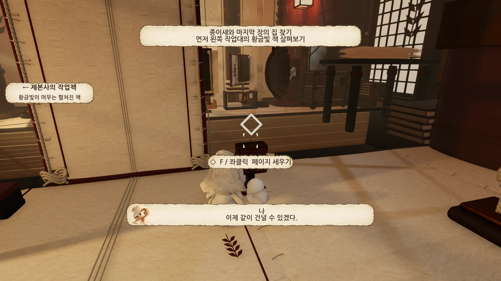

# 접힌 빛 — A Fold of Light

**빛의 경로, 그림자의 윤곽, 기억등의 상태를 조합해 책 속 공간의 길을 여는 3D 퍼즐 게임입니다.**

3인 팀 · 개발 중 · 3D 퍼즐 탐험 · Unity 6000.3.10f1 · C#

[Windows 실행 파일](https://github.com/lde0707/portfolio-game-builds/releases/tag/afoldoflight-2026-11-14) · [QA 엑셀](https://leedoeon.vercel.app/qa/reports/booktower.xlsx) · [QA 포트폴리오](https://leedoeon.vercel.app/qa/index.html)

## 내가 맡은 역할

공간·퍼즐 진행 구조 기획을 담당했습니다.

## 게임의 주요 흐름

타이틀 → 시작 대사 → 이동·시점 → 제본 다리

## 실행 방법

### Unity 없이 플레이

1. 위 **Windows 실행 파일** 링크에서 `AFoldOfLight-Windows-x64.zip`을 받습니다.
2. ZIP **전체를 압축 해제**합니다.
3. `AFoldOfLight.exe`를 실행합니다.

Windows 64비트용입니다. EXE와 `Data` 폴더·`UnityPlayer.dll`을 함께 유지하세요. GitHub의 `Source code` 압축 파일은 게임 실행 패키지가 아닙니다.

**기본 조작:** WASD 이동 / 마우스 시점 / Space 점프 / F 상호작용 / Esc 일시정지

Unity에서 소스 열기

1. Unity Hub에서 저장소 루트를 프로젝트로 추가합니다.
2. **Unity 6000.3.10f1**으로 엽니다.
3. `Assets/Scenes/InGame.unity` 씬을 열고 Play를 실행합니다.
4. 실행 파일을 만들 때 Windows Build Support를 설치하고 기존 Build Settings의 씬 구성으로 Windows x64를 빌드합니다.

## QA 테스트

Windows 빌드에 실제 키보드·마우스 입력을 보내 확인한 내용입니다. 세부 조건과 관찰값은 **QA 엑셀의 플레이 재검증 시트**에서 볼 수 있습니다.

| 확인 기능 | 테스트 조건 | 관찰 결과 |
|---|---|---|
| 첫 방 진입·조작 | 시작 대사 후 이동·시점·점프 | 첫 방에서 조작 정상 확인 |
| 제본 다리 | F 입력 후 다시 입력 | 다리 내림·올림과 상태 전환 확인 |
| 일시정지 | 정지 중 이동 입력 후 복귀 | 위치 유지, 복귀 후 다리 재조작 가능 |

**검증 범위:** 실제 입력 검증은 첫 방까지입니다. 1A·1B 퍼즐 및 연결 통로는 별도 내부 기능 검사 결과이며, 실제 입력 완주 결과와 구분합니다.

[실제 입력 검증 기록](PLAYTEST.md) · [실행·검증 안내](PLAY.md)

## 소스와 상세 문서

- [게임 흐름](Assets/_BookTower/Scripts/Core/GameFlow.cs)
- [제본 다리 제어](Assets/_BookTower/Scripts/Interaction/FoldBridgeControl.cs)
- [퍼즐 판정](Assets/_BookTower/Scripts/Puzzle/FoldBridgePuzzle.cs)
- [기존 개발·설계 기록](README-DEV-NOTES.md)
